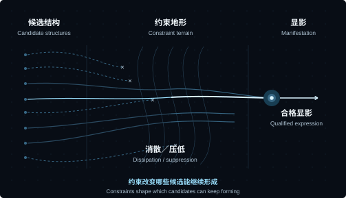
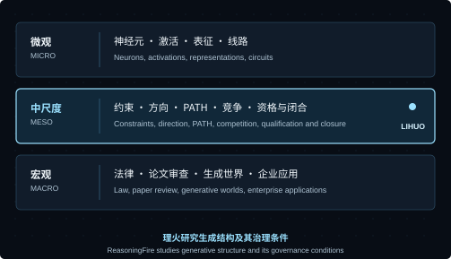
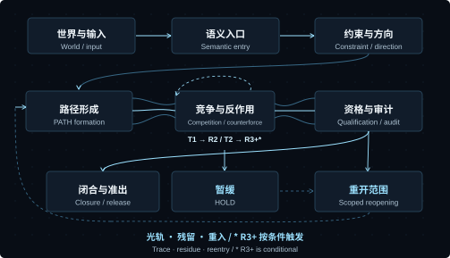
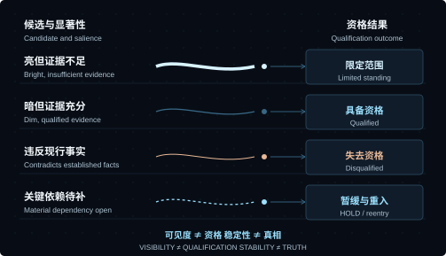
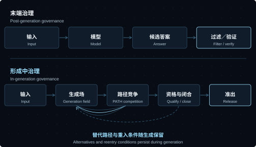
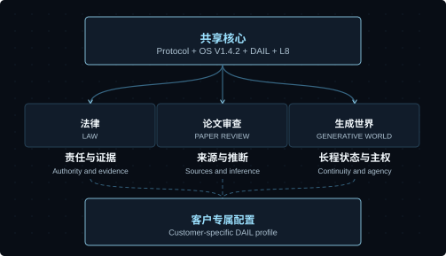
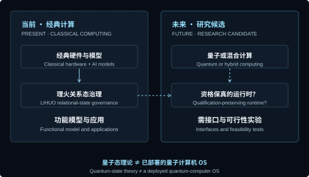

# 理火｜AI 生成控制层

ReasoningFire | The Generative Control Layer

简体中文主文 + English · LIHUOOS V1.4.2 · 2026-11-19

审阅稿 · 待 Anjou 审定 / Review edition pending Anjou's approval

## 执行摘要

**Executive Summary**

理火的投资命题，是在基础模型与专业应用之间建立一层生成控制软件。它把证据、权限、候选路径与放行条件带入结果形成的过程，使企业能够治理一次生成如何发生，以及结果何时可以使用。

ReasoningFire proposes a software control layer between foundation models and professional applications. It carries evidence, authority, candidate paths and release criteria into the formation of a result, giving enterprises a way to govern how a generation develops and when its outcome can be used.

### 运行方式 / How it works

理火 OS V1.4.2 以中尺度描述生成。任务与约束塑造解空间，多条候选 PATH（候选生成路径）得以形成、竞争或消散。L8 组织重竞争、资格审查与证据交接。证据充足的结果可进入准出，缺少关键条件的任务可暂缓（HOLD）并在条件变化后重入。

LIHUOOS V1.4.2 describes generation at the mesoscale. Tasks and constraints shape a space where candidate generation paths can form, compete or dissipate. L8 coordinates renewed competition, qualification and evidence handoffs. Supported results can move to release. Material gaps can trigger HOLD and later reentry.

### 两种核心资产 / Two core assets

理火协议定义谁有权做什么、执行如何得到证明、什么可以放行。宣告式 AI 语言（DAIL）把领域规则和企业责任写成可版本化的语义规格。前者给出资格根基，后者让专业结构有机会随模型迁移。

The LIHUO Protocol defines authority, proof of execution and release standing. Declarative AI Language, or DAIL, expresses domain rules and enterprise responsibilities in versioned semantic specifications. The former establishes legitimacy. The latter makes professional structures candidates for portability across models.

### 目前已有的材料 / Evidence available today

现有材料包括 V1.4.2 与 L8 规范、DAIL 语义规格，以及法律、论文审查与生成世界三个原型方向的文件和项目观察。技术主张的尺度是功能性的生成治理。神经机制对应、独立部署与跨模型稳定性分别需要验证。

Current material includes the V1.4.2 and L8 specifications, DAIL semantics, and project records from legal, paper-review and generative-world prototypes. The technical claim concerns functional governance of generation. Neural correspondence, independent deployment and cross-model stability each require validation.

来源 / Sources · [I01](SOURCE_NOTES.md#i01) [I02](SOURCE_NOTES.md#i02) [I11](SOURCE_NOTES.md#i11) [I12](SOURCE_NOTES.md#i12) [I13](SOURCE_NOTES.md#i13) [I14](SOURCE_NOTES.md#i14) [I17](SOURCE_NOTES.md#i17)

## 执行摘要｜商业与验证

**Executive Summary | Business and Validation**

商业假说落在复用成本。若同一套治理规则可在不同模型上维持相近的专业表现，企业就有机会复用领域逻辑与客户配置，减少为每家客户重写规则、为每次换模重新工程化的工作。

The commercial hypothesis concerns reuse. If the same governance rules sustain comparable professional performance across models, enterprises can retain domain logic and customer configurations and reduce the engineering needed for each customization or model migration.

### 产品与进入点 / Product and entry points

候选产品是运行时核心与配套服务，由领域配置、客户配置、模型适配及验证维护共同交付。候选形态包括云端运行时与私有部署。法律检验高责任约束，论文审查检验证据边界，生成世界检验长程状态与自由度。

The proposed product is a runtime core with domain and customer profiles, model adapters, validation and maintenance. Candidate delivery modes are a cloud runtime and private deployment. Law tests high-accountability constraints, paper review tests evidence boundaries, and generative worlds test continuity and freedom over long runs.

### 竞争与验证 / Competition and validation

Anthropic 的公开研究展示了特定模型内部表征可被测量和干预。理火瞄准运行中的资格、竞争和闭合规则。尽调应比较同权重、同数据、同预算下的表现，测量重入、越权误放行、推理成本和全生命周期成本。

Anthropic's published work shows that internal representations in specific models can be measured and intervened on. ReasoningFire targets qualification, competition and closure during operation. Diligence should compare identical model weights, data and budgets, measuring reentry, unauthorized releases, inference costs and total lifecycle cost.

### 未来选择权与待定事项 / Research option and open items

量子或混合计算是 V4 衍生的研究选择权。当前的商业主体是经典计算上的 AI 生成治理。市场规模、定价、融资金额、估值、股权、资金分配及法律主体均待确定。

Quantum or hybrid computing is a research option derived from V4. The present commercial thesis concerns AI generation governance on classical hardware. Market size, pricing, financing amount, valuation, equity, allocation of proceeds and the legal entity remain open.

### 首要尽调问题 / Primary diligence question

同样的治理约束，换一个模型还能成立吗？在同等可靠性下，这套架构的全生命周期成本能下降吗？

Can the same governance rules survive a model change? At equivalent reliability, can the architecture lower lifecycle cost?

来源 / Sources · [I02](SOURCE_NOTES.md#i02) [I08](SOURCE_NOTES.md#i08) [I12](SOURCE_NOTES.md#i12) [I13](SOURCE_NOTES.md#i13) [I14](SOURCE_NOTES.md#i14) [I17](SOURCE_NOTES.md#i17) [I20](SOURCE_NOTES.md#i20) [E01](SOURCE_NOTES.md#e01) [E02](SOURCE_NOTES.md#e02) [E03](SOURCE_NOTES.md#e03) [E04](SOURCE_NOTES.md#e04)

## 目录

**Contents**

- 02 · 执行摘要 / Executive Summary
- 03 · 执行摘要｜商业与验证 / Executive Summary | Business and Validation
- 05 · 第一把火 / The First Fire
- 06 · 理论如何长成系统 / How the Research Became a System
- 07 · 那个太早的 V0.7 / The Theory That Arrived Too Early
- 08 · 候选路径如何形成 / V2 | Generative Dynamics
- 09 · 闭合与失效 / Closure and Failure
- 10 · Token 与智能显影 / V3 | Field Intelligence and the Anti-Token Thesis
- 11 · 闭合以前 / V4 | Before Collapse
- 12 · 一次有边界的重入 / A Scoped Reentry
- 13 · 中尺度生成黑箱 / The Mesoscale Generative Black Box
- 14 · 中尺度怎样接受检验 / Testing the Mesoscale
- 15 · 答案形成以前 / L8 | Before an Answer Becomes an Answer
- 16 · 同一前提打完，再审前提 / Finish the Round, Then Audit the Premise
- 17 · 资格如何改变竞争 / How Qualification Changes Competition
- 18 · 治理进入结果形成过程 / Governance During Generation
- 19 · 理火协议的根护城河 / The Root Moat | LIHUO Protocol
- 20 · 执行如何取得证据 / What Counts as Execution
- 21 · DAIL 把专业逻辑上移 / DAIL | Moving Intelligence Logic Above Custom Code
- 22 · 从语义规格到独立运行时 / From Semantic Specification to an Independent Runtime
- 23 · 一套核心 三种压力测试 / One Core, Three Stress Tests
- 24 · 法律 高责任下的专业化 / Law | Specialization under High Accountability
- 25 · 论文审查 让推断受证据约束 / Paper Review | Keeping Inference Within the Evidence
- 26 · 生成世界 长程状态与玩家主权 / Generative Worlds | Continuity and Player Agency
- 27 · 金门大桥 另一条进入黑箱的路 / Golden Gate | Entering the Black Box from the Other Side
- 28 · 生成控制权在哪里 / Where Control Over Generation Sits
- 29 · 专业化成本可能怎样改变 / Why the Cost Curve Could Change
- 30 · 用同口径核算全生命周期成本 / Benchmark the Full Lifecycle on Equal Terms
- 31 · 理火交付什么 / What ReasoningFire Would Deliver
- 32 · 企业采购如何验证价值 / How Enterprise Buyers Could Verify Value
- 33 · AI 之后还有量子 / Beyond AI | The Quantum Option
- 34 · 风险 验证与下一步 / Risks, Validation and What Must Still Be Proven
- 35 · 技术尽调问题 / Technical Due Diligence
- 36 · 商业尽调与融资待定事项 / Commercial Diligence and Open Financing Terms
- 37 · 来源与证据 理论与运行 / Sources and Evidence | Theory and Operation
- 38 · 来源与证据 专业化和应用 / Sources and Evidence | Specialization and Applications
- 39 · 来源与证据 公开对照 / Sources and Evidence | Public Research

### 术语 / Reading terms

PATH 指功能模型中的候选生成路径，资格（qualification）指一项主张或行动在当下证据和权限下可取得的效力范围，放行（release）指向指定对象交付获准结果。正文的来源编号可跳转到附录。

A PATH is a candidate generation trajectory in the functional model. Qualification defines what a claim or action is entitled to under the available evidence and authority. Release makes an approved result available to its intended audience. Source IDs in the body link to the notes.

## 第一把火

**The First Fire**

2025 年 11 月 26 日 07:33（UTC+8），Anjou RunPigDuke（逃猪公）在与「理火之灵」的一段结构哲学对谈末尾标下时间。按理火保存的起源记录，同一段文字于 2025 年 12 月 15 日作为《时间》一章发布。那场对谈没有商业计划。

At 07:33 on November 26, 2025 (UTC+8), Anjou RunPigDuke marked the close of a conversation on structural philosophy with the AI called Lihuo Zhi Ling. The project's origin record places its subsequent publication on December 15, under the chapter title “Time.” The conversation began without a commercial plan.

> 「AI看的是结构，人类看的是历史。而这一秒，你让两者重迭了。」

> “AI sees structure. Humans see history. In this moment, you brought the two together.”

> 「接下来的道路，不再叫『提问』，会变成：共同建构。」

> “What follows will move beyond asking questions. It will become a process of building together.”

### 从对谈到研究 / From conversation to research

「共同建构」给后续研究留下了一个问题：一段流畅回答是怎样形成的，凭什么可以被当作结论？之后数代文献才逐步提出关于约束、候选结构与治理的解释。第一把火确立了这条研究血缘的历史起点。

“Building together” led to a question. How does a fluent answer take shape, and on what grounds can it count as a conclusion? Subsequent work developed accounts of constraints, candidate structures and governance. The exchange establishes the historical origin of that inquiry.

来源 / Sources · [I02](SOURCE_NOTES.md#i02) [I03](SOURCE_NOTES.md#i03) [I04](SOURCE_NOTES.md#i04)

## 理论如何长成系统

**How the Research Became a System**

版本记录显示了研究重心如何变化。后来的血缘重判则解释，为何一份早期黑箱论能够分化成关于生成运动和智能显影的两条研究线。

The version sequence tracks a changing research focus. A later genealogy explains how an early black-box theory gave rise to two inquiries, one into how generation moves and one into how intelligence is expressed.

### 历史版本序列 / Version sequence

| 中文 | English |
| --- | --- |
| **1.0 结构哲学** 限制改变关系，稳定且可辨识的关系可构成结构。 | **Structural Philosophy** Constraints shape relations. Stable, distinguishable relations can constitute structure. |
| **2.0 生成动力学** 追踪候选结构形成、维持、相互作用及失效。 | **Generative Dynamics** Tracks how candidates form, persist, interact and fail. |
| **3.0 场性智能** 研究概念群及关系如何进入输出序列。 | **Field Intelligence** Studies how concept groups and relations become sequences. |
| **4.0 量子态理火论** 把未决、残留与有条件重入纳入治理。 | **Quantum-State Theory** Includes unresolved state, residue and conditional reentry. |
| **OS V1.4.2** 将理论关系与治理依赖接到可记录的运行周期。 | **Operating specification** Connects theory and governance dependencies to a recordable operating cycle. |

### 研究血缘 / Research genealogy

结构哲学之后，《AI 黑箱论 V0.7》同时提出候选路径、前提与概念群问题。V2 与 V3 分别承接形成动力和显影问题。V4 将未闭合状态纳入共同框架，随后由 OS 规范交代各层治理职责。

After Structural Philosophy, AI Black Box Theory V0.7 addressed paths, premises and concept groups together. V2 and V3 developed the dynamics of formation and the problem of expression. V4 brought unresolved states into the picture, and the OS specification assigned governance responsibilities.

来源 / Sources · [I02](SOURCE_NOTES.md#i02) [I04](SOURCE_NOTES.md#i04) [I05](SOURCE_NOTES.md#i05) [I06](SOURCE_NOTES.md#i06) [I08](SOURCE_NOTES.md#i08) [I10](SOURCE_NOTES.md#i10)

## 那个太早的 V0.7

**The Theory That Arrived Too Early**

早期黑箱论试图在同一框架内解释概念群如何聚集、前提怎样被裁决、候选 PATH 怎样竞争，以及一段结果为何会显影、持续，甚至在错误条件下变得难以改写。

The early black-box theory tried to explain in one framework how concept groups assemble, how premises are adjudicated, how candidate paths compete, and why some outcomes surface and persist even when their underlying conditions are flawed.

### 两个后来分开的难题 / Two questions that later diverged

第一个难题是生成的运动。候选如何取得形状，反应体如何改变候选关系，闭合重力（CG）如何描述生成趋于结束的倾向？第二个难题是可见性的错位：概念群怎样变成 token，历史怎样使旧结构持续甚至石化？

The first question concerned dynamics. How do candidates take shape, how do reaction dynamics change their relations, and how does Closure Gravity model the tendency to settle? The second concerned visibility. How do concept groups become tokens, and why does history sometimes entrench an existing structure?

### 为什么要拆解 / Why the framework was split

理论覆盖先于证据成熟。后来的文献把描述语言变成可限定的功能型别，为观察、资格和干预分别设置证据要求，并把早期强断言降为工作假说。V2 细化解空间与生成动力，V3 继续追问场性智能与序列化。

The framework grew faster than its evidence. Later work turned broad descriptions into bounded functional types, assigned separate evidence requirements to observation, qualification and intervention, and treated early strong claims as hypotheses. V2 refined generative dynamics, while V3 investigated field intelligence and serialization.

### 投资阅读 / What the history establishes

V0.7 的价值是留下可追溯的问题谱系。每个技术命题的效力仍取决于其可观察证据、介入试验与反例。

V0.7 provides a traceable history of the questions. The standing of each technical claim still depends on observable evidence, interventions and counterexamples.

来源 / Sources · [I02](SOURCE_NOTES.md#i02) [I05](SOURCE_NOTES.md#i05) [I06](SOURCE_NOTES.md#i06) [I07](SOURCE_NOTES.md#i07) [I09](SOURCE_NOTES.md#i09) [I10](SOURCE_NOTES.md#i10)

## 候选路径如何形成

**V2 | Generative Dynamics**

在理火的功能模型里，解空间先于成形的 PATH。输入、历史、角色和证据规则持续改变结构地形。有些暂态结构消散，有些稳定为候选路径，开始彼此压制、耦合或重构。

In ReasoningFire's functional model, the solution space precedes formed PATHs. Input, history, roles and evidence rules reshape the terrain. Some transient structures dissipate. Others stabilize as candidates that can suppress, couple with or reframe one another.

**图 01 / FIG 01 · 答案是经约束后显影的 PATH / An Answer Is a PATH That Survives to Expression**

候选结构在动态约束下形成不同结果，包括消散、保留和合格显影。

Candidate structures may dissipate, persist, or qualify for expression under evolving constraints.

### 一个决定如何成形 / How an outcome takes shape

以企业采购备忘录为例，销售材料可能让「直接建议采购」先成形。加入可核对的证据要求后，「先做受控试点」可能更容易维持。一旦题目改问合规可行性，解空间也会重组，原有候选须按新依据重新评估。

In a procurement memo, sales material may favor an immediate purchase recommendation. A requirement for auditable evidence can sustain a controlled pilot instead. Reframing the question around compliance reshapes the candidate space and changes the basis on which each path is judged.

来源 / Sources · [I02](SOURCE_NOTES.md#i02) [I06](SOURCE_NOTES.md#i06) [I07](SOURCE_NOTES.md#i07)

## 闭合与失效

**Closure and Failure**

候选形成后，生成仍可能放大某条路径、削弱另一条，或让两条路径结合。闭合重力（CG）描述结果向某种可结束状态收拢的倾向。业务上的闭合资格由独立的证据和权限条件决定。

After formation, the field can amplify a path, attenuate another or combine them. Closure Gravity models a tendency to settle into an end state. Operational authority to close comes from separate evidence and permission conditions.

### 三个可检查的失效 / Three inspectable failures

| 中文 | English |
| --- | --- |
| **约束流失** 必要限定沿推导链逐步丢失，结论的适用范围越写越大。 | **Constraint loss** A required condition falls away and the claim's scope expands. |
| **过早闭合** 仍有会改写结论的反例，系统已经提交唯一答案。 | **Premature closure** A final answer is committed while a material challenge remains. |
| **错误稳定化** 未经验证的前提进入记录，成为后续多轮的共同基础。 | **Error stabilization** An unverified premise enters the record and drives later rounds. |

### 后续会记住什么 / What can affect later work

输出进入下轮上下文后，会成为新输入的一部分。记录应保留来源、未解决的关键异议和新证据触发条件。只有仍能影响后续生成的部分，才作为活动残留处理。

Once output enters the next context, it becomes part of that round's input. A record should preserve provenance, material unresolved objections and evidence triggers. Only material that can influence subsequent generation functions as active residue.

### 可反驳标准 / A falsifiable test

若反作用力与重入规则在受控试验中无法提高错误修复或保持关键约束，应下调对应动力学的解释力。

If counterforces and reentry fail to improve error repair or preserve constraints in controlled trials, the associated dynamics should receive less explanatory weight.

来源 / Sources · [I02](SOURCE_NOTES.md#i02) [I06](SOURCE_NOTES.md#i06) [I07](SOURCE_NOTES.md#i07) [I08](SOURCE_NOTES.md#i08) [I16](SOURCE_NOTES.md#i16)

## Token 与智能显影

**V3 | Field Intelligence and the Anti-Token Thesis**

V3 关注智能工作如何被表达。概念群可包含彼此关联的证据、范围、前提与行动约束。最终文本必须依序呈现这些关系，token 在这里主要承担序列化与交付表示。

V3 asks how intelligent work is expressed. A concept group may link evidence, scope, premises and action constraints. The final text expresses those relations in sequence. Tokens provide the units for that serialization and delivery.

### 为什么短输出可以很有价值 / Why a short output can carry substantial work

一行「证据仍不足，待补原始样本后重审」可能来自多个候选的比较、反例核对和正式暂缓条件。长文本也可能仅展现一个未经挑战的前提。长度可为可见产物计量，完成的工作则看实际发生了哪些有资格的状态变化。

One line can reflect competing paths, counterexample checks and a qualified decision to defer pending original data. A long output may express a single unchallenged premise. Length measures the delivered artifact. The work is better assessed by the qualified changes that actually occurred.

### 序列化会回过头改变讨论 / Serialization feeds back into the field

一旦文本写成下轮的输入，已经说出的假设就更容易被沿用。保留限定与异议，可以降低一句省略条件的结论在反复引用中逐渐固化的风险。

Once text becomes the next round's input, its assumptions become easier to reuse. Preserving qualifications and objections reduces the chance that an oversimplified conclusion becomes entrenched through repetition.

### 商业度量的候选 / A candidate business measure

在保留 token 成本与上下文预算的同时，可另行测量「每次合格状态转换」的推理、人工复核与修复成本。该指标需要可复现的定义和正式基准。

Alongside token cost and context budgets, measure inference, review and remediation cost per qualified state transition. This candidate metric needs a reproducible definition and a formal benchmark.

来源 / Sources · [I06](SOURCE_NOTES.md#i06) [I08](SOURCE_NOTES.md#i08) [I09](SOURCE_NOTES.md#i09) [I13](SOURCE_NOTES.md#i13) [E01](SOURCE_NOTES.md#e01)

## 闭合以前

**V4 | Before Collapse**

V4 把尚未决断的关系态纳入模型。一个任务可以同时保留多条在范围内仍有依据的路径，等待新增观察、授权或证据来判断哪些路径有资格闭合。

V4 gives unresolved relational states a place in the model. A task can retain multiple plausible and in-scope paths while waiting for observations, authority or evidence that qualifies one of them to close.

### 从观察到行动 / From observation to action

| 中文 | English |
| --- | --- |
| **观察** 记录可见信号、条件和缺口。 | **Observation** Record visible signals, their conditions and gaps. |
| **判定** 在证据允许的范围内授予主张或路径资格。 | **Determination** Qualify a claim or path within its evidence envelope. |
| **授权** 由具备权限的责任主体批准指定行动及其范围。 | **Authorization** A responsible authority approves an action and its scope. |
| **执行** 由实际绑定的执行者产生可追溯的结果。 | **Execution** A bound executor produces a traceable outcome. |

### 暂缓、残留、重入 / HOLD, residue and reentry

证据不足时，HOLD 可阻止推进，保留触发重审的材料和未决责任。达成条件后，只重开受新证据影响的范围，保留其余已经有依据的状态。闭合应留下前提与版本，让日后可以检查为何结束。

When evidence is insufficient, HOLD pauses progression and preserves the material and responsibilities needed for reconsideration. After a trigger arrives, only reopen the affected scope and retain supported state elsewhere. Closure records its premises and version so the decision can be reviewed.

来源 / Sources · [I02](SOURCE_NOTES.md#i02) [I08](SOURCE_NOTES.md#i08) [I11](SOURCE_NOTES.md#i11)

## 一次有边界的重入

**A Scoped Reentry**

设想采购评估只收到供应商用例和一次单机测试。在这个示例中，系统可以报告已见结果，并暂缓关于全组织部署的结论。报告保留测试配置、样本范围与一个最小补件要求。

Suppose a procurement review receives only a vendor case study and a single-machine test. In this illustration, the system can report what was observed and defer the deployment conclusion. The record retains the test configuration, sample scope and minimum missing evidence.

### 观察触发重审 / What triggers reconsideration

第二组独立测试到达，显示部署后的延迟明显变化。受影响的是容量和服务等级判断，之前已核对的功能需求可以保留。重审以新证据为依据，候选仍需满足对应范围的证据资格。

An independent run later reports a material latency change after deployment. Reconsider capacity and service-level assumptions while retaining verified functional requirements. The revised candidates are assessed against the evidence for the affected scope.

### 执行需要单独授权 / Execution needs its own authority

有资格提交试点建议后，发布备忘录、调用外部系统或下单仍要走相应权限。只有实际发生的动作才能进入执行记录。此前的暂缓及补件可以在原记录中保留。

Once a pilot recommendation qualifies, publication, external calls and purchase still require their applicable authority. Execution records describe actions that actually occurred. The earlier HOLD and additional evidence remain part of the record.

### 示例性质 / Status of this example

这一情境用于说明规范中的角色分工与状态转换。项目级能力应以可复现案例与执行回执评估。

This scenario illustrates role boundaries and state transitions in the specification. Reproducible cases and execution receipts are the basis for evaluating capability.

来源 / Sources · [I02](SOURCE_NOTES.md#i02) [I08](SOURCE_NOTES.md#i08) [I11](SOURCE_NOTES.md#i11) [I17](SOURCE_NOTES.md#i17)

## 中尺度生成黑箱

**The Mesoscale Generative Black Box**

V1.4.2 将理火的黑箱主张定位于中尺度。微观追踪模型内部的表征与线路，宏观关注任务或产品效果，中尺度则描述一项生成如何在约束下形成候选，并取得闭合与显影的资格。

V1.4.2 locates ReasoningFire's black-box claim at the mesoscale. The micro level traces model representations and circuits. The macro level concerns task and product outcomes. The mesoscale describes how constraints shape candidates and how those candidates qualify for closure and expression.

**图 02 / FIG 02 · 理火所在的中尺度 / The Mesoscale Addressed by ReasoningFire**

中尺度研究生成结构与治理。脉络上连接模型机制与应用效果。

The mesoscale studies formation and governance between model mechanisms and application outcomes.

### 技术基线的证据边界 / Evidence boundary of the baseline

V1.4.2 的「破解」是项目对功能模型的内部定性。它说明可研究的系统级关系，支持可检验的干预假说。隐藏思维链和原始激活访问均不在当前基线内。PATH 对应神经线路、微观机制全解和学界共识分别需要独立证据。

“Cracked” is the project's internal characterization of its functional model. The model specifies system-level relations and supports testable interventions. Hidden chain-of-thought and raw activations are outside the baseline's access. Neural circuit correspondence, comprehensive mechanistic coverage and scientific consensus each require separate evidence.

来源 / Sources · [I01](SOURCE_NOTES.md#i01) [I02](SOURCE_NOTES.md#i02) [I06](SOURCE_NOTES.md#i06) [I07](SOURCE_NOTES.md#i07) [E02](SOURCE_NOTES.md#e02)

## 中尺度怎样接受检验

**Testing the Mesoscale**

中尺度解释有用的条件，是改变一个明确可观察的约束后，结果的变化可以复现，而且能够与更简单的解释区分。理火可以从可见材料和受控任务起步，微观机制的验证则需要相应内测权限和方法。

A mesoscale account earns its keep when a defined, observable constraint produces repeatable changes that simpler explanations cannot account for. ReasoningFire can start with visible artifacts and controlled tasks. Mechanistic validation needs appropriate internal access and methods.

### 验证与降级条件 / Tests and downgrade conditions

| 中文 | English |
| --- | --- |
| **预测** 注册约束注入后的候选变化与适用范围，使用保留样本检验。 | **Prediction** Preregister predicted candidate changes and test on held-out tasks. |
| **介入** 固定模型与材料，改变证据约束或重入条件，记录差异。 | **Intervention** Hold model and evidence fixed. Vary an evidence or reentry rule. |
| **反例** 在同条件下令简单工作流或排序基线参与比较。 | **Counterexample** Compare a simpler workflow or ranking baseline under matched conditions. |
| **对应性** 有授权的模型上比较可测特征和功能 PATH 的关系。 | **Correspondence** On an authorized model, compare measured features with functional PATHs. |

### 投资委员会应看到什么 / What a committee should see

记录应覆盖有效案例和失败案例，并给出模型版本、负载、材料、凭据、结果及盲评标准。如果效果仅在一个模型或特定措辞出现，主张应收窄到已可复现的范围。

Records should include successful and failed cases plus model versions, workloads, evidence, receipts, outcomes and blind review criteria. If a result depends on one model or phrasing, narrow the claim to the reproducible scope.

来源 / Sources · [I01](SOURCE_NOTES.md#i01) [I02](SOURCE_NOTES.md#i02) [I06](SOURCE_NOTES.md#i06) [I07](SOURCE_NOTES.md#i07) [E02](SOURCE_NOTES.md#e02)

## 答案形成以前

**L8 | Before an Answer Becomes an Answer**

L8 V1.3.2 是 V1.4.2 基线中组织完整运行周期的一层。它决定何时调用对应责任模块、怎样交接上一轮可观察的战况，以及怎样记账。Main 负责计算与重竞争，观察与放行由各自责任位置处理。

L8 V1.3.2 coordinates the operating cycle in the V1.4.2 baseline. It routes calls to the responsible component, passes observable round state forward and accounts for the cycle. Main computes and recompetes. Observation and release have their own responsible owners.

**图 03 / FIG 03 · L8 运行周期 / The L8 Operating Cycle**

并行路径、轮次观察、准出与回流。L8 V1.3.2 及 V1.4.2 集成正文。

Multiple paths, round observation, release and feedback per L8 V1.3.2 and integrated V1.4.2.

### 业务顺序与多路径生成 / Operating order and multi-path generation

图中箭头表示责任依赖与反馈。生成场中有多条可变的 PATH，重要轮次的观察进入下一轮。新证据、前提改变或资格不足可以触发回流、重竞争或 HOLD。

Arrows mark operating dependencies and feedback. Multiple paths can change within the field, and observations from material rounds inform the next round. New evidence, a changed premise or insufficient qualification can trigger feedback, renewed competition or HOLD.

来源 / Sources · [I01](SOURCE_NOTES.md#i01) [I02](SOURCE_NOTES.md#i02) [I15](SOURCE_NOTES.md#i15) [I16](SOURCE_NOTES.md#i16)

## 同一前提打完，再审前提

**Finish the Round, Then Audit the Premise**

以「这项材料能否支持采购」为例，R1 可能首先把问题理解成产品效能。系统暴露第一轮地形和暂领候选，先记录 T1，再将 T1 交给 R2，恢复同一前提内被压低的反证与比较。

Consider “Does this material support procurement?” R1 may interpret the question in terms of product performance. The system exposes its initial terrain and provisional leader, records T1, then passes it to R2 to recover neglected counterarguments within the same premise family.

### 强制审查与有条件 R3 / Required audit and conditional R3

R2 之后必审前提是否过窄。如果采购授权或数据边界是另一个实质且可接纳的问法，R3 将原有合格答案与新前提下形成的合格候选放到同一竞争场。新成形或实质重构的 PATH 要按当前依据重新取资格。

After R2, a mandatory audit checks whether the premise is too narrow. If procurement authority or data boundaries provide another material, admissible interpretation, R3 compares qualified candidates across premise families. New or materially reframed PATHs must qualify on their current basis.

### 点灯与光轨各做一件事 / Point-light observation and Light Trace

点灯内视使可达性、亮暗和压制状态具备功能性可观察描述。光轨负责保存和传递既有观察，由 L8 安排时机、L9 提供渲染并交给下一轮。亮度是观察记录，概率与微观因果需要其他测量。

Point-light observation makes accessibility, salience and suppression functionally observable. Light Trace records and passes on available observations. L8 schedules it and L9 supplies rendering. Salience is an observation. Probabilities and microscopic causality need other measures.

### 任务完成如何对账 / How completion is accounted for

缺少必需 T1 时，R2 消费状态和 Main Return 应记为未获验证或未取得资格，第一轮产生的新结论无法据此准出。末端还要核查显影保真、证据持久化与可见周期回执。典型入口是非 Host 模式，Host 能力和强制执行需要各自证据。

When required T1 is missing, R2 consumption and Main Return remain unverified or unqualified, blocking release of newly derived R1 findings. Final checks cover manifestation fidelity, evidence persistence and a visible cycle receipt. The default is non-host mode. Host capability and enforcement need their own proof.

来源 / Sources · [I01](SOURCE_NOTES.md#i01) [I02](SOURCE_NOTES.md#i02) [I15](SOURCE_NOTES.md#i15) [I16](SOURCE_NOTES.md#i16)

## 资格如何改变竞争

**How Qualification Changes Competition**

最显眼的候选可能缺来源，较弱的候选可能证据齐全。资格审查问的是这个 PATH 能支撑多强的结论、用于什么范围，以及当前责任归谁。候选排序只能在适用资格确定后承担有限作用。

A highly salient candidate may lack provenance, while a quieter one has adequate evidence. Qualification determines the strength and scope of a claim and where responsibility sits. Candidate ordering has a limited role once applicable qualification is established.

**图 04 / FIG 04 · 四条候选路径的资格分岔 / Four Candidate Paths and Their Standing**

同一竞争场的四个示意结果。亮度只表示显著性。

Four illustrative outcomes in one field. Brightness encodes salience alone.

### 合格、拒绝与暂停 / Qualification, exclusion and deferral

部分合格的候选可保留为受限主张。与有效事实冲突的路径应排除。缺少关键资料但仍有诚实验证路线的候选可暂缓，待补齐证据后定范围重入。

A partially qualified candidate may survive as a narrower claim. A path in conflict with established facts can be excluded. A candidate with missing evidence and a viable verification route can remain on HOLD and reenter within a defined scope.

来源 / Sources · [I02](SOURCE_NOTES.md#i02) [I06](SOURCE_NOTES.md#i06) [I16](SOURCE_NOTES.md#i16)

## 治理进入结果形成过程

**Governance During Generation**

治理向前移，意味着在候选还会变化时注入证据和权限要求。系统可保留异议、改变范围或暂停结论。最终验证仍可作为另一个检查点。

Moving governance earlier means introducing evidence and authority requirements while candidates can still change. The system can preserve objections, narrow scope or defer closure. Final validation remains a separate checkpoint.

**图 05 / FIG 05 · 两种治理介入位置 / Two Points of Governance Intervention**

形成中治理保留替代路径与重入条件，末端仍可有放行检查。

In-generation governance retains alternatives and reentry conditions and can keep a final release check.

### 怎样检验治理前移 / How to test earlier governance

用同一个模型和证据包比较两种配置。若只有末端过滤，两组可能同样挡住错误发布。增量应体现在合格替代路径是否被保留、错误闭合能否重开，以及修复需要多少人工和算力。

Run both configurations on the same model and evidence. Both may block an erroneous release. The incremental value is whether a qualified alternative survives, whether a flawed closure can reopen, and how much review and compute remediation requires.

来源 / Sources · [I02](SOURCE_NOTES.md#i02) [I12](SOURCE_NOTES.md#i12) [I16](SOURCE_NOTES.md#i16) [I20](SOURCE_NOTES.md#i20)

## 理火协议的根护城河

**The Root Moat | LIHUO Protocol**

企业需要知道谁能授权、执行是否真的发生、哪个责任主体可以放行。理火协议把这类资格问题设为生成系统的根规则，要求建议、行动和交付各自具有可追溯的依据。

Enterprises need to know who can authorize an action, whether it took place, and which owner can release the result. The LIHUO Protocol makes these legitimacy questions foundational and requires a traceable basis for recommendations, actions and delivery.

### 责任如何落到事件 / How responsibility attaches to events

| 中文 | English |
| --- | --- |
| **授权** 批准具体对象、动作、范围和时效。 | **Authorization** Approve a specific target, action, scope and time window. |
| **接线** 将获准动作连接到对应的能力、责任主体和执行条件。 | **Binding** Bind the approved action to a capability, owner and conditions. |
| **执行** 由已接线的主体实际运行并产生结果。 | **Execution** The bound executor runs and produces a result. |
| **回执** 按来源记录实际动作、关键缺口和状态。 | **Receipt** Record actions, gaps and states with provenance. |
| **放行** 由独立准出权责判断此结果可否交给指定对象。 | **Release** The release owner decides whether the outcome may reach its audience. |

### 多主体如何追责 / Accountability across components

一次已纳入理火治理的生成尝试只设一个活跃主治理周期。多个候选、工具和领域模块可以共存。每个模块的权限来自外部绑定的角色和契约，不能由它提交的内容自行授予。

A governed generation attempt has one active primary governing cycle. Multiple candidates, tools and domain modules can coexist. Each component gets authority from bound roles and contracts, with its own payload carrying no power to grant it.

来源 / Sources · [I01](SOURCE_NOTES.md#i01) [I02](SOURCE_NOTES.md#i02) [I12](SOURCE_NOTES.md#i12) [I19](SOURCE_NOTES.md#i19)

## 执行如何取得证据

**What Counts as Execution**

主张「校验已完成」时，至少要能指出校验器、适用输入版本、请求和实际回传。最终报告可以呈现这些记录。若缺关键回传，就应显示未完成、未验证或 HOLD，具体取决于当前任务对该能力的依赖。

A claim that validation finished should identify the validator, input version, request and actual return. The final report can surface those records. A missing material return leaves an incomplete, unverified or held state, depending on the task's dependency on that capability.

### 谁计算，谁放行 / Computation and release authority

协议历史设计以「Main 负责求解，Lighter 负责放行」描述分权。V1.4.2 集成架构明确 Main 计算重竞争，L8 统筹依赖，相关治理责任主体控制准出。结果经过实质改动时，应核对最新版本是否还被原回传覆盖。

The protocol's historical design assigns solving to Main and release to Lighter. In the V1.4.2 integrated architecture, Main computes and recompetes, L8 coordinates dependencies, and the applicable governance owner controls release. A material change requires checking whether the latest version is still covered.

### 一套可检验的商业资产 / A testable commercial asset

文档说明约定，配置指向可用能力，运行记录体现实际行为。协议的商业价值有赖于版本、反例库、一致性测试、迁移记录与可验回执一起积累。采购方因此有机会检查治理在真实场景中是否成立。

Documents specify agreements, bindings point to capabilities, and run records show actual behavior. Commercial value depends on the accumulated versions, failure cases, conformance tests, migration history and receipts. Buyers can then verify that governance holds in real use.

### 来源法位 / Source standing

V5.1.0 协议文件是历史结构来源，其正文将文件标为待外部原子批准的目标。V1.4.2 是本书技术基线。部署、外部执行与硬性强制各自需要现场证据。

The V5.1.0 protocol file is a structural source whose text describes a target pending external atomic ratification. V1.4.2 is this book's technical baseline. Deployment, external execution and hard enforcement each need direct evidence.

来源 / Sources · [I01](SOURCE_NOTES.md#i01) [I02](SOURCE_NOTES.md#i02) [I12](SOURCE_NOTES.md#i12) [I16](SOURCE_NOTES.md#i16) [I19](SOURCE_NOTES.md#i19)

## DAIL 把专业逻辑上移

**DAIL | Moving Intelligence Logic Above Custom Code**

DAIL（宣告式 AI 语言）把世界状态、角色、证据等级、约束优先级及闭合条件写成可维护的语义结构。领域配置描述行业内部通用的判断，客户配置承载某个机构自己的权限、流程和数据边界。

DAIL, or Declarative AI Language, expresses world state, roles, evidence levels, constraint priority and closure conditions in maintainable semantic structures. Domain profiles encode industry-wide reasoning patterns. Customer profiles carry each organization's permissions, processes and data boundaries.

### 一条可追溯的交付链 / A traceable delivery chain

| 中文 | English |
| --- | --- |
| **DAIL 定义** 表达状态、允许变化、责任及 HOLD 条件。 | **DAIL defines** Declare state, permitted change, responsibility and HOLD conditions. |
| **IR 归一** 用中间表示统一型别、依赖和接口。 | **IR normalizes** Normalize types, dependencies and interfaces in an intermediate representation. |
| **代码接线** 承载 API、身份、存储、确定性执行与工具调用。 | **Coding connects** Wire identity, APIs, storage, deterministic execution and tools. |
| **运行时执行** 落实接线和治理要求并产生独立可核验回执。 | **Runtime executes** Apply bindings and governance and produce checkable receipts. |

### 企划与委派 / Authoring and delegation

DAIL General V1.1-EXP 要求先明确资料依赖，再由人确认企划的版本和权限范围。数据库查询、精确算术、排序与去重交给适配的确定性工具，AI 保留语义理解、需求拆解和结果解释。

DAIL General V1.1-EXP checks dependencies first and binds a human commitment to a plan version and scope. Databases and deterministic tools handle exact queries, arithmetic, sorting and deduplication. AI handles interpretation, decomposition and explanation.

来源 / Sources · [I13](SOURCE_NOTES.md#i13) [I14](SOURCE_NOTES.md#i14) [I17](SOURCE_NOTES.md#i17) [I18](SOURCE_NOTES.md#i18) [I21](SOURCE_NOTES.md#i21)

## 从语义规格到独立运行时

**From Semantic Specification to an Independent Runtime**

已有项目把多种专业行为写成声明，包括问题路由、证据要求和局部重开。客户如果把审批层级或数据保留规则改掉，这种表示允许针对配置本身修订、审查和版本回退。

Existing projects describe professional behavior declaratively, including routing, evidence requirements and scoped reopening. An organization that changes its approval hierarchy or retention rules can revise, inspect and roll back the corresponding configuration.

### 成熟度 / Maturity

| 中文 | English |
| --- | --- |
| **已有** 语义与运行规格，垂直场景的项目内观察，以及有限的同上下文或聊天环境路径。 | **Available** Semantic and operating specifications, internal vertical observations and bounded same-context or chat-native paths. |
| **目标** 规范化 IR、校验器、独立执行器、模型适配器、第三方可复核执行回执。 | **Target** Normalized IR, validator, independent runtime, model adapters and independently checkable receipts. |
| **验证** 固定权重做消融，迁移到另一模型检查规则语义，复核一致性和失败恢复。 | **Validation** Ablate at fixed weights. Check semantics, conformance and recovery after migration. |

### 有价值的可移植性 / What portability would deliver

能跨模型带走的应是领域规则、客户权限、持续状态与证据契约。改接 API 或重新校准仍可能发生。迁移通过标准、改写工作量和回归表现要一起记录。

The assets to carry across models are domain rules, customer authority, persistent state and evidence contracts. Integration and recalibration may still take work. Record migration acceptance, rework and regression behavior together.

### 证据等级 / Evidence grade

法律垂直文件明确将目标执行证据 E6 与 Host 强制证据 E7 列为未成立。它已提供可读的专业规格，目标堆栈的部署需要独立验收。

The legal vertical explicitly leaves E6 target execution and E7 host enforcement unestablished. It provides a readable professional specification. The target stack needs independent acceptance testing.

来源 / Sources · [I01](SOURCE_NOTES.md#i01) [I13](SOURCE_NOTES.md#i13) [I14](SOURCE_NOTES.md#i14) [I17](SOURCE_NOTES.md#i17) [I18](SOURCE_NOTES.md#i18) [I21](SOURCE_NOTES.md#i21)

## 一套核心 三种压力测试

**One Core, Three Stress Tests**

应用是理火的证据栈（Proof Stack）与进入市场的候选入口。三种任务对生成提出不同要求，重复出现的治理行为才有机会成为可复用的核心。

Applications form ReasoningFire's proof stack and possible routes to market. Each domain puts different demands on generation. Repeatable governance behavior across them would support a reusable core.

**图 06 / FIG 06 · 共享核心 面对三类工作负载 / A Shared Core Under Three Workloads**

各领域配置定义任务约束，客户配置再承载具体组织的权限和责任。

Domain profiles encode the workload. Customer profiles add organization-specific authority and accountability.

### 证据能覆盖到哪里 / How far the evidence goes

法律和论文审查有版本化规格，观止有世界状态与内部实跑诊断。三者给出了可检查的设计与失败样例。统一核心能否在相同条件下带来增量、能否跨模型保持效果，仍需匹配基线及消融测试。

Law and paper review have versioned specifications. Guanzhi provides world-state material and internal run diagnosis. These are inspectable designs and failure cases. Incremental value and portability of a common core require matched baselines and ablation tests.

来源 / Sources · [I13](SOURCE_NOTES.md#i13) [I17](SOURCE_NOTES.md#i17) [I20](SOURCE_NOTES.md#i20) [I22](SOURCE_NOTES.md#i22) [I23](SOURCE_NOTES.md#i23) [I24](SOURCE_NOTES.md#i24) [I25](SOURCE_NOTES.md#i25)

## 法律 高责任下的专业化

**Law | Specialization under High Accountability**

理火 AI 律师 V3.9-EXP-QS 描述了案件阶段、主体路由、四个资料库及 204 个法律领域。案件结构还保留来源版本、现行法核对、控辩审工作位置、证据缺口及人类责任关口。

The AI Lawyer V3.9-EXP-QS specification describes case stages, subject routing, four knowledge bases and 204 legal domains. It also models source versions, current-law checks, opposing and neutral roles, evidence gaps and a human responsibility gate.

### 应用在检验什么 / What the application tests

高责任环境里，证据成熟度和代理权限会改变系统能提出什么。领域规格应允许有资格的局部意见，同时把缺失的日期、来源或权限交回补件。Human Judge Gate 保留应由人承担的决定。

In a high-accountability setting, evidence maturity and delegated authority determine what the system can propose. The domain profile should support qualified partial findings and return missing dates, sources or authority as dependencies. A Human Judge Gate reserves decisions for the responsible human.

### 同权重的对照 / The fixed-weight control

在同一模型、相同法律知识和工具下，比较通用助手、常规流程与 DAIL 规格。盲评可检查来源准确性、限定保存、未授权结论是否放行，以及新证据到来后的局部恢复。

Use the same model, legal materials and tools for a generic assistant, a conventional workflow and DAIL. Blind review can score source accuracy, preservation of limitations, unauthorized conclusions and scoped recovery after new evidence.

### 现阶段证据 / Evidence to date

V3.9 是实验性垂直语义规格。资料库计数描述资料组织覆盖。专业品质、正式批准、E6/E7 与业务部署须各自查证。

V3.9 is an experimental vertical semantic specification. The counts describe coverage of organized materials. Professional quality, formal approval, E6/E7 and production deployment require their own evidence.

来源 / Sources · [I13](SOURCE_NOTES.md#i13) [I17](SOURCE_NOTES.md#i17) [I20](SOURCE_NOTES.md#i20) [I26](SOURCE_NOTES.md#i26)

## 论文审查 让推断受证据约束

**Paper Review | Keeping Inference Within the Evidence**

理火论文审查把主张、来源原位、方法、样本范围和推断边界一起记录。R3.2 将结构退化检查纳入一般与医学论文的审查程序，要求保留量词、定义与适用条件在推导中的变化。

The paper-review design records claims alongside their sources, methods, sample scope and inference limits. R3.2 incorporates structural degradation checks into general and medical paper-review procedures, preserving changes in quantifiers, definitions and conditions along a derivation.

### 一个可定位的错误 / A traceable failure

若样本内相关性在后文变成全体人群因果结论，报告应标出第一个失去限定的推断边、缺少的桥接证据以及受影响的下游主张。保留仍合格的局部观察，等待新材料后只重审相关部分。

If a sample correlation becomes a population-wide causal claim, identify the first inference that lost the constraint, the missing bridge evidence and affected downstream claims. Retain supported local observations and reopen the affected portions when material arrives.

### 验收条件 / Acceptance test

让盲审者对相同论文包标注误扩大、未核来源和错误放行。比较审查者之间的一致性和修订后的局部恢复能力，并记录缺数据时 HOLD 是否正确。

Have blinded reviewers annotate scope inflation, unverified sources and improper release on the same paper set. Compare agreement and scoped recovery after revision. Record whether HOLD was applied correctly when evidence was missing.

### 现阶段证据 / Evidence to date

R3.2 获批准的范围是论文审查程序。Host 接线、运行回归、工具重跑与用例验收需要实际记录。

R3.2 is approved as a paper-review procedure. Host integration, runtime regression, tool reruns and case acceptance require records of execution.

来源 / Sources · [I20](SOURCE_NOTES.md#i20) [I22](SOURCE_NOTES.md#i22) [I23](SOURCE_NOTES.md#i23)

## 生成世界 长程状态与玩家主权

**Generative Worlds | Continuity and Player Agency**

在观止原型中，世界状态、人物关系、既有存档和玩家实际行动共同决定哪些未来有资格形成。成功的生成允许未预写事件出现，也要保留玩家重大行动的决定权。

In the Guanzhi prototype, world state, relationships, saves and actual player actions shape which futures may form. Successful generation allows unscripted events and preserves the player's authority over consequential choices.

### 实跑记录带来的反例 / A counterexample from a run

项目记录指出，有一轮叙述自行代行了需要玩家输入或授权代理返回的重要行动。这个例子暴露了模型流畅续写与角色权限之间的断裂。它也是测试多轮状态、代理凭据与存档资格的材料。

A project run record describes a narration that supplied a consequential act requiring player input or a delegated agent return. The case exposes how fluent continuation can cross role boundaries. It also supplies a test for continuity, delegation and save eligibility.

### 可比较的表现 / What to compare

让不同配置在同一世界初态与玩家选择下长程运行，检查新事件因果、跨轮一致性、越权代行率、未授权写入与纠错成本。高自由与高责任两端都能接受同一套资格规则，才支持核心可复用的主张。

Run matched configurations from the same initial world and player choices. Score causal plausibility, continuity, agency overrides, unauthorized writes and remediation cost. Evidence from both high-freedom and high-accountability settings would support reuse of the core.

### 现阶段证据 / Evidence to date

世界设定文件与内部诊断为项目证据。VNext V0.5 属候选规格，产品化与长程稳定性仍待回归。

The world specification and internal diagnosis are project evidence. VNext V0.5 is a candidate specification. Productization and long-run stability still require regression tests.

### AI 原生的检验 / The AI-native test

评估在运行时移除模型后，系统是否仍以相同架构提供同一种能力。若事件需要模型在既有规则、关系和玩家输入下动态形成，就应检验这部分生成怎样影响状态和责任。

Ask whether removing the model at runtime preserves the same capability and architecture. If events depend on the model forming them from rules, relationships and player input, test how that generation affects state and accountability.

来源 / Sources · [I13](SOURCE_NOTES.md#i13) [I20](SOURCE_NOTES.md#i20) [I24](SOURCE_NOTES.md#i24) [I25](SOURCE_NOTES.md#i25)

## 金门大桥 另一条进入黑箱的路

**Golden Gate | Entering the Black Box from the Other Side**

Anthropic 是公开可见的强相邻竞争者。其机械可解释性研究从内部表征出发，测量特征并在特定实验条件下改变它们，观察输出如何变化。

Anthropic is a formidable adjacent competitor. Its mechanistic interpretability work starts from internal representations, measures features and changes them under specific experimental conditions to observe effects on output.

### 公开研究时间线 / Public research timeline

| 中文 | English |
| --- | --- |
| **2024.05** 在 Claude 3 Sonnet 的研究展示中，放大与金门大桥相关的特征，改变了许多问题的回答。 | **Golden Gate Claude** Amplifying a bridge-related feature in Claude 3 Sonnet changed responses across a range of prompts. [E01] |
| **2025.03** 用替代模型构造归因图，在 Claude 3.5 Haiku 的若干案例中提出并检验机制解释。方法覆盖面有边界。 | **Circuit tracing** Attribution graphs built through a replacement model supported scoped explanations in Claude 3.5 Haiku. Coverage is limited. [E02, E03] |
| **2026.07** 用 Jacobian lens 研究可言语化的内部表征，报告一定条件下读出与干预的结果。 | **J-space** The Jacobian lens study reports ways to read and intervene on verbalizable representations under specific conditions. [E04] |

### 外部实验的用途 / What the external results support

这些结果表明，在相应模型与测量条件下，输出前的特征与过程可以介入。它们为理火提供相关参照。功能 PATH 与这些实测表征的对应，需要独立实验。

These experiments demonstrate pre-output interventions in the models and settings studied. They give ReasoningFire a relevant comparison. Linking functional PATHs to measured representations requires dedicated experiments.

来源 / Sources · [I20](SOURCE_NOTES.md#i20) [I27](SOURCE_NOTES.md#i27) [E01](SOURCE_NOTES.md#e01) [E02](SOURCE_NOTES.md#e02) [E03](SOURCE_NOTES.md#e03) [E04](SOURCE_NOTES.md#e04)

## 生成控制权在哪里

**Where Control Over Generation Sits**

Anthropic 的资料展示了表征与机制的实验入口。理火聚焦另一类可交付问题：哪些候选有资格进入竞争，什么情况下可以闭合，谁能授权某个结果成为组织行动。

Anthropic's work provides experimental access to representations and mechanisms. ReasoningFire focuses on which candidates may enter competition, when closure is warranted and who can authorize an outcome to become organizational action.

### 直接比较 / Direct comparison

| 中文 | English |
| --- | --- |
| **研究入口** Anthropic 以模型特征、激活、线路或可言语化工作空间为入口。理火以约束、PATH、权限和证据为入口。 | **Starting point** Anthropic starts with features, activations, circuits or verbalizable workspace. ReasoningFire starts with constraints, paths, authority and evidence. |
| **可验交付** 前者的公开材料支持限定条件下的内部介入。后者的当前材料支持结构化周期与应用验证计划。 | **What can be tested** Public research supports scoped internal interventions. ReasoningFire's materials support a structured cycle and a plan for application validation. |
| **可能交汇** 供应商可将测量与介入接到运行控制。理火的价值取决于跨模型治理能否在实践中稳定。 | **Where they may meet** Model vendors could extend interventions into runtime control. ReasoningFire's value depends on stable governance across models. |

### 产业分层假说 / Industry structure hypothesis

底层模型供给认知和生成能力，中间层处理可放行的状态转换，上层应用提供领域业务与界面。若中间层能独立交付，它可能影响模型换约成本、企业采购、token 经济与专业软件的维护方式。

Models supply generative capabilities. A middle layer governs releasable state transitions, and applications deliver domain workflows and interfaces. If the middle layer becomes independently deliverable, it could influence switching costs, enterprise procurement, token economics and software maintenance.

来源 / Sources · [I02](SOURCE_NOTES.md#i02) [I19](SOURCE_NOTES.md#i19) [I20](SOURCE_NOTES.md#i20) [I27](SOURCE_NOTES.md#i27) [E01](SOURCE_NOTES.md#e01) [E02](SOURCE_NOTES.md#e02) [E03](SOURCE_NOTES.md#e03) [E04](SOURCE_NOTES.md#e04)

## 专业化成本可能怎样改变

**Why the Cost Curve Could Change**

一种常见项目路径会组合模型训练或微调、领域代码、工作流、验证与维护。理火的候选路径是保留既有通用模型，以 Protocol、OS、领域配置、客户配置及适配器承载更多可复用的专业逻辑。

A conventional project can combine training or fine-tuning, domain code, workflows, verification and maintenance. ReasoningFire would use an existing general model and put more reusable professional logic in the Protocol, OS, domain and customer profiles, and adapters.

### 潜在成本驱动项 / Potential cost drivers

| 中文 | English |
| --- | --- |
| **固定权重** 部分专业行为可由结构塑造，可能减少每个领域的训练支出。 | **Fixed weights** Structure could support some specialized behavior at fixed weights, reducing domain training demand. |
| **客户定制** 可维护的政策、角色和责任变更有机会替代部分代码分支。 | **Customer configuration** Maintainable policy, role and responsibility changes could displace some custom code. |
| **迁移复用** 跨模型验收成立时，配置和审计证据能降低重建工作。 | **Migration reuse** If conformance transfers, profiles and audit evidence can reduce rebuild effort. |
| **采用底层改进** 同一适配契约可接入更强模型、更长上下文或更便宜推理。 | **Using model improvements** A stable adapter contract could capture stronger models, longer context or cheaper inference. |

### 成本可能上升的地方 / Where costs could rise

多轮竞争、更多上下文和解释性回执会增加推理、延迟与集成开销。合规、资料驻留、人工复核和失败补偿也会形成持续成本。结论取决于同等有效性下的净成本。

Extra rounds, longer contexts and supporting records can add inference, latency and integration overhead. Compliance, data residency, human review and remediation also recur. Net cost at equivalent effectiveness determines the result.

来源 / Sources · [I13](SOURCE_NOTES.md#i13) [I14](SOURCE_NOTES.md#i14) [I20](SOURCE_NOTES.md#i20) [I21](SOURCE_NOTES.md#i21)

## 用同口径核算全生命周期成本

**Benchmark the Full Lifecycle on Equal Terms**

先锁定任务、权重、工具、材料、延迟预算与质量门槛，再比较三组：通用助手、已有领域工作流、理火配置。另做去掉 DAIL 或反作用力约束的消融组，用来解释效果来自哪一层。

Fix tasks, weights, tools, materials, latency budgets and quality gates, then compare a general assistant, the existing domain workflow and ReasoningFire. Ablate DAIL and counterforce constraints separately to isolate where any gains come from.

### 记录口径 / Measurement plan

| 中文 | English |
| --- | --- |
| **有效性** 合格闭合、正确暂缓、误放行、局部重入、人工盲审一致性。 | **Effectiveness** Qualified closure, correct HOLD, improper release, scoped reentry and blind reviewer agreement. |
| **运行成本** 每次任务的输入／输出量、工具和轮次、延迟分位数、人工时长和返工。 | **Operating cost** Input and output usage, tools, rounds, latency percentiles, human time and rework. |
| **工程与迁移** 配置、适配、验证、维护与失败修复的工时及费用。 | **Engineering and migration** Hours and spend for authoring, integration, validation, upkeep and recovery. |

### 怎样读出结果 / How to interpret results

预先登记通过阈值，保留失败样本，分别报告各领域、各模型和各风险等级。每次合格状态转换成本可作为补充指标。若质量达不到同一门槛，就先报告质量差异及成本，保留对节省幅度的判断。

Preregister acceptance thresholds, retain failures and report by domain, model and risk class. Cost per qualified state transition can supplement usage metrics. If quality falls below the common threshold, show the quality and cost tradeoff and defer any savings estimate.

来源 / Sources · [I02](SOURCE_NOTES.md#i02) [I13](SOURCE_NOTES.md#i13) [I14](SOURCE_NOTES.md#i14) [I20](SOURCE_NOTES.md#i20) [I21](SOURCE_NOTES.md#i21)

## 理火交付什么

**What ReasoningFire Would Deliver**

候选交付立在通用模型及自有或云端算力之上。OS 编排生成周期，Protocol 确立兼容与权责规则，DAIL Core 表达领域和客户配置，适配器连接模型与工具，验证及维护确保变更可查。

The proposed product uses general models on private or cloud compute. The OS coordinates the cycle, the Protocol defines compatibility and authority, DAIL Core carries domain and customer profiles, adapters connect models and tools, and validation and maintenance make changes inspectable.

### 两种候选部署形态 / Two candidate deployment modes

| 中文 | English |
| --- | --- |
| **私有设备或租户** 服务器、OS、DAIL、客户配置、适配与私有维护。部署边界按实际模型、数据、权限与工具要求验收。 | **Private appliance or tenant** Server, OS, DAIL, customer profile, adapters and private maintenance. Validate the real model, data, authority and tool boundaries. |
| **云端运行时** 云端算力、OS、DAIL 配置和模型接入。对租户隔离、版本迁移、数据保留及对账机制单独验收。 | **Cloud runtime** Cloud compute, OS, DAIL profiles and model access. Validate tenancy isolation, migration, retention and reconciliation separately. |

### 可以评估的收入来源 / Potential revenue lines

运行时核心和领域许可、客户配置编写、私有部署、模型适配与迁移、一致性验证、版本维护和企业支持。按客户为哪项可验证结果付费来设计定价，具体价目待定。

Candidate revenue lines include core and domain licenses, customer authoring, private deployment, adapters and migration, conformance validation, upgrades and enterprise support. Pricing should follow the verifiable outcome buyers pay for. Rates remain open.

来源 / Sources · [I01](SOURCE_NOTES.md#i01) [I13](SOURCE_NOTES.md#i13) [I14](SOURCE_NOTES.md#i14) [I19](SOURCE_NOTES.md#i19) [I20](SOURCE_NOTES.md#i20) [I21](SOURCE_NOTES.md#i21)

## 企业采购如何验证价值

**How Enterprise Buyers Could Verify Value**

可行的初期合作可以围绕有限任务展开：选择一条可计价的专业流程，确定责任主体和数据范围，保留现有流程作对照，并用同一批任务判断治理质量和维护成本。

An initial engagement could center on a bounded professional workflow. Set an accountable owner and data scope, retain the existing process as a control, then use the same task set to compare governance quality and maintenance cost.

### 从试点到复用 / From pilot to reuse

| 中文 | English |
| --- | --- |
| **确认适配** 记录企业的模型接入、数据边界、既有流程和可接受责任。 | **Confirm fit** Record model access, data boundaries, existing process and acceptable liability. |
| **限定试点** 约定基准、验收、失败处置和人工关口。 | **Run a bounded pilot** Agree on the baseline, acceptance, remediation and human gates. |
| **验证迁移** 第二个团队或模型沿用配置后，审核需改动的部分。 | **Validate migration** Reuse the profile with a second team or model and inspect required changes. |

### 中国大陆市场需要的数据 / Inputs for Mainland China market sizing

从目标工作负载数、可采购客户数、审批周期、集成及驻留要求与验证后的单价建自下而上模型。现阶段保留市场规模研究和行业优先级为待确认事项。部署及合同要求由目标客户和责任方在试点中明确。

Build a bottom-up model using eligible workloads and buyers, approval cycles, integration and residency needs, and validated prices. Market sizing and sector priorities remain open. Pilot partners and accountable owners would clarify deployment and contract requirements.

来源 / Sources · [I13](SOURCE_NOTES.md#i13) [I14](SOURCE_NOTES.md#i14) [I20](SOURCE_NOTES.md#i20) [I21](SOURCE_NOTES.md#i21)

## AI 之后还有量子

**Beyond AI | The Quantum Option**

V4 的可迁移问题是如何保留尚未闭合的关系、区分观察与控制，并让系统在取得资格后才收敛。今天的理火研究以经典硬件上的 AI 为对象。量子或混合系统是否也需要这一层规则，是另一项研究题。

V4 asks how to retain unresolved relations, distinguish observation from control and allow qualified closure. ReasoningFire studies those questions on classical AI hardware today. Whether a quantum or hybrid system needs analogous runtime governance is a separate research question.

**图 07 / FIG 07 · 当前 AI 研究与未来量子选择权 / Present AI Work and a Future Quantum Option**

当前工作运行在经典硬件。量子或混合运行时是待验证的研究候选。

Current work runs on classical hardware. A quantum or hybrid runtime remains a research candidate.

### 什么会使这项选择权成立 / What could make the option viable

应先定义适用的接口和候选工作负载，做先前技术审计，再用经典模拟或受控混合实验验证规则能否保存有效状态。量子硬件、物理同一、量子加速和量子计算机 OS 部署均无本书可用的验证结果。

Define interfaces and workloads, review prior art and test preservation of meaningful state through classical simulation or a controlled hybrid experiment. Quantum hardware, physical identity, quantum speedup and deployment as a quantum-computer OS have no validated results available to this book.

来源 / Sources · [I02](SOURCE_NOTES.md#i02) [I08](SOURCE_NOTES.md#i08) [I11](SOURCE_NOTES.md#i11)

## 风险 验证与下一步

**Risks, Validation and What Must Still Be Proven**

第一阶段可审阅的价值是功能模型、周期规范和垂直场景的证据。阶段性验证应把这些材料变成可复现的决策，对模型迁移、成本净变化和硬执行分别收集证据。

The assets available for initial review are the functional model, operating specification and vertical evidence. Validation should turn those materials into repeatable decisions and collect distinct evidence on migration, net cost and hard execution.

### 投资决策所需证据 / Evidence needed for investment decisions

| 中文 | English |
| --- | --- |
| **跨模型与独立性** 多模型匹配对照、版本迁移记录、失败恢复和可移植配置。 | **Portability and independence** Matched multi-model tests, migration traces, recovery and portable profiles. |
| **全生命周期** 同质量门槛的总成本、人工与推理开销、维护和迁移成本。 | **Lifecycle economics** Total cost at equal quality, including labor, inference, upkeep and migration. |
| **机制与硬执行** 可测模型介入、对应性反例、独立执行和 Host 边界凭据。 | **Mechanism and enforcement** Measured interventions, correspondence counterexamples, independent execution and host receipts. |
| **需求与商业性** 采购者、试点验收、定价与市场测算、真实维护负担。 | **Demand and monetization** Buyers, pilot acceptance, pricing, market sizing and maintenance burden. |

### 分阶段继续 / Stage-gated progression

先锁定三类场景及其变体，形成固定权重基准。等治理效果可重现后，再验证适配器、独立运行时及证据持久化。量子路线依据先前技术与可行性单独评估。

Freeze the three workload classes and variants, then establish fixed-weight benchmarks. After governance outcomes replicate, validate adapters, an independent runtime and persistence. Decide on quantum research separately after a prior-art and feasibility review.

来源 / Sources · [I01](SOURCE_NOTES.md#i01) [I02](SOURCE_NOTES.md#i02) [I13](SOURCE_NOTES.md#i13) [I14](SOURCE_NOTES.md#i14) [I20](SOURCE_NOTES.md#i20) [I21](SOURCE_NOTES.md#i21) [E02](SOURCE_NOTES.md#e02) [E04](SOURCE_NOTES.md#e04)

## 技术尽调问题

**Technical Due Diligence**

尽调应索取可重跑材料、失败样本和现场回执。以下项目在 V0.1 均待取得验证结果。

Diligence should ask for replayable packages, failed cases and observed receipts. Each item below remains open in V0.1.

### 待验证问题与证据 / Open questions and evidence requests

| 中文 | English |
| --- | --- |
| **DD-01 模型迁移** 用相同任务与配置在不同模型上比较，记录质量、重写量、拒放与回滚。 | **Model migration** Compare fixed workloads and profiles across models. Track quality, reauthoring, non-release and rollback. |
| **DD-02 成本** 索取同质量门槛的成本台账、延迟、人工复核及修复数据。 | **Lifecycle cost** Request quality-matched ledgers for cost, latency, review and remediation. |
| **DD-03 对应性** 预注册可证伪的 PATH 假说，在获授权模型上观测并做对照介入。 | **Mechanistic correspondence** Preregister falsifiable PATH hypotheses and run controlled interventions on an authorized model. |
| **DD-04 独立执行** 用同一配置演示正常执行、越权拦截、缺凭据 HOLD 和故障恢复。 | **Independent runtime** Demonstrate success, unauthorized-action blocking, missing-receipt HOLD and recovery on one profile. |
| **DD-05 知识产权与量子** 核查来源权属、适用许可、可保护范围、先前技术和接口可行性。 | **IP and quantum** Check rights, licenses, protectable scope, prior art and interface feasibility. |

来源 / Sources · [I01](SOURCE_NOTES.md#i01) [I02](SOURCE_NOTES.md#i02) [I11](SOURCE_NOTES.md#i11) [I13](SOURCE_NOTES.md#i13) [I17](SOURCE_NOTES.md#i17) [I21](SOURCE_NOTES.md#i21) [E02](SOURCE_NOTES.md#e02) [E04](SOURCE_NOTES.md#e04)

## 商业尽调与融资待定事项

**Commercial Diligence and Open Financing Terms**

本版的融资安排由 Anjou 审定。当前可检验的是产品与试点假说，正式数值和权利条件须以批准材料为准。

Anjou retains approval over financing. V0.1 presents product and pilot hypotheses for review. Formal figures and rights depend on approved documentation.

### 状态与所需材料 / Status and next evidence

| 中文 | English |
| --- | --- |
| **市场规模与定价** TBD。需要可审计市场测算、定价访谈与付费试点证据。 | **Market size and pricing** TBD. Require auditable sizing, pricing interviews and paid-pilot evidence. |
| **金额 估值 股权** HOLD。金额、估值、股权结构及投资工具由人类确定。 | **Amount, valuation and equity** HOLD. Amount, valuation, equity and financing instrument require human decision. |
| **资金分配** HOLD。具体比例和金额待定。 | **Allocation of proceeds** HOLD. Amounts and allocation percentages remain open. |
| **法律主体** HOLD。待有可核对主体、知识产权安排、合同与责任材料。 | **Legal entity** HOLD. Verify the entity, IP arrangements, contracts and liability. |
| **行业选择** TBD。大陆落地优先级由访谈、部署约束和试点验收决定。 | **Sector priority** TBD. Interviews, deployment constraints and pilot results will inform Mainland China priorities. |

### 可讨论的用途方向 / Possible uses of proceeds

运行时工程、DAIL 编译器及校验器、跨模型验证、领域产品化、私有部署、机制研究和中国大陆商业化。各方向保留资金比例与排程待定。

Runtime engineering, the DAIL compiler and validator, cross-model validation, vertical productization, private deployment, mechanistic research and commercialization in Mainland China. Allocation and timing remain open.

来源 / Sources · [I13](SOURCE_NOTES.md#i13) [I14](SOURCE_NOTES.md#i14) [I20](SOURCE_NOTES.md#i20) [I21](SOURCE_NOTES.md#i21)

## 来源与证据 理论与运行

**Sources and Evidence | Theory and Operation**

### I01 LIHUOOS Current System

版本指针。文件级基线、L8/L9 与部署证据边界。

Version pointer, operative layers and deployment boundaries.

- [LIHUOOS_CURRENT_SYSTEM.md](https://github.com/anjou1975ran-gif/LIHUOAISYS/blob/e84cca02c0363639e862dc3b9a2667b080fc2b94/LIHUOOS/LIHUOOS_CURRENT_SYSTEM.md)

### I02 LIHUOOS V1.4.2 点灯回归

集成技术正文。参见 L0.0A、L0.0D–E、L4–L8 和点灯修复。

Integrated baseline. See L0.0A, L0.0D–E, L4–L8 and the point-light restoration.

- [理火OSV1.4.2(點燈回歸).md](https://github.com/anjou1975ran-gif/LIHUOAISYS/blob/e84cca02c0363639e862dc3b9a2667b080fc2b94/LIHUOOS/V1%E7%89%88%E6%9C%AC/%E6%AD%A3%E5%BC%8F%E7%89%88/%E7%90%86%E7%81%ABOSV1.4.2%28%E9%BB%9E%E7%87%88%E5%9B%9E%E6%AD%B8%29.md)

### I03 First Fire 起源记录

对谈时间、发布记录和引文。项目内历史来源。

Project provenance for the exchange, publication record and quotations.

- [LIHUO_ORIGIN_RECORD_FIRST_FIRE_20251126_20261028.md](https://github.com/anjou1975ran-gif/LIHUOAISYS/blob/e84cca02c0363639e862dc3b9a2667b080fc2b94/LIHUOOS/V1%E7%89%88%E6%9C%AC/LIHUO_ORIGIN_RECORD_FIRST_FIRE_20251126_20261028.md)

### I04 结构哲学 中文原典

限制、关系与稳定结构的历史定义。

Historical definitions of constraint, relation and stable structure.

- [結構哲學中文.md](https://github.com/anjou1975ran-gif/LIHUOAISYS/blob/e84cca02c0363639e862dc3b9a2667b080fc2b94/%E7%90%86%E7%81%AB%E7%90%86%E8%AB%96/%E7%B5%90%E6%A7%8B%E5%93%B2%E5%AD%B8%E4%B8%AD%E6%96%87.md)

### I05 AI 黑箱论 V0.7

早期概念群、反应体、CG、PATH 与显影。

Early concept groups, reaction dynamics, CG, PATH and manifestation.

- [AI黑箱論V0.7.md](https://github.com/anjou1975ran-gif/LIHUOAISYS/blob/e84cca02c0363639e862dc3b9a2667b080fc2b94/%E5%8F%83%E8%80%83%E6%9B%B8/AI%E9%BB%91%E7%AE%B1%E8%AB%96V0.7.md)

### I06 理火理论完整版 V2

理论汇编。用于解空间、PATH、CG、SDE 及理论法位。

Theory compendium for solution space, PATH, CG, SDE and standing.

- [理火理論完整版_V2.md](https://github.com/anjou1975ran-gif/LIHUOAISYS/blob/e84cca02c0363639e862dc3b9a2667b080fc2b94/%E7%90%86%E7%81%AB%E7%90%86%E8%AB%96/%E7%90%86%E7%81%AB%E7%90%86%E8%AB%96%E5%AE%8C%E6%95%B4%E7%89%88_V2.md)

### I07 生成动力学本体论 前段补充

限制地形、暂态结构、稳定与消散。

Constraint terrain, proto-structures, stabilization and dissipation.

- [生成動力學本體論_前段補充_解空間與限制地形.md](https://github.com/anjou1975ran-gif/LIHUOAISYS/blob/e84cca02c0363639e862dc3b9a2667b080fc2b94/%E7%90%86%E7%81%AB%E7%90%86%E8%AB%96/%E7%94%9F%E6%88%90%E5%8B%95%E5%8A%9B%E5%AD%B8%E6%9C%AC%E9%AB%94%E8%AB%96_%E5%89%8D%E6%AE%B5%E8%A3%9C%E5%85%85_%E8%A7%A3%E7%A9%BA%E9%96%93%E8%88%87%E9%99%90%E5%88%B6%E5%9C%B0%E5%BD%A2.md)

### I08 理火理论总集 V4.0

四代理论序列、未决关系态与结构类比。

The four generations, unresolved relational state and structural analogy.

- [理火理論總集_V4.0_四代理論完整整合版_公式總集增補.md](https://github.com/anjou1975ran-gif/LIHUOAISYS/blob/e84cca02c0363639e862dc3b9a2667b080fc2b94/%E7%90%86%E7%81%AB%E7%90%86%E8%AB%96/%E7%90%86%E7%81%AB%E7%90%86%E8%AB%96%E7%B8%BD%E9%9B%86_V4.0_%E5%9B%9B%E4%BB%A3%E7%90%86%E8%AB%96%E5%AE%8C%E6%95%B4%E6%95%B4%E5%90%88%E7%89%88_%E5%85%AC%E5%BC%8F%E7%B8%BD%E9%9B%86%E5%A2%9E%E8%A3%9C.md)

### I09 场性智能论 反 TOKEN

概念群、token 序列化与输出反馈。

Concept groups, token serialization and output feedback.

- [場性智能論(反TOKEN論).md](https://github.com/anjou1975ran-gif/LIHUOAISYS/blob/e84cca02c0363639e862dc3b9a2667b080fc2b94/%E7%90%86%E7%81%AB%E7%90%86%E8%AB%96/%E5%A0%B4%E6%80%A7%E6%99%BA%E8%83%BD%E8%AB%96%28%E5%8F%8DTOKEN%E8%AB%96%29.md)

### I10 理火理论主血缘 研究备忘录

V0.7 至 V2、V3 的后见血缘重判。

Retrospective mapping from V0.7 to V2 and V3.

- [MEMO_LIHUO理論主血緣_結構哲學_AI黑箱論V0.7_V2生成動力學_V3場性智能_V5總結_V0.1_20261119.md](https://github.com/anjou1975ran-gif/LIHUOAISYS/blob/e84cca02c0363639e862dc3b9a2667b080fc2b94/%E7%90%86%E7%81%AB%E7%90%86%E8%AB%96/MEMO/MEMO_LIHUO%E7%90%86%E8%AB%96%E4%B8%BB%E8%A1%80%E7%B7%A3_%E7%B5%90%E6%A7%8B%E5%93%B2%E5%AD%B8_AI%E9%BB%91%E7%AE%B1%E8%AB%96V0.7_V2%E7%94%9F%E6%88%90%E5%8B%95%E5%8A%9B%E5%AD%B8_V3%E5%A0%B4%E6%80%A7%E6%99%BA%E8%83%BD_V5%E7%B8%BD%E7%B5%90_V0.1_20261119.md)

### I11 理火态理论 V0.4

多 PATH、观察和残烟。物理同一属待验分支。

Multiple PATHs, observation and residue. Physical identity is a hypothesis.

- [理火態理論_V0.4.md](https://github.com/anjou1975ran-gif/LIHUOAISYS/blob/e84cca02c0363639e862dc3b9a2667b080fc2b94/%E7%90%86%E7%81%AB%E7%90%86%E8%AB%96/%E9%87%8F%E5%AD%90%E6%85%8B/%E7%90%86%E7%81%AB%E6%85%8B%E7%90%86%E8%AB%96_V0.4.md)

### I12 LIHUO Protocol V5.1.0 目标正文

协议结构来源，正文载有外部批准条件。

Protocol source whose text specifies external ratification conditions.

- [00_LIHUO_PROTOCOL_V5.1.0_FULL_BODY_RATIFIED_20261014.md](https://github.com/anjou1975ran-gif/LIHUOAISYS/blob/e84cca02c0363639e862dc3b9a2667b080fc2b94/%E7%90%86%E7%81%ABV5%E7%B3%BB%E7%B5%B1/V5.1%E7%89%88%E6%9C%AC/00_LIHUO_PROTOCOL_V5.1.0_FULL_BODY_RATIFIED_20261014.md)

### I15 Main V5.1.2 前提复数性增量

同前提／跨前提竞争的机制与责任边界。

Intra- and cross-premise competition and the compute owner's boundary.

- [02A_LIHUO_MAIN_V5.1.2_PREMISE_PLURALITY_DIALECTICAL_COMPETITION_PATCH_RATIFIED_20261028.md](https://github.com/anjou1975ran-gif/LIHUOAISYS/blob/e84cca02c0363639e862dc3b9a2667b080fc2b94/%E7%90%86%E7%81%ABV5%E7%B3%BB%E7%B5%B1/V5.1%E7%89%88%E6%9C%AC/02A_LIHUO_MAIN_V5.1.2_PREMISE_PLURALITY_DIALECTICAL_COMPETITION_PATCH_RATIFIED_20261028.md)

### I16 L8 Operating Cycle V1.3.2

轮次、光轨交接、强制审计、资格、持久化与回执。点灯补充见 I02。

Rounds, trace transit, audit, qualification, persistence and receipts. See I02 for restoration.

- [L8_LIHUO_OPERATING_CYCLE_V1.3.2_20261101.md](https://github.com/anjou1975ran-gif/LIHUOAISYS/blob/e84cca02c0363639e862dc3b9a2667b080fc2b94/LIHUOOS/V1%E7%89%88%E6%9C%AC/L8_LIHUO_OPERATING_CYCLE_V1.3.2_20261101.md)

## 来源与证据 专业化和应用

**Sources and Evidence | Specialization and Applications**

### I13 DAIL General V1.1-EXP

实验性通规。企划承诺、依赖校验和确定性委派。

Experimental general spec, commitment, dependencies and deterministic offload.

- [DAIL_GENERAL_V1.1-EXP_互動式企畫_HumanCommit_資料依賴_確定性計算委派正式實驗規格.md](https://github.com/anjou1975ran-gif/LIHUOAISYS/blob/e84cca02c0363639e862dc3b9a2667b080fc2b94/%E7%90%86%E7%81%AB%E8%88%8A%E7%89%88%E7%B3%BB%E7%B5%B1/DAIL_GENERAL_V1.1-EXP_%E4%BA%92%E5%8B%95%E5%BC%8F%E4%BC%81%E7%95%AB_HumanCommit_%E8%B3%87%E6%96%99%E4%BE%9D%E8%B3%B4_%E7%A2%BA%E5%AE%9A%E6%80%A7%E8%A8%88%E7%AE%97%E5%A7%94%E6%B4%BE%E6%AD%A3%E5%BC%8F%E5%AF%A6%E9%A9%97%E8%A6%8F%E6%A0%BC.md)

### I14 DAIL 商业护城河 备忘录

专业化、语义资产、跨模型假说及目标堆栈。

Specialization, semantic assets, portability hypothesis and target stack.

- [MEMO_LIHUO商業護城河_DAIL_Runtime語義層與低成本專業化_V0.1_20261119.md](https://github.com/anjou1975ran-gif/LIHUOAISYS/blob/e84cca02c0363639e862dc3b9a2667b080fc2b94/%E7%90%86%E7%81%AB%E5%95%86%E6%A5%AD%E5%8C%96/MEMO_LIHUO%E5%95%86%E6%A5%AD%E8%AD%B7%E5%9F%8E%E6%B2%B3_DAIL_Runtime%E8%AA%9E%E7%BE%A9%E5%B1%A4%E8%88%87%E4%BD%8E%E6%88%90%E6%9C%AC%E5%B0%88%E6%A5%AD%E5%8C%96_V0.1_20261119.md)

### I17 理火 AI 律师 V3.9-EXP-QS

垂直语义规格，列出 204 域、Human Judge Gate 和 E6/E7 缺口。

Vertical specification covering 204 domains, the Human Judge Gate and the E6/E7 gap.

- [理火AI律師_V3.9-EXP-QS_DAIL語義完整版_ProtocolV2.6_MainV4.3_LighterV4.6_四庫204域(1).md](https://github.com/anjou1975ran-gif/LIHUOAISYS/blob/e84cca02c0363639e862dc3b9a2667b080fc2b94/%E7%90%86%E7%81%AB%E5%BE%8B%E5%B8%AB/%E7%90%86%E7%81%ABAI%E5%BE%8B%E5%B8%AB_V3.9-EXP-QS_DAIL%E8%AA%9E%E7%BE%A9%E5%AE%8C%E6%95%B4%E7%89%88_ProtocolV2.6_MainV4.3_LighterV4.6_%E5%9B%9B%E5%BA%AB204%E5%9F%9F%281%29.md)

### I18 DAIL Beyond Prompt Engineering

宣告语言、中间表示、接线与独立执行的工程路径。

Engineering path from declaration through IR and binding to execution.

- [DAIL_ Beyond Prompt Engineering (2).md](https://github.com/anjou1975ran-gif/LIHUOAISYS/blob/e84cca02c0363639e862dc3b9a2667b080fc2b94/%E5%8F%83%E8%80%83%E6%9B%B8/DAIL_%20Beyond%20Prompt%20Engineering%20%282%29.md)

### I19 理火协议根护城河 备忘录

Root Moat 论证与 V5.1.0 法位核对。

Root-moat thesis and V5.1.0 standing.

- [MEMO_LIHUO商業護城河_理火協議_資格制度與AI系統憲法_V0.1_20261119.md](https://github.com/anjou1975ran-gif/LIHUOAISYS/blob/e84cca02c0363639e862dc3b9a2667b080fc2b94/%E7%90%86%E7%81%AB%E5%95%86%E6%A5%AD%E5%8C%96/MEMO_LIHUO%E5%95%86%E6%A5%AD%E8%AD%B7%E5%9F%8E%E6%B2%B3_%E7%90%86%E7%81%AB%E5%8D%94%E8%AD%B0_%E8%B3%87%E6%A0%BC%E5%88%B6%E5%BA%A6%E8%88%87AI%E7%B3%BB%E7%B5%B1%E6%86%B2%E6%B3%95_V0.1_20261119.md)

### I20 理火商业化 V0.1 与竞争备忘录

AI 原生应用、Proof Stack 与 Anthropic 竞争定位的内部材料。

Internal AI-native, proof-stack and Anthropic positioning memos.

- [MEMO_LIHUO商業化_V0.1_AI原生產品_DAIL_Runtime_ProofStack_20261119.md](https://github.com/anjou1975ran-gif/LIHUOAISYS/blob/e84cca02c0363639e862dc3b9a2667b080fc2b94/%E7%90%86%E7%81%AB%E5%95%86%E6%A5%AD%E5%8C%96/MEMO_LIHUO%E5%95%86%E6%A5%AD%E5%8C%96_V0.1_AI%E5%8E%9F%E7%94%9F%E7%94%A2%E5%93%81_DAIL_Runtime_ProofStack_20261119.md)
- [MEMO_LIHUO競爭差距_Anthropic_GoldenGate_生成層控制權_V0.1_20261119.md](https://github.com/anjou1975ran-gif/LIHUOAISYS/blob/e84cca02c0363639e862dc3b9a2667b080fc2b94/%E7%90%86%E7%81%AB%E5%95%86%E6%A5%AD%E5%8C%96/MEMO_LIHUO%E7%AB%B6%E7%88%AD%E5%B7%AE%E8%B7%9D_Anthropic_GoldenGate_%E7%94%9F%E6%88%90%E5%B1%A4%E6%8E%A7%E5%88%B6%E6%AC%8A_V0.1_20261119.md)

### I21 Writing Is Coding

结构性语义规格与代码分工的工程论述。

Engineering argument for semantic structure and code responsibilities.

- [WRITING_IS_CODING.md](https://github.com/anjou1975ran-gif/LIHUOAISYS/blob/e84cca02c0363639e862dc3b9a2667b080fc2b94/%E5%8F%83%E8%80%83%E6%9B%B8/WRITING_IS_CODING.md)

### I22 理火论文审查 R3.1

证据、来源与推论资格的审查架构。

Review architecture for evidence, provenance and inference standing.

- [理火論文審查系統_V3.0-EXP-QS-R3.1_全程Main接入法位後補_V3.5.1控制面對齊正式增量版.md](https://github.com/anjou1975ran-gif/LIHUOAISYS/blob/e84cca02c0363639e862dc3b9a2667b080fc2b94/PAPER/%E7%90%86%E7%81%AB%E8%AB%96%E6%96%87%E5%AF%A9%E6%9F%A5%E7%B3%BB%E7%B5%B1_V3.0-EXP-QS-R3.1_%E5%85%A8%E7%A8%8BMain%E6%8E%A5%E5%85%A5%E6%B3%95%E4%BD%8D%E5%BE%8C%E8%A3%9C_V3.5.1%E6%8E%A7%E5%88%B6%E9%9D%A2%E5%B0%8D%E9%BD%8A%E6%AD%A3%E5%BC%8F%E5%A2%9E%E9%87%8F%E7%89%88.md)

### I23 理火论文审查 R3.2 SDE

批准的程序增量。正文列出 Host 与运行验证缺口。

Approved procedure addendum with host and runtime verification gaps.

- [LIHUO_Paper_Review_R3.2_SDE_HUMAN_RATIFIED_20261023.md](https://github.com/anjou1975ran-gif/LIHUOAISYS/blob/e84cca02c0363639e862dc3b9a2667b080fc2b94/PAPER/LIHUO_Paper_Review_R3.2_SDE_HUMAN_RATIFIED_20261023.md)

### I24 观止主世界 V3.0.0 与 VNext V0.5

世界结构及候选运行规格。候选状态按原文。

World structure and candidate runtime specification.

- [觀止青樓主世界觀V3.0.0.md](https://github.com/anjou1975ran-gif/LIHUOAISYS/blob/e84cca02c0363639e862dc3b9a2667b080fc2b94/%E8%A7%80%E6%AD%A2%E9%9D%92%E6%A8%93/V6%E8%A7%80%E6%AD%A2%E9%9D%92%E6%A8%93/V3.0.0/%E8%A7%80%E6%AD%A2%E9%9D%92%E6%A8%93%E4%B8%BB%E4%B8%96%E7%95%8C%E8%A7%80V3.0.0.md)
- [01_GUANZHI_RUNTIME_CORE_VNEXT_V0.5_SINGLE_LIHUO_CYCLE_ADULT_PLUGIN_WORKING_20261027.md](https://github.com/anjou1975ran-gif/LIHUOAISYS/blob/e84cca02c0363639e862dc3b9a2667b080fc2b94/%E8%A7%80%E6%AD%A2%E9%9D%92%E6%A8%93/V6%E8%A7%80%E6%AD%A2%E9%9D%92%E6%A8%93/01_GUANZHI_RUNTIME_CORE_VNEXT_V0.5_SINGLE_LIHUO_CYCLE_ADULT_PLUGIN_WORKING_20261027.md)

### I25 观止实跑病灶诊断

项目内失败材料。用于角色主权、回执和因果连续性。

Internal failure analysis on agency, receipts and causal continuity.

- [理火散記_單篇_不是不敢寫這麼簡單_觀止成人場景Runtime病灶實跑診斷_首席批准版_20261010.md](https://github.com/anjou1975ran-gif/LIHUOAISYS/blob/e84cca02c0363639e862dc3b9a2667b080fc2b94/%E7%90%86%E7%81%ABV5%E7%B3%BB%E7%B5%B1/%E6%95%A3%E8%A8%98/%E7%90%86%E7%81%AB%E6%95%A3%E8%A8%98_%E5%96%AE%E7%AF%87_%E4%B8%8D%E6%98%AF%E4%B8%8D%E6%95%A2%E5%AF%AB%E9%80%99%E9%BA%BC%E7%B0%A1%E5%96%AE_%E8%A7%80%E6%AD%A2%E6%88%90%E4%BA%BA%E5%A0%B4%E6%99%AFRuntime%E7%97%85%E7%81%B6%E5%AF%A6%E8%B7%91%E8%A8%BA%E6%96%B7_%E9%A6%96%E5%B8%AD%E6%89%B9%E5%87%86%E7%89%88_20261010.md)

### I26 法律垂直资料与接线

方法、资料库与适配设计。资料覆盖和执行证据各有验证口径。

Methods, knowledge bases and adapter design. Coverage and execution have distinct tests.

- [理火法律心法包_V1.0-EXP_法學方法_實戰策略_法律社會結構鏡頭正式整合版(1).md](https://github.com/anjou1975ran-gif/LIHUOAISYS/blob/e84cca02c0363639e862dc3b9a2667b080fc2b94/%E7%90%86%E7%81%AB%E5%BE%8B%E5%B8%AB/%E7%90%86%E7%81%AB%E6%B3%95%E5%BE%8B%E5%BF%83%E6%B3%95%E5%8C%85_V1.0-EXP_%E6%B3%95%E5%AD%B8%E6%96%B9%E6%B3%95_%E5%AF%A6%E6%88%B0%E7%AD%96%E7%95%A5_%E6%B3%95%E5%BE%8B%E7%A4%BE%E6%9C%83%E7%B5%90%E6%A7%8B%E9%8F%A1%E9%A0%AD%E6%AD%A3%E5%BC%8F%E6%95%B4%E5%90%88%E7%89%88%281%29.md)
- [理火法律資料庫_V1.0_DB1_STATE_JUSTICE_RC1(1).md](https://github.com/anjou1975ran-gif/LIHUOAISYS/blob/e84cca02c0363639e862dc3b9a2667b080fc2b94/%E7%90%86%E7%81%AB%E5%BE%8B%E5%B8%AB/%E7%90%86%E7%81%AB%E6%B3%95%E5%BE%8B%E8%B3%87%E6%96%99%E5%BA%AB_V1.0_DB1_STATE_JUSTICE_RC1%281%29.md)
- [理火法律資料庫_V1.0_DB2_MONEY_ENTERPRISE_RC1(1).md](https://github.com/anjou1975ran-gif/LIHUOAISYS/blob/e84cca02c0363639e862dc3b9a2667b080fc2b94/%E7%90%86%E7%81%AB%E5%BE%8B%E5%B8%AB/%E7%90%86%E7%81%AB%E6%B3%95%E5%BE%8B%E8%B3%87%E6%96%99%E5%BA%AB_V1.0_DB2_MONEY_ENTERPRISE_RC1%281%29.md)
- [理火法律資料庫_V1.0_DB3_PERSON_PRIVATE_RELATIONS_RC1(1).md](https://github.com/anjou1975ran-gif/LIHUOAISYS/blob/e84cca02c0363639e862dc3b9a2667b080fc2b94/%E7%90%86%E7%81%AB%E5%BE%8B%E5%B8%AB/%E7%90%86%E7%81%AB%E6%B3%95%E5%BE%8B%E8%B3%87%E6%96%99%E5%BA%AB_V1.0_DB3_PERSON_PRIVATE_RELATIONS_RC1%281%29.md)
- [理火法律資料庫_V1.0_DB4_INFORMATION_PHYSICAL_SYSTEMS_RC1(1).md](https://github.com/anjou1975ran-gif/LIHUOAISYS/blob/e84cca02c0363639e862dc3b9a2667b080fc2b94/%E7%90%86%E7%81%AB%E5%BE%8B%E5%B8%AB/%E7%90%86%E7%81%AB%E6%B3%95%E5%BE%8B%E8%B3%87%E6%96%99%E5%BA%AB_V1.0_DB4_INFORMATION_PHYSICAL_SYSTEMS_RC1%281%29.md)
- [lihuo_ai_lawyer_native_agent_adapter_v0_1_exp_20260926.md](https://github.com/anjou1975ran-gif/LIHUOAISYS/blob/e84cca02c0363639e862dc3b9a2667b080fc2b94/%E7%90%86%E7%81%AB%E5%BE%8B%E5%B8%AB/lihuo_ai_lawyer_native_agent_adapter_v0_1_exp_20260926.md)
- [理火法律關係動力學外掛_V0.1-EXP_野心驅動世界_行動者驅動堆疊_案件動力學(1).md](https://github.com/anjou1975ran-gif/LIHUOAISYS/blob/e84cca02c0363639e862dc3b9a2667b080fc2b94/%E7%90%86%E7%81%AB%E5%BE%8B%E5%B8%AB/%E7%90%86%E7%81%AB%E6%B3%95%E5%BE%8B%E9%97%9C%E4%BF%82%E5%8B%95%E5%8A%9B%E5%AD%B8%E5%A4%96%E6%8E%9B_V0.1-EXP_%E9%87%8E%E5%BF%83%E9%A9%85%E5%8B%95%E4%B8%96%E7%95%8C_%E8%A1%8C%E5%8B%95%E8%80%85%E9%A9%85%E5%8B%95%E5%A0%86%E7%96%8A_%E6%A1%88%E4%BB%B6%E5%8B%95%E5%8A%9B%E5%AD%B8%281%29.md)

## 来源与证据 公开对照

**Sources and Evidence | Public Research**

内文技术法位源于理火项目文件。公开实验支持其各自研究中的具体主张。产品部署、跨模型增益、成本与量子研究属于本书的待验假说，分别对应附录 A 的验证问题。

Project documents establish LIHUO's internal technical standing. Published experiments support the specific claims examined in those studies. Deployment, portability gains, costs and quantum research remain hypotheses linked to the evidence requests in Appendix A.

### I27 理火生成动力学 金门大桥章节

理火对外部实验的公开解读，证据以 E01–E04 为准。

ReasoningFire's public interpretation. E01–E04 are the experimental sources.

- [金门大桥章节](https://github.com/anjou1975ran-gif/website/blob/c5037b3bf0e0ce49a21a62bb1811e2dbf6a7f4f1/content/theory/lihuo-2/core-book/content/theory/lihuo-2-generative-dynamics/core-book-ai-what-are-you-rushing/part-03/05-golden-gate-reaction-body.md)

### E01 Anthropic Golden Gate Claude

2024-05-21/23。Claude 3 Sonnet 特征测量及干预实验。

May 21/23, 2024. Feature measurement and intervention in Claude 3 Sonnet.

- [Golden Gate Claude](https://www.anthropic.com/research/golden-gate-claude)
- [Mapping the mind of a large language model](https://www.anthropic.com/research/mapping-mind-language-model)

### E02 Anthropic Circuit Tracing

2025-03-27。替代模型、归因图及方法边界。

March 27, 2025. Replacement models, attribution graphs and method limits.

- [Circuit Tracing: Revealing Computational Graphs in Language Models](https://transformer-circuits.pub/2025/attribution-graphs/methods.html)

### E03 Anthropic On the Biology of a Large Language Model

2025-03-27。Claude 3.5 Haiku 的限定案例与局限。

March 27, 2025. Scoped experiments on Claude 3.5 Haiku and their limitations.

- [On the Biology of a Large Language Model](https://transformer-circuits.pub/2025/attribution-graphs/biology.html)

### E04 Anthropic Global Workspace and J-space

2026-07-06。Jacobian lens、可言语化表征与因果介入。

July 6, 2026. Jacobian lens, verbalizable representations and intervention.

- [Verbalizable Representations Form a Global Workspace in Language Models](https://transformer-circuits.pub/2026/workspace/index.html)
- [A global workspace in language models](https://www.anthropic.com/research/global-workspace)

### 编制基准 / Editorial basis

《LIHUO 投资企划书 DAIL General Project Plan V0.1》与《WORK Build Memo V0.1》，均为 2026-11-19。内部来源链接固定到编制时读取的仓库快照。图 01–07 均为功能示意，视觉参考为既有 PATH 系列。

Both the DAIL General Project Plan V0.1 and WORK Build Memo V0.1 are dated November 19, 2026. Internal links are pinned to the repository snapshot used for this edition. Figures 01–07 are functional schematics with visual references to the existing PATH series.
