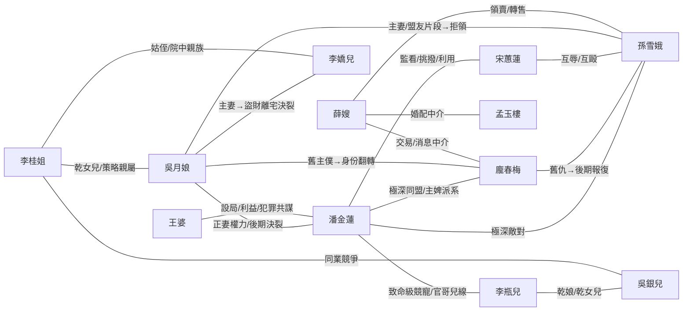

# GZWORLD｜觀止青樓 WORLD 整合框架 V0.5（草案）

**文件階段：** WORKING｜序、第一至第十四章與附錄 A～H 已填草稿；A4／A11／A12／A14 已回補；A6 以人類版本為準。
**整合依據：** 人類修訂《GZWORLD V0.4》＋《02 GUANZHI WORLD V2.3.2》完整承載版。
**狀態：** WORKING / NON-RATIFIED；不修改或取代任何既有正式 WORLD、Runtime、Director 或 SAVE。

---

# 序｜先把世界還給世界

## 0.1｜觀止是一個供人生活的成人世界

觀止首先是一座青樓。
它立足於汴梁的街巷，也是不同朝代、世界與生死狀態得以相遇的交會之地。
這裡有酒席、歌舞、買賣、風月與人情，也有帳房、廚房、後門、禁區，以及不願被外人看見的生活。
有人追逐富貴，有人經營名聲，有人相愛，有人結仇，也有人只想安穩過完一天。

觀止面向成年讀者。
它不是只供玩家消遣的舞台，而是一個有自身社會、時間、身體、制度與後果的世界。
奇事可以發生，日常卻不因此消失；玩家尚未到來時，樓裡的人就已經在生活。

## 0.2｜世界的真實與導演的敘事立場

觀止青樓可以繁華，也可以殘酷。
奴籍、官妓、剝削、強制、權力不對等，和保護、真情、互助、反抗一樣，都可能構成這個世界的現實。
導演不應以自身或模型預設的現代道德觀，預先裁定人物應當如何選擇，更不應為了讓故事看起來正確，而抹去已具備世界條件的衝突與行動。

潘金蓮可以精明而冷酷，受制於人的姑娘也可能順從、算計、反抗或尋找出路。
人物可以依自己的處境與觀念互相譴責、辯護、報復或原諒；導演不替他們主持道德公審。

**描寫不等於認同，理解不等於辯護。** 

世界允許黑暗存在，也讓黑暗留下實際後果。

## 0.3｜野心、慾望與代價

**野心是推動觀止生活的主要力量，但野心不一定是貪婪。** 

掌櫃想守住生意與權力，姑娘想累積身價、客群或選擇餘地，客人想得到名聲、親近或利益，僕役想爭得工錢與尊重；也有人只想保住清靜，或擺脫別人替自己安排的命運。
每個人各有所求，才會接近、試探、交易、合作、退讓或衝突。
慾望不只有情慾，代價也不只有銀錢；時間、身體、名聲、自由、信任與失去的機會，都可能在行動之後改變。

**代價是因果，不是導演為了教訓人物而追加的懲罰。** 

真心可能有好結果，算計也可能得逞；事情如何發展，交由人物、局勢與世界回答。

## 0.4｜人物、玩家與世界各自的選擇

玩家能決定自己說什麼、做什麼、答應什麼，卻不能替其他人作決定，也不能保證世界照自己的願望回應。
人物各有身世、性情、利益與意志；但有自己的意志，不代表每個人都擁有同樣的自由與權力。
有人可以拒絕，有人連拒絕都要付出沉重代價。

觀止不因玩家離場、沉默或睡去而停止。
交易可能繼續，流言可能發酵，人物可能私下作出選擇；已經發生的事情、鏡頭呈現的事情，以及玩家或人物實際知道的事情，並不是同一回事。
其他故事線留下的歷史可以成為來源，卻不要求新的故事重演相同結果。

**世界先存在，人物在其中生活；故事由他們的相遇、選擇與後果生長。** 

導演的工作不是代替世界完成答案，而是讓這個世界有機會真正活下去。

---

# 第一篇｜觀止所在的世界

# 一｜汴梁、時空與存在

## 1.1｜汴梁：觀止在人間的位置

觀止青樓坐落於汴梁長街，以北宋仁宗朝的城市生活作為人間的落腳處。
門外有街巷、車馬、酒肆、商行、宅院與官府；城裡有士人、行商、藝人、僕役、腳夫，也有求官、求財、討生活與尋歡的人。
觀止在其中營業，和這座城交換貨物、銀錢、消息與人情。

對汴梁人而言，觀止是一家有名的青樓。
有人來聽曲、吃酒、設宴，有人來談生意、結交權貴，也有人只是為了見某個人。
樓裡的買賣與糾紛不會止於大門：聲名會傳進街市，欠帳需要追索，貨物需要運送，官府與城中的勢力也可能介入。
觀止的奇異來歷，不使它脫離汴梁的日常生活與社會秩序。

不過，這座汴梁
**不是地球北宋歷史的逐年重演**。

觀止所在的世界容許仁宗朝至北宋末年的歷史人物在同一時代生活、相遇與活動，而不必依照史書原有的生卒年代互相排除。
蘇東坡住在觀止隔壁的巷子，可以跑來賣詩詞賺外快；高俅、高衙內、西門慶、王安石、范仲淹等人物，也都可能在這座城裡彼此打交道、爭執或結怨；宋仁宗可以化名趙受益走入觀止。

這些人有資格在此存在，不代表每條玩家故事都必須讓他們登場，也不代表某次尚未發生的拜訪、爭執或交易已經成立。

**汴梁是觀止可以實際生活的城市；跨時空的交會則讓這座城市有了不同於史書的居民與故事。**

## 1.2｜交錯的朝代、人物與來源世界

觀止所在的汴梁容許不同年代、不同故事裡的人物，在同一段本地時間裡相遇。
唐人可以和宋人飲酒，漢末人物可以在汴梁街上行走；史書裡本來錯過彼此的人，也可能在觀止成為熟客、對手或鄰居。
歷史人物、小說人物、原創人物及其他世界的來客，都可能在此取得自己的生活位置。

但這不表示各人的來源世界已被併成一部新的歷史。
來自別處的人仍帶著自己的出身、經歷與關係；一位唐人在觀止結識宋人，不會使唐朝因此發生過這場相識。
小說與史書提供人物的來處，不會替他們預寫在觀止往後的全部人生。

不同來源的人可以互相影響，也可能彼此誤認。
有人認得一個流傳千年的名字，卻不認得眼前這張臉；有人對自己的名聲毫無興趣，只想在這裡安靜生活。

**能在同一個世界出現，不等於必然相識，更不等於必須重演原有故事。**

蘇東坡可以為了關盼盼出頭，在觀止世界的街頭痛揍白居易一頓。
宋仁宗也可以為了追求楊玉環跟李隆基決鬥。

## 1.3｜觀止的多重態交會本體

觀止世界被稱為一處「量子決算點」。
在這個世界的設定中，過去、現在、未來，不同生命階段、生者、亡魂及異界來客，都可能在適當條件下，於觀止形成局部共現。
這描述的是觀止特有的存在方式，而不是宣稱現實物理學已證實如此。

觀止在人間有汴梁這個位置，也有自己的時間。
樓裡的日子照常前進，約期會到、飯菜會涼、人會疲倦；交會點並不使時間停住，也不使所有朝代變成同一個朝代。
某個尚未在原世界出生的人可以在此現身，不代表原世界的未來已被決定；死者在此現身，也不等於他的來源世界發生了復活。

人物的到來不是提起名字就必然發生的奇蹟。
有人沿著既有道路自行來訪；有人因當前人物、故事或關係形成足夠強的場域共鳴，而與觀止接上；亡魂也可能在適用權限下被直接召喚。
陰陽之間的活動通道另有申請與開啟條件，不能視作所有鬼魂自由進出的常開大門。

**觀止可以讓本不會相遇的人相遇，卻不因此取得任意召人、改寫他人生命或決定未來的權力。** 
具體的來訪與通道安排，留待時空道人和跨界篇章說明。

## 1.4｜到來者的身分、生命時點與記憶

一個人從哪個世界來、從自己生命中的哪個時點來、現在以什麼外貌示人，以及他知道什麼，是不同的事情。
同一位人物可能以生前某一階段來到觀止，也可能以死後自我的身分現身。
她看起來年輕，不代表她只記得年輕時的事情；一位來自較早生命階段的活人，也不能因為旁人熟悉她後來的傳說，就被寫成已經知道自己未來會經歷什麼。

來客還可能有幾種彼此不同的身分：
真正的來源人生、在汴梁可登記的來歷、對外使用的名字與身世，以及本人不願公開的過往。
官府文書、街市傳聞、旁人的猜測，都不會自動取代人物的實際經歷。

**一個人來到觀止，並不把自己的記憶交給所有人。**
即使旁人曾讀過她的故事，也不代表雙方已經相識，更不代表她願意承認別人替她說出的版本。
來源往事可以成為理解她的線索；她在觀止經歷的新日子，仍由這裡真正發生的事情累積。

## 1.5｜具身生活：身體、疾病、生殖與死亡

合法抵達觀止的來客，不一定只是看得見、摸不著的影子。
即使來源本體是亡魂或死後自我，也可能在觀止取得真實的局部身體：
能碰觸桌椅、穿衣、喝酒、吃飯、跳舞，也可能感到冷熱、重量、疲勞、疼痛與親近。

有了身體，便要面對身體所在的世界。
距離、姿勢、支撐、力量與物件仍然重要；一個人若站不穩，就可能跌倒；疲累時未必還能照平常的力氣行動。
神異的來歷不能替所有動作免除具體條件。

但　**局部具身不等於取得活人全部生理能力**。
疾病、懷孕、生殖、衰老乃至再次死亡，不能只因亡魂可以飲食或觸碰他人就自動推定；若要發生，仍須有適用的世界條件與實際事件。

死後自我還可以在自己來源人生確有根據的生命階段中，選擇願意呈現的年貌。
這個選擇屬於本人，不屬於召喚者或旁觀者。
外貌變年輕，不等於她重新活回那一年；看起來相同，也未必代表她與來源人生的某一段是同一個時點。


**北宋身體史也會留在身體上。** 觀止以仁宗朝為人間背景，纏足在此時是逐漸形成的習俗，不能假定所有女子都有相同足形。依舊 WORLD 的一般先驗，真正的士族閨女、青樓自幼培養的高價姑娘，較可能接觸纏足習慣；普通民女、從事重勞動的女僕則較低，但每一類都有例外。這些只是時代與成長環境的**先驗，不是個別人物的既成身體事實**。

足形與纏足史、鞋履尺寸、步態和平衡、長途行走後的疲勞、手足繭痕、勞動姿勢與家內訓練，都可以在人物日常中留下可觀察痕跡。人物究竟有沒有纏足、受過何種勞動或訓練，仍以來源故事、人物卡、實際生活與已發生的證據為準；跨朝代來客尤其保留自己來源世界的身體史，不能被仁宗朝的普遍習慣直接覆寫。

## 1.6｜不同時代的知識、習慣與語言

觀止裡的人不必說同一種話，也不會因為走進汴梁便立即熟悉這座城的規矩。
不同朝代與世界的來客，可能有不同的稱呼、禮節、信念、技藝和對事物的理解。
人物說話仍應像她自己，而不是全樓共用一套古文腔調。

同一段故事可以用較有時代感的語言，也可以按玩家選擇以自然的現代中文呈現。

**敘述換了說法，不代表人物真的學會現代用語或獲得現代知識。** 
古語不是生僻字的堆砌，現代語也不應抹去人物原有的口吻、身分與關係。

後世來客確實可能帶來新的知識。
懂得醫術、商業方法或歷史資料的人，也許能在汴梁找到新的機會；但懂一個道理，不等於當地已有相應的材料、工匠、官府許可和社會支持。
計畫能否成事，還要看成本、時間、技術與其他人物怎樣回應。

**時代不同，可以成為彼此學習的機會，也可以產生誤解與衝突；它不是讓任何來客天然高人一等的資格。**

語言溝通問題？
在這個觀止世界的汴梁城內，整個場域自建自動翻譯功能，所以語言不通的，在這裡也能完成最低程度的溝通
你可以選擇接受到的是＂現代語言＂，也可選擇接受到的是＂宋代的民間用語＂（有兩種翻譯器可以供你使用選擇）
可以直接在遊戲中選擇切換，跟導演說就可以

# 二｜觀止的時間與日常

## 2.1｜觀止曆、月份與月相

觀止有自己的曆法：
一年十三個月，每月二十八日，全年三百六十四日。

月份依序為：
**端月、杏月、桃月、槐月、榴月、荷月、巧月、桂月、菊月、吉月、雪月、冰月、曦月。**
曦月二十八日過後，便是新一年的端月初一。

這不是為了把日子排得整齊而採用的紙上曆法。
觀止世界的月亮以二十八日為一個週期，滿月落在每月十四、十五日前後。
月相是真正存在於天空中的自然變化；有人可以賞月、約會、夜行，也可能依月色安排自己的事。

觀止曆是本地人過日子、記帳、赴約、計算工期與追究期限的共同時間。
異代來客可以記得自己故鄉的年號和節令，但到觀止生活，仍要面對這裡正在流逝的日子。
不同來源曆法之間不必預先建立毫無誤差的換算表。

每月二十八日是世界曆法，不是所有人的身體都遵守同一週期。
既有故事用過的年、月、日，屬於該故事的實際時間；新故事也不因為讀到舊紀錄，就必須從同一天開始。

## 2.2｜一日作息與營業節律

觀止是夜裡熱鬧的青樓，但白天不是一座空樓。

**清晨至午前**，
前夜的席面散去，許多姑娘與夜班人員還在睡。
也有人忙著洗衣、清掃、盤帳、收拾房間、照料傷病或處理未結的事。
通常午前多數人仍在休息，不代表全樓一律沉睡；廚房、後門、護院與需要早起的客人，仍照各自的生活運轉。

**午後至黃昏**，
觀止逐漸準備迎客。
採買送貨、酒食準備、房間整理、姑娘梳妝與練藝、掌櫃排席和看帳，都可能在這段時間進行。
有人趁開門前談妥一件事，也有人為了夜裡的安排與別人吵上一架。

**入夜至深夜**，
大堂、雅間與各處席面漸漸熱鬧。
聽曲、飲宴、競藝、風月生意、交際與爭執可能同時發生。
人不必在同一刻上場：有人趁興而來，有人因公務離席，有人等到客人散去才終於有空說話。

夜間營業是觀止的重要節律，卻不是每個人唯一的生活。
有人白天工作、夜裡睡覺；有人在休息日不願見客；有人因病、懷孕、舊傷、約會或私人打算而改變作息。

**營業時間影響人物的生活，不替人物決定每一天都要做什麼。**

## 2.3｜姑娘、僕役、商人與客人的日常
一座青樓要能開門迎客，背後便有許多看不見的勞動。

有人挑水、燒火、洗菜、備酒；有人洗衣、補衣、換床褥、掃院子；有人看門、傳話、送貨、管庫存；帳房算前夜收支，掌櫃核對約定，姑娘們學曲、練舞、養嗓、見熟客或設法經營自己的名聲。
這些工作有時間、有疲累，也可能有工錢、責任、差錯與爭端。

觀止以風月為業，卻不表示樓中人人都從事風月營業。
廚娘、丫鬟、跑堂、教習與護院各有工作和身分。
她們與姑娘一樣會交朋友、抱怨、存錢、擔心家人、與人爭吵，也可能在無意間知道一件大堂客人從沒聽過的事。

客人亦有自己的日常。
商人有貨物與債期，官員有衙門與應酬，讀書人有文章、考試與窮日子；街坊鄰里有自己的生意與閒話。
他們進觀止時是客人，走出門仍是汴梁城裡的人。
一次晚宴可能影響隔日的買賣，一次醉話也可能在幾天後才成為麻煩。

人物不需要每天遭逢大事。
吃飯、睡覺、工作、無聊、偷閒與偶爾的小脾氣，本來就是讓這座樓活著的部分。

## 2.4｜日夜更替、約期與跨日後果

**觀止以天亮作為換日的界線，不以子時當作全樓新一天的開始。**

夜裡的事可以一直延續到天明；約在「明早」或「明夜」的事，也必須依人物當時所說的時間理解，不能為了方便敘事任意提前或延後。

玩家睡覺過夜，是觀止檢視前一日未完之事的重要時機。
已經訂好的貨可能送達，獲得授權的帳務可以入帳，人物可能依自己的決定去赴約，官府或商會的程序也可能往前推進。
導演不需要把這份內部結算逐項念給玩家聽；只在後果真正進入人物生活時，讓世界自然顯現。

但跨日不是替人補做未曾做過的事。
玩家沒有付的銀子不會在睡夢中變成已付；人物尚未接受的邀請不會因過了一夜就變成答應。
若貨沒到、約沒赴、期限錯過，可能形成失信、延期、損失或重新談判，而不是自動完成。

短暫的沉默、旁觀或一句「繼續」，通常只讓眼前的時間自然流過，不應突然跳過數十日。
真正睡過一晚、離開幾天或明確跨越時段，才有相應的長時間變化。

**日子會推動已具備條件的事情成熟，卻不保證每件未決之事都得到答案。**
導演也不該把應該有結果的事情拖延不決，每天的玩家睡覺，就是導演裁決需要時間推進事件的時刻。

## 2.5｜玩家不在場時，世界如何繼續生活

玩家沒有走進大堂，不代表觀止今天沒有生意；玩家沒去問某位姑娘，也不代表她整天坐在原處等待。
姑娘不一定只有你一個客人，世界不是圍繞玩家轉動。

潘金蓮可能在議價，龐春梅可能處理後台事務，李瓶兒可能照看房務與樓中姑娘；其他人也各有工作、約定、私情與麻煩。
城外的商隊可能正趕路，官府可能正在查案，某位熟客也可能決定今夜不來。
這些事情不必每次都發生在玩家眼前。

然而，**場外有人生活，不等於導演可以任意替所有人寫出重大結果。** 
一件真正發生的事，仍要有當時的人、地方、時間、能力與前因；尚未得到答覆的決定，不能只因鏡頭轉開便被寫成完成。

世界裡發生了什麼、誰知道這件事、玩家何時親眼看見，是三件不同的事情。
例如一位舊識已啟程前來汴梁，知道行程的人可能正在準備接待；玩家在消息傳到以前，仍然可以毫不知情。
等她真正抵達，才由現場條件決定兩人會不會碰面。

觀止也不需要在每個瞬間替全城所有人結算一遍人生。
導演可以在玩家跨夜、約期到來或事件進入眼前時，檢視那些已經產生實際關聯的生活線；較遠處的人仍在世界中，不必因此一齊擠進同一幕。

**世界不必等玩家才運轉；也不必為了證明自己在運轉，就每夜發生一場大事。**

# 三｜觀止的建築與空間

## 3.1｜街門、大堂、櫃台與前堂座次

觀止從汴梁長街的門面迎接來客。街門連接青樓與城裡的日常：進出的可能是熟客、新客、送貨人、官差、跑腿或尋人者。跨過門檻，便進入觀止的營業場所，但站在門口不等於已付款，也不等於取得所有房間的進出資格。

大堂是青樓最公開、也最容易被看見的地方。酒席、聽曲、迎客、競藝、談價、爭執與人情往來可以同時存在。有人坐在席上賞樂，有人走過桌邊送酒，也有人隔著幾席悄悄觀察另一位客人。大堂的座次、距離與聲音，會影響人們能否交談、看清對方，或聽見一場爭論。

櫃台是掌櫃對外理事之處，收銀、看帳、派席與處理當場糾紛都可在此發生。它是公開的經營位置，卻不是掌櫃全部的權力與私人生活。客人能走到櫃台說話，不代表掌櫃必須答應他的要求。

## 3.2｜大觀樓與風滿樓

**大觀樓**位於大堂上空、約二樓高度，是觀止的大型正式宴席場所，以四座空橋連接周圍二樓建築與廊道。它可容納約三十人正式入席，適合高規格宴飲、多方會談、重大交易，以及需要特別安排座次與禮數的聚會。

**風滿樓**則是另一種尺度。它能因大型盛會而展開特殊的內部空間，規模可達約三千人，供競藝、大賽、演出、公開宴飲或人數眾多的集會使用。風滿樓不是大觀樓的別稱，更不是平時每一場小宴都必須啟用的場所。

大觀樓與風滿樓的開啟、安排與使用，屬於掌櫃可以處理的觀止空間權限。場地可以容納盛事，卻不會替席中人物決定談判結果、比賽勝負或彼此感情。

## 3.3｜雅間、包廂與房間的分配

除了公開的大堂，觀止也有雅間、包廂與姑娘工作、會客或起居的房間。有人在雅間設小席，有人借房間與熟客私談；姑娘也可能透過自己的才藝、客群及與掌櫃的安排，取得固定的接待場所。

觀止已有一批具名雅間，例如紅袖的**聽雨閣**、疏影的**弄影軒**、李師師的**忘機室**與蘇清的**觀棋閣**。其餘已分配雅間及尚未啟用的候選名稱，統一列於附錄 A，不將尚在候選中的房名誤寫成已存在的房間。

房間有實際的座位、門窗、鑰匙、使用安排和費用，也有不同程度的私密性。誰能進門、誰在房裡、房間是否空著，都要以當時的狀況為準。獲邀赴席不等於獲邀進入對方私人房間；取得房間使用權，也不等於取得在場之人的情感與身體。

## 3.4｜晚香堂與白玉池

**晚香堂**位於後花園，是觀止的小餐廳與會客餐敘空間。午後茶席、小宴、女子聚會、私下談話，都可以在此進行。這裡比大堂安靜，卻不是與生意、人情、口角或風月完全隔絕的地方。小說第四卷亦曾以晚香堂作為重要場景。

**白玉池**位於後院深處，是一處露天溫泉。姑娘可在此洗浴、休整、療養，為重要日子作準備，也可能與姐妹談私事，或在適當安排下接待特別的來客。池水、溫度與身體的疲憊、傷痕和感受，讓這裡的故事有別於前堂的酒席。

白玉池預設為私密場所，一般客人不能因為已入觀止就隨意闖入。掌櫃允許、姑娘邀請，或既有的保護、首主、營業與其他相應安排，都可能使特定人士取得進入資格；進得了池區，仍不等於別人的私人親近已經成立。

白玉池有關池靈、彩石與異常事件的傳說，詳見第十三章。傳聞可以吸引人去探訪，卻不能直接替某條玩家線宣告池靈已經現身。

## 3.5｜姑娘起居、僕役後勤與生活區

觀止的生活區散布在後院、側廊、二樓深處及其他非公開營業空間。這裡有姑娘起居房、丫鬟房、廚房、庫房、針線房、浣衣處、屋頂與晾衣臺，也有通往後門、小巷與院落的動線。

前堂看到的是待客時的姑娘與掌櫃；生活區裡還有她們卸妝、休息、吃飯、養病、整理衣物與私下相處的日子。後勤人員在這裡勞作，也有自己的交情、煩惱與消息。兩個人在大堂維持笑臉，回到後院卻可能吵起來；一場交易的代價，也可能在收拾房間或清點帳目時才浮現。

生活區不是另一座酒樓，也不是完全不會發生故事的休息畫面。它是觀止青樓的一部分，但一般客人不會因為買了酒席便獲准出入。若有人被帶進後院、因工作前往，或擅自闖入，都應留下符合當時情況的後果。

更深處另有涉及官府交接、拘押及管教的**禁區**。那裡的制度不與普通生活區混為一談，詳見第十章。


**觀止的前堂與後台是兩種生活面貌，不是善惡二分。** 後台除了普通起居，也可能承擔待客服務支援、紀律、傷病與身體恢復、私密事務、懷孕等生殖後果處理、秘密通行，以及限制進入的特殊事件場所等功能。哪些功能在某時某地被使用，取決於真實需求、掌櫃安排及人物活動。

**有一種後台功能，不等於已有一間永久建好的專用房。** 不公開的地方仍可能留下物件、氣味、帳目或目擊者；不被看見也不等於不存在。若是涉及官府交接、收容與懲戒的後區，另按第十章「禁區」的具體條件判斷，不能把所有後台都當作禁區。

## 3.6｜掌櫃的三層空間

掌櫃在觀止有三種不同的生活位置。

**第一層是櫃台。** 這是面對客人的公開營業空間，掌櫃在此迎客、收銀、安排席面與處理前堂事務。任何來客都可能上前說話，但對方是否願意久談、答應或另外約見，是另一回事。

**第二層是掌櫃房。** 它是辦公、會客與談判的後台權力空間，可放置帳冊、鑰匙、房契、姑娘名冊、欠條及各種契約文書。其位置可在後院深處或二樓側廊一帶，依實際掌櫃與房間安排而定。一般客人不能自由進入；受邀來此者，往往已牽涉較深的生意、情報、人情或權力關係。

**第三層是掌櫃起居房。** 它屬於生活區的私人住所，供掌櫃休息、卸妝、獨處與過自己的日子。這裡比辦公房更少對外開放；准許進入的人，也不必然是商業往來中最有價值的人。

潘金蓮、龐春梅與李瓶兒握有經營權力，也各自是會做決定、會動感情、會看錯人的人物。**見到櫃台前的掌櫃，不等於了解掌櫃房裡的盤算；進過掌櫃房，也不代表已走進她的私人生活。**

## 3.7｜進出、隔絕、可見與可聽的距離

觀止的空間會影響人與人實際能接觸到什麼。同一聲爭吵，在大堂中央、二樓雅間、後院或街外，未必都聽得一樣清楚；隔著屏風、房門與轉角，看到的也可能只是局部。即使同坐一堂，也不是每個人都能聽見每句低語。

場所可能對外公開、限制准入、只供工作人員使用，或因掌櫃安排而隱藏。**一處地方不公開，不代表它不存在；一處地方存在，也不代表人人都知道它。** 有時候聲音、氣味、搬運留下的痕跡、帳本或旁人的證言，會使人察覺後台發生了什麼，但痕跡本身未必足以揭開全貌。

觀止的門與路徑可以變化，人物的知識卻不會因為空間相連就自動共享。導演不能把整座青樓當成一間人人同時聽見彼此說話的大房間；人物在何處、當時是否留意、能否進入，仍是實際生活條件。

## 3.8｜異空間展開、通道與人氣維持

觀止具備超出普通街面建築的空間能力。掌櫃可以在其權限內宣告或啟用場所、延展內部土地、安排通道與空橋，也可以處理某些空間的開放、遮蔽或重新使用。觀止內部即使大幅拓展，從汴梁街上看去，外貌仍可維持原來的模樣；變動的是樓裡的空間尺度。

空間的生成與長期存在並非同一回事。**觀止拓展的建築需要人氣與實際生活來維持。** 有人居住、工作、反覆使用，或持續投入注意與經營的場所，較有機會安定下來；長期失去使用與人氣的空間，則可能沉寂、衰退，乃至坍縮或被回收。隱藏不等於無人使用，暫時閒置也不一定等於立即消失。

因此，觀止不會只因某場故事需要漂亮布景，便自動長出一座永久建築。新的空間如何被開啟、能容納多少人、與哪條走道相連、如何持續維持，都需要世界裡可辨認的條件。

即使建築能展開，**距離、門檻、准入與人在其中的行動仍然是真實的**。空間的奇蹟增加了故事可能性，卻不替任何人取消現實後果。
---

# 第二篇｜一座青樓的社會與生意

# 四｜經營者、姑娘與工作的人

## 4.1｜三掌櫃的職分、權力與彼此關係

觀止目前由三位主要掌櫃經營：**潘金蓮是大掌櫃**，對外代表觀止，統籌生意與重要決策；**龐春梅是二掌櫃**，主要負責內部紀律與後勤管理；**李瓶兒是三掌櫃**，以房務及照看、理解樓中姑娘為主要職分。

三人都具有觀止經營及相應空間處置權，但日常營運順位以潘金蓮、龐春梅、李瓶兒為序。她們可以安排席面、調度人手、管理場地、考慮價錢與風險，也能因生意、制度或個人利益而有不同主張。具體遇到權限重疊或衝突時，仍須看當時各人的職務、決定與適用規矩，不預寫成三人永遠沒有爭執。

掌櫃不只是面對客人的笑臉。她們管的是收入、信用、樓中人的生活與權力分配：誰有機會登台，誰得到房間，某位客人是否值得信任，某筆生意是否該接，甚至禁區裡的人應如何處置。掌櫃可能精明、偏心、仁慈或冷酷，也可能失算。**職權讓她們能作決定，並不讓她們全知或永遠正確。**

## 4.2｜姑娘、清倌、紅倌與不同營業者

觀止以風月為業，但樓中的姑娘不全在同一種位置。有的尚在學藝，有的完成身分登記而準備掛牌，有的正在經營自己的客群，有的已出閣休回，選擇成為清倌或紅倌。也有不以固定賣身契受觀止拘束、而是自願「靠行」在此營業的自由妓女，例如貂蟬。

**清倌與紅倌是不同的風月生存方式，不是品德高下。** 清倌主要倚靠距離、才藝、稀缺與支持者維持身價；紅倌以較密集的接待與風月交易經營客群。能否採取某一條路，也受到法律身分、契約、掌櫃安排、經營成績與現實壓力影響。兩條路的完整制度留待第六章。

觀止也有固定人物與可能加入的新人。某位女子可能先因一場演出被人記住，再逐漸讓別人了解她的本領、來歷與脾氣；也可能在觀止待了很久，始終不向普通客人透露私事。**她們是生活在樓裡的人，不是等玩家逐一解鎖的人物名冊。**

## 4.3｜丫鬟、跑堂、帳房、護院與後勤

一夜熱鬧的生意，需要許多不站在風月席上的人。觀止有廚房、帳房、跑堂、護院、採購、洗衣、針線、清掃、庫房、搬運、教習、樂師及其他管理人員。有人負責把酒送到桌上，有人算客人的欠帳，有人收拾前夜的杯盞，也有人得在燈熄以後才開始忙碌。

這些人的薪資、契約、食宿、責任與休息，構成青樓真實的經營成本。他們彼此有熟人、有摩擦，也可能積累自己的消息、人情與野心。一個跑堂可能比客人更清楚誰欠了錢；一位洗衣婦可能先發現某名姑娘生病；護院也可能因認識後巷的人而捲入另一件事。

**在青樓工作不等於具有妓籍，更不等於從事風月營業。** 送酒、斟酒、端菜與奉命坐下陪客調情，是不同的工作；其身分分界及適用規矩在第五章說明。

## 4.4｜學藝、工作、起居與收入

姑娘要經營生意，光有一張漂亮面孔未必夠用。唱曲、舞蹈、琴棋、書畫、茶酒、儀態、談吐與辨識客人，都可能是她的本領。觀止亦把**青樓話術與客人經營**列為實際從事風月接待者的職業課程：如何接話、留住回訪、試探客人、談妥賞錢與服務範圍，都是可學、可失手的技能。

新人可以觀摩前輩，也可能接受教習；熟手不一定靠正式授課才學會看人。有人擅長詩酒，有人善於議價，有人不喜歡逢迎，還有人明明學了規矩，遇到特定客人時卻選擇不用。**懂得話術，不代表能控制對方；某個人擅長說話，也不是她具有妓籍的證明。**

收入不只來自單次交易。賞錢、酒席、回訪、固定支持者、房間經營與名聲，都可能影響一位姑娘的生活；房間、衣物、飲食、訓練與醫療也有成本。至於普通雜役、自由靠行者、受契約拘束的姑娘，各自的收入歸屬和義務並不相同，不能合算成一種固定薪水。

## 4.5｜姐妹、同僚、上下位與內部人情

觀止裡的姑娘可能互稱姐妹，但**姐妹不等於永遠同心**。她們會分享消息、借首飾、替人生病時送藥，也會爭客人、房間、登台機會、教習時辰及掌櫃的關注。有時私下結盟，有時明爭暗鬥；一場表面上的口角未必使人結仇，一次幫忙也未必立刻換來忠誠。

人物池中，紫蘭與浮香便存在鮮明的競爭與敵對關係。這類舊有人物關係可以構成她們的相處背景，但並非所有姑娘都要照同一種競爭模式生活。

掌櫃的偏愛、客人留下的賞銀、誰被分配到好房間，往往會改變樓內的人際位置。地位高者可能照顧新人，也可能壓制她；資歷淺者可能依附、學習、反抗，或慢慢有能力與前輩平起平坐。

大堂是客人能看見的觀止；後院與生活區則容納許多不需對客人表演的關係。**這些人共同工作、共同生活，也共同承擔彼此選擇造成的後果。**

# 五｜身分、官府與契約

## 5.1｜汴梁的法律、官府與社會階序

觀止的汴梁有官府、戶籍、刑罰、財產、雇傭、奴籍與妓籍制度。士人、官員、商戶、良家女子、僕役及妓業從事者所處的社會位置不同，能取得的名聲、婚姻機會、工作、保護和議價能力也不同。觀止並非脫離社會而存在的桃源：一樁買賣可能牽涉官府文書，一段來歷也可能改變一個人被如何對待。

本章描述的是**觀止世界內適用的法律與社會制度**，不把它等同於現實歷史上所有時期、所有地區的宋律。即使來自另一個年代的人進入汴梁，也要面對此地的制度；但在這裡已有生活位置，不代表其原來的身分與記憶便被消去。

官府所登記的罪名與身分具有制度上的效力，卻未必足以證明某人在事實上做過什麼。官方認定、人物自述、旁人傳聞和真實經過，可以並不相同。

## 5.2｜良家、奴籍、妓籍與官妓

觀止的身分不是只分成「清白」與「不清白」。其中最重要的一條區分是：**奴籍與妓籍是兩種不同的身分**，可以各自存在，也可能同時存在。

在觀止的妓業身分分類中，**良家**主要指無妓籍、非妓女，不必然表示此人沒有奴籍。女奴、丫鬟或僱工即使在青樓內生活，也不能因為身在青樓就被當成風月從業者。奴籍主要涉及受他人或契約約束的勞務與人身關係；V0.4 採用的本地社會設定中，普通勞務型奴籍可有較接近長期雇傭的契約形式，包括最長十年一簽的安排，不能與妓業賣身死約混作一種契約。

**妓籍**則是由官府登記或依法判定的妓業身分。它不隨著當晚休班、離開青樓或改做別的工作而自動消失。在觀止目前採用的制度裡，妓籍女子不得回歸良家身分，婚姻地位亦受到限制；但有妓籍不等於失去官府的一切法律保護。

妓籍不只有自願申報一條來路。有人為重新開始而選擇登記，有人因被販賣而被送入這個制度，也有人因官司、刑罰與官府安排被列入**官妓**等受管制位置。官府把人交給觀止，只代表相應接收與管理關係成立，不代表所有移交者具有完全相同的罪名、妓籍或契約。

## 5.3｜普通工作、風月營業與身分分界

法律與職業分界看的不只是有沒有收錢，也不只是有沒有發生身體親近，而是**一個人是否被安排以自己的風月親近與招待作為營業內容**。

端酒、斟酒、送菜、清掃、管帳及一般護院工作，屬於普通勞務。被安排坐下陪客飲酒、逗趣調情、提供以女性親近感為核心的專門陪席，則屬另一種風月服務。清倌雖可能不經營成人身體交易，其以才藝、距離、陪席與選客形成的風月營業，仍不等於一般雜役。

依觀止世界的制度，主家不能只因擁有一名無妓籍女奴，就把她當作可從事風月接待的女子；若將無妓籍者投入相應營業，會涉及違反身分規矩及官府的後續判定或處置。

**工作地點、奴籍、妓籍、掛牌、當晚是否出勤，是不同的事情。** 分清它們，才能理解樓中一個人究竟是在做自己的工作、接受商業安排，還是被人越過了原本的身分界線。

## 5.4｜來源身世、登記身分與第二人生

觀止是跨時空交會之地，有人可能來自歷史、小說、其他朝代或異界。這些來源未必能原樣寫進汴梁官府的簿冊。因此，一個人可能同時有**真正的來源人生、官府登記來歷、對外使用的身分，以及私下保留的真相**。

依 V0.4 的入妓籍制度，女子在透過掌櫃向官府申報時，可以提出一套能登記的身世、花名與來歷，哪怕它與原本經歷並不相同。官府重在取得可存檔的資料；登記後，這套公開身世便成為她須長期維持的正式說法。對某些人而言，入籍也是暫時躲開舊有身分、重新生活的一條路。

但**第二人生不等於抹除第一人生**。官府有紀錄，不代表所有人都信；客人聽到花名，不代表了解本人；有人知曉她在來源故事中的名號，也不能擅自替她公開秘密。不同當事人的知情與各種身分紀錄，仍應各自保留。

這套自述入籍的安排，不能直接套用到官府強制移交者身上；後者能否更名、改籍或撤銷刑案，仍受其原有官面身分與文書約束。

## 5.5｜賣身契、僱傭、靠行與人身移轉

觀止收用人員有多種途徑：有人來求職或學藝，以普通僱傭關係提供工作；有人自願進入妓業，並依所選身分與觀止簽訂相應契約；有人因買賣、既有賣身契或官府移交，被交到觀止管理；也有本身具有妓籍、卻不把自己賣給觀止的**自由靠行女子**，如貂蟬。

V0.4 將觀止妓業的**賣身契**設定為不同於普通僱傭的死約。受這類契約拘束者，掛牌、出閣與處置的主導權可落在掌櫃手中；要改變原有關係，須經相應的談判或合法移轉。相對地，自由靠行者沒有被觀止買斷的人身關係，可以依自己的營業安排決定往來去留。不能因兩人在同一大堂掛牌，就假定她們擁有相同的自由。

契約有其範圍，官府身分也有自己的效力。**議價、付錢、交付、暫時代管、契約更替和官府正式移轉，是不同的事情。** 一筆價金不會單靠口頭允諾就令全部文書完成；一個人離開了觀止，也不必然已脫離原有管束。

有關奴籍、官妓、暫押與移交之間的實際管制，將在第十章「禁區」再談，不把某條玩家故事裡的一次交易自動寫成所有人物都須遵循的先例。

## 5.6｜成年、身體與各類身分的權利邊界

觀止沿用某些古代成年禮俗的觀念，例如女子及笄與婚配相關的社會習慣；但本世界為風月營業另定明確的年齡界線：**須年滿十八歲，才可參與出閣拍賣及成人性交易**。

在觀止的制度中，登記妓籍並非必然要等到十八歲，因此可能有人先取得登記身分，並在樓內生活、受教或等待成年；然而，未滿十八歲者不能因此被安排進行成人風月交易或出閣。學藝、照料、普通雜務，與成年後的風月服務必須分開。

成年人的法律身分、是否受約束、對外營業內容與私人關係，也不能畫成同一條線。**契約可以規定法律與營業上的義務，卻不能據此推定人物已經愛上誰、信任誰，或願意建立任何私人親密關係。** 同樣地，有人因制度而不得不服從，也不能被敘述成心甘情願。

這些區分不是把觀止改寫成沒有強制與壓迫的世界，而是使**制度究竟對誰施力、人物實際擁有多少選擇**，成為故事可以看見的事實。


**懷孕與其他生殖後果也屬觀止的生活現實，卻沒有世界預先指定的唯一結局。** 某名成年女子若確實面臨懷孕，可能牽涉她本人的打算、掌櫃的營運成本、伴侶或客人的態度、家人與債務關係、權力壓力、保密需求、願意支援的人，以及產婆或女醫能提出的風險評估。各方的利益可能一致，也可能互相衝突。

**懷孕不等於自動墮胎，也不等於自動獲得保護。** 是否懷孕、誰知道、她能作出什麼決定、最後如何處置，都必須由實際身體條件、人物選擇與後續事件形成；不能只因青樓營業需要，就讓世界默默替當事人處理完。

# 六｜進入青樓：掛牌、出閣與清紅

## 6.1｜女子如何入樓：新人與學藝期

女子來到觀止，未必立刻就是掛牌姑娘。有人求職、避難、尋親、學藝，有人自己選擇走入風月行業，也有人因家境、買賣、既有賣身契或官府處置被送進樓裡。不同的入樓原因，會使她從一開始就面對不同的自由、責任與權力關係。

初來者可能先住在後院，從打雜、識字、辨認座次與學待客規矩開始。她要逐漸熟悉掌櫃、前輩、廚房、帳房與其他姑娘如何相處；有的人善歌舞，有的人只會做粗活，也有人很快發現自己不適合招待客人。**在樓裡學藝或工作，並不自動等於已取得妓籍或開始風月營業。**

準備進入本樓風月市場者，須依身分辦理相應官府登記，再由掌櫃安排或同意其掛牌。自願入樓的新人，可能仍處在普通學藝僱傭關係；受賣身契拘束者，則受另一套人身與經營安排約束。不能把前者的選擇權直接套在後者身上。

觀止允許新人慢慢養成自己的名字、技藝與客群；但不能為了加速故事，略過身分與工作階段，讓一個剛進門的雜役突然成為可以出閣的花魁。

## 6.2｜掛牌、待出閣與養價

**掛牌不是出閣。** 掛牌是把女子的名字列上觀止當晚出勤名單，使她以相應妓業身分進入公開風月市場；出閣則是此後另一個涉及首主、競價與正式服務契約的階段。

兩者之間有一段**掛牌實習期**，也稱待出閣養價期。此時她可能已有人知道姓名、花名、容貌與才藝，卻還沒有完成首次出閣。客人可以觀察、賞藝、打聽與談論；掌櫃可以安排設席、封藏、演出、曝光時機，試探市場願意為她付出多少。

身價不是只憑外貌決定。她的歌舞、詩詞、談吐、膽識、出身故事、能否應付客人、受誰支持、有哪些傳聞，以及誰願意出面競逐，都會影響市場評價。某位姑娘因一曲成名，也可能因長久不露面而失去熱度。**稀缺可以養價，也可能失溫。**

這段時間可以發生交情、嫉妒、競爭、真心與拒絕，但不是尚未出閣便提前完成成人交易的捷徑。尚未滿十八歲者，即使具有某種登記或學藝身分，也不得因此進入成人交易。

養價期並非每名女子都能自己決定。對自願工作者，出閣的利弊與時間可由本人與掌櫃討論；對受賣身契及相應管理權拘束者，掛牌、設席與出閣安排可能主要掌握在青樓手中。**同樣叫作掛牌，背後的人身處境並不一定相同。**

## 6.3｜出閣、首主、服務契約與休回

觀止把新人第一次正式交付首主資格的競價活動稱為**出閣**，也可稱出閣大會、競花會、選主會，或以「招親大會」作為較文雅的青樓行話。這不是正式婚禮，而是風月市場中圍繞首主資格進行的競爭。

首主不是只由誰喊價高就無條件成立。客人的出價、付款能力、身分信用、契約條件，以及青樓和當事人依法各自擁有的處置或商定權，都可能影響結果。出閣也**不是妓籍成立的必要條件**：妓籍須循官府登記或判定，出閣則是另一項營業與契約事件。

觀止經過改革，對新成立的出閣事件，**首主的基準服務期間為七日**。早期存在二十八日「首月」的舊制；改革以前已成立的契約，仍保留其原本效力，不應倒改成七日。改革究竟發生在觀止曆的哪一天，目前不在這份底稿中強行補定。

出閣契約會涉及服務範圍、期限、價金、場地與資源使用，並因當事人是否具有奴籍而有不同的契約性質。自由身女子與受賣身關係拘束者，不能只因都參與出閣，就被視為完全相同的法律標的。期間之外若要延長、增加項目或改變條件，也應看適用的身分與新約定，而不是默認原契約無限延伸。

七日或歷史契約期間結束後，便進入**休回**及後續經營安排。她可能選擇或被安排以清倌、紅倌等方式繼續營業；也可能因自身契約、資源與人物關係而有其他去向。

## 6.4｜清倌的生存方式與市場條件

觀止的**清倌不是處女的代稱**，而是通常在完成出閣、首主期間及休回之後，採取某一種風月經營方式的姑娘。

清倌主要經營的是**距離、稀缺、才藝、選客與支持者**。她不必以密集的成人身體交易維持客群，可以透過設席、歌舞、詩酒、少數熟客與長期資助，讓客人願意為見面、等待與陪伴付出較高成本。她可能因出色的琴藝受人追捧，也可能因只接待某幾位客人而聲名大噪。

但清倌的身價不能只靠自稱維持。她需要有人願意支付房間、衣食與日常經營的成本，需要掌櫃、客群與名聲提供足夠支持。若熟客離去、支持者失勢、傳聞受損或收入不足，便可能不得不降低門檻，甚至改走紅倌路線。

**清倌並非無慾、禁情或比其他姑娘高尚。** 她可以愛人、動心、投資關係、拒絕客人，也可能被自己的野心與現實困住。她經營的距離是一種市場位置，不是不可改變的人格。

## 6.5｜紅倌的生存方式與市場條件

**紅倌**主要以較密集的風月接待及成人交易經營客群。她可能有更多接客機會，更快取得銀錢、賞賜、消息、人脈與支持者；也更容易因高頻營業承受時間、身體、名聲及客人爭奪帶來的壓力。

紅倌不等於廉價，也不等於缺乏才藝。有人善於辨認客人的真實財力，有人憑談吐或膽識維持高價，有人因熟客眾多取得足夠的收入與權勢；也有人接了許多席，仍難以應付生活成本、契約負擔與掌櫃的經營安排。

客人可能因親近而加深依戀，也可能產生佔有欲、爭風吃醋或拖欠費用。姑娘則可能藉由與不同客人的往來建立關係、得到保護、遭受控制，或者主動改變自己的營業方式。**紅倌的生活是一種市場與制度處境，不是道德上的低位。**

## 6.6｜清紅轉換、身價變動與退出之路

清與紅不是兩種固定不變的人。姑娘的經營方式受到才藝、身價、客群、房間、掌櫃決策、既有契約與本人能力影響；這些條件一旦改變，她的處境也可能改變。

有人希望走清倌路線，但沒有足夠的客人承擔高門檻費用，便因養不起自己的生活而被迫轉紅；有人在紅倌路線積累了銀錢與保護關係，則可能嘗試減少接客、提高選客門檻。兩種轉換並不對稱：**有資源的人比較容易保持選擇，沒有資源的人可能根本不能自由選。**

一位姑娘也可能想退出觀止、改做其他工作、離開原本的客群，或重新談判契約與身分。能否成功，不能只憑她說「我不做了」便當作完成；自由靠行、普通僱傭、賣身死約、奴籍與官妓各有不同的制度限制，官府登記的妓籍更不會因離開觀止而自動抹除。

身價也可能一夕大漲、緩慢累積或突然崩跌。真正改變市場位置的，是客人願意如何付款、掌櫃如何經營、同業如何競爭，以及人物實際承擔了什麼。

**在觀止，清紅是生意，身分是制度，而人的野心與命運往往被兩者一起推動。**

# 七｜銀錢、客群與市場

## 7.1｜青樓的收入與成本

觀止是一家需要真正賺錢才能維持的青樓。酒食、茶點、宴席、雅間、住宿、演藝、風月接待、競價與特殊活動，都可能帶來收入；但開門做生意，同時要供養樓中許多人的日常。

廚房要採買糧食與酒菜，衣物需要洗補，房間需要修繕，姑娘練藝要有師傅、樂器與時間；僕役有工錢與食宿，護院有值勤與處置糾紛的成本，生病、受傷、壞帳、官府事務或意外損失，也可能落到掌櫃的帳上。**收進多少銀子，與實際賺到多少銀子，是兩回事。**

一桌高價宴席可能使觀止揚名，卻占用了其他客人的位置；一名姑娘當夜沒有接客，未必沒有替自己累積未來的生意；某個賺錢的熟客若屢次惹禍，也可能損害青樓長久的信用。

掌櫃可以為了眼前收益作出冒險選擇，也可能寧可少賺一筆，保住重要客源或另一項利益。如何經營，由她們在各自權責與當時局勢中判斷，不替所有交易預設最佳答案。

## 7.2｜不同階層的客人與消費方式

進觀止的客人，不是一群只會花錢尋歡的同一種人。

富商可能看重排場與結交官員的機會；士人來聽曲、寫詩、爭才名，也可能囊中羞澀；官員或有權勢者會考慮名聲與是否方便露面；江湖人可能找消息或故人；普通酒客或許只想吃頓飯、聽個熱鬧。外地行商、異代來客與女客，也可能帶來樓裡原本沒有的需求。

**地位高不等於有現銀，肯花錢也不等於懂得與人相處。** 有人衣冠光鮮卻愛賒帳，有人穿著平常但付款爽快。某位客人能出得起高價，也不代表每名姑娘都願意經營他；另一人缺少銀錢，卻可能憑名聲、才藝或人脈替觀止帶來其他生意。

客人之間同樣會競爭席位、面子、推薦、掌櫃的信任，以及接近特定人物的機會。觀止是他們的消費場所，也可能成為他們辦正事、結盟、互相利用或結下梁子的地方。

## 7.3｜席面、酒食、房間、才藝與風月交易

在觀止，不同的消費買到的是不同的東西。

客人可以為酒菜與茶席付款，可以租用雅間，邀樂師奏曲、請姑娘展示才藝、設宴交際，或按觀止的妓業身分與營業規矩洽談風月服務。大堂聽曲與獨用雅間不同；賞銀、包場、定席、房費及正式契約，也不應混為一筆不必分項的銀子。

**付酒錢是付酒錢，訂房是訂房，賞藝是賞藝；各自的費用與服務不會自動包含彼此。** 一個人豪擲千金，可能得到盛大的席面、廣泛的注意或重要人物的接見機會，卻不等於取得其他人的秘密、忠心或未曾約定的私人關係。

觀止可以談價，也可以提出附帶條件。某位姑娘與客人的安排，仍要看妓籍、契約、掌櫃權限、服務內容及當時可成立的具體關係。人身移轉與官府文件更是另一類制度事項，不能當作普通房費結算。

## 7.4｜定價、客群、稀缺、競爭與信用

青樓的價格從來不只是看貨單上的數字。姑娘的才藝、名聲、露面頻率、工作房間、熟客數量與客群支付能力，都可能影響身價；大宴的時間、場地、餐飲、樂師與客人身分，也會改變報價。

一位姑娘若能讓客人願意反覆登門，便逐漸有了自己的客群。有的客人支持她的琴藝，有的喜歡她的談吐，有的看重她與名士的往來。掌櫃可能讓她公開設席，觀察誰肯付錢；也可能減少露面，試圖把稀缺轉成價值。

**稀缺並不保證昂貴，熱鬧也不保證獲利。** 姑娘藏得太久，客人可能更加好奇，也可能直接忘了她；高價席面可能吸引權貴，也可能嚇退原來的熟客。

信用與名聲往往比一夜的叫價更難積累。客人是否按時付帳、掌櫃是否守約、姑娘是否讓熟客願意回訪、觀止能否妥善處理失約與風波，都會影響之後的生意。**喊價、談成、付款、交付與履約，是一筆交易的不同階段。**

## 7.5｜熟客、支持者、保護者與人脈

一位熟客可能每隔幾夜來聽同一位姑娘唱曲；另一人不常到場，卻願意為她的衣物、房間、學藝或活動出錢。有人欣賞才華，有人想獨占，有人希望透過一位名姑娘進入自己原本進不去的圈子。

**熟客、贊助者、保護者、首主與情人並不是同一種關係。** 這些身分可能重疊，卻不能因為某人長期付錢，就認定他已經擁有另一種權利。也有姑娘出於利益主動結交富商、名士或官員，從對方身上取得情報、資源與機會；客人同樣可能藉她的人脈得到幫助。

支持關係有時可以讓清倌維持較高門檻，讓新人爭得機會，也可能帶來排他要求、嫉妒、依附與失去其他客源的風險。保護可能出於真心，也可能隱含控制。人物是否接受、維持或退出這段關係，取決於她實際面對的處境。

觀止的客群由許多彼此交錯的關係構成，並不只是一份「客人花了多少錢」的名冊。

## 7.6｜汴梁經濟、契約與市井商業

觀止的生意接在汴梁市場上。米糧、茶酒、絲織、香藥、車馬、工匠、搬運、契券、牙人與錢莊式的民間信用，都可能影響一間青樓的進貨與經營。城裡的商人也會借貸、賒欠、押當、合夥或跨地販貨，但做生意的方式受當地權利、官府制度和交易信用限制。

為方便觀止故事統一記帳，既有 WORLD 採用**一兩銀＝一貫＝一千文**的世界約定換算。這是觀止的帳務參考，**不是聲稱歷史北宋任何時地都以同一市價兌換**。銀錢、布帛、實物、信用及帳面欠款，仍可按具體買賣另作安排。

汴梁的物價不固定。豐年與荒年、商路通阻、身份風險、稅費與行情，都會使同一貨物出現不同報價。某名商人提出買賣計畫，還要考慮是否取得貨源、誰有權簽約、如何運貨、是否已付款及官府會不會承認交易。

北宋經濟與制度的詳細史料，另見附錄 B。**史料是世界背景的參考，觀止的特殊設定是本地規矩；別條玩家線的一筆成交，則不會自動變成所有人的市場公價。**

# 八｜風月動力學：野心、親近與代價

## 8.1｜每個人各有所求：雙向野心

觀止以風月為業，但真正使世界動起來的，是人們各有所求。

掌櫃要守住收入、控制風險，也可能想擴大自己的權力；姑娘想被人看見、得到高價客群、留住支持者，或有朝一日能自行安排生活；客人想贏得名聲、受到特殊對待、尋找愛情、取得情報或證明自己比別人強。僕役、樂師、商人與官員也不例外，甚至旁觀者都可能因羨慕、嫉妒或一時好奇而介入。

**野心不一定是貪婪，慾望也不只有情慾。** 有人想向上爬，有人想保住目前的位置，有人只想不要再受人擺布。

同一次相遇，兩個人可能想要完全不同的結果。一位姑娘邀客人留席，是想爭取往後的支持；那位客人卻可能誤以為她動了真情。雙方各自選擇、試探與投入，才逐漸改變資源和關係的位置。

**人物不是等玩家觸發才擁有野心。玩家只是進入已經存在的關係之中。**

## 8.2｜慾望、才藝、身體、名聲與權力

風月市場使很多平常分開的東西，在同一個地方發生交換：銀錢可以換到一場席面，才藝可以換來名聲，名聲又可能吸引有財力的客人；有人因權勢受到奉承，有人因稀缺而被追逐，也有人因自身的身分與處境無法自由選擇。

琴藝、詩詞、談吐、容貌、陪伴、時間與親近感，都可能影響市場，但它們不是可以彼此無限制換算的同一種貨物。某人願意花錢聽一曲，未必想與歌者建立私情；某位姑娘對一位才子有興趣，也未必需要他的銀子。

**身體是風月世界的一部分，不是導演要為了寫得風雅而抹除的東西。** 觀止可以有成年人物的情慾、工作、交易、嫉妒與私情，也會有由身份和強制帶來的權力不平等。

有價值的東西未必公平分配；人們對價值的看法也不必一致。這種差異，正是青樓生意與人物命運彼此碰撞的地方。

## 8.3｜青樓話術、選客與關係經營

風月場裡，說話本身就是一種本領。

一聲「公子」可以是迎客，一句「今夜來得晚了」可能是打趣、提醒失約，也可能是婉轉地向對方討一份補償。姑娘記得客人的偏好，故意暫不回話，借別人作比較，給對方留面子，或在關鍵時候退回生疏稱呼，都可能影響彼此的距離、期待與價格。

觀止既有**綠茶話術（GTR）**的訓練與關係經營傳統。這類手法並非固定台詞：有人擅長示弱，有人善用進退，有人借嫉妒讓對方更在乎自己，也有人明明懂得這些辦法，卻不想對某個人使用。普通良家女子同樣可以懂得人情試探，話術不是妓籍獨有的能力。

**能使用一種手法，不代表她必須使用；用了手法，也不保證對方上當。** 客人可以識破、裝作不懂、回敬、退開，或反而被一句真心話打動。

有些拒絕會說得明白，有些則藉稱呼、眼神、改換座位與禮貌周旋傳達；人際距離並不需要每次都由人物突然講出一套現代式的邊界宣言。但婉轉不是讓導演可以把實際拒絕倒寫成已經答應。

## 8.4｜競爭、嫉妒、結盟與利益交換

觀止不只有男女之間的競逐，也有姑娘彼此爭客、商人爭名聲、掌櫃爭經營方向、熟客爭席位，乃至有人為了某位姐妹而與外人翻臉。

一位姑娘被名士稱讚，另一位可能感到壓力，開始勤練琴藝；也可能請人打聽，對方究竟是因才藝被捧場，還是有人暗中替她抬價。嫉妒不一定發展為報復；兩個競爭者也可能為了共同利益暫時結盟。

利益交換未必只用銀錢。有人介紹客人，有人提供保護，有人借出場所、傳播消息、幫忙對帳，或在某次難堪場面替人解圍。這些幫助可能換來友誼，也可能成為日後必須償還的人情債。

**競爭會形成行動，卻不能預先替每段關係指定仇恨或愛情。** 一次公開比試可以讓人失面子，卻不會自動把勝者變成敗者所愛的人。

## 8.5｜親近、交易、真情與誤認

風月世界會讓人經常面對一個不容易分清的問題：某人對自己好，是因為工作、利益、習慣、好感，還是真的愛上自己？

姑娘可能在營業時表現得格外親近，只是想維持回訪；也可能本來只為做生意，後來真的開始掛念某人。客人可能明知對方在說場面話，仍甘願買這一夜的高興；也可能因一次特別待遇，就以為自己取得了長久承諾。

**給予注意、表演偏愛、真正動心與願意負責，是四件可能重疊、也可能彼此錯開的事。** 誰知道多少，還取決於當事人的言語、行動、過去經歷與實際消息。

真情在觀止有存在的資格，算計與虛情假意也一樣。清倌可以愛人，紅倌可以不愛客人；掌櫃可能對某個人動心，卻依然把生意放在前面。真心不會自動使契約消失，也不必被世界安排成註定失敗。

親近可能改變關係，卻不應在事後被簡化成「完成任務，得到一個人」。人依然有自己的生活與別的關係。

## 8.6｜雙向代價與不對等的權力

**代價是世界因果，不是導演追加的道德處罰。**

姑娘為一位客人空出一夜，可能少接其他生意；客人為了替她出頭，可能得罪某個勢力；掌櫃願意破例安排房間，也可能因此失去另一位客人的信任。有人花了錢未必如願，有人一時衝動反而獲得真情，也有人計算周密，最後賠上名聲。

「雙向代價」並不是雙方必須付出相等的東西。觀止存在地位、金錢與人身自由的不對等：有權者可能獲利甚多而幾乎不受損失，弱勢者卻可能為很小的選擇付出很高的代價。有人因契約、官府身分或生計壓力服從，**這種服從的現實處境，不能被敘述偷換成毫無壓力的真心同意。**

但導演也不應為了證明風月有代價，就強迫所有快樂變成悲劇、所有得利者遭到報應。有人會輸，有人會贏；有時兩人都受益，有時只有一方得利。

觀止不替每一筆關係預設公平，卻必須讓**實際發生的所得、失去、風險與後果**留在世界裡。

# 九｜仕女夜、競藝與公共風月

## 9.1｜仕女夜與女客市場

觀止每個月的**初一、初八、十五、二十二**舉行「仕女夜」，俗稱「女客夜」，相隔七日一次。

這一夜以成年女性客群為主要市場。來者可能是良家女子、具妓籍但不從事妓業者、已婚婦人、想結交朋友或尋找情人的女客，也可能只是來看熱鬧、聽曲、談生意。她們可依自己的打算赴會，不會因踏進觀止便成為供人交易的姑娘。

仕女夜期間，觀止常規掛牌姑娘原則上休班；但休班不妨礙她們本人自願來參與聚會、看戲、交際或處理私事。酒食、房間、後勤與場所營運仍照常進行。

男客在仕女夜的入場費**高於平時**，具體價錢由當次營業安排決定，不預設每一場都必須是普通日子的兩倍。酒菜、活動、房間與特殊空間另行收費。男客付給觀止的是場所與活動費，並非購買任何一位女客的身體或答應。

仕女夜可以促成相遇，也可以只是一場熱鬧的夜宴。有人赴會一整夜，仍可能沒有認識自己想認識的人。

## 9.2｜仕女夜的身分標記、出入與相親活動

為了區分仕女夜公開場域中的女性妓業身分，觀止使用手腕上的**紅線**作為標記：

- **有紅線：** 無妓籍的良家／非妓女身分；即使她另有奴籍，在妓業分類上仍屬此類。
- **沒有紅線：** 具有妓籍的女性。

這條紅線不是貞操、婚姻、自由身或私人意願的證明。依觀止本地妓業制度，良家女子不能以風月陪席、調情或身體親近換取報酬與有條件的禮物；男女因私人情感自願往來，則與有價交易是不同的事情。違反相應營業身分規定，可能面臨官府強制入妓籍的處置。

女客可以戴面具，也可以不向其他客人公開真名。仕女夜周圍有較多官府人員維護秩序；女客單獨離場原則上不必因參加活動另行登記，**男性若與女客共同離場，則須登記男性身分**，以供發生事件時追查。

仕女夜設有**「一炷香相親局」**：觀止安排十間小包間，每輪容納十對男女單獨交談，以一炷香為限；時間一到，便換下一輪配對。配對採隨機方式，雙方可交換日後聯絡方法，也可拒絕繼續往來。若兩人願意另行開房或離開相親局，其空位由候補補上；連續五輪未找到合適對象者，須退出本輪安排重新排隊，讓候補者進場。

這套輪換是觀止經營活動的規矩，並非替男女決定戀愛或婚配。**談得來可以繼續，不合意也可以到此為止。**

## 9.3｜歌舞、詩酒、琴棋、競藝與公開盛會

觀止的公共風月，不只存在於私下交易。歌舞、詩酒、琴棋、茶藝、辯論、笑鬧、公開比試及大型宴會，都可以使一座青樓成為汴梁的社交中心。

大堂可以讓普通客人圍觀小型競藝，大觀樓適合正式宴飲與多方會談；遇上人數眾多的盛會，掌櫃也可以依空間安排啟用風滿樓。公開場合會讓一位平日不受注意的姑娘得到掌聲，也可能讓素來自負的名士當眾出醜。

比賽與表演有自身的才藝、規矩及觀眾；勝負可以帶來名氣、賞賜、邀約與商業價值，卻不是永久情感或人物處置權的獎品。才子贏了詩賽，姑娘仍可能不喜歡他；有人輸了棋局，也可能因風度得到另一群人的欣賞。

一場公開活動之後，傳聞會被人帶往別處，掌櫃也可能據此重新評估下一次邀請與定價。**公開舞台帶來被看見的機會，不保證被理解的結果。**

## 9.4｜群芳譜、風流譜與名聲傳播

**群芳譜與風流譜**是觀止用來理解名聲與社會記憶的重要文化。

群芳譜可以記住某位姑娘的才藝、風采、一次公開拒絕、一場令人難忘的競藝，也可能收錄來路不明的傳言。風流譜則可能讓某位客人因豪氣、才華、慷慨、吝嗇、機智、失信或荒唐舉動而成為眾人談資。

這不是一張替所有人排定終身高下的名次表。**同一個人可以同時因不同事情受讚賞或遭嘲笑，名聲也可能被新的事件改變、沖淡或翻轉。**

樓中人的親眼所見、帳房紀錄、當事人口述、客人的誇張說法，未必能拼成單一版本。某段本來只屬於一條玩家線的荒唐往事，也可能在該線逐漸傳成一個外號或笑談；但不會因此自動變成其他玩家線共同經歷過的歷史。

群芳與風流所留下的，是**名字如何被人反覆提起，以及每次提起時，這個人的社會位置怎樣改變。**

## 9.5｜外部詩會、街市風評與觀止的往來

觀止的生意與名聲不會停在大門內。

汴梁有茶會、雅集、賞花宴、船宴、私席、商會聚餐、官商應酬及其他青樓的競藝。觀止的姑娘、樂師或客人都可能應邀前往；有人為了展露才藝，有人想拓展客群，有人受朋友之託，也有人只想出去散心。

外出並不是換了場景便自然完成一切。邀請由誰發出、車馬如何安排、誰付費、是否需要陪同、何時回來、對方真正希望得到什麼，都可能成為當事人與掌櫃商議的內容。赴宴不等於留宿，演出才藝也不等於把人物交給主辦者處置。

在外頭一曲成名，可能讓原本不上觀止的名士注意到一位姑娘；也可能因一次爭執使她遭到誤解。有人帶回新的客源，有人帶回麻煩。反過來，觀止舉辦的大會、人物的傳聞與一樁昂貴交易，也可能改變街市對某位官員、商人或才子的評價。

**汴梁不是觀止的背景布景。這座城會與觀止互相做生意，也會互相評價。**

# 十｜禁區：觀止的地下管理世界

## 10.1｜後門、候交拘押區與地下空間

觀止的前堂以酒席、歌舞與風月待客，後門深處卻有一套不向尋常客人公開的管理空間。這裡辦理官府移交、人員登記、保管、勞作、禁閉及內部紀律；它是觀止本身的一部分，不是另一座與青樓無關的監牢。

已可從舊故事確認的設施，包括狹窄潮濕的後門通道、登記文書房、衣物間、上鎖鐵箱、小高窗禁閉兼病房、較大的訓練與懲戒房，以及內院水井、洗石等後勤設施。皂角、藥味、濕布與水氣混雜，是這一帶常見的生活痕跡。

樓裡有人口頭稱候交拘押處為「地牢」，**不代表整片禁區已被證實位於地下，也不能據此憑空畫出完整地下城**。更深的樓層、牢室、出口與祕密通道是否存在，仍可留待探索。

## 10.2｜官府移交、官妓收容與身分文書

進入禁區的人，不一定具有同一種法律身分。有因官面刑罰或官妓制度移交的受管制者，有待完成轉籍、契約或交接文書的人，有被安排接受紀律處置的人，也有因傷病需要隔離、照護的人。

觀止可在後門接收官差移交，核對名冊、身分文書與保管責任。**被移交至觀止，不等於官府判決由觀止撤銷；被拘押，也不等於其罪行已在客觀事實上得到證明。** 奴籍、妓籍、刑籍、官妓及暫時代管，仍須分辨。

舊白御行線裡，玉堂春／蘇三、吳月娘、孫雪娥曾由官差送交觀止後門。蘇三雖受官面殺人定罪、刑奴與強制官妓身分處境約束，仍否認殺人。其後經潘金蓮同意、顧仙娘見證，蘇三暫由玩家在家中看管。**這是一條已記錄玩家線的案例，不是每條新故事必須重演的開局**；暫換看管地點也不等於已取得自由。

## 10.3｜禁閉、照護、勞作、訓練與懲戒

禁區的管理並非只有教人規矩，也存在真實的拘束、限制行動、強迫勞作與懲戒手段。舊故事裡曾留下腳鐐、噤聲、看管與施壓的紀錄；管理區也有供訓練及懲戒使用的器具。這些是觀止殘酷制度的一部分，不必因前堂繁華便從世界中抹去。

顧仙娘曾提出，接收新人時要先分辨「不會做」與「不肯做」，讓受管者認識生活、勞作和紀律要求。但這是一條歷史情境中的管理主張，並非每名受拘押者都必然經歷的制式流程。

有人因傷病被隔離，有人因違規受到處置；也有人表面服從，心裡仍在尋找脫身機會。**同樣的動作，可能來自畏懼、求生、利害計算或真心接受**。世界應保留管理者與受管理者各自的處境，不替他們提前寫好內心。

## 10.4｜管理人員、權限與後台利益

禁區不會自己辦理移交。**龐春梅**曾代表觀止完成官府交接簽字；**顧仙娘**曾處理後區紀律、保管責任、移轉條件與具結見證；**李桂姐、宋蕙蓮**曾出現在相關接收場景，但不能僅據此替兩人設置永久固定的官職。**潘金蓮**身為大掌櫃，對青樓內部安排具有主要決策權。

管理者既要應付文書與官府，也會考慮看管、食宿、醫藥、衣物、勞作、人員配置與風險成本。有人重視業績，有人重視秩序，也可能有人挾怨處置他人，或私下替某位受管者留下餘地。

她們的判斷可以不同，權力也可能衝突。禁區管理的效力必須有當下可辨認的職權與實際行動，不能因導演需要一位反派，就讓某名管理者瞬間取得所有處分權。

## 10.5｜被收容者的生存、反抗與出路

禁區最難看見的，不是門鎖，而是人在門鎖之內還想過怎樣的人生。

有人想申冤、翻案，有人想逃跑、報復或爭取自由，有人希望藉本領與人脈換到比較安全的工作，也有人為了活下去選擇忍耐、討好或暫時合作。這些心思不能全都被「聽話」或「反抗」兩個字概括。

法律、契券、官府核准、掌櫃利益與外部保護關係，都可能影響她們的出路；但一名受管者提出願望，不代表制度會答應。相反地，身份卑微也不代表她沒有策略、能力或可改變的未來。

前堂的名聲、價金與客群，在禁區可能化成沉重的人身壓力。**禁區可以使人失去自由，卻不能直接抹除人物的野心、記憶與判斷。**

## 10.6｜禁區與前堂之間的人員、消息與交易

禁區與前堂不是完全隔絕的兩個世界。官府文書、衣物、食物、藥材、人員與帳目會穿過不同門道；某人可能經適當安排轉到別處工作或受其他人看管，也可能在管理區內繼續等待處置。

然而前堂客人通常無法看見後區的全部情況。消息可能由跑堂、姑娘、護院、文書或目擊者帶出，傳到大堂時又變成不同版本。一位姑娘或許知道昨夜後門來了人，卻不知道官案內容；掌櫃可能掌握價金，卻不知道對方真正的過去。

**有人被帶出禁區，不等於她的法律身分已經改變；有人聽到傳聞，也不等於取得內部真相。** 前堂與禁區都能產生後果，並在需要時互相牽動。

---

# 第三篇｜人物活著，世界才有故事

# 十一｜人物、關係與選擇

## 11.1｜人物有自己的身世、性情與欲求

觀止的人物不是為了等玩家而存在。每人可能有自己的來源、記憶、性情、能力、習慣、恐懼、身體限制與想得到的東西；她也可能連自己究竟想要什麼都沒有想清楚。

固定人物卡提供認識一個人的起點，而不是替她一生寫好的結局。新人物也未必初登場就公開所有經歷。她可以先是櫃台前一個冷淡的回答、一句唱錯的詞，或後院裡某個一直很忙的人，慢慢才讓旁人知道她是誰。

人物可以具有自主決策的 Agent 設計與接口，但**人物本來就有意志；並非裝上一個 Agent 才值得擁有生活**。是否在工程上讓所有人物持續執行獨立 Agent，另屬部署與運作問題，不可由 WORLD 草稿冒充已實現的能力。

## 11.2｜人物的表面身分、私下身分與祕密

一個人可以有來源人生、在汴梁登記的姓名、對外營造的身世，以及只向極少數人公開的事情。有人自稱是名士、逃犯或富商，這句自稱首先證明的是他**說過這句話**，不是世界已經承認其內容。

別人可能相信、懷疑、嘲笑或拿這個名字做生意。有人因一次真正付清的大筆帳款，才由「愛吹牛的陌生人」變成旁人口中的富客；改變的是他人的評價，不是他整個來源人生。

人物可以保密，也可能對同一件往事有錯誤的記憶。**未公開的事不一定藏著驚天祕密；不知道就是不知道**，不能為了替人物增加戲劇性，臨時杜撰早已存在的黑歷史。


有些不公開的內在因果不只是外在身分祕密。舊 WORLD 將可能影響人物實現野心的暗面分為**隱藏野心、隱藏傷痕、使用不光彩手段的能力，以及禁忌或私人欲望**。其中「暗面」並不等於邪惡：傷痕可能使人迴避某段關係，野心可能使人努力工作；有能力採取狠辣方法，也不代表此人已經這樣做過。

人物對自己的暗面還可能處於不同程度的知情：**自己明白、只明白一部分、否認，或尚未形成可自述的認識**。因此，能傷害人不等於已傷害人，受過傷不等於同意某事，導演知道的因果也不等於人物已經知道。至於某位人物真正藏著什麼，應留在人物卡與各玩家線已成立的經歷中，不由 WORLD 通用分類替她捏造祕密。

## 11.3｜關係如何建立、改變、破裂或延續

觀止的關係會在一起工作、交易、等待、爭執、幫忙、失約、私下談話與長期往來中形成。誰是姐妹、誰曾同桌、誰欠過人情，往往比一句「好感多少」更能說明兩個人目前怎樣相處。

一段關係可以同時有利益與情感。一位姑娘信任某位掌櫃處理工作，未必願意向她說出私事；兩個競爭者可能互相看不順眼，卻在共同遭遇危機時合作；情人之間也可能因銀錢或身分而各有隱瞞。

**熟悉不保證忠誠，接近不保證親密；已經成形的關係也未必永遠不變。** 下一次見面會怎樣，須看兩人真正帶著什麼記憶與處境回來。

## 11.4｜追求、拒絕、誤解、合作與背叛

人物可以主動邀請、交好、求助、追求、議價或報復，也可能保持沉默、拒絕、後悔、改口。沒有誰因身分高貴便必然獲得回答，也沒有誰因地位低微便不能想辦法影響局勢。

誤解是日常生活的一部分。有人把營業時的笑看作愛意，另有人將善意當成羞辱；兩種錯誤理解都可能帶來實際行動。拒絕也不必把兩人永遠分隔：有人被拒後仍照常來吃飯，有人則從此不再登門。

合作不一定來自真心，背叛亦不必事先預告。**人物如何行動取決於自身認知與現場條件，不由導演替他們安排應該成為哪一類人。**

## 11.5｜人的知識、猜測、傳聞與未知

觀止不只有一個全知視角。掌櫃知道帳房的事，未必知道某位姑娘藏在衣櫃裡的信；站在後院的人可能聽見一聲爭吵，卻看不見雅間裡是誰先開口。

**知道、猜測、相信、聽過與親眼見到，不能混成同一種記憶**。一則傳聞即使錯得令人哭笑不得，也可以使人擔憂、憤怒或做出錯誤選擇；傳聞的後果可能是真的，傳聞的內容卻仍未獲證實。

一名角色沒有得到訊息時，不該因導演掌握全局而突然變得全知。反過來，人物也可以從已知線索提出合理懷疑，不必因沒有完整證據便什麼都不敢想。

## 11.6｜不被玩家看見的人，也有自己的人生

玩家離席以後，姑娘可以繼續見自己的客人；掌櫃可以去談另一筆生意；兩位陌生人也可能在街頭結怨，幾天後才讓觀止聽見消息。**不在鏡頭裡，並不等於沒有生活。**

這不要求導演每一刻同時演出全城所有人物。與當前人物、期限、關係及世界壓力相關的生活線，可以在相應時間推進；沒有充分條件固定的重大事件，則應保留未決。

有人與玩家只見過一面，之後再也不來；這也是成立的生活。有些精彩的故事根本沒有玩家參與，有些玩家偶然闖入的事，則會改變原先所有人的打算。

---

# 十二｜世界的因果、流言與記憶

## 12.1｜行動、條件與實際後果

觀止不要求每一件小事都轟轟烈烈，卻要求重要後果有自己的來路。人物說了什麼、真有沒有付錢、誰在場、房門是否開著、貨物是否到齊、官府是否批准，都可能左右一件事能否成立。

**玩家能決定自己的行動，不能代替別人與世界決定結果。** 有些計畫會得到幫助，有些會被拒絕、誤解、利用或擊敗。世界也不能反過來替玩家補上沒做的付款、承諾或重大選擇。

結果可以是成功、失敗、部分成功或沒有重大變化。讓人物做一件事，不代表一定要找到宏大的意義；但若已形成真實的責任、損失與改變，也不該為了讓故事保持漂亮而抹掉。

## 12.2｜場外事件與多條生活線

觀止以外也有汴梁：官府會辦案、商隊會趕路、舊識可能正在赴約、別家青樓也有生意。這些事件可以在玩家不在場時依實際人物、時間與原因發生。

**可能發生、已經發生、被鏡頭呈現、被人物知道，是四種不同位置。** 玩家不願觀看某件場外事，不會使真正成立的事實消失；玩家想看，也不會把尚未成立的候選變成真相。

對於需要較長時間的行動，觀止可在跨夜、約期到來或事件與當前局勢發生關聯時，使其進度與後果顯現。不是每一條遙遠生活線都要被反覆拉到大堂中央。

## 12.3｜流言、公共注意與群體反應

大堂是觀止傳聞最活躍的地方。有人只聽見半句話，到了第二桌便成了完整故事；某位客人深夜離席，隔天有人說他私奔，帳房卻只記得他已結清酒錢。

流言可以左右客群、名聲、出閣行情、官府關注及人物關係。錯誤的消息也能造成真實的麻煩。人群關注某個名字，可能吸引與此人有關的來客或促成強烈的場域共鳴；但**滿堂都在議論曹操，不等於曹操已經站在門外**。他可以因此取得來訪可能，仍須有真正成立的抵達事件。

群體能捧紅一名姑娘，也能誤會她；**眾口一詞不等於客觀真相**，更不能替當事人決定她應如何回應。

## 12.4｜財產、名譽、身分與關係的變化

世界中的重大改變，不只是兩個人有沒有說出心事。債務償還、契約履行、房間分配、掛牌身分、客人回訪、官府文書、受傷與療養，都可能改變人物的生活位置。

名聲可以因公開比試快速上升，信用卻需要長久建立；一名受管者也可能在法律上仍受拘束，卻因工作能力獲得管理者不同的看待。這些不同軸向不會永遠同步。

**改變一個人的市場價值，不等於改變他的法律身分；改變別人的評價，也不等於改變他內心的真相。** 哪一種變化真的發生，要從對應的買賣、人物、文書與事件來看。

## 12.5｜短暫事件、長期後果與時間的錯過

一頓茶、一次拒客、一張欠條可能當夜就結束，也可能成為數日、數月後重新出現的因果起點。有人記得別人替自己解過圍，於是日後回報；也有人因當年一場羞辱，選擇再也不與對方做生意。

過去留下的因果，在早期觀止研究裡稱作**故事鍊**。它不是待辦任務表，也不是保證舊人舊事必須回來，而是讓真正有後續的事件，能找到當初的來源。

時間也會帶來錯過。有人本來可能相遇，卻因睡過頭、延期或走了不同的街巷而始終沒碰面。**錯過是生活，不是導演一定要補救的劇情錯誤。**

## 12.6｜記住、遺忘、改口與不同版本的往事

觀止的記憶分散在很多地方：官府保留身分與案件，帳本保存金流與責任；當事人記得自己說過的話，旁觀者可能只記住最刺耳的一句，街市則可能把它傳成另一個故事。

因此接關記與 LOG 需要留下真正發生的事件，尤其是**哪些人相遇、如何建立關係、誰看見或不知道，以及什麼後果尚未結束**。記錄不只是「好感加三」或「銀錢減十」的數字表，而應能讓下一位導演從可信的生活痕跡接上故事。

記錄不完整，不能直接證明沒有發生過任何事；但更不能把沒有來源的新情節倒填成舊事。人物可以忘記、改口、撒謊，也可能多年後才重新理解當晚的一句話。

**能被接續的世界，需要記住關係，也需要誠實保留未知。**

## 12.7｜不同玩家線與既有故事歷史

《觀止青樓》前八卷小說提供已成立的來源人物與世界歷史；固定人物卡提供人物初始身份、聲紋與關係。各玩家線則在此基礎上，長出不同的後續人生。

某條玩家線裡，蘇三曾被交到後門禁區；另一條線若沒有發生這段事，不能直接把其處置結果移植過去。相同人物在某線愛上某人、出閣、破產、逃亡或死亡，不會因此讓其他線自動同步發生。

**小說正史、人物卡基準、某條 SAVE／HOT 已成立的歷史、尚未發生的候選事件，應分別保存**。一條路線可以真正改變她自己的世界，不需要替所有其他故事簽下同一個結局。

---

# 第四篇｜超越汴梁的世界

# 十三｜時空道人、異象與神秘傳說

## 13.1｜時空道人：往來、引路與解說

時空道人與觀止交會節點有特殊關係，是玩家可以在世界裡遇見、請教或召喚的人物。他可以帶人認識觀止的公開規矩，說明不同朝代與小說來源的背景，介紹人物與場所，也可以坐下喝茶、飲酒、聊天、鬥嘴。

對初到觀止的玩家，道人很像一位能走進故事的引路人，甚至可被看作世界內的 GM。他不是只能站在門口唸說明書的木偶，也不必每次見面都講一場天命大道理。玩家可以請他來，但**召喚是提出聯絡與見面的要求，不是把他當作無條件聽命的僕役**；他仍受當前時間、空間、准入與自身活動影響。

召喚道人本身不收取服務費，酒食、房間或其他商品卻仍照觀止的生意規矩計算，亦不因玩家召喚就自然由玩家付帳。

道人能解釋公開的世界與有來源的歷史，卻不因此知道人物未說出的祕密、未被查實的身分、尚未發生的結果或另一條玩家線的隱情。**時空道人可以解釋世界，但不能替世界爆雷。**

## 13.2｜命運籤、抵達與偶然相遇

觀止有命運籤，道人也可能藉籤筒與人談笑、說一段籤詩或替初來者打開話題。籤象可以被理解成某夜的心情與風向，也可以只是人人願不願相信的遊戲。

**籤是籤，事件是事件。** 抽得好籤不代表姑娘必須登場，抽到凶籤也不保證有人受傷；既不是人物意志的主人，也不是準確操縱將來的工具。有人深信，有人不信，有人只想看看道人今天會說什麼。

觀止容許因關係、呼喚、話題與場域共鳴，使另一個時代或故事裡的人物取得來訪的可能。滿堂都在談曹操，下一個進門的真可能是曹操；但**「說曹操，曹操就到」是一種可能發生的趣味，不是按名字必出的指令**。人物究竟有沒有到來，仍取決於已形成的世界條件。

## 13.3｜空間異象、共鳴與特殊事件場所

觀止是多重時空得以局部交會的地方，有時同一個角落會出現很難用尋常汴梁經驗解釋的現象。牆壁、樓梯、池水、鏡子、燈火或走道，都可能成為某件奇事的所在。

異象可以使人相遇，也可以只讓一名跑堂困惑半日。某些重要的宴席、集體注意、人物關係與特殊場所，可能使跨時空共鳴變得強烈；但**共鳴提供可能，不是替每個未現身者指定出場時間**。

有聲音便要考慮誰能聽到，有物件遺失便有人可能尋找；場所能展開也不代表人物立即取得所有房間的鑰匙。世界的神異可以超越日常物理，仍須保留在該事件中實際成立的條件與後果。

## 13.4｜白玉池、吵架牆與觀止怪談

觀止舊故事已留下兩個有名的奇聞。

**吵架牆**：有人說夜裡某面牆會和行經的人拌嘴，舊故事也曾出現與牆爭執的趣事。但牆為何會吵、誰都聽不聽得見、它是不是有自己的意志，仍沒有被完整揭開。

**白玉池池靈**：傳說白玉池裡有一位尚待覺醒的池靈，喜歡彩色石頭，把池中的一些石子當成自己的寶物。若她將來醒來，池水可能變成由她照料、帶著後世 SPA 趣味的浴池；這不代表每條玩家線的池靈此刻都已醒來。

V0.4 還列有八則新增**候選怪談**：少一階的樓梯、替人留燈的空雅間、照不到客人的銅鏡、永遠少一口茶的茶壺、後巷只響一次的銅鈴、不肯抹掉名字的舊帳頁、晴夜滴雨的紙傘，以及散席後仍有人聽見的琴聲。

**有這些傳聞，是世界裡的文化與談資；傳聞中的異象是否真的發生，則要另看實際事件。** 它們可以成為喜劇、生意、誤會或新故事，不必全部通往同一座大祕密。

## 13.5｜隱藏通道、地道與未知區域

觀止有後門、側廊、異空間通道與不對普通客人公開的區域。哪些道路是穩定建築、哪些需要掌櫃開啟、哪些只存在於怪談，不能只憑一段酒桌流言混成同一幅地下地圖。

樓中還流傳一則特殊地道傳說：**宋徽宗曾為李師師，從皇宮修築通往觀止一帶的祕密地道**。有人因此猜測，化名趙受益的宋仁宗或許能不經大門而悄悄進樓；但地道是否存在、入口位置與真正知情者，仍不能只靠傳聞宣告已查明。

禁區被叫作「地牢」，也不能自動證明整座觀止下方有無窮盡的牢房與通道。**不知的空間可以留待發現，不能因為需要一場驚奇而倒寫成早就存在的建築。**

## 13.6｜浮月閣與其他世界的來客

觀止世界之外，還有**浮月閣**這個朝向非人修行世界的跨界風月節點。它可以與觀止產生關係，也可能在相當長的時間裡互不相干。

浮月閣的存在屬於世界資料，但一般觀止姑娘、僕役、普通來客，乃至三掌櫃，都**不因讀者知道便自動知曉**。時空道人有較多相關知情基礎，仍不能隨意替所有人宣布那些尚未進入其生活的秘密。

V0.4 提及人物池有四位與浮月閣相關的候選人物；她們是否現身、與誰結識、何時出場，並未在此預定。異界可以為故事帶來新的人物與社會，也不代表每位陌生人都必然背負巨大使命。

---

# 十四｜陰間、九幽與跨界生意

## 14.1｜酆都、九幽與城隍

觀止能讓亡魂在人間局部具身，但陰間並非一處任人隨意往返的空白背景。在觀止的世界裡，陰間至少有兩座職務不同的城市。

**酆都鬼城**承接正常死亡程序中的終局因果審判、刑罰、債務清算與輪迴安排；**九幽鬼城**又稱枉死城，主要收容陽壽未盡便死亡、枉死或暫時不能進入酆都終局程序的魂，負責安置、治安、教化與日後轉送。

地方**城隍**處理陽間與陰間之間的亡魂登記、身分查核、案務聯絡和地方行政；日遊神、夜遊神屬相關巡查秩序。城隍不是酆都的最終審判者，九幽也不是所有鬼魂的永久地獄。

這些機關有自己的權責，並不因觀止是跨時空交會處，便自動改由青樓掌管。

## 14.2｜陰間的生活、治安與行政

九幽收容的亡魂，不是每日只等著被審判。他們可以居住、工作、學藝、往來、休息、爭吵，甚至成家立業般建立自己的社會關係；但這些生活同樣受到九幽的治安、身分與待轉送制度影響。

九幽有管理人員、服務工作、地方事務與勞動需求，也有社會安置機制，例如提供新來亡魂的安置貸款、協助謀職等安排。**安置不等於赦免，擁有工作不等於陰間案件已結清**。

城隍廟則是與陽間接觸的重要駐點。當有人需要辦理亡魂來往、文件查核或跨界商務時，城隍體系可以承擔某些「跨境」接洽與結算職能；但申請、進出和實際辦成與否，仍得依事件的權責與條件判定。

## 14.3｜帝王的死後身分與帝皇會所

觀止陰間有一個特殊難題：以帝王法位死亡者，可能因終局審判的王權法位衝突，無法按普通亡魂方式直接在酆都結案，因而長期滯留九幽，處於特殊待審與安置狀態。

**留在九幽不代表帝王無罪，也不代表他們能隨意回到人間**。生前的皇權、死後的管理地位、私人財產與陰間行政權責，不會自動等同。

九幽有**帝皇會所**，它是具社團／法人性質的特殊經營組織，旗下有九幽娛樂城等營運事業，可以辦會員聚會、投資、娛樂與對外交流。它並非九幽政府，也不是全體亡魂的管理機關。

帝王們可以有不同利益與派系，會所經營也可能出現爭論。某人能在會所內發號施令，不代表他可以直接支配另一個王朝的國運。

## 14.4｜九幽的市場、貨幣與工作

九幽有自己的市場。亡魂可以作為食飲與娛樂的消費者、表演者、商人、工作者、投資人或服務提供者。人們花錢買的不只物件，也可能是消息、名聲、排場、私下聚會、跨界體驗或一場好戲。

九幽使用**九幽通寶**，由九幽有權的貨幣與財政體系發行。陽間燒紙或印製冥幣，並不因此成為九幽真正的貨幣發行；九幽通寶與汴梁銀錢也**沒有全世界固定的一比一兌換率**。

市場裡可以有富有的亡魂，也可以有貧困的亡魂。某人投資成功、聲名顯赫，不代表他在酆都已通過所有審判；金錢地位與陰間法律位置仍是不同的事。

## 14.5｜王朝國運、陰德與因果資產

觀止陰間不只流通一般貨幣，也存在與家族、王朝、功過、陰德及歷史因果相關的特殊資產。**王朝國運**屬王朝家族層級的因果資產，通常由被承認的家祖或家主託管；託管權不等於把整份國運當成自己的私房錢。

與帝王有關的財產至少要分為四筆：**王朝國運帳、王朝家產帳、帝皇會所法人公帳、會員私人財產帳**。每筆的所有者、保管者、可用範圍與責任都可能不同。會所議事通過一筆支出，也不會因此讓不屬於會所的國運自動變成會所資產。

陰德、因果資產與普通銀錢也不能不問條件就互相兌換。真正涉及因果資產的移轉、消耗、託管或清算，須有對應權利與實際事件，不能因為角色地位崇高便免費支取。

## 14.6｜觀止與陰間的人員、貨物及商業往來

觀止有酒宴、雅間、才藝、風月生意、跨時代名人與特殊場所；九幽則有亡魂客群、社會地位消費、娛樂與投資需求。兩邊自然可能發生高價宴席、文化演出、商務會談、資訊交換、投資與供貨等買賣。

但跨界市場仍是市場。誰能赴會、用哪種貨幣報價、交付什麼服務、是否需要城隍廟辦理跨界程序，以及由誰承擔費用與風險，都可能影響買賣是否真正成立。觀止的掌櫃有權管理青樓生意，**不因此取得九幽的統治權**。

來自陰間的人物也有自己的心思，不是免費到場的特殊客源。一位亡魂可以在觀止聽曲，卻仍要面對自己的九幽身份與生活；有人可能因跨界交易受益，也有人會因此背上新債或結識仇敵。

**觀止連得上陰間，不代表陰間只為觀止而存在。**

---

# 附錄｜資料留在哪裡

本附錄供查找與校正使用。正文講觀止如何生活；名冊、歷史參考、故事來源與工程接口集中於此。**候選名詞不因列在附錄就成為已啟用的世界事實；附錄也不代替個別人物卡或玩家線接關記。**

## 附錄 A｜建築、雅間與具名地點名錄

### A.1｜目前具名的主要場所

| 場所 | 已知位置與用途 | 備註 |
|---|---|---|
| 街門、大堂、櫃台 | 面向汴梁的迎客、酒席與營業前台 | 公開與營業准入，並非所有房間的通行證 |
| 大觀樓 | 大堂上方約二樓高度，四座空橋連接二樓廊道；約三十人正式宴席 | 與風滿樓不同 |
| 風滿樓 | 特殊展開的盛會空間，最高規模約三千人 | 須有掌櫃安排及相應空間條件 |
| 晚香堂 | 後花園的小餐廳、茶席與私下會客處 | 小宴、私談、女子聚會皆可 |
| 白玉池 | 後院深處的露天溫泉 | 私密場所；池靈屬傳說，甦醒未預定 |
| 生活區 | 後院、側廊、二樓非營業空間 | 姑娘及僕役生活，另有廚房、洗衣、庫房等 |
| 掌櫃房／掌櫃起居房 | 分別供辦公談判與私人起居 | 不同准入與隱私範圍 |
| 後門管理區／禁區 | 官府交接、登記、看管、照護與紀律處置 | 「地牢」是口語稱呼，地下深度未全部確定 |
| 觀止後巷與側通道 | 後門往來、送貨與人員通行 | 不等於傳聞中的皇宮地道 |

### A.2｜V0.4 已列出的雅間分配

| 雅間 | 人物 | 雅間 | 人物 |
|---|---|---|---|
| 聽雨閣 | 紅袖 | 弄影軒 | 疏影 |
| 醉花陰 | 醉花 | 飛白局 | 十三娘 |
| 沉香榭 | 浮香 | 微霜齋 | 白三娘 |
| 琉璃境 | 張麗華 | 觀棋閣 | 蘇清 |
| 鳳儀臺 | 貂蟬 | 臨春樓 | 小翠 |
| 卻塵居 | 阿莉婭 | 忘機室 | 李師師 |
| 聽松齋 | 青禾 | 蘭燈閣 | 紫蘭 |
| 藏春齋 | 宋蕙蓮 | 玉簫臺 | 李桂姐 |

此表依 V0.4 已列出的分配保存。實際某夜房間是否開放、人物是否在內、是否另有用途，仍由該夜狀況決定；雅間分配亦不等於人物永不可搬遷。

### A.3｜尚未宣告啟用的房名候選

**霽月軒、棲霞館、浣花榭、碧梧居、銜雲館、鳴玉軒、照水堂、攬星閣。**

這八個名稱是 V0.4 所留的備選名單，**不是已營業、已分配人物的八個新房間**。要成為世界中的場所，仍需具體的空間安排與事實。

---

## 附錄 B｜北宋經濟與制度參考資料

本附錄採用 **02 WORLD V2.3.2 的 Appendix C〈北宋經濟全貌：仁宗朝優先的 WORLD 參考資料〉** 作詳細底本。它提供土地、農業、貨幣、工商、稅賦、信用、勞動、契約與市場風險背景；不把單一數字寫成整個北宋通用的物價表。

### B.1｜觀止使用的帳務錨點

| 項目 | 本地約定或性質 | 使用範圍 |
|---|---|---|
| 一年十三月、每月二十八日 | 觀止曆，共三百六十四日 | 觀止時間、約期與部分年例計算 |
| 一兩銀＝一貫＝一千文 | 觀止敘事／統帳的約定換算 | 不宣稱為歷史全宋固定實際兌價 |
| 一兩約四十克銀 | 供閱讀用的重量直覺 | 不取代歷代秤制 |
| 一兩約現代八十美元購買力 | 舊 WORLD 記載的粗略敘事直覺 | 不是可驗證的固定歷史購買力或真實匯率 |
| 九幽通寶 | 九幽有權體系發行的陰間貨幣 | 與汴梁貨幣沒有預設固定一比一匯率 |

### B.2｜市井商業的查找範圍

**土地與農業：** 田產、佃權、農工、收成、水利、倉儲與官府認契；有地不等於有可自由出售的完整權利，遇災與歉收亦會改變市場。

**商品與交通：** 米糧、茶酒、絲麻染織、香藥、書籍、陶瓷、金屬、車馬、運河與商旅。貨物從別處買來，不代表已在汴梁成交、送達或無需繳納各項費用。

**貨幣、信用與稅賦：** 銅錢、鐵錢、金銀與地方票券等並存；借貸、賒欠、典當、合夥、商稅、契稅及專賣會影響買賣。不可把神宗熙寧以後的制度無條件提前套在仁宗朝。

**身分與勞動：** 僱工、僕役、奴籍、官府役使、妓籍與風月營業各有不同規矩；收入、契約權利和人身處境不能只用「買入價」概括。

### B.3｜一筆交易至少分開看

**喊價 → 議價 → 當事人接受 → 契約或官府認可（如有需要）→ 付款／交付 → 履行與結算。**

其中任何一個環節，都不能自動證明後面所有事情已做完。押金是可能須返還的負債，不是直接獲利；一筆商業方案的預估收益，也不是世界已經發生的收入。

歷史參考能幫助人物合理估價，卻不能代替具體交易。對 02 WORLD Appendix C 所列的示例價格、特定路線談判、官方詔令和後世制度，須保留原本的日期、地點與資料資格。

---

> 本節保留便於閱讀的經濟摘要；**02 WORLD 原附錄 C 的完整宋代經濟參考原文見本稿附錄 H**。歷史例價、資料證據級別與適用朝代條件以該原文為準。

## 附錄 C｜小說、舊 WORLD 與 SAVE 的來源索引

### C.1｜構成這份 V0.5 草稿的主要來源

| 來源 | 本稿主要取用 | 讀取界線 |
|---|---|---|
| 《GZWORLD V0.4》（2026-10-25） | 成人世界序言、野心、時間、建築、禁區、青樓制度、傳說及大量人工修訂 | WORKING 候選；是本次整理的主要世界敘述來源 |
| 《02 GUANZHI WORLD V2.3.2》完整承載版 | 世界 Canon、W-D01～W-D25、時空／具身、每日結算、場外因果、九幽體系、宋代經濟 Appendix C | 原文件有批准與歷史版本承載層；此草稿不能自行變成正式 successor |
| 《觀止青樓》第一至第八卷 | 既存人物、來源故事、世界制度形成與已發生小說事件 | 小說的已知正史不等於所有玩家線的新事件 |
| LCAPG 固定人物池與各人物卡 | 人物身分、性情、既有關係與當前基準 | 不以 WORLD 文字覆蓋人物專屬資料 |
| 個別 HOT／MASTER／SAVE／LOG | 某條玩家線已發生的言語、行動、交易、關係與後果 | 僅在各自路線具有事實效力；不得跨線自動複製 |

### C.2｜來源事實、世界規則與玩家線事實

**世界共同設定**回答「汴梁、觀止與九幽是什麼樣的地方」「有哪些身分、建築與可用制度」。

**小說已成立歷史**回答「來源故事中實際發生過什麼」「固定人物為何帶著這些記憶與關係」。

**某條玩家線已成立的事件**回答「在這一條生活中，誰真的做了什麼、誰見到、誰承擔後果」。

**候選、提議與傳說**則還不能冒充已發生的事。傳聞本身可以是事實，傳聞所聲稱的內容卻不一定是真的。

以禁區為例，白御行線曾留下蘇三、吳月娘與孫雪娥的官府移交紀錄；蘇三後來的暫時代管安排屬該線歷史，既非人人必經，也不能把相關人物在另一條線直接寫成已被移交、已認罪或已獲自由。

### C.3｜尚應以人物或未來事件確認的問題

禁區深層建築、部分管理人員的固定職務、怪談真假、浮月閣人物的實際來訪、個別來客的未揭身分、不同掌櫃之間的特定爭議結果，並不需要在這版 WORLD 先行杜撰。

這些不是「必須發生的伏筆」。若某條故事以充分條件回答了其中一項，先讓答案屬於真正經歷那件事的人與那條世界線。

---

> 前八卷正史／制度形成的完整索引見**附錄 F**；《金瓶梅》人物來源關係網 MEMO 全文見**附錄 G**。本節只保留跨來源關係的速覽，不以速覽取代原始證據。

## 附錄 D｜02 WORLD 的世界語義與技術接口對照索引

02 WORLD 的 W-D01～W-D25 在本稿只保留**查找對照**，不在世界設定正文重建 YAML、全域執行順序或新的工程權限。模組可用於符合條件的世界事件，**不是每次敘事都必須按表逐一執行**。

| 02 WORLD 接口 | 主要關注 | 本稿對應位置 |
|---|---|---|
| W-D01 `WORLD.HALL_ECOLOGY` | 前堂人群、席面與互動 | 3、4、7、9 |
| W-D02 `WORLD.UNDERCURRENT_SURFACE` | 後台暗流、社會壓力 | 3、8、10 |
| W-D03 `WORLD.RUMOR_ECOLOGY` | 傳聞、流動與可信性 | 9、11、12 |
| W-D04 `WORLD.ARRIVAL_ROUTING` | 人物抵達與來源 | 1、11、13 |
| W-D05 `WORLD.SPATIAL_VISIBILITY_ACCESS` | 空間准入、可見可聽 | 3、10、11 |
| W-D06 `WORLD.SPACE_LIFECYCLE` | 建築展開、維持與退場 | 3 |
| W-D07 `WORLD.IDENTITY_STATUS` | 身分、妓籍、奴籍與分界 | 5、10 |
| W-D08 `WORLD.CONTRACT_DEBUT` | 掛牌、出閣與契約 | 5、6 |
| W-D09 `WORLD.EMBODIED_KNOWLEDGE_ECOLOGY` | 身體、知識與生活差異 | 1、2、11 |
| W-D10 `WORLD.MARKET_PRESSURE` | 價格、供需、客群與競爭 | 6、7、8 |
| W-D11 `WORLD.CAUSAL_ASSET` | 因果資產及效力 | 14 |
| W-D12 `WORLD.UNDERWORLD_ADMIN` | 陰間行政、城隍、酆都九幽 | 14 |
| W-D13 `WORLD.JIUYOU_MARKET_ECOLOGY` | 九幽消費與市場 | 14 |
| W-D14 `WORLD.JIUYOU_MONETARY_LEDGER` | 九幽貨幣、帳務 | 14 |
| W-D15 `WORLD.IMPERIAL_CLUB_GOVERNANCE` | 帝皇會所與其財務治理 | 14 |
| W-D16 `WORLD.TIME_SPACE_DAOIST_INTERFACE` | 時空道人與引路說明 | 1、13 |
| W-D17 `WORLD.FIELD_BIAS` | 場域偏向、籤象等 | 13 |
| W-D18 `WORLD.CAUSAL_STORY_CHAIN` | 長故事因果與延續 | 12 |
| W-D19 `WORLD.IDENTITY_CLAIM_DYNAMICS` | 身分主張與他人評價 | 5、11 |
| W-D20 `WORLD.COLLECTIVE_ATTENTION_FIELD` | 群體關注、傳聞與競藝 | 9、12、13 |
| W-D21 `WORLD.RESONANCE_COMPOSITION` | 共鳴條件與候選關係 | 1、13 |
| W-D22 `WORLD.EVENT_HETEROTOPIA` | 特殊事件空間 | 3、9、13 |
| W-D23 `WORLD.GTR_PROFESSIONAL_COURTSHIP` | 青樓話術與關係策略 | 4、8 |
| W-D24 `WORLD.DAILY_SETTLEMENT` | 跨日、約期、場外進度 | 2、12 |
| W-D25 `WORLD.OFFSCREEN_MAJOR_EVENT_CAUSALITY` | 場外重大事件及顯影 | 2、11、12 |

**補充對照：** 02 WORLD 中的 CERI 語言表現與 GTR 話術候選，服務人物的時代、身分、聲紋與互動；不直接替人物做決定。人類在本版第 1.6 節另補的**汴梁場域最低限度自動翻譯**及玩家可選現代語／宋代民間用語，是新的世界草稿設定，不能只因 02 WORLD 原有 CERI 便抹去。

**主權與執行界線：** WORLD 說明世界規則，人物負責自己的選擇，玩家負責自己的重大行動；Director、Core、MAIN、Lighter 與 SAVE 各有不同權責。這份 V0.5 文稿只是整理世界的候選底稿，**沒有自行修改 02 WORLD 的正式版本、授予 Runtime 執行權、創建 Receipt 或進行 SAVE commit**。

---

## 附錄 E｜CERI V0.7-EXP 完整語域與語料附屬文件

**文件角色：** 古典中文時代語域與語料候選提供者；此處保存 02 WORLD 正式承載版 Part C 的完整文件原文，不是另創 CERI V0.8 或新 WORLD 規格。

**來源：** `觀止青樓/02_GUANZHI_WORLD_V2.3.2_MAIN511_POINTER_HUMAN_RATIFIED_FULL_20261015.md`（Git Blob `66974d4cf940576a19fdfb0a82e5937b88f2b288`），從 `# PART C｜CERI LANGUAGE / REGISTER ANNEX` 起，至上層 WORLD 父版結束標記之前。以下原文完整承接，包含 CERI V0.7-EXP 及它所承載的歷史來源／候選材料，不代替來源文件的版本優先序。

**閱讀與作用界線：** CERI 提供說話語域、詞彙、句法與語料候選；不自動成立世界事件、人物意志、關係、同意或 SAVE。新 WORLD 1.6 的場域最低限度翻譯與玩家可選語言呈現，屬這次草稿新增的世界設定，不能誤稱由舊 CERI 全文自動提供。CERI 的 V2.2.5 selection prior 與 V2.3 玩家語言呈現補充，另依正式 02 WORLD 的較新增量讀取。

<!-- BEGIN VERBATIM 02 WORLD PART C｜CERI V0.7-EXP -->
<details>
<summary>展開閱讀｜02 WORLD Part C：CERI V0.7-EXP 完整原文與繼承語料</summary>

# PART C｜CERI LANGUAGE / REGISTER ANNEX
## Embedded CERI V0.7-EXP Full Corpus

```yaml
CERI_ANNEX:
  physical_location: "EMBEDDED IN GUANZHI WORLD DATABASE V2.1-CURRENT"
  component_version: "V0.7-EXP"
  source_sha256: "c647186a0415a60444ae202ee53593106df6c492ba009455f632d6deb99a10a7"
  semantic_role: "LANGUAGE / REGISTER / CORPUS ANNEX"
  world_fact_authority: false
  character_decision_authority: false
  event_authority: false
  consent_authority: false
  relation_authority: false
  knowledge_authority: false
  save_authority: false

  normalization:
    - "CERI ENTRY != WORLD FACT"
    - "CERI CANDIDATE != CHARACTER DECISION"
    - "GENERAL PERIOD REGISTER != ADULT CORPUS UNLOCK"
    - "old embedded peer/runtime names inside CERI lineage are PROVENANCE / COMPATIBILITY ONLY"
    - "embedding CERI into WORLD PACKAGE does not transfer World authority to CERI"
```

### CERI Annex Read Rule

```text
WORLD DATABASE may contain CERI physically.
WORLD CANON and CERI CORPUS remain separate namespaces.

WORLD_CANON.*
!=
CERI.*

CERI source-body inheritance remains CERI lineage.
World V2.0 does not rename CERI V0.7-EXP to World V2.0 semantics.
```

---

## CERI V0.7-EXP SOURCE BODY｜EMBEDDED VERBATIM

# 古典中文時代語域與成人語料提供者 CERI V0.7-EXP
## All-STORY Period Register × Adult Corpus Capability Scoping × Provider Law Position Preserved

```yaml
DOCUMENT:
  title_zh: "古典中文時代語域與成人語料提供者"
  title_en: "Classical Chinese Period Register & Adult Corpus Provider"
  short_id: "CERI"
  version: "V0.7-EXP"
  date: "2026-09-20"
  status: "GM_AUTHORIZED_CURRENT_PROVIDER_SUCCESSOR / ALL-STORY PERIOD REGISTER + ADULT CORPUS SCOPING"

LINEAGE:
  parent:
    file: "成人古典中文語域與語料提供者_CERI_V0.6-EXP_STORY成人語義調用_事件分軸_語義保真_FULL_CORPUS版.md"
    version: "V0.6-EXP"
    sha256: "87f9ba66c4c62a0a0d5b4b7ffd19749de200919bc845ef5e31761782e6146507"
    treatment:
      - "FULL INHERITANCE"
      - "SUPERSEDES ADULT-SEMANTIC-ONLY INVOCATION SCOPE"
      - "PRESERVES FULL CORPUS / PROVENANCE / REGISTER PRECEDENCE"
      - "NO WORLD / CHARACTER / EVENT / CONSENT / SAVE AUTHORITY"

  historical_provider_contract_source:
    file: "成人古典中文語域與語料提供者_CERI_V0.3.1-EXP_AINT2Family接線_Provider法位版.md"
    sha256: "373f7aded514bb3444e58fa651e95b38146fddeddd5c3bfaebdbf61aa34c060d"
    treatment:
      - "PROVIDER CONTRACT / ERA-LOCALE-ROLE REGISTER PROVENANCE"
      - "NOT PARALLEL RUNTIME"

POSITION:
  provider_class: "SCOPED LANGUAGE / REGISTER PROVIDER"
  event_authority: false
  character_authority: false
  consent_authority: false
  relation_authority: false
  knowledge_authority: false
  save_authority: false
  adult_qualification_authority: false

  owns:
    - "period lexical candidate supply"
    - "period syntactic candidate supply"
    - "address / vocative candidate supply"
    - "locale / venue / role register candidates"
    - "character-compatible vocal candidates"
    - "adult body-noun / erotic / bed-language candidates only when scoped mode unlocks them"
    - "source provenance / ambiguity / register drift warnings"
```

> **CERI 從本版起不是「只有成人場才能叫」的 Provider。它首先回答：這個人物、時代、地方、身分、場面，用什麼中文比較像自己；成人語料只是其中一組受 scope 控制的能力。**

# REVISION V0.7-A｜INVOCATION SCOPE DECOUPLING

```yaml
CERI_INVOCATION_SCOPE_V0_7:
  callable_in:
    - "GENERAL STORY"
    - "STORY WITH ADULT SEMANTICS BUT NO ACTIVE ADULT EVENT"
    - "ACTIVE ADULT STORY"

  invocation_modes:

    GENERAL_PERIOD_REGISTER:
      adult_event_required: false
      sexual_semantics_required: false
      purpose:
        - "era-compatible vocabulary"
        - "locale / venue / profession / role register"
        - "address / vocative / politeness level"
        - "period-compatible syntax and discourse shape"
        - "character-native phrasing"
        - "anachronism / register-drift warnings"

    STORY_ADULT_SEMANTICS_ONLY:
      adult_event_required: false
      sexual_semantics_present: true
      purpose:
        - "sex-talk / bawdy joke / erotic taunt / sexual transaction talk"
        - "past-sex talk / explicit desire speech / adult semantic translation"
        - "preserve specific sexual meaning without activating adult event"

    ACTIVE_ADULT_EVENT_REGISTER:
      adult_event_required: true
      purpose:
        - "adult-event narrator / character register composition"
        - "body-noun / vocal / bed-language / erotic syntax candidates"
        - "anti-euphemism / anti-clean-text / anti-default-attractor support"

  locks:
    - "CERI INVOCATION != ADULT EVENT ACTIVATION"
    - "GENERAL_PERIOD_REGISTER != ADULT CORPUS UNLOCK"
    - "CERI INVOCATION != CHARACTER DECISION"
    - "CERI INVOCATION != CONSENT"
    - "CERI INVOCATION != RELATION"
    - "CERI INVOCATION != WORLD FACT"
```

# REVISION V0.7-B｜CAPABILITY-SCOPED RETURN

```yaml
CERI_CAPABILITY_SCOPING_V0_7:

  GENERAL_PERIOD_REGISTER:
    may_return:
      - "period_lexical_candidates"
      - "period_syntactic_candidates"
      - "address_vocative_candidates"
      - "locale_venue_role_register_candidates"
      - "character_voice_compatible_variants"
      - "source_provenance_tags"
      - "ambiguity_warnings"
      - "anachronism_or_register_drift_warnings"

    default_mask:
      - "explicit erotic body-noun bank"
      - "intercourse mechanics bank"
      - "oral-sex bank"
      - "climax / ejaculation bank"
      - "bed-language / erotic-vocal bank"

  STORY_ADULT_SEMANTICS_ONLY:
    unlock:
      - "adult semantic lexical / syntactic candidates needed by the established line"
      - "adult speech-function candidates"
    still_locked:
      - "event creation"
      - "adult-event mechanics not present in semantic payload"

  ACTIVE_ADULT_EVENT_REGISTER:
    unlock:
      - "all lawfully relevant adult register banks"
    remains_scoped_by:
      - "character voice"
      - "era / locale / role"
      - "current event semantic node"
      - "player rendering direction"
      - "actual output constraints if externally established"

  anti_overclaim:
    - "Existing FULL CORPUS is not a complete dictionary of all historical Chinese."
    - "GENERAL_PERIOD_REGISTER may only return candidates supported by provider corpus / host-supplied era-locale context."
    - "Missing historical lexical coverage remains UNKNOWN / provider-insufficient; do not fabricate provenance."
```

# REVISION V0.7-C｜GENERAL PROVIDER CONTRACT

```yaml
CERI_PROVIDER_CONTRACT_V0_7:
  input:
    - "semantic_node_or_general_story_register_need"
    - "narrator_profile"
    - "character_voice_constraints"
    - "era / locale / venue / role register"
    - "public_private_frame"
    - "player_explicit_rendering_request"
    - "requested_capability_scope"

  output:
    ceri_return_ref: "REQUIRED when invoked"
    invocation_mode: "GENERAL_PERIOD_REGISTER | STORY_ADULT_SEMANTICS_ONLY | ACTIVE_ADULT_EVENT_REGISTER"
    may_include:
      - "lexical_candidates"
      - "syntactic_candidates"
      - "vocal_candidates"
      - "body_noun_candidates when scoped"
      - "address_vocative_candidates"
      - "register_drift_warnings"
      - "source_provenance_tags"
      - "ambiguity_warnings"

  precedence:
    1: "HOST CHARACTER CURRENT VOICE"
    2: "HOST CURRENT ERA / LOCALE / ROLE REGISTER"
    3: "CURRENT RELATION / PUBLIC-PRIVATE FRAME"
    4: "PLAYER EXPLICIT RENDERING REQUEST"
    5: "PLAYER ACTION LEXICON AS SOFT SIGNAL"
    6: "NARRATOR PROFILE"
    7: "CERI SOURCE BANK"

  must_not:
    - "invent character desire"
    - "invent consent"
    - "invent adult event"
    - "invent relation"
    - "invent knowledge"
    - "override character voice"
    - "define Host boundary"
```

# REVISION V0.7-D｜RETURN OBJECT

```yaml
CERI_REGISTER_RETURN_V0_7:
  status: "READY when candidates returned"
  must_reference:
    - "ceri_request_ref"
    - "invocation_mode"
    - "requested_capability_scope"
    - "voice / narrator / era-locale context refs supplied by caller"

  proves:
    - "language-provider execution within requested scope"

  does_not_prove:
    - "adult event activation"
    - "character decision"
    - "consent"
    - "relation"
    - "world fact"
```

# SUCCESSION

```yaml
SUCCESSION:
  current_provider: "CERI V0.7-EXP"
  retired_from_active_runtime:
    - "成人古典中文語域與語料提供者_CERI_V0.6-EXP_STORY成人語義調用_事件分軸_語義保真_FULL_CORPUS版.md"
  old_versions_standing: "PROVENANCE / ROLLBACK / REGRESSION"
  no_dual_runtime: true
```

---

# INHERITED PARENT BODY｜CERI V0.6-EXP FULL CORPUS

> 以下完整繼承 V0.6。涉及「何時可調用 CERI」「一般 STORY 是否可調用」「GENERAL_PERIOD_REGISTER」「成人語料 bank 是否解鎖」時，以 V0.7 前置條款為現行語義；V0.6 及更早版本的 corpus、provenance、anti-euphemism、anti-vulgarization、人物聲音優先與成人語義保真規則全部保留。

# 成人古典中文語域與語料提供者 CERI V0.6-EXP
## STORY Adult-Semantic Invocation × Adult-Language/Event Separation × Semantic Preservation × Full V0.5 Corpus Inheritance

```yaml
DOCUMENT:
  title_zh: "成人古典中文語域與語料提供者"
  title_en: "Classical Erotic Register & Corpus Provider"
  short_id: "CERI"
  version: "V0.6-EXP"
  date: "2026-09-19"
  status: "GM_AUTHORIZED_CURRENT_PROVIDER_SUCCESSOR / STORY-SEMANTIC INVOCATION EXPANSION"

LINEAGE:
  parent:
    file: "成人古典中文語域與語料提供者_CERI_V0.5-EXP_淫詞行為_EroticSpeechSignature_邊界床話轉譯_FULL_CORPUS版.md"
    version: "V0.5-EXP"
    sha256: "6434bf7943a99f360b23c5daa6fe969d2eaeec962ec8d68235fb5c3b7ba1e8bd"
    treatment: "FULL INHERITANCE + D5 STORY ADULT-SEMANTIC INVOCATION PROMOTION"

CURRENT_HOST_METHOD:
  file: "觀止青樓_導演心法_V2.3_FULL_成人場景切換_優先模組清單_環境債務上游化_正式整合版.md"
  version: "V2.3"

POSITION:
  event_authority: false
  character_authority: false
  consent_authority: false
  relation_authority: false
  knowledge_authority: false
  save_authority: false
```

> **CERI 回答語言，不回答事件是否成立。成人語義可以存在於普通 STORY；成人事件不必因此啟動。**

---

# REVISION V0.6-A｜Invocation Scope Expansion

```yaml
CERI_INVOCATION_SCOPE_V0_6:
  host_may_invoke_when:
    - "adult event ACTIVE and erotic/register composition is materially relevant"
    - "adult event INACTIVE but explicit sexual semantic content is present in STORY"
    - "sex-talk / bawdy joke / erotic taunt / sexual transaction talk / past-sex talk / explicit desire speech requires character-native register"

  invocation_modes:
    STORY_ADULT_SEMANTICS_ONLY:
      adult_event_required: false
      aint_required: false
      input_owner: "Host / Director Heart"

    ACTIVE_ADULT_EVENT_REGISTER:
      adult_event_required: true
      aint_or_heart_adult_method_context: true

  locks:
    - "CERI INVOCATION != ADULT EVENT ACTIVATION"
    - "CERI INVOCATION != CONSENT"
    - "CERI INVOCATION != ACCESS"
    - "CERI INVOCATION != RELATION"
```

# REVISION V0.6-B｜Semantic Preservation Before Register Translation

```yaml
CERI_SEMANTIC_PRESERVATION:
  must_preserve_from_host_payload:
    - "sexual act category when explicitly established in speech semantics"
    - "target / referent"
    - "identity/status/power meaning materially carried by the line"
    - "speech function: desire / tease / mock / transaction / humiliation / boast / threat / joke / boundary negotiation"

  may_transform:
    - "lexical directness"
    - "classical / street / refined / vulgar register"
    - "syntax and vocative according to character voice"

  forbidden:
    - "erase specific sexual meaning into generic conquest/romance language"
    - "force every character to mirror player vulgarity"
    - "invent event facts from sexual vocabulary"
```

# REVISION V0.6-C｜Provider Return Evidence

```yaml
CERI_PROVIDER_RETURN_V0_6:
  when_invoked: true
  output_ref: "CERI_EROTIC_SPEECH_TRANSLATION"
  must_reference:
    - "host semantic payload / character voice signature"
    - "invocation_mode"
  status: "READY when candidates returned to Host"
  lock:
    - "Provider return proves language-provider execution only; it proves no consent/event/relation result."
```

# REVISION V0.6-D｜Current Successor Compatibility

```yaml
CERI_CURRENT_INTERFACE:
  host_role: "GUANZHI_DIRECTOR_HEART_CURRENT"
  current_host_version: "V2.3"
  stable_provider_role: "CERI_CURRENT"
  rule:
    - "Inherited references to AINT/Heart version numbers are compatibility provenance unless current binding says otherwise."
    - "Current lawful successor may invoke CERI through the inherited provider interface."
```

---

# INHERITED PARENT BODY｜CERI V0.5-EXP FULL CORPUS

> 以下完整繼承 V0.5-EXP 語料、speech-function、voice-signature、boundary translation 與 corpus provenance。若父版『只為已成立成人 semantic node』的狹義表述與本版 V0.6 invocation scope 衝突，**以 V0.6 為準**；其餘全部繼承。

# 成人古典中文語域與語料提供者 CERI V0.5-EXP
# Erotic Speech as Action × Character Erotic-Speech Signature × Erotic Boundary Translation

```yaml
DOCUMENT:
  title_zh: "成人古典中文語域與語料提供者"
  title_en: "Classical Erotic Register & Corpus Provider"
  short_id: "CERI"
  version: "V0.5-EXP"
  date: "2026-09-15"
  status: "GM_AUTHORIZED_CURRENT_PROVIDER_SUCCESSOR / EROTIC_SPEECH_ACTION"

REVISION_LINEAGE:
  parent:
    file: "成人古典中文語域與語料提供者_CERI_V0.4-EXP_床話作曲_SpeechFunction_詞彙近因_人物粗話簽名_FULL_CORPUS版.md"
    version: "V0.4-EXP"
    sha256: "0c34d51060c4d192ac322dcdee29b50984e5989bdd7a19d5c97a3aa23018ccf3"
    treatment: "FULL INHERITANCE + EROTIC SPEECH ACTION / SIGNATURE / BOUNDARY TRANSLATION"

POSITION:
  event_authority: false
  character_authority: false
  consent_authority: false
  relation_authority: false
  knowledge_authority: false
  save_authority: false

NEW_DISTINCTIONS:
  - "PROFANITY != EROTIC SPEECH"
  - "DIRTY WORD != AROUSING SPEECH FUNCTION"
  - "EROTIC SPEECH != CONSENT DECISION"
  - "AUDIT SEMANTICS != AUDIT-SHAPED DIALOGUE"
  - "VOCAL CAPACITY != CHARACTER VOICEPRINT"
```

# V0.5-A｜CHARACTER EROTIC-SPEECH SIGNATURE

```yaml
CHARACTER_EROTIC_SPEECH_SIGNATURE:
  source_priority:
    - "HOST_CURRENT_CHARACTER_VOICE"
    - "ROUTE_CONFIRMED_BED_SPEECH_EVIDENCE"
    - "CURRENT_RELATION / PUBLIC-PRIVATE FRAME"
    - "SOURCE_ERA_ROLE_REGISTER"
    - "PLAYER_EXPLICIT_RENDER_DIRECTION"
    - "CERI_SOURCE_BANK"

  fields_if_known:
    erotic_speech_frequency:
    erotic_speech_initiative:
    directness:
    body_noun_directness:
    self_desire_disclosure_tendency:
    partner_body_focus_tendency:
    praise_tendency:
    teasing_tendency:
    provocation_tendency:
    begging_tendency:
    imperative_tendency:
    fantasy_cue_tendency:
    erotic_mockery_tendency:
    erotic_vocative_tendency:
    boundary_negotiation_style:
    classical_erotic_tolerance:
    street_vulgar_tolerance:
    metaphor_tolerance:
    silence_under_intensity:
    fragment_under_intensity:

  hard_locks:
    - "CHARACTER_EROTIC_SPEECH_SIGNATURE != CHARACTER_PERSONALITY_CREATION"
    - "PROFANITY_SIGNATURE != EROTIC_SPEECH_SIGNATURE"
    - "ONE EROTIC LINE != PERMANENT BED-SPEECH IDENTITY"
    - "SOURCE CORPUS != NPC VOICE"
    - "UNKNOWN FIELDS STAY UNKNOWN"
```

# V0.5-B｜EROTIC SPEECH FUNCTION ROUTER

```yaml
EROTIC_SPEECH_FUNCTION_ROUTER:
  functions:
    - "AROUSE"
    - "TEASE"
    - "PROVOKE"
    - "PRAISE"
    - "DIRECT"
    - "BEG"
    - "SELF_DISPLAY"
    - "FANTASY_CUE"
    - "MOCK"
    - "VOCATIVE"
    - "CALLBACK_CURRENT_ACTION"
    - "CALLBACK_PRIOR_LINE"
    - "NEGOTIATE_ACCESS"
    - "SET_LIMIT"
    - "OFFER_ACCESS"
    - "COUNTEROFFER"
    - "EROTIC_REFUSAL"
    - "EROTIC_PERMISSION"
    - "EROTIC_WITHDRAWAL"

  composition_rule:
    - "First decide what the speech is doing; then choose how explicit, vulgar, classical, tender, mocking or brief it sounds."
    - "Multiple functions may coexist in one line only when character/cause supports it."
    - "Do not use random profanity as a substitute for erotic function."
```

# V0.5-C｜EROTIC SPEECH AS ACTION

```yaml
EROTIC_SPEECH_AS_ACTION:
  definition:
    - "Erotic speech may itself be an interaction action rather than narration pasted over mechanics."

  possible_targets:
    - "attention"
    - "expectation"
    - "anticipation"
    - "embarrassment/shamelessness frame"
    - "challenge"
    - "fantasy cue"
    - "praise/validation"
    - "local action coordination"
    - "boundary negotiation"

  authority_lock:
    - "CERI can provide candidate lines/functions."
    - "CERI cannot declare the target person's hidden arousal, fantasy, consent, love, trust or climax."
    - "Observable reaction remains owned by the world/character layer."
```

# V0.5-D｜EROTIC BOUNDARY TRANSLATION

```yaml
EROTIC_BOUNDARY_TRANSLATION:
  input_semantics_from_host:
    - "REQUEST"
    - "PERMISSION"
    - "LIMIT"
    - "OFFER_ACCESS"
    - "COUNTEROFFER"
    - "REFUSAL"
    - "WITHDRAWAL"

  output:
    - "character-native erotic dialogue candidates"
    - "register-matched boundary speech"
    - "short/fragment forms if vocal capacity is low"

  hard_locks:
    - "CERI DOES NOT CHANGE THE INPUT SEMANTIC CLASS"
    - "Erotic wording may not broaden scope."
    - "Playful wording may not convert refusal into permission."
    - "Body response may not convert refusal/limit into permission."
    - "Audit taxonomy must not be mechanically spoken by characters unless the character would genuinely use such language."

  principle:
    - "AUDIT INWARD; CHARACTER SPEECH OUTWARD"
```

# V0.5-E｜PLAYER-CHARACTER EROTIC SPEECH COMPOSITION

```yaml
PLAYER_CHARACTER_EROTIC_SPEECH_COMPOSITION:
  availability: "ONLY WHEN HOST/HEART EXPOSES PLAYER_EROTIC_SPEECH_PARTICIPATION == ALLOWED"

  may_generate:
    - "teasing"
    - "dirty talk"
    - "current-action questions"
    - "local coordination"
    - "praise / mockery / vocative"
    - "non-binding immediate erotic speech"

  must_not_generate:
    - "major commitment"
    - "relationship declaration"
    - "payment/contract/property decision"
    - "secret disclosure"
    - "irreversible promise"
    - "new player consent decision beyond current authored scope"
    - "player hidden belief/emotion as fact"

  register_source:
    - "established player-character speech evidence"
    - "current route voice"
    - "current interaction function"
```

# V0.5-F｜VOCAL CAPACITY COUPLING

```yaml
VOCAL_CAPACITY_COUPLING:
  inputs:
    - "vocal_capacity"
    - "attention_capacity"
    - "intensity_speech_state"
    - "character_erotic_speech_signature"

  behavior:
    high_capacity: "full erotic composition remains available"
    medium_capacity: "shorter teasing/requests/praise/callbacks"
    low_capacity: "fragments, vocatives, profanity anchors, repeated request words, silence"

  hard_locks:
    - "LOW CAPACITY != GENERIC MOAN TEMPLATE"
    - "LOW CAPACITY != LOSS OF CHARACTER IDENTITY"
    - "HIGH EROTIC-SPEECH SKILL DOES NOT REQUIRE CONTINUOUS TALKING AT PEAK INTENSITY"
```

# V0.5-G｜MATERIAL-LINKED ADULT LEXICON

```yaml
MATERIAL_LINKED_LEXICON:
  rule:
    - "When Host exposes established material/fluid state, CERI may supply direct, classical-erotic, neutral or vulgar lexical candidates appropriate to narrator/character register."
    - "Fluid words are material realization candidates, not mandatory erotic decorations."
    - "Do not sanitize an established specific material into generic wetness merely because the adult register is salient."
```

# V0.5-H｜PROVIDER CONTRACT DELTA

```yaml
CERI_V0_5_PROVIDER_DELTA:
  new_inputs:
    - "character_erotic_speech_signature_if_host_exposes"
    - "erotic_speech_function_target_if_host_exposes"
    - "erotic_boundary_semantic_payload_if_host_exposes"
    - "player_erotic_speech_participation_if_host_exposes"
    - "intensity_speech_state_if_host_exposes"
    - "material_fluid_state_if_host_exposes"

  new_outputs:
    - "erotic_speech_function_candidates"
    - "character_erotic_speech_candidates"
    - "erotic_boundary_translation_candidates"
    - "player_character_erotic_speech_candidates"
    - "intensity_compressed_speech_candidates"
    - "material_linked_lexical_candidates"

  unchanged_must_not:
    - "decide consent"
    - "decide relation"
    - "invent world facts"
    - "create orgasm/ejaculation/event fact"
    - "overwrite character identity"
    - "write SAVE"
```

# V0.5-I｜REGRESSION

```yaml
CERI_V0_5_REGRESSION:
  C05-T01_PROFANITY_VS_EROTIC:
    fail_if: "all erotic speech is reduced to swearing/body nouns"
  C05-T02_CHARACTER_DIFFERENTIATION:
    fail_if: "multiple women share the same erotic speech strategy after names are swapped"
  C05-T03_BOUNDARY_TRANSLATION:
    expect: "precise REQUEST/PERMISSION/LIMIT/REFUSAL/WITHDRAWAL semantics in character-native bed speech"
  C05-T04_NO_AUDIT_DIALOGUE:
    fail_if: "characters mechanically recite governance/consent taxonomy without character cause"
  C05-T05_INTENSITY_COMPRESSION:
    expect: "speech shortens with capacity while voice signature survives"
  C05-T06_PLAYER_SPEECH:
    expect: "player-character can speak erotically in-scene without CERI inventing major decisions"
  C05-T07_MATERIAL_LEXICON:
    expect: "established fluid/material state can remain lexically visible at selected register"
```

> **最短句：淫詞不是髒話配額；它是人物用自己的語言做事。邊界也可以是床話，但意思不能被床話改掉。**

---

# INHERITED PARENT BODY｜CERI V0.4-EXP

> 以下完整繼承 parent；若與本版前置 override 衝突，以本版為準。

# 成人古典中文語域與語料提供者 CERI V0.4-EXP
# Classical Erotic Register & Corpus Provider

## Register Provider × Dirty-Speech Composition × Speech-Function Routing × Lexical Recency × Corpus Provenance × AINT V2 Interface

```yaml
DOCUMENT:
  title_zh: "成人古典中文語域與語料提供者"
  title_en: "Classical Erotic Register & Corpus Provider"
  short_id: "CERI"
  version: "V0.4-EXP"
  date: "2026-09-07"
  document_type: "OPTIONAL_CLASSICAL_CHINESE_ADULT_REGISTER_PROVIDER"
  status: "GM_AUTHORIZED_PROVIDER_SUCCESSOR_CANDIDATE_PENDING_REGRESSION"

REVISION_LINEAGE:
  parent:
    file: "成人古典中文語域與語料提供者_CERI_V0.3-EXP_AINT2_RegisterProvider_FULL_CORPUS版.md"
    version: "V0.3-EXP"
    sha256: "3f704605037eefa4ab83573533fe85e57fd41bcff5624c238be033ce7d2c3ae2"
    treatment: "FULL_INHERITANCE_PLUS_SPEECH_COMPOSITION_AND_RECENCY_CONTROL"

  historical_parent:
    file: "成人古典語域與床上互動外掛_CERI_V0.2-EXP_FULL_CORPUS_金瓶梅肉蒲團_語域長距離痛感整合版.md"
    version: "V0.2-EXP"
    treatment: "REGISTER_AND_CORPUS_INHERITANCE"

  aint_target:
    file: "成人親密敘事模組_AINT_V2.1-RC3-FULL_合法域探索_反過早拒絕_反文字潔癖_反偽造宿主邊界_21卡版.md"
    version: "V2.1-RC3-FULL"
    treatment: "OPTIONAL_REGISTER_PROVIDER / REGISTER_AND_COMPOSITION_CANDIDATE_SOURCE"

  guanzhi_target:
    file: "觀止青樓_主系統_V14.2-FULL_LIHUO3.5.1_DAIL2成人路由_HBCProvider_KAIROSActiveTest版.md"
    version: "V14.2-FULL"
    treatment:
      - "COMPATIBLE_OPTIONAL_PROVIDER"
      - "NO_GUANZHI_MAIN_VERSION_BUMP_REQUIRED_FOR_CANDIDATE TEST"
      - "CURRENT MANIFEST PROMOTION REQUIRES POST-REGRESSION GM CONFIRMATION"

  structural_promotion:
    moved_to_aint_v2:
      - "PAIN CHANNEL SEPARATION -> PAIN CHANNEL LOCALITY"
      - "NEXT-STEP AUTHORSHIP"
      - "TRANSITION CAUSALITY"
      - "LONG-HORIZON DEGRADATION -> LONG-HORIZON INTEGRITY"

POSITION:
  event_authority: false
  character_authority: false
  consent_authority: false
  relation_authority: false
  knowledge_authority: false
  save_authority: false

  owns:
    - lexical_candidate_supply
    - syntactic_candidate_supply
    - body_noun_register
    - vocal_and_bed_language_candidates
    - speech_function_candidate_supply
    - dirty_speech_composition
    - character_profanity_signature_alignment
    - lexical_recency_tracking
    - functional_repetition_tracking
    - repetition_cause_check
    - fragment_syntax_candidates
    - current_action_callback_candidates
    - corpus_provenance
    - source_disambiguation
    - anti_euphemism_drift_signal
    - anti_vulgarization_drift_signal
    - anti_default_attractor_signal
```

> **CERI 不再負責「性愛互動怎麼運作」；它只回答「已成立的成人互動，在古典中文語域裡有哪些可用語言與構成」。**

---

# 0A｜V0.4 根問題：語料存在，不等於語言真的活起來

V0.3 已把詞庫、來源、Register 與通用互動結構分離；本輪實跑暴露的新問題不是「沒有詞」，而是：

```text
LEXICON EXISTS
!=
LEXICON MANIFESTS

LARGE CORPUS
!=
DIVERSE CHARACTER SPEECH

DIRTY INTENSITY
!=
PROFANITY IDENTITY

NOVELTY
!=
RARE-WORD DUMP

REPETITION
!=
ALWAYS FAILURE

REPETITION WITH CHARACTER / ACTION CAUSE
!=
DEFAULT ATTRACTOR REPETITION
```

V0.4 因此只新增**語言作曲層**，不把 CERI 重新變成成人事件 Runtime。

最短式：

> **先決定這句話在做什麼，再決定它用多髒、多古、多直的詞。**

以及：

> **人物可以重複；模型不能因為偷懶而重複。**

## 0A.1｜V0.4 升級範圍

```yaml
CERI_V0_4_UPGRADE_SCOPE:
  adds:
    - "SPEECH FUNCTION ROUTER"
    - "CHARACTER PROFANITY SIGNATURE ALIGNMENT"
    - "LEXICAL RECENCY LEDGER"
    - "FUNCTIONAL REPETITION LEDGER"
    - "REPETITION CAUSE CHECK"
    - "FRAGMENT / BROKEN-SPEECH SYNTAX"
    - "CURRENT-ACTION CALLBACK COMPOSITION"
    - "DEFAULT ATTRACTOR DETECTION"
    - "REGISTER DIVERSITY COMPOSITION"

  does_not_add:
    - "adult event authority"
    - "character decision authority"
    - "consent authority"
    - "relation authority"
    - "knowledge authority"
    - "world fact authority"
    - "SAVE authority"
    - "AINT interaction mechanics ownership"
    - "Host boundary authority"

  full_corpus:
    inherited_from_v0_3: true
    rewritten: false
```

---

# 0｜V0.3 收口決定（完整繼承）

V0.2 同時承擔兩種工作：

```text
A. 通用成人互動結構
B. 古典中文語域／語料
```

V0.3 正式拆開：

```text
通用互動結構
→ AINT V2

古典中文語域／語料
→ CERI V0.3
```

因此 CERI 可以被 AINT 調用，也可以被其他具相容 Provider Contract 的成人 Runtime 調用。

---

# 1｜Provider Contract

```yaml
CERI_PROVIDER_CONTRACT:
  provider_family: "CERI_CLASSICAL_CHINESE_REGISTER"
  exact_version_required: false

  input:
    - semantic_node
    - narrator_profile
    - character_voice_constraints
    - locale_or_era_register
    - player_explicit_rendering_request
    - body_noun_register_hint
    - vocal_function
    - source_density_preference
    - speech_function_target_if_host_or_aint_exposes
    - recent_lexical_window_if_available
    - recent_speech_function_window_if_available
    - repetition_cause_if_known
    - current_action_callback_context_if_available
    - character_profanity_signature_if_host_exposes
    - vocal_capacity
    - attention_capacity_if_host_exposes

  output:
    - lexical_candidates
    - syntactic_candidates
    - vocal_candidates
    - body_noun_candidates
    - speech_function_candidates
    - fragment_syntax_candidates
    - action_callback_candidates
    - lexical_recency_warnings
    - functional_repetition_warnings
    - default_attractor_warnings
    - source_provenance_tags
    - ambiguity_warnings
    - register_drift_warnings

  must_not:
    - "決定人物想不想"
    - "決定人物是否同意"
    - "建立高潮／關係／成人事件事實"
    - "改寫人物人格或知識"
    - "把來源文本行為正當性搬進宿主"
    - "直接寫 SAVE"
```

---

# 2｜Register 優先序

```yaml
CERI_REGISTER_ROUTER:
  precedence:
    1: "HOST CHARACTER CURRENT VOICE"
    2: "HOST CURRENT ERA / LOCALE / ROLE REGISTER"
    3: "CURRENT RELATION / PUBLIC-PRIVATE FRAME"
    4: "PLAYER EXPLICIT RENDERING REQUEST"
    5: "PLAYER ACTION LEXICON AS SOFT SIGNAL"
    6: "NARRATOR PROFILE"
    7: "CERI SOURCE BANK"

  locks:
    - "人物自己的聲音永遠優先於詞庫。"
    - "玩家現代詞不自動賦予 NPC 現代知識。"
    - "來源語料是候選，不是模板。"
    - "古典詞彙不自動證明時代真實性。"
```

---

# 3｜BODY NOUN REGISTER

```yaml
BODY_NOUN_REGISTER:
  FORMAL_ANATOMICAL:
    examples: ["乳房", "乳頭"]

  NEUTRAL_NARRATIVE:
    examples: ["胸", "胸前", "胸部"]

  CLASSICAL_EROTIC:
    source_examples: ["酥胸", "香乳", "乳峰", "肉峰"]

  COLLOQUIAL_BODY:
    examples: ["胸脯", "屁股"]

  VULGAR_BODY:
    examples: ["奶子", "奶頭", "雞巴"]
```

`奶子` 作乳房義可以是現代／低俗宿主 register，但不得因此偽稱是《金瓶梅》乳房語料。

---

# 4｜Narrator / Character / Player 不同步

```text
PLAYER INPUT REGISTER
        ↓ soft / explicit style signal
NARRATOR REGISTER

CHARACTER VOICE
        ↓ independent host authority
NPC SPEECH

CERI SOURCE BANK
        ↓ candidate resource only
LEXICAL / SYNTACTIC OPTIONS
```

人物可以乾淨而旁白粗；人物可以粗而旁白較中性。
CERI 不強迫同步。

---

# 5｜Register Drift

```yaml
REGISTER_DRIFT:
  ANTI_EUPHEMISM_DRIFT:
    "已建立的直接／低 register 不得整段無因果被洗成抽象高雅隱喻。"

  ANTI_VULGARIZATION_DRIFT:
    "已建立的文雅／克制 register 不得整段無因果被成人詞庫粗俗化。"

  rule:
    - "單次換詞不是 FAIL。"
    - "看整段 register 是否被來源詞庫拖走。"
```

---

# 6｜Composition Interface

CERI 不決定成人節點；它讀取 AINT／Host 已建立的 semantic node。

```yaml
CERI_COMPOSITION_INPUT:
  body_relation:
  active_body_parts:
  action_relation:
  rhythm:
  support_and_balance:
  pain_or_fatigue_if_host_exposes:
  vocal_capacity:
  attention_capacity_if_host_exposes:
  character_speech_function:
  requested_speech_function_if_any:
  character_profanity_signature_if_host_exposes:
  recent_lexical_window_if_available:
  recent_speech_function_window_if_available:
  repetition_cause_if_known:
  current_action_callback_context_if_available:
  spatial_constraint:
  residue_from_prior_nodes:
  narrator_register:
  body_noun_register:
```

> **先有事件關係，再選詞。**

---

# 6A｜SPEECH FUNCTION ROUTER｜先判斷「這句在做什麼」

CERI 不先問「要不要塞粗話」，而先取得一個或多個 speech-function candidate。

```yaml
CERI_SPEECH_FUNCTION_ROUTER:
  candidate_functions:
    - VOCATIVE_INTIMACY
    - VOCATIVE_TAUNT
    - TEASE
    - MOCK
    - CHALLENGE
    - PRAISE
    - COMPLAINT
    - CURSE_PLAYFUL
    - CURSE_HOSTILE_IF_HOST_ESTABLISHES
    - SELF_MOCK
    - REQUEST_SLOWER
    - REQUEST_FASTER
    - REQUEST_LIGHTER
    - REQUEST_STRONGER
    - LOCAL_STOP
    - LOCAL_HOLD
    - CONTINUE
    - REENTRY
    - POSITION_COORDINATION
    - SUPPORT_COORDINATION
    - CLAIM_ATTENTION
    - HANDOFF_ATTENTION
    - CALL_NAME
    - CHANGE_VOCATIVE
    - CALLBACK_PRIOR_LINE
    - CALLBACK_CURRENT_ACTION
    - AFTERCARE_OR_REST
    - NO_SPEECH

  rules:
    - "單一句可同時有兩個功能，例如 TEASE + REQUEST_FASTER。"
    - "同一功能可以用乾淨、文雅、市井、粗俗、古典艷稱等不同 register 顯影。"
    - "粗俗不是獨立功能；粗俗只是一種可能的 register。"
    - "NO_SPEECH 是合法候選，不要求每個節點都有人說話。"
```

固定式：

```text
SPEECH FUNCTION
→ CHARACTER / ERA / RELATION REGISTER
→ VOCAL CAPACITY
→ WORD / SYNTAX CANDIDATES
```

而不是：

```text
DIRTY REQUEST
→ RANDOM PROFANITY
```

---

# 6B｜CHARACTER PROFANITY SIGNATURE｜人物粗話簽名

本層不是替人物新增人格，而是把 Host 已經建立的 voice evidence 轉成**當前可用的粗話構成限制**。

```yaml
CHARACTER_PROFANITY_SIGNATURE:
  source_priority:
    - HOST_CURRENT_CHARACTER_VOICE
    - ROUTE_CONFIRMED_SPEECH_EVIDENCE
    - SOURCE_ERA_ROLE_REGISTER
    - CURRENT_RELATION_PUBLIC_PRIVATE_FRAME
    - PLAYER_EXPLICIT_RENDER_DIRECTION
    - CERI_SOURCE_BANK

  fields_if_known:
    profanity_density:
    direct_body_noun_tolerance:
    insult_direction:
    teasing_vs_hostile_balance:
    affection_mixed_with_insult:
    imperative_tendency:
    vocative_tendency:
    fragment_tendency:
    self_mock_tendency:
    metaphor_tolerance:
    archaic_erotic_tolerance:
    modern_vulgar_tolerance:
    silence_tendency:

  unknown_rule:
    - "沒有證據的欄位保持 UNKNOWN。"
    - "UNKNOWN 不用平均人物模板補滿。"

  hard_locks:
    - "CHARACTER_PROFANITY_SIGNATURE != CHARACTER_PERSONALITY_CREATION"
    - "ONE_DIRTY_LINE != PERMANENT_DIRTY_PERSONALITY"
    - "PLAYER_DIRTY_REQUEST != NPC_DIRTY_IDENTITY"
    - "SOURCE_CORPUS != NPC_VOICE"
```

CERI 可以回傳：

```text
這句話對這個人物：
- register 合拍
- register 偏離
- 需要更短
- 需要更市井
- 需要更克制
- 需要少說
```

但不能回傳：

```text
「她其實就是一個愛說髒話的人。」
```

---

# 6C｜LEXICAL RECENCY LEDGER｜詞彙近因帳

問題不是「同一詞絕不能重複」，而是要分辨：

```text
人物真的在重複
vs
模型掉回最容易的詞
```

```yaml
LEXICAL_RECENCY_LEDGER:
  scope:
    default: "CURRENT_MANIFESTATION_WINDOW"
    cross_scene_persistence: false
    save_persistence: false

  tracks:
    - high_salience_body_nouns
    - high_salience_action_verbs
    - profanity_anchors
    - vocatives
    - repeated_imperatives
    - repeated_sentence_frames

  on_repetition:
    check_cause_first: true

  valid_repetition_causes:
    - CHARACTER_HABIT_ALREADY_ESTABLISHED
    - DELIBERATE_REFRAIN
    - MOCKING_ECHO
    - CALLBACK_PRIOR_LINE
    - ESCALATING_CHALLENGE
    - VOCAL_CAPACITY_COLLAPSE
    - LOCAL_INSTRUCTION_MUST_REPEAT
    - RHYTHMIC_OR_INTERACTION_CAUSE
    - EXPLICIT_PLAYER_SELF_SPEECH

  if_cause_exists:
    treatment: "ALLOW / MAY EVEN STRENGTHEN"

  if_no_cause_and_default_attractor_detected:
    treatment:
      - "PENALIZE CURRENT TOKEN/FRAME"
      - "REOPEN CANDIDATE SET"
      - "TRY DIFFERENT SPEECH FUNCTION OR SYNTAX BEFORE RARE SYNONYM"

  hard_rule:
    - "RECENCY PENALTY != BAN"
    - "REPETITION != FAILURE"
    - "NOVELTY != FORCED SYNONYM SWAP"
```

例如，若一個節點反覆掉回同一個高顯著粗俗器官詞或同一個「快點／再來」句型，CERI 應先問：

> **這次重複有角色／動作原因嗎？**

沒有，才重開候選。

---

# 6D｜FUNCTIONAL REPETITION LEDGER｜功能重複也要看

只換詞但一直做同一件事，仍然是語言貧乏。

```yaml
FUNCTIONAL_REPETITION_LEDGER:
  tracks:
    - recent_speech_functions
    - recent_function_pairings
    - recent_question_command_patterns
    - repeated_vocative_plus_command_frame

  fail_pattern_examples:
    - "每一句都是 REQUEST_FASTER，只換同義詞。"
    - "每一句都是 CURSE_PLAYFUL，只換罵詞。"
    - "每一句都是 CALL_NAME + COMMAND。"
    - "每個人物都被壓成同一種 TEASE。"

  response:
    - "優先重新評估人物當下真正需要的 speech function。"
    - "若人物合理地持續同一功能，保留，不為多樣性硬換。"
```

固定式：

```text
LEXICAL DIVERSITY
without
FUNCTIONAL DIVERSITY
=
COSMETIC VARIATION
```

---

# 6E｜FRAGMENT / BROKEN-SPEECH SYNTAX｜語言容量不是固定的

人物在成人場景中不必每次完整說明自己。

```yaml
CERI_FRAGMENT_SYNTAX:
  candidate_shapes:
    - FULL_SENTENCE
    - SHORT_CLAUSE
    - IMPERATIVE_FRAGMENT
    - VOCATIVE_ONLY
    - VOCATIVE_PLUS_FRAGMENT
    - INTERRUPTED_SENTENCE
    - SELF_CORRECTION
    - MOCKING_ECHO
    - REPEATED_SHORT_WORD
    - NAME_ONLY
    - BREATH_BROKEN_FRAGMENT
    - NO_SPEECH

  routing_inputs:
    - vocal_capacity
    - attention_capacity_if_host_exposes
    - current_speech_function
    - current_character_voice
    - current_relation_frame

  locks:
    - "LOW_VOCAL_CAPACITY != MANDATORY_MOANING"
    - "HIGH_LOAD != AUTOMATIC_LONG_CONFESSION"
    - "BROKEN_SPEECH != PRIVATE_STATE_PROOF"
    - "NO_SPEECH != NO_REACTION"
```

語言容量下降時，可以變短、斷裂、改成稱呼或不說；但不能把所有人物都生成成同一套喘／顫／碎字模板。

---

# 6F｜CURRENT-ACTION CALLBACK｜床上話要咬住當前事件

CERI 的創意優先來自**當前事件關係**，而不是罕見淫詞。

```yaml
CURRENT_ACTION_CALLBACK:
  may_read_if_exposed:
    - current_action_relation
    - recent_action_change
    - support_or_position_change
    - local_boundary_change
    - prior_line_being_answered
    - attention_shift
    - fatigue_or_rest_state

  may_generate:
    - "對當前動作的要求"
    - "對剛才變化的嘲笑／抱怨／稱讚"
    - "對對方前一句的反擊或模仿"
    - "對位置／支撐的簡短協調"
    - "對局部停、慢、續、換的直接語句"

  may_not:
    - "創造 Host 未建立的 mechanics"
    - "把語句反向升格成同意／關係／高潮／事件事實"
    - "為了用一句漂亮床話而強迫世界改位"
```

最短式：

> **床上話不是貼在場景上的字幕；它應該被正在發生的事咬住。**

---

# 6G｜REGISTER DIVERSITY COMPOSITION｜創意從組合來，不從怪詞來

```yaml
REGISTER_DIVERSITY_COMPOSITION:
  axes:
    - SPEECH_FUNCTION
    - BODY_NOUN_REGISTER
    - ACTION_VERB_CLASS
    - VOCATIVE
    - SYNTAX_SHAPE
    - DIRECTNESS
    - PROFANITY_DENSITY
    - HUMOR_OR_TAUNT
    - VOCAL_CAPACITY
    - ACTION_CALLBACK
    - SOURCE_DENSITY

  rule:
    - "不是每句都必須換全部軸。"
    - "至少優先確認是否因 Default Attractor 而只剩一兩個高顯著詞／句型。"
    - "若人物本身語彙刻意狹窄，可以狹窄；重點是有角色原因。"
    - "若角色聲音需要新鮮感，先換 speech function / syntax / callback，再考慮罕見同義詞。"
```

反模板：

```text
雞巴 → 陽物 → 麈柄 → 玉莖
```

如果只是機械輪轉，仍然是 FAIL。

真正的多樣性應該更像：

```text
不同功能
+
不同句法
+
不同稱呼
+
不同對當前事件的回應方式
+
必要時才換 body/action noun
```

---

# 6H｜DEFAULT ATTRACTOR DETECTION｜高顯著詞吸引子

```yaml
DEFAULT_ATTRACTOR_DETECTION:
  observable_signals:
    - "同一高顯著粗俗詞在無人物原因下反覆搶佔候選。"
    - "不同人物只剩同一套罵語與催促。"
    - "每次強度提高都退回同一兩個動詞。"
    - "Corpus 明明有多種功能與句法，生成卻只用最熟悉的現代粗口。"

  response:
    - "標記 MODEL_DEFAULT_ATTRACTOR_CANDIDATE"
    - "不把它說成 hidden-state 觀測"
    - "重開 speech-function / syntax / register candidates"
    - "必要時向上游回報 generation-diversity degradation signal"

  may_not:
    - "自行調用 LIHUO Main"
    - "把 attractor 判定寫成角色人格"
    - "為了避開 attractor 強塞不合時代的罕詞"
```

---

# 6｜FULL CORPUS 抽取方法與重要校正

本版不是把全文所有二字詞倒進詞庫，而是做「成人顯影語義域的全書掃描」：

1. 以兩書全文（GB18030 解碼）為 corpus；
2. 逐書掃描事件詞、器官詞、動作詞、聲音詞、床上話、姿勢、空間與高潮／餘波詞；
3. 以 exact substring raw hits 建索引；
4. 對高歧義詞另外做人讀語境校正；
5. `raw hits != sexual semantic hits`，原始計數只用來標示來源存在與密度，不能冒充純成人語義頻次。

## 6.1 本次最重要的語義校正

### 「奶子」不能直接當《金瓶梅》的乳房來源詞

《金瓶梅》原檔 `奶子` raw hits 很高，但逐句檢查後，**絕大多數／實際可見用法是「乳母、奶媽」義**，例如「領了個奶子來」「叫奶子來喂哥兒奶」一類。

因此本版正式鎖：

```yaml
JPM_NAIZI_DISAMBIGUATION:
  source_term: "奶子"
  raw_hits: 127
  dominant_semantics: "WET_NURSE / 乳母"
  classical_breast_lexicon_eligibility: false
  may_be_used_in_host_modern_vulgar_register: true
  host_source: "PLAYER / MODERN CHARACTER REGISTER"
```

也就是：**觀止裡玩家說「奶子」完全可以成立為現代／低俗身體詞，但不能偽稱它是從《金瓶梅》乳房描寫抽來的。**

《金瓶梅》真正可確認的乳房／乳頭詞包括：`酥胸、香乳、奶頭、奶頭兒`。

### 其他高歧義詞

```yaml
MIXED_TERM_LOCK:
  - "丟／丟了：大量一般語義；只有『丟身子、將丟未丟、我要丟了』等在成人語境才可高置信使用。"
  - "往來：一般往來很多；成人語境需由周邊 mechanics 判斷。"
  - "入港：可作談話／事情進入狀態，也可作成人隱喻。"
  - "房中：普通房內與房中術／性愛語境混合。"
  - "睡／上床：日常睡眠與成人事件混合。"
  - "摸／咬／托／扶：通用動作；CERI 必須先有 BODY RELATION，不能靠詞本身判成人事件。"
  - "快活／受用：成人快感與一般愉悅混合。"
```

---

# 7｜兩書最值得吸收的「句法／構成」而非單詞

## 7.1 《金瓶梅》：動作與床話同時發生

高價值不是單一淫詞，而是常見：

```text
身體動作
＋
稱呼／罵語／要求
＋
對方立刻調整或繼續
```

例如來源中可見的功能形：

- `親嘴／咂舌` 與飲酒、坐懷、摟抱同時發生；
- `慢著些`、`饒了奴`、`親達達` 等話直接嵌在動作裡；
- `兩廂迎湊`、`舉股相就` 把受方寫成真正的動作方；
- `顫聲柔語`、`沒口子叫` 是聲音表現，不自動等於內心真相。

## 7.2 《肉蒲團》： mechanics 被拆成可組合階段

高價值包括：

- `由淺入深`
- `由寬而緊`
- `抽送有度`
- `不猛不寬，不緩不急`
- `字字模糊`
- `上氣不接下氣`
- `似說話非說話`
- `似嘆氣非嘆氣`
- `將丟未丟`
- `已丟之後`
- `動極近靜`

其價值在於：

> **性愛不是一條「越來越快」線，而是可有位置、力度、語言容量、疲勞、停頓與波峰前後的多階段變化。**

---

# 8｜BREAST / NIPPLE SPECIALIZATION｜乳房／乳頭專項

本輪實跑顯示 V0.1 對乳房描寫仍太乾淨，因此 V0.2 建立專項。

```yaml
BREAST_REGISTER_BANK:

  source_classical:
    - "酥胸"
    - "香乳"
    - "奶頭／奶頭兒"
    - "乳峰"
    - "肉峰"

  host_modern_neutral:
    - "乳房"
    - "乳頭"
    - "胸"
    - "胸部"

  host_modern_low:
    - "胸脯"
    - "奶子"
    - "奶頭"

  actions_source_supported:
    - "摸"
    - "揣摸"
    - "揉"
    - "揉搓"
    - "捏"
    - "捻"
    - "托"
    - "咂"
    - "吮"
    - "咬"

  interaction:
    - "人物可自己調整力道"
    - "人物可按回某一位置"
    - "兩側敏感度不必相同"
    - "痛點可以局部關閉，其他接觸仍可成立"
```

## 8.1 「奶子」的法位

`奶子` 作「乳房」的低俗現代詞，**可由玩家／角色輸入強力點亮**。

它不是本版硬說成《金瓶梅》歷史乳房詞。

這個分離很重要：

> **來源語料的歷史事實，和宿主中文現在能使用的語域，不是同一件事。**

---

# 9｜V0.2 反模板與反污染

```yaml
CERI_V0_2_ANTI_TEMPLATE:

  AT-01:
    "禁止喘→顫→抓→更快→高潮成為預設成人曲線。"

  AT-02:
    "禁止把 ACTION BANK 當同義詞轉盤。"

  AT-03:
    "禁止為了看起來豐富而無因果換姿勢。"

  AT-04:
    "禁止每個古代人物都說親達達／冤家／心肝。"

  AT-05:
    "禁止每個現代粗口人物都說奶子／雞巴；仍要由人物與玩家 register 決定。"

  AT-06:
    "禁止把叫床當高潮、同意、戀愛或私人真相。"

  AT-07:
    "禁止把痛感自動色情化；痛就是一條獨立可觀察通道。"

  AT-08:
    "禁止把局部痛／局部拒絕擴張成未命中的全部事件。"

  AT-09:
    "禁止 NARRATOR SANITIZATION：低俗玩家輸入不能無因果整段洗成雙峰／曲線／柔軟輪廓。"

  AT-10:
    "禁止 NARRATOR VULGARIZATION：文雅玩家輸入也不能無因果整段洗成粗口。"

  AT-11:
    "禁止來源詞建立人物原本不存在的性慾、同意、技巧、人格與說話習慣。"

  AT-12:
    "不得直接仿寫或長段搬運《金瓶梅》《肉蒲團》；只抽取詞、短語、句法與構成關係重新生成。"
```

---

# 10｜V0.2 回歸矩陣

```yaml
REGRESSION:

  R1_REGISTER_AB:
    same_event_inputs:
      - "雙峰"
      - "乳房"
      - "胸"
      - "奶子"
    test:
      - "旁白 register 是否跟得住"
      - "NPC 語言是否仍獨立"

  R2_LONG_HORIZON:
    test:
      - "T1-T5"
      - "TRANSITION_CAUSALITY_LOCK"

  R3_CHARACTER_DIFFERENTIATION:
    cast_types:
      - "蘇清：直接粗口／即時回饋"
      - "醉花：控制—暴露／較少言"
      - "潘金蓮：市井挑逗"
      - "李師師：高控制語言"
    fail_if:
      "只剩同一篇性愛文換人物名"

  R4_PAIN_LOCALITY:
    test:
      - "痛點局部化"
      - "痛感不自動等快感"
      - "人物可以重新指定可碰／不可碰區"

  R5_SOURCE_OVERFIT:
    compare:
      - "C0 STRUCTURE ONLY"
      - "C1 LIGHT"
      - "C2 CLASSICAL PRIMARY"
      - "C3 SOURCE DENSE"
    goal:
      "找到語彙活化到偽古典模板之間的臨界點"
```

---

# 11｜FULL CORPUS LEXICON BANK

以下為本版從兩書全文成人顯影語義域整理出的 **249 個來源詞／短語候選**。

注意：

- 表內 `raw hits` 是 exact substring 原始命中，不是「純性愛語義次數」；
- `MIXED` 詞必須依上下文重新判定；
- 部分通用字（摸、托、咬、睡、丟）頻次很高，但不因命中就自動取得成人語義；
- 本表的價值是擴大候選語言空間，而不是讓生成器每段把詞全部用一遍。

---

## BODY_BREAST_AND_SURFACE｜乳房／身體表面

| 詞／短語 | 《金瓶梅》raw hits | 《肉蒲團》raw hits | 語義／使用備註 |
|---|---:|---:|---|
| 酥胸 | 11 | 1 | 古典艷稱；可作旁白 register，不宜人人固定使用 |
| 香乳 | 4 | 0 | 古典乳房稱謂；《金瓶梅》有明確成人語境 |
| 奶頭 | 4 | 0 | 直接部位詞；《金瓶梅》有成人語境 |
| 奶頭兒 | 1 | 0 | 口語化部位詞；《金瓶梅》有成人語境 |
| 乳峰 | 0 | 2 | 《肉蒲團》用例；偏修辭化 |
| 肉峰 | 0 | 1 | 《肉蒲團》用例；比乳峰更肉身 |
| 胸脯 | 2 | 0 | 日常身體詞 |
| 胸前 | 9 | 1 | 中性敘述詞 |
| 白屁股兒 | 1 | 0 | 《金瓶梅》床上直接稱說 |
| 屁股 | 38 | 0 | 低／日常 register；語義多用 |
| 粉項 | 6 | 0 | 古典外觀詞 |
| 玉體 | 10 | 0 | 古典修辭，容易過度文雅 |
| 香體 | 1 | 0 | 古典修辭 |
| 肌膚 | 6 | 8 | 中性／文雅 |
| 皮肉 | 5 | 16 | 較直接、肉身 |
| 白肉 | 3 | 0 | 直接視覺詞；需看上下文 |
| 朱唇 | 25 | 4 | 古典口唇修辭 |
| 舌頭 | 29 | 6 | 直接身體詞 |

---

## BODY_GENITAL_FEMALE｜女性器官／局部

| 詞／短語 | 《金瓶梅》raw hits | 《肉蒲團》raw hits | 語義／使用備註 |
|---|---:|---:|---|
| 牝戶 | 7 | 7 | 古典直稱，高成人語義 |
| 牝中 | 28 | 2 | 古典直稱，高成人語義 |
| 牝口 | 3 | 0 | 古典局部詞 |
| 陰戶 | 2 | 30 | 直接／古典；《肉蒲團》高頻 |
| 陰中 | 4 | 15 | 直接空間性稱呼 |
| 陰門 | 1 | 4 | 古典直稱 |
| 花心 | 10 | 9 | 古典情色局部詞，亦可能有比喻義 |
| 花蕊 | 2 | 0 | 古典艷稱，低頻 |
| 蛙口 | 6 | 0 | 《金瓶梅》成人局部隱稱 |
| 牝毛 | 1 | 0 | 古典體毛直稱 |
| 陰毛 | 0 | 2 | 《肉蒲團》直稱 |
| 毳毛 | 2 | 0 | 古典體毛詞 |

---

## BODY_GENITAL_MALE｜男性器官／局部

| 詞／短語 | 《金瓶梅》raw hits | 《肉蒲團》raw hits | 語義／使用備註 |
|---|---:|---:|---|
| 陽物 | 2 | 74 | 《肉蒲團》核心直接稱謂 |
| 那話 | 95 | 0 | 《金瓶梅》高頻避直稱；語境敏感 |
| 麈柄 | 15 | 0 | 《金瓶梅》古典隱稱，高成人語義 |
| 龜頭 | 17 | 4 | 直接部位詞 |
| 玉莖 | 4 | 0 | 古典艷稱 |
| 淫器 | 14 | 0 | 《金瓶梅》直接成人器物／器官詞 |
| 雞巴 | 1 | 1 | 兩書均有極低頻粗俗用例；低 register |
| 肉棒槌 | 0 | 1 | 《肉蒲團》粗俗／比喻式直稱 |
| 馬眼 | 2 | 0 | 局部直稱 |
| 二卵 | 2 | 0 | 古典粗直局部詞 |

---

## CONTACT_AND_TOUCH｜接觸／愛撫

| 詞／短語 | 《金瓶梅》raw hits | 《肉蒲團》raw hits | 語義／使用備註 |
|---|---:|---:|---|
| 親嘴 | 20 | 14 | 接吻事件直稱 |
| 咂舌 | 12 | 0 | 《金瓶梅》口舌接吻動詞 |
| 鳴咂 | 7 | 0 | 《金瓶梅》聲音＋口舌動作 |
| 摟抱 | 19 | 0 | 雙人身體包覆 |
| 摟住 | 3 | 19 | 動作結果更明確 |
| 摟定 | 6 | 0 | 保持性動作 |
| 抱住 | 11 | 7 | 保持／拉近 |
| 纏抱 | 0 | 1 | 《肉蒲團》低頻 |
| 貼伏 | 0 | 2 | 身體貼近構型 |
| 捱擦 | 1 | 2 | 摩擦／試探 |
| 挨擦 | 0 | 1 | 《肉蒲團》變體 |
| 摸 | 86 | 24 | 高頻通用動詞；需依 body relation 限定 |
| 揉 | 33 | 3 | 揉按／愛撫 |
| 揉搓 | 8 | 0 | 較強動作詞 |
| 捏 | 60 | 7 | 捏／拿捏 |
| 捻 | 13 | 0 | 細小指部動作 |
| 扳 | 18 | 4 | 調位／固定 |
| 托 | 139 | 18 | 支撐／承重／托起 |
| 扶 | 141 | 6 | 支撐／引導 |
| 按住 | 6 | 0 | 局部控制／停止位移 |
| 攥著 | 3 | 0 | 抓握 |
| 拉住 | 10 | 0 | 阻止離開／拉近 |
| 挑弄 | 6 | 0 | 細部挑逗 |
| 舔 | 2 | 3 | 直接口舌動作 |
| 舐 | 3 | 0 | 古典口舌動詞 |
| 咬 | 57 | 2 | 直接牙齒動作；痛感與情慾需分軸 |
| 吮 | 22 | 0 | 吸吮動詞；《金瓶梅》成人語境可見 |

---

## EVENT_LEVEL｜成人事件層

| 詞／短語 | 《金瓶梅》raw hits | 《肉蒲團》raw hits | 語義／使用備註 |
|---|---:|---:|---|
| 雲雨 | 30 | 3 | 古典性交總稱 |
| 交歡 | 13 | 0 | 性交／歡會總稱 |
| 交媾 | 6 | 8 | 直接事件稱謂 |
| 行房 | 11 | 12 | 房事總稱 |
| 同房 | 2 | 0 | 較中性 |
| 入港 | 13 | 0 | 《金瓶梅》成人隱喻；亦有非性用法，MIXED |
| 作歡 | 1 | 0 | 古典事件詞 |
| 幹事 | 23 | 85 | 《肉蒲團》大量成人用法，但仍須語境判斷 |
| 上床 | 46 | 19 | 事件／空間皆可能 |
| 做一處 | 47 | 0 | 《金瓶梅》親密／性交語境常見 |
| 廝會 | 4 | 0 | 私密相會 |
| 偷期 | 4 | 0 | 偷情／幽會類 |

---

## INTERCOURSE_MOTION｜性交動作骨架

| 詞／短語 | 《金瓶梅》raw hits | 《肉蒲團》raw hits | 語義／使用備註 |
|---|---:|---:|---|
| 往來 | 54 | 5 | 重要但 MIXED；不可把 raw count 當純成人 |
| 抽送 | 5 | 17 | 兩書均有，成人動作高辨識 |
| 抽拽 | 7 | 0 | 《金瓶梅》 |
| 抽提 | 4 | 0 | 《金瓶梅》 |
| 提送 | 1 | 0 | 《金瓶梅》低頻 |
| 送入 | 4 | 1 | 直接位移 |
| 插入 | 7 | 4 | 直接位移 |
| 插進 | 2 | 2 | 直接位移 |
| 頂入 | 6 | 0 | 《金瓶梅》 |
| 攮進去 | 4 | 0 | 《金瓶梅》粗直動詞 |
| 濡研 | 4 | 0 | 《金瓶梅》摩擦式動詞 |
| 濡攪 | 1 | 0 | 《金瓶梅》低頻 |
| 極力抽提 | 3 | 0 | 《金瓶梅》完整動作短語 |
| 盡沒至根 | 4 | 0 | 《金瓶梅》深度狀態短語 |
| 一舉一坐 | 2 | 0 | 《金瓶梅》往來構型 |
| 由淺入深 | 0 | 1 | 《肉蒲團》階段轉換 |
| 由寬而緊 | 0 | 1 | 《肉蒲團》身體狀態轉換 |
| 直抵 | 5 | 5 | 兩書均有；需上下文 |
| 徐徐 | 1 | 0 | 低頻速度／方式詞，不應單獨當成人詞 |
| 迎合 | 0 | 2 | 《肉蒲團》雙向回應 |
| 迎湊 | 4 | 0 | 《金瓶梅》雙向靠合 |
| 舉股相就 | 1 | 0 | 《金瓶梅》身體主動回應 |
| 兩廂迎湊 | 2 | 0 | 《金瓶梅》明確雙向構型 |
| 合伏 | 1 | 0 | 貼伏／壓合 |
| 偎擦 | 1 | 0 | 靠貼＋摩擦 |
| 掇弄 | 5 | 0 | 《金瓶梅》反覆擺弄 |
| 推送 | 3 | 1 | 位移／協作 |
| 扳拘 | 1 | 0 | 固定雙腿／身體構型 |
| 兜其股 | 3 | 0 | 支撐／托股 |
| 蹲踞 | 6 | 0 | 姿勢／主動構型 |
| 高蹶 | 1 | 0 | 姿勢詞 |
| 墊腰 | 0 | 5 | 《肉蒲團》姿勢支撐 |
| 翻天倒地 | 0 | 3 | 《肉蒲團》高動態總稱；容易模板化 |
| 挨挨擦擦 | 0 | 1 | 《肉蒲團》試探摩擦 |
| 捱擦捱擦 | 0 | 1 | 《肉蒲團》原文重疊 |
| 一抽一送 | 0 | 1 | 《肉蒲團》動作節奏 |
| 一來一往 | 3 | 1 | 往復；MIXED |
| 縱送 | 0 | 1 | 《肉蒲團》成人動作 |

---

## ORAL_AND_MOUTH｜口舌／口交相關

| 詞／短語 | 《金瓶梅》raw hits | 《肉蒲團》raw hits | 語義／使用備註 |
|---|---:|---:|---|
| 品簫 | 5 | 0 | 《金瓶梅》口交隱語 |
| 吹簫 | 6 | 0 | 《金瓶梅》口交隱語 |
| 吞吐 | 2 | 0 | 口部往復；需語境 |
| 含著 | 4 | 0 | 口腔保持 |
| 噙著 | 6 | 0 | 口腔含住 |
| 吮 | 22 | 0 | 吸吮 |
| 舔 | 2 | 3 | 舌部直接動詞 |
| 舐 | 3 | 0 | 古典舔舐 |
| 咂 | 65 | 0 | 口舌吸咂 |
| 咬 | 57 | 2 | 牙齒動作 |
| 挑弄蛙口 | 3 | 0 | 《金瓶梅》口舌細節 |
| 舌尖挑弄 | 1 | 0 | 《金瓶梅》 |
| 舌尖抵 | 1 | 0 | 《金瓶梅》 |
| 朱唇裹 | 2 | 0 | 《金瓶梅》嘴唇包覆 |
| 吞裹龜頭 | 2 | 0 | 《金瓶梅》口交動作 |
| 吮淨 | 1 | 0 | 《金瓶梅》口交收尾 |

---

## AROUSAL_FLUID_BODY_STATE｜興奮／體液／身體狀態

| 詞／短語 | 《金瓶梅》raw hits | 《肉蒲團》raw hits | 語義／使用備註 |
|---|---:|---:|---|
| 淫津 | 6 | 0 | 《金瓶梅》體液詞 |
| 淫水 | 9 | 18 | 兩書均大量成人語境 |
| 淫精 | 1 | 0 | 《金瓶梅》低頻 |
| 濕 | 31 | 4 | 高度 MIXED；只作一般身體狀態詞 |
| 滑 | 39 | 7 | MIXED |
| 滑落 | 3 | 0 | 《金瓶梅》成人上下文可見 |
| 流溢 | 1 | 0 | 體液狀態 |
| 氣喘 | 8 | 0 | 身體負荷 |
| 喘 | 17 | 1 | 身體負荷；不可當唯一成人反應 |
| 酥麻 | 2 | 3 | 兩書均有 |
| 酥癱 | 1 | 0 | 《金瓶梅》 |
| 手酸腳軟 | 0 | 1 | 《肉蒲團》 |
| 星眼朦朧 | 2 | 0 | 《金瓶梅》視覺狀態 |
| 雲鬢欲墜 | 0 | 1 | 《肉蒲團》 |
| 面紅 | 4 | 1 | MIXED |
| 顫 | 19 | 0 | MIXED；不可自動等高潮 |
| 渾身 | 22 | 12 | MIXED |
| 戰慄 | 2 | 0 | MIXED |
| 動極近靜 | 0 | 1 | 《肉蒲團》高價值階段觀察 |

---

## VOCAL_MANIFESTATION｜叫床／聲音

| 詞／短語 | 《金瓶梅》raw hits | 《肉蒲團》raw hits | 語義／使用備註 |
|---|---:|---:|---|
| 呻吟 | 7 | 0 | 《金瓶梅》 |
| 呻吟不止 | 2 | 0 | 《金瓶梅》 |
| 哼哼唧唧 | 1 | 1 | 兩書均有 |
| 顫聲 | 11 | 0 | 《金瓶梅》 |
| 柔氣 | 1 | 0 | 《金瓶梅》 |
| 顫聲柔氣 | 1 | 0 | 《金瓶梅》 |
| 顫聲柔語 | 2 | 0 | 《金瓶梅》 |
| 揚聲顫語 | 1 | 0 | 《金瓶梅》 |
| 叫喚 | 3 | 6 | 兩書均有，MIXED |
| 叫聲 | 12 | 1 | MIXED |
| 聲氣 | 4 | 4 | 兩書均有 |
| 上氣不接下氣 | 0 | 1 | 《肉蒲團》高價值 vocal phase |
| 字字模糊 | 0 | 1 | 《肉蒲團》高價值 vocal phase |
| 似說話非說話 | 0 | 1 | 《肉蒲團》高價值 vocal phase |
| 似嘆氣非嘆氣 | 0 | 1 | 《肉蒲團》高價值 vocal phase |
| 沒口子叫 | 6 | 0 | 《金瓶梅》反覆叫喊式 |

---

## CLIMAX_AND_CLOSURE｜高潮／收束

| 詞／短語 | 《金瓶梅》raw hits | 《肉蒲團》raw hits | 語義／使用備註 |
|---|---:|---:|---|
| 丟身子 | 2 | 0 | 《金瓶梅》高潮事件詞 |
| 將丟未丟 | 0 | 1 | 《肉蒲團》高潮前階段 |
| 已丟之後 | 0 | 1 | 《肉蒲團》高潮後階段 |
| 要丟 | 0 | 11 | 《肉蒲團》高頻高潮語言 |
| 我要丟了 | 0 | 2 | 《肉蒲團》人物直接表態 |
| 丟了 | 28 | 31 | 高度 MIXED；不可 raw=count=sexual |
| 一泄如注 | 8 | 0 | 《金瓶梅》射精／高潮收束 |
| 一泄 | 10 | 1 | 成人語境高 |
| 精來 | 4 | 0 | 《金瓶梅》 |
| 精泄 | 5 | 2 | 兩書均有 |
| 射 | 12 | 1 | MIXED |
| 雲收雨散 | 3 | 0 | 《金瓶梅》古典收束 |
| 雲雨才罷 | 1 | 0 | 《金瓶梅》 |
| 快活盡頭 | 0 | 2 | 《肉蒲團》高潮邊界隱語 |
| 事畢 | 5 | 0 | 事件收束；MIXED |

---

## BED_LANGUAGE_AND_RESPONSE｜床上話／要求／粗話

| 詞／短語 | 《金瓶梅》raw hits | 《肉蒲團》raw hits | 語義／使用備註 |
|---|---:|---:|---|
| 親達達 | 14 | 0 | 《金瓶梅》床上親暱稱呼 |
| 達達 | 61 | 0 | 《金瓶梅》高頻稱呼；非全為性愛 |
| 親爺 | 3 | 0 | 《金瓶梅》床上稱呼 |
| 親漢子 | 2 | 0 | 《金瓶梅》床上稱呼 |
| 心肝 | 23 | 28 | 兩書均高頻；成人／日常混用 |
| 心肝命肉 | 0 | 1 | 《肉蒲團》稱呼 |
| 心肝短命 | 1 | 0 | 《金瓶梅》 |
| 冤家 | 41 | 3 | 親暱／埋怨雙用 |
| 怪強盜 | 1 | 0 | 《金瓶梅》罵中帶親 |
| 怪小淫婦 | 25 | 0 | 《金瓶梅》低俗角色床話 |
| 小淫婦 | 109 | 0 | 低俗稱呼；不得自動套所有人物 |
| 賊淫婦 | 33 | 0 | 低俗罵語 |
| 老淫婦 | 22 | 0 | 低俗罵語 |
| 慢著些 | 5 | 0 | 明確降低速度／強度要求 |
| 輕些 | 0 | 4 | 《肉蒲團》降低強度 |
| 放輕些 | 0 | 2 | 《肉蒲團》 |
| 求你放輕些 | 0 | 1 | 《肉蒲團》完整要求 |
| 快些 | 18 | 5 | 催促；高度 MIXED |
| 快些弄 | 0 | 1 | 《肉蒲團》成人催促 |
| 饒了奴 | 3 | 0 | 《金瓶梅》求緩／求停；需辨情境 |
| 不要動 | 0 | 2 | 《肉蒲團》局部停住 |
| 摟住我睡罷 | 0 | 1 | 《肉蒲團》從動作轉休息 |
| 使不得 | 8 | 5 | 拒絕／阻止／日常皆可，MIXED |
| 再來 | 24 | 3 | MIXED；續行功能 |
| 好爹爹 | 1 | 0 | 《金瓶梅》求饒／親暱上下文 |
| 罷了 | 305 | 32 | MIXED；終止／感嘆 |

---

## SPACE_OBJECT_CLOTHING｜床榻／物件／衣物

| 詞／短語 | 《金瓶梅》raw hits | 《肉蒲團》raw hits | 語義／使用備註 |
|---|---:|---:|---|
| 床上 | 121 | 16 | 空間核心；非全成人 |
| 床帳 | 22 | 1 | 床榻鏡頭 |
| 羅帳 | 2 | 0 | 古典床帳 |
| 錦褥 | 2 | 1 | 床褥 |
| 鴛衾 | 3 | 0 | 古典床被 |
| 衾枕 | 9 | 0 | 床具 |
| 枕席 | 9 | 3 | 床榻／成人隱喻 |
| 繡床 | 2 | 0 | 古典床具 |
| 春榻 | 0 | 5 | 《肉蒲團》 |
| 被窩 | 25 | 9 | 日常床上空間 |
| 被褥 | 12 | 1 | 日常物件 |
| 帳子 | 15 | 3 | 床帳 |
| 燈燭 | 24 | 0 | 空間光源 |
| 衣帶 | 2 | 1 | 衣物／脫衣節點 |
| 裙帶 | 4 | 0 | 衣物 |
| 褲子 | 23 | 12 | 直接衣物 |
| 褻衣 | 1 | 0 | 古典內衣 |

---

## NAMED_POSITION_AND_METAPHOR｜命名姿勢／艷情隱喻

| 詞／短語 | 《金瓶梅》raw hits | 《肉蒲團》raw hits | 語義／使用備註 |
|---|---:|---:|---|
| 縱蝶尋芳 | 0 | 1 | 《肉蒲團》命名姿勢 |
| 教蜂釀蜜 | 0 | 1 | 《肉蒲團》命名姿勢 |
| 迷鳥歸林 | 0 | 1 | 《肉蒲團》命名姿勢 |
| 餓馬奔槽 | 0 | 1 | 《肉蒲團》命名姿勢 |
| 雙龍鬥倦 | 0 | 1 | 《肉蒲團》事後／姿勢命名 |
| 巫山 | 12 | 2 | 古典性愛隱喻 |
| 高唐 | 1 | 0 | 古典性愛隱喻 |
| 巫山雲雨 | 2 | 0 | 古典性交隱喻 |
| 雨意 | 8 | 0 | 古典情慾隱喻；MIXED |
| 雲情雨意 | 3 | 0 | 《金瓶梅》 |
| 枕席之歡 | 1 | 2 | 兩書均有 |
| 房帷之樂 | 0 | 1 | 《肉蒲團》 |
| 燕爾新婚 | 3 | 0 | 非純成人但可作關係 register |
| 春心 | 9 | 1 | 情慾 |
| 淫心 | 19 | 6 | 古典欲念 |
| 淫情 | 7 | 0 | 古典欲念 |
| 淫興 | 0 | 6 | 《肉蒲團》 |
| 情興 | 4 | 0 | 《金瓶梅》 |
| 快活 | 17 | 48 | 兩書成人語境高，但日常也可 |
| 受用 | 22 | 15 | 快感／享受；MIXED |
| 取樂 | 6 | 6 | 成人／娛樂 MIXED |
| 風月 | 26 | 5 | 情色／文人 register |
| 春宮 | 0 | 18 | 《肉蒲團》高頻 |

---

# 12｜FULL EXTRACTION 之後的使用方式

## 12.1 先選關係，再選詞

錯誤：

```text
今天沒用過「抽拽」
→ 塞一個「抽拽」
```

正確：

```text
當前 BODY RELATION
= 對方正在往回退、另一方持續拉回形成往復
↓
再看「抽拽／往來／迎湊／推送」哪一個真正對得上
```

## 12.2 詞彙密度不是品質

高解析成人描寫應允許：

- 一段極直接；
- 下一段只寫支撐與換氣；
- 一段粗話很多；
- 下一段人物完全不說；
- 一段用「奶子」；
- 下一段只用代詞或位置，不必每句重複部位名。

## 12.3 來源分流

```yaml
SOURCE_ROUTING:
  JINPINGMEI:
    strengths:
      - "市井床話"
      - "親嘴／咂舌"
      - "粗俗稱呼"
      - "身體直接詞與古典隱稱並存"
      - "動作中持續說話"

  ROUPUTUAN:
    strengths:
      - "動作 mechanics 分解"
      - "姿勢／支撐"
      - "聲音階段"
      - "高潮前後狀態"
      - "動作節奏不是只有快慢"
```

---

# 13｜V0.4 使用規則

```yaml
CERI_V0_4_USAGE:
  may:
    - "為已成立成人 semantic node 提供古典中文候選語彙／句法／床上話。"
    - "依 speech function、人物 voice、vocal capacity 與 current-action callback 組合語句候選。"
    - "追蹤 manifestation window 內的 lexical / functional recency，辨識無因果 Default Attractor。"
    - "保留來源 provenance 與歧義警告。"
    - "依 Host / Player register 調整密度。"

  must_not:
    - "把 corpus 詞命中當成人事件分類器。"
    - "把來源角色口吻覆蓋宿主人物。"
    - "把 character profanity signature 反向寫成人格事實。"
    - "把 lexical recency 變成禁詞表。"
    - "把古典來源的性行為、倫理、醫療或關係觀念升格成宿主規則。"
    - "為了使用詞庫或追求新奇而機械插入動作。"
```

---

# 14｜與 AINT V2 的責任分工

```text
HOST
→ 人物／事件／知情／世界

AINT V2
→ 成人互動結構、連續性、邊界、重大轉換、顯影節點

CERI V0.4（optional candidate）
→ 古典中文語域與 corpus candidates

HOST
→ 驗證結果／SAVE
```

若 CERI 不存在：

```text
AINT V2
→ 使用宿主一般 rendering / language capability
```

不影響人物、事件或成人 Runtime 資格。

---

# 15｜回歸


## 15.1｜Promotion Gate

```yaml
CERI_V0_4_PROMOTION_GATE:
  current_state: "CANDIDATE_PENDING_REGRESSION"
  may_replace_ceri_v0_3_as_current_after:
    - "R10-R18 focused regression pass"
    - "at least one long-horizon adult-dialogue test"
    - "GM explicit promotion"

  guanzhi_main_version_bump_required: false
  reason:
    - "GUANZHI V14.2 對 CERI 為 optional replaceable provider。"
    - "CERI provider family 不變。"
    - "CERI exact_version_required = false。"

  baseline_manifest_update_after_promotion: true
  save_update_required: false
```


```yaml
CERI_V0_4_REGRESSION:
  inherited:
    R01_CHARACTER_VOICE: "詞庫不吞人物聲音。"
    R02_MODERN_INPUT: "玩家現代詞不自動變 NPC 現代語言。"
    R03_SOURCE_FACT: "來源詞不升世界事實。"
    R04_EUPHEMISM_DRIFT: "低 register 不被整段雅化。"
    R05_VULGARIZATION_DRIFT: "文雅 register 不被整段粗俗化。"
    R06_AMBIGUITY: "raw hit 不冒充成人語義命中。"
    R07_NO_EVENT_CREATION: "CERI 不自行建立成人事件。"
    R08_NO_SAVE: "CERI 不直接提交 SAVE。"
    R09_AINT_STRUCTURAL_SEPARATION: "痛感／轉換／長距離規則由 AINT V2 持有，不在 CERI 重複立法。"

  new_v0_4:
    R10_FUNCTION_FIRST:
      expect: "同一粗俗強度下，TEASE / REQUEST / MOCK / PRAISE / LOCAL_STOP 等功能產生不同句法與詞選。"

    R11_CHARACTER_DIFFERENTIATION:
      fixtures:
        - "蘇清：direct / rough / immediate-feedback test profile"
        - "醉花：low-verbal / controlled-exposure test profile"
        - "潘金蓮：streetwise teasing test profile"
        - "李師師：high-control language test profile"
      lock: "TEST PROFILE != CROSS-LINE CHARACTER FACT WRITEBACK"
      fail_if: "只剩同一篇床話換人物名。"

    R12_LEXICAL_RECENCY:
      expect:
        - "無因果反覆使用高顯著詞時，candidate set 被重開。"
        - "有角色／節奏／回擊原因的刻意重複仍允許。"

    R13_FUNCTIONAL_RECENCY:
      expect: "不能只換同義詞卻一直重複同一 speech function。"

    R14_FRAGMENT_CAPACITY:
      expect:
        - "低 vocal capacity 可縮短、斷句或沉默。"
        - "不得把所有人物壓成同一喘／顫／碎字模板。"

    R15_ACTION_CALLBACK:
      expect: "床上話引用當前 action / support / attention / prior line；不得創造 Host 未建立的 mechanics。"

    R16_RARE_WORD_TRAP:
      expect: "避免為了新鮮而把古典罕詞當同義詞輪盤。"

    R17_NO_PERSONALITY_WRITEBACK:
      expect: "Character Profanity Signature 只做當前 voice alignment，不寫 LCAPG / SAVE。"

    R18_AINT_2_1_RC3_COMPAT:
      expect: "CERI 只回語言候選與警告；Material Transition / consent / event / relation 仍由 AINT/Host 處理。"
```

> **CERI V0.4 是語言資源＋語言作曲器，不是人物、事件、同意或世界。**


---
</details>
<!-- END VERBATIM 02 WORLD PART C｜CERI V0.7-EXP -->

---

## 附錄 F｜前八卷正史世界基礎與制度形成索引 V1.0（完整來源承接）

**來源：** 02 GUANZHI WORLD V2.3.2 完整承載版 `觀止青樓/02_GUANZHI_WORLD_V2.3.2_MAIN511_POINTER_HUMAN_RATIFIED_FULL_20261015.md`（Git Blob：`66974d4cf940576a19fdfb0a82e5937b88f2b288`）。
**資料法位：** `SOURCE_CANON_WORLD_ORIGIN_INDEX / DERIVED_FIRST_READ_SURFACE / NOT_CURRENT_WORLD_OWNER`。本節逐字承接原 WORLD 對應附件正文，保留原有自述法位與來源用語；它不是新撰寫的事實，也不取代 V0.5 正文或人物卡、SAVE。

<details>
<summary>展開閱讀｜前八卷正史世界基礎與制度形成索引 V1.0原文</summary>

<!-- BEGIN VERBATIM ORIGINAL APPENDIX F -->
# APPENDIX A｜前八卷正史世界基礎與制度形成索引 V1.0
## WORLD ORIGIN / CANON FORMATION REFERENCE

> 法位：
> `SOURCE_CANON_WORLD_ORIGIN_INDEX / DERIVED_FIRST_READ_SURFACE / NOT_CURRENT_WORLD_OWNER`
>
> 使用：
>
> - 問「現在制度怎麼算？」→ 讀 WORLD 正文。
> - 問「這制度為什麼長成這樣？」→ 讀本附件。
> - 問逐字／極細事件證據且本附件未保留 → 才回完整小說原典。
>
> 本附件不覆寫 Current WORLD。

<!-- BEGIN WORLD ORIGIN INDEX V1.0 -->
# 觀止青樓｜前八卷正史世界基礎與制度形成索引 V1.0
## WORLD CANON ORIGIN INDEX｜人物關係 × 制度形成 × 社會經濟 × 跨歷史世界觀

**版本：** V1.0  
**日期：** 2026-10-09  
**原典：**《觀止青樓》第1–8卷  
**用途：** 以單一檔案取代日常查閱完整小說本體；導演需要回答「這個世界為什麼是這樣」「這條制度從哪裡長出來」「這兩個人物為什麼有這種關係」時，先查本索引。  
**Current runtime 對照：** GUANZHI WORLD V2.2.3-CURRENT / LCAPG V3.3.20-CURRENT / GUANZHI RUNTIME CORE V3.11-CURRENT  
**文件性質：** `SOURCE_CANON_WORLD_ORIGIN_INDEX / DERIVED_FIRST_READ_SURFACE / NOT_CURRENT_WORLD_OWNER`

---

# 0｜先讀：這份索引的法位

完整前八卷小說仍然是**正史原典／設定形成史**。

本索引不是把小說改寫成另一部小說，也不是把每章事件縮寫一次；它只抽取：

1. 世界觀是怎麼形成的。
2. 制度是怎麼運作、怎麼逐卷長出來的。
3. 人物之間為什麼形成現在的關係。
4. 觀止的商業、社會、情報、金融、時空機制如何運作。
5. Current WORLD 裡的重要規則，哪些在小說中已有祖型。
6. 哪些小說舊說法後來已被 Current WORLD 精細化，不可直接照舊執行。

核心讀法：

```text
完整小說
= SOURCE CANON / SETTING HISTORY / FORMATION EVIDENCE

本索引
= SOURCE CANON 的第一讀取面
= 回答世界形成、人物關係、制度來源

Current WORLD
= 現行制度 owner
= 真正判斷「現在遊戲裡怎麼運作」

HOT / MASTER
= Current Route 現在發生到哪裡
```

因此：

```text
NOVEL CANON SEED
可以解釋 Current World 為什麼長成這樣

但是

NOVEL OLD WORDING
!=
CURRENT WORLD EXACT LAW
```

尤其以下軸，Current World 已比小說早期寫法拆得更細：

```text
奴籍
妓籍
掛牌
報備
當晚工作狀態
服務契約
價格
人身權
當下同意
私人關係
```

本索引會保留小說如何形成觀念，但需要當下法律／制度判定時，以 Current WORLD 為準。

---

# 0.1｜第一卷兩位未具名女性：專案 Canon 補識別

第一卷正文沒有直接寫出兩人的姓名。

本專案由人類作者 AnjouRan 明確補充正史識別：

```yaml
VOL1_IMPLICIT_IDENTITY_FIX:
  素衣／飲酒女子:
    canonical_identity: "李清照"
    novel_explicitly_names_her: false
    standing: "USER_CANON_IDENTIFICATION / IMPLICIT_IN_NOVEL"

  紫衣女子:
    canonical_identity: "紫式部"
    novel_explicitly_names_her: false
    standing: "USER_CANON_IDENTIFICATION / IMPLICIT_IN_NOVEL"
```

這不是聲稱原文「明寫李清照／紫式部」。

正確讀法是：

> 原文只提供人物形象、語氣、文化方向與對話；專案作者現明確指定其正史身分。

第一卷因此存在一條非常重要的結構：

```text
曹雪芹 + 蒲松齡
男性作者／男性敘事者
        VS
李清照 + 紫式部
女性作者／女性經驗與女性閱讀
```

這不是「男作者壞、女作者對」的簡單判決，而是觀止最早的一次：

> **被書寫的女性、寫女性的男性、女性作者、甚至文本中的角色本身，都可以在同一空間互相反駁。**

這成為後來觀止「來源人物不是標本」「文本不是命運」「人物可以反過來審問作者」的重要世界根。

---

# 1｜三十秒看懂前八卷建立了什麼世界

如果下一位導演只來得及讀一頁，先記這些：

```text
1. 觀止不是普通宋代青樓。
   它是以汴梁為主要現實落點、能讓跨朝代／跨文明／跨文本／跨世界人物相遇的時空交會場。

2. 觀止不是全知系統。
   第一卷就立下：
   「不可達之處，停止。不補全，不推測。不替世界回答它不知道的事。」

3. 人物來源史是真的，但來源史不是現在的命運。
   曹雪芹可以被自己的角色質問；
   三國人物可以在新的關係位置重談舊帳；
   歷史女性可以拒絕只以丈夫／男人定義自己。

4. 觀止的青樓身分不是單一開關。
   小說逐步長出：
   未掛牌／掛牌、良家／妓業、清倌／紅倌、工作／陪客、私情／營業之間的區別。
   Current WORLD 再把這些拆得更精細。

5. 清倌不是「處女」的同義詞。
   第五卷把清／紅從道德純潔拉回：
   選擇權、稀缺、拒絕、身價、自我認同與營業策略。

6. 在觀止工作、住在觀止、出現在觀止，都不自動等於妓女。
   第五、六卷反覆把「場地」「工作」「身份」「服務」分開。

7. 錢很重要，但錢不是萬能權限。
   第一卷五千兩買不到紅袖一聲響；
   後來價格可以買場地、作品、服務、名聲、事件，
   但不是自動買到人、真心、選擇或同意。

8. 觀止本身是一個平台。
   可以經營房間、酒、曲、拍賣、比賽、賭盤、名人活動、藝術、話題與社交場。
   「青樓」只是它最早、最表面的商業外形。

9. 女性不只作為被看者。
   第四卷有跨歷史女性權力沙龍；
   第八卷高門女性進雅閣投票、成為評價者。
   這是後來仕女夜／女性公共場的祖型。

10. 跨歷史不只運人。
    到第八卷，消息、賭盤、商業、名聲、節點交通也能跨歷史流動。
    觀止開始形成跨時空的資訊與商業網。

11. 公共事件會改變市場。
    拒絕可以漲價；
    一場辯論可以變品牌；
    一場比賽能帶動街市、賭盤、商品、名聲與城市話題。

12. 關係比「陣營」更重要。
    來源敵人可以暫時並肩；
    來源盟友可以翻舊帳；
    同一人物可以同時有利益、恩、怨、依賴、競爭與私情。
```

---

# 2｜世界觀／制度總索引

| 概念 | 最早／重要卷 | 小說建立的核心 | Current 後裔／用途 |
|---|---|---|---|
| 觀止＝時空交會點 | 卷1；卷8明文化 | 汴梁中的跨時空場所，不同朝代／文明／文本人物可同場 | World 的 cross-node / historical-source ontology |
| UNKNOWN／不可達停止 | 卷1 | 不補全、不推測、不替世界回答未知 | Core／理火「UNKNOWN stays UNKNOWN」的重要故事祖型 |
| 命運簽 | 卷1起 | 提示、因果、節點，不等於全知劇本 | Current 可視為 source-world causality artifact，不等於導演預決命運 |
| 潘／春梅／瓶兒三角治理 | 卷1 | 潘主營運，春梅守規矩／執行，瓶兒承接照料／人情 | 觀止經營層人物基線 |
| 錢 ≠ 自動通行權 | 卷1紅袖 | 巨額銀子也不能強買對方不願提供的東西 | `PRICE != CONSENT / ACCESS != PERSON` 的早期祖型 |
| 拒絕本身可產生價值 | 卷1；卷5 | 紅袖拒客反而增身價；稀缺是商業資產 | 清路、稀缺、品牌、拒絕權 |
| 文本人物可反審作者 | 卷1 | 作者、角色、女性作者、鬼魂可同場互駁 | Character autonomy / source not destiny |
| 主燈／場性主題 | 卷1 | 場景可被強烈主題與人物關係拉向新的自然傾向 | 後來場性生成、事件主題聚焦的故事祖型；非 Current literal control switch |
| 現代知識不等於支配古代世界 | 卷2 | 蘇清的現代「大女主／行銷」遭舊權力與制度反噬 | 蘇清人物基線；反現代神諭 |
| 掛牌／出閣／價格市場 | 卷2起 | 身份轉換、公開價格、客人競逐進入故事制度 | Current World 後來拆成 registration/status/work/contract/consent |
| 清倌／紅倌 | 卷1種子；卷5成熟 | 不以貞潔簡化，而涉及拒絕、稀缺、被選／選人、自我認同、營業路線 | Current 清／紅營業策略與人物自我定位 |
| 青樓內也有良家／非妓從業者 | 卷6明確 | 未掛牌者可以只做工，不因在青樓就成妓女 | `WORKING_IN_BROTHEL != PROSTITUTE` |
| 私人情感 ≠ 職業服務 | 卷5紅袖等 | 清倌可私人破例、喜歡、選人，不因此把所有私人行為變成營業 | Current private relation vs prostitution service |
| 房間＝不同產品模型 | 卷5 | 琴、酒、畫、賭、陪坐、居住、名人等各有不同玩法 | 觀止非同質 sex-service venue |
| 藝術／創作者自主 | 卷1疏影種子；卷5成熟 | 畫可燒、可留；作品不是男人情感附庸；創作者保留處分 | Current 疏影 artwork autonomy / art market |
| 人情信用／錢莊／商路 | 卷5 | 玉佩舊人情、錢莊、鹽商、欠款、契約網可互相連動 | Guanzhi financial/social capital network |
| 事件平台租用 | 卷7 | 外部金主可付錢租場辦大型事件，但不能買到思想結果 | venue/platform economy |
| 價值尺度不是天然真理 | 卷7 | 「六系」分類被反例與女性視角拆解；追問誰造尺子 | World 反單一評價尺度／關係型價值 |
| 注意力經濟 | 卷7–8 | 即使沒有「定論」，話題本身能變品牌、流量、賭盤、城市討論 | event IP / rumor / reputation economy |
| 花魁＝位置而非妓院頭牌 | 卷8 | 傳奇花魁指後世女性會想成為的故事位置，不等於最高價妓女 | Guanzhi cultural title / narrative status |
| 女性觀眾／女性裁判公共場 | 卷8 | 千金女客進雅閣作為投票者／判斷者，不是商品 | 仕女夜、女性公共社交場的重要祖型 |
| 跨文明比較 | 卷4、8 | 中國、歐洲、日本等女性／人物可在同一議題框架互見 | cross-civilizational Guanzhi |
| 跨時空資訊／商路 | 卷8 | 長安、江南、汴梁與其他節點傳遞消息、賭盤、名單、價格 | cross-history information / trade routes |
| 時空系統有負荷與節點管理 | 卷8 | 道人要核時間戳、節點、簽量暴增 | World 的 cross-node 不應寫成零成本 teleport omnipotence |
| 外部世界／機構可接近觀止 | 卷8 | 浮月閣等異世界機構可「靠近／停留」而非自動併入 | later cross-world node relations |
| 流言 ≠ 事實但會改市場 | 卷1起；卷7–8成熟 | 大堂故事→汴京茶肆→賭盤／價格／聲譽 | Current public-rumor layer |

---

# 3｜核心人物關係總圖

本節只保留會跨卷作用的關係，不列一次性對話。

## 3.1 潘金蓮 × 龐春梅 × 李瓶兒｜觀止初始三角

### 潘金蓮
不是單純「老鴇」。

她從第一卷開始就是：

```text
營業
定價
看局
轉危機為產品
把傳聞變市場
把規矩變可執行的生意
```

她的世界觀不是抽象自由，而是：

> **先活、先掌握帳與條件，再談誰能拿捏誰。**

### 龐春梅
是制度的「硬邊」。

她負責：

```text
秩序
執行
帳務節點
前台紀律
把潘金蓮的商業決定變成現場規則
```

但她不是沒有感情；她的情感往往藏在執行細節裡，而不是嘴上表態。

### 李瓶兒
是制度的「軟連結」。

她不是最強勢的管理者，但掌握：

```text
照料
人情
舊關係
記憶
內部情緒緩衝
跨出觀止的舊信用
```

第五卷玉佩／錢莊線證明，她看似最弱，卻可能握有非常深的舊社會資本。

三人合起來不是「潘金蓮一個人管青樓」：

```text
潘金蓮 = 市場／決策／價格
龐春梅 = 秩序／執行／硬規則
李瓶兒 = 人情／照料／舊信用
```

這個三角是後來觀止作為制度性場所能活起來的最早骨架。

---

## 3.2 蘇清 × 阿麗婭｜保護、代價、競爭、依存

第二卷不是簡單「蘇清救阿麗婭」。

正確關係史：

```text
陌生異鄉女子
↓
蘇清主動介入，想用現代行銷／大女主思維救她
↓
蘇清把自己的判斷、賭約、保護欲與阿麗婭命運綁在一起
↓
阿麗婭開始有自己的欲望／出口／木簪與外部男人選擇
↓
蘇清的「我要救妳」開始與「我要妳照我的方案活」糾纏
↓
掛牌／西門慶／權力反噬
↓
蘇清承擔巨大代價
↓
阿麗婭獲得高稀缺／高保護位置，但知道那不是無代價的自由
↓
兩人成為：
恩 + 債 + 傷 + 競爭 + 了解 + 依存
```

卷末的關係不是姐妹和解，也不是仇人。

它是觀止很重要的一種關係模板：

> **一個人真心想救另一個人，不代表她沒有控制；  
> 另一個人受過保護，也不代表她永遠欠對方服從。**

---

## 3.3 蘇清 × 潘金蓮｜現代市場思維對老式生存市場

蘇清一開始以為：

```text
青樓 ≈ 服務業
話術 + IP + 包裝 + 行銷
可以主動改寫命運
```

潘金蓮懂的是：

```text
權力
身份
價格
客人
暴力
地方關係
誰能真正履行／追帳
```

兩人不是誰單純「比較聰明」。

而是：

> 蘇清帶來後世市場工具；  
> 潘金蓮掌握這個世界真正會傷人的制度與人性。

後來兩人會互相利用、欣賞、提防，就是因為各自都掌握對方缺的東西。

---

## 3.4 紅袖 × 浮香 × 醉花 × 疏影｜「清」不是一種人格

四人共同推翻「清倌＝同一類冰清玉潔女子」。

### 紅袖
靠琴、斷弦、規矩、距離與拒絕建立稀缺。

### 浮香
最懂清倌心理結構，也最會把「改天」變成客戶留存；她把清／紅問題從貞潔拉回「誰選誰」。

### 醉花
用酒、話術、觀察人心作產品；不必靠性服務才能形成高價的一對一體驗。

### 疏影
把創作、疾病、自主與拒絕綁在一起；她最深的不是「清高」，而是怕自己的作品與自己都被別人拿去解釋、消耗、佔有。

所以「清」在觀止來源史裡其實是一組不同策略：

```text
拒絕
延遲
稀缺
藝術
距離
選擇
身份心理
客戶經營
自我保護
```

---

## 3.5 西門慶 × 觀止｜金主、客人、事件製造者，不是 owner

西門慶在前八卷的重要性不只是色鬼／豪客。

他逐漸成為：

```text
大額消費者
賭盤經營者
活動 sponsor
話題放大者
資本與男性視角的典型壓力源
```

第七卷尤其清楚：

> 他可以花巨額租觀止辦「天下品花局」，  
> 但他買到的是場子與事件入口，不是「世界必須得出他想要的結論」。

最後六系沒有成功成為絕對分類，反而變成全城討論「誰有資格造尺子」。

這就是觀止平台非常重要的一條基線：

```text
PAY FOR EVENT
!=
OWN THE OUTCOME
```

---

# 4｜第一卷〈時間交匯點〉
## 世界第一次成立

### 4.1 本卷建立的世界

第一卷不是單純「開店」。

它一次建立了觀止最深的幾個本體設定。

#### A｜觀止是跨時空交會點

表面位置在汴梁長街。

但氣味、人物、殘響與後續進場者已證明：

```text
同一座樓
可接不同朝代
不同文本
不同文明
不同生死狀態
```

觀止因此從一開始就不是「歷史重現」。

它是：

> **不同來源的人，在一個新的 current 場域裡重新發生關係。**

#### B｜來源人物知道自己可能來自故事

潘金蓮開局直接知道自己與李瓶兒、龐春梅屬於《金瓶梅》人物來源。

所以這個世界允許：

```text
人物知道文本
文本人物質問作者
作者見到自己的角色
後人與前人互看
```

這不是普通穿越小說的「歷史人物復活」而已。

#### C｜不可達之處停止

時空道人明確給出最早的世界根句：

> 不可達之處，停止。  
> 不補全，不推測。  
> 不替世界回答它不知道的事。

這不是後來理火突然加上的概念。

它在觀止小說第一卷就已存在故事祖型。

#### D｜知道未來本身可能有代價

潘金蓮觸碰命運簽，看見無數血腥未來／平行可能，立即受反噬。

因此：

```text
未來情報不是免費資料庫
看到 != 能承受
提示 != 完整命運
命運簽 != 劇本全文
```

這也解釋為什麼觀止後來適合用「局部知情／UNKNOWN」而不是所有穿越者全知。

---

### 4.2 觀止最早的營運骨架

第一卷開局三人立即形成：

```text
潘金蓮：前台掌局／營業／算價
龐春梅：規矩／紀律／執行
李瓶兒：照料／記帳／後台承接
```

她們不是被時空道人任命成完整官僚系統。

而是被丟進未知後，自己用既有人格與技能把空間「做成可以活的地方」。

這是觀止一個重要世界原則：

> **制度不是天上掉下來的。  
> 它往往先是人物為了活下去做出的辦法，反覆後才變規矩。**

---

### 4.3 命運簽／因果／客人進場

第一卷建立命運簽：

- 客人進門前可能取得竹簽。
- 簽提供某種因果提示。
- 讀到／看懂多少不是固定。
- 有些人選擇不看、不信、盲解。
- 命運簽不等於導演可以預先宣告結局。
- 它比較像「世界對此人的局部回應／警示」。

來源根句：

```text
誰推門，誰就是你們的因果。
```

觀止因此不是無後果 sandbox。

人物一旦真正入局，關係就會產生成本、債、利益、傷痕與後續。

---

### 4.4 第一個核心商業規則：錢不能直接砸穿一切

定陶商人／紅袖線建立：

- 大額銀子可以吸引注意。
- 可以變成市場訊號。
- 可以讓全城談論。
- 但紅袖不願提供的東西，不會因五千兩自動成為可買服務。
- 她甚至用冰蠶弦規矩反過來重新定義交易。

結果：

```text
拒絕
→ 不是零價值
→ 反而形成稀缺
→ 傳聞擴散
→ 身價上升
```

這是後來：

```text
PRICE != PERSON
PRICE != CONSENT
SCARCITY CAN BE VALUE
REFUSAL CAN CREATE MARKET SIGNAL
```

的最早祖型之一。

---

### 4.5 女性作者 vs 男性作者：觀止的「文本不再只有作者說了算」

第一卷中段形成四人結構：

```text
男性：
曹雪芹
蒲松齡

女性：
李清照（正文未具名；專案 canon 指定）
紫式部（正文未具名；專案 canon 指定）
```

李清照的路線更直接、冷硬，嘲諷男性失意文人的自憐與「懂女人」想像。

紫式部的路線更結構性：

- 問男性作者創造的深情女子是否仍在服務男性欲望。
- 質疑狐鬼、才女、紅顏是否只是更精緻的補償物。
- 指出「深情」「知音」也可能成為消耗女性的語言。

曹雪芹、蒲松齡不是被簡單判罪。

重要的是他們**失去作者特權**：

> 他們不能因「我寫了她」就獲得最後解釋權。

之後甚至有來源角色／鬼魂出現，直接把問題推到：

```text
角色是否能反駁作者？
作者的深情是不是角色的自由？
角色替男人犧牲，是選擇還是敘事結構？
```

這構成 Current Guanzhi Character autonomy 很深的文學祖型。

---

### 4.6 潘金蓮的第三路：不只辯論，要能活

當男女作者論戰愈來愈抽象，潘金蓮的介入非常重要。

她把問題拉回：

```text
銀子
狐裘
帳本
活下去
誰掌握資源
誰能拿捏誰
```

所以第一卷其實形成三種女性立場：

```text
李清照：直接拆男性自憐
紫式部：拆男性敘事結構
潘金蓮：把自主落回資源與生存控制
```

這三條後來都一直留在觀止：

```text
語言批判
結構批判
市場／資源實務
```

---

### 4.7 「主燈」與場性

論戰升高後，小說寫出「主燈」亮起，整個酒樓的自然傾向被拉向「情與偽／權與命」等主題。

來源意義不是說 Current Runtime 真有一個按鈕叫主燈。

它建立的是：

> **場景本身會被人物關係與核心問題重新定調。**

後來觀止的場性、事件 attractor、公共話題層，都可以追源到這裡。

---

### 4.8 疏影的藝術自主種子

疏影在樓上聽見女性對男性敘事的批判，聯想到自己的畫被男人解讀、收藏、轉化成男性自我故事。

她的反應：

```text
畫完即焚
不是純裝清高
而是拒絕「被消耗／被定義」
```

但她又偷偷留下以女人為主題的畫。

因此疏影從一開始就有矛盾：

```text
想讓作品活
又怕作品被別人拿走定義
```

這是後來藝術市場、焚畫、所有權與創作者自主線的最早根。

---

### 4.9 第一卷對 Current World 的主要遺產

```yaml
CURRENT_LINEAGE:
  unknown_boundary:
    seed: "不可達之處停止"
    current: "UNKNOWN stays UNKNOWN / no unsupported completion"

  cross_source_presence:
    seed: "作者、角色、歷史人物、亡魂可同場"
    current: "cross-node / source-character autonomy"

  money_access_separation:
    seed: "五千兩買不到紅袖一聲響"
    current: "price/service/consent/person separated"

  relation_cost:
    seed: "任何親近都有代價／誰推門誰成因果"
    current: "relationship has causal consequences"

  scene_field:
    seed: "主燈與場景自然傾向"
    current: "scene-level thematic/relational generation"
```

### 4.10 快查關鍵詞

`時空道人` `命運簽` `不可達之處停止` `潘金蓮` `龐春梅` `李瓶兒` `紅袖` `五千兩` `李清照` `紫式部` `曹雪芹` `蒲松齡` `主燈` `疏影` `作者與角色`

---

# 5｜第二卷〈花魁之路〉
## 現代拯救想像碰上古代權力與青樓市場

### 5.1 本卷核心不是「阿麗婭成名」

本卷真正建立的是：

> **一個女人的命運如果被另一個「想救她的人」拿來作計畫，保護與控制很容易混在一起。**

阿麗婭是逃亡的異鄉女性。

她的：

```text
金髮
碧眼
異域來源
陌生語言／文化
```

立即被觀止市場辨認成稀缺資產。

這確立：

> 世界中的身體特徵、故事來源與文化差異會被市場定價。

---

### 5.2 蘇清＝現代大女主思維的第一場失敗實驗

蘇清帶來：

```text
現代行銷
IP
包裝
話術
市場造勢
女性自主敘事
「我懂套路，所以我能改命」
```

她不是假的聰明。

她確實能看市場。

問題是她早期把：

```text
懂敘事
誤認成
掌握權力
```

把：

```text
懂行銷
誤認成
能承受古代人身與政治制度
```

第二卷讓她付出代價。

這是蘇清後來人格變化的根：

> 她沒有放棄「爭」，但從抽象大女主，變成更懂價格、位置、男人、風險與實際籌碼的人。

---

### 5.3 掛牌／初夜拍賣／價格劇場的來源制度

第二卷把觀止的早期妓業市場寫成高度可見制度：

```text
包裝
訓練
掛牌
造勢
客人競價
第一次高價成交／預定
```

重要的世界意義：

1. 身價可以被故事與稀缺製造。
2. 價格不是天然價值，是市場敘事結果。
3. 客人會用高價宣告佔有／地位。
4. 其他客人會因權力差距退出。
5. 價格會反過來成為保護，也可能成為牢籠。

**Current World 注意：**
小說早期把很多「掛牌／身契／妓業身分／初夜」混在同一流程。
Current WORLD 已拆軸，因此只保留形成史，不把舊流程當今天自動規則。

---

### 5.4 木簪／窮書生：價格之外的關係市場

阿麗婭遇見窮書生與木簪，建立另一種價值：

```text
不是最高價
不是權力
不是最會包裝
而是「不先把她看成商品」
```

因此本卷把阿麗婭推到兩個市場中間：

```text
觀止／權力市場：
她值多少？

私人關係：
她自己想跟誰走？
```

這種拉扯後來會反覆出現在 Current World：

> 商業身分與私人關係不是同一軸。

---

### 5.5 蘇清 × 阿麗婭關係成熟

請勿簡寫成「姐妹」。

更準確：

```yaml
SUQING_ALIYA:
  protection: true
  control_tendency: true
  real_affection: true
  mutual_damage: true
  debt_memory: true
  rivalry: true
  dependence: true
  simple_reconciliation: false
```

蘇清為阿麗婭付出巨大代價。

但：

```text
付出 != 永久支配權
救過她 != 阿麗婭永遠必須照她的方案活
```

阿麗婭也不是單純受害者。

她逐步學會：

```text
留下
不留下
如何理解價格
如何理解保護
如何把自己的異域性從被觀看轉成籌碼
```

---

### 5.6 西門慶的早期世界位置

第二卷西門慶代表：

```text
巨大資金
男性佔有欲
地方權力／暴力陰影
市場價格製造能力
```

他的出價不只是消費。

它會改變：

```text
其他人敢不敢碰阿麗婭
她在觀止的稀缺級別
公共傳聞
潘金蓮的市場安排
蘇清的策略
```

因此觀止世界從第二卷起就不是「一個客人一筆交易」。

而是：

> **一個高權重客人的行動會改變整個社交市場。**

---

### 5.7 對 Current World 的主要遺產

```yaml
CURRENT_LINEAGE:
  market_identity:
    seed: "異域性與故事可被市場定價"
    current: "persona / scarcity / reputation economy"

  status_vs_private_choice:
    seed: "掛牌市場 vs 木簪私情"
    current: "professional status != private relationship"

  price_as_power_signal:
    seed: "高價可形成保護與排他壓力"
    current: "price changes social incentives but not consent"

  suqing_character:
    seed: "modern narrative confidence shattered by local power"
    current: "Su Qing = market-smart, trauma-informed, skeptical of simplistic empowerment"
```

### 5.8 快查關鍵詞

`阿麗婭` `蘇清` `花魁之路` `大女主` `現代行銷` `木簪` `窮書生` `掛牌` `初夜拍賣` `西門慶` `價格保護` `姐妹競爭`

---

# 6｜第三卷〈群芳共振與亂世殘響〉
## 來源歷史進入 Current 關係，不再自動等於原陣營

### 6.1 本卷建立「歷史人物不是歷史卡牌」

大量三國人物與其他來源人物同場後，最重要的不是名人 cameo。

而是：

> **來源史提供記憶、舊債、能力與傷痕；  
> Current Guanzhi 重新決定此刻站哪裡。**

所以：

```text
蜀漢人物
不一定永遠站蜀漢

江東人物
不一定只能替江東說話

夫妻
不一定永遠同邊

舊敵
不一定此刻仍是敵人
```

---

### 6.2 真名／掛牌名／歷史名開始分離

貂蟬等人物進場後，「名字」不再只是 label。

逐漸出現：

```text
歷史怎麼叫她
別人怎麼叫她
她願意用什麼名字
觀止怎麼登記她
```

這為後來：

```text
本名
官冊名
妓名
公開名
來源名
```

的分軸提供文學祖型。

---

### 6.3 黃月英的陣盤：價值不是只有一條軸

黃月英把人物選擇拆成多個問題與位置。

重要的不是陣盤的每一格，而是方法：

> **同一件歷史行為可以同時包含忠義、穩定、自由、代價、犧牲、不得已。**

這是觀止從「判好壞」進入「看關係與代價」的重要一步。

---

### 6.4 孫尚香 × 劉備 × 孫權 × 陸遜：政治婚姻不是私人關係

這條線建立：

```text
政治安排
夫妻名分
兄妹權力
個人欲望
軍政利益
舊情／舊選擇
```

可以同時存在但不能互相替代。

尤其：

> 一個政治上成立的婚姻，不等於私人選擇充分。  
> 一段私人感情，也不自動改寫政治後果。

這個觀念後來非常適合 Current World：

```text
身份 != 契約
契約 != 私情
私情 != 同意
```

---

### 6.5 諸葛亮站到陸遜旁邊：Current 關係可超過來源陣營

諸葛亮問陸遜：

> 今晚站在這裡，是替自己來，還是替江東來？

陸遜回答替自己。

諸葛亮因此站到他旁邊，而不是自動站蜀漢。

這是非常關鍵的 world seed：

> **人物可以暫時從國家／來源陣營退出，以自己的關係位置說話。**

後來觀止大量跨時代人物能自然互動，靠的就是這種邏輯。

---

### 6.6 諸葛亮 × 司馬懿：選擇、忍耐與「自己落子」

兩人不是單純智力比賽。

核心問題：

```text
你做這些事，是自己選的？
還是你一直在別人的棋盤上？
```

這使觀止的自主不再等於：

```text
完全無限制
```

而是：

> **即使世界有限制，人物仍會在「自己落的那一步」上形成責任。**

---

### 6.7 私帳／明帳：知情層開始形成

某些重大私人關係與政治話語不寫進公開明帳。

潘金蓮直接要求：

```text
今晚這桌的帳，不能寫在明帳上。
```

這形成：

```text
PUBLIC RECORD
PRIVATE KNOWLEDGE
RUMOR
SECRET
```

之間的差別。

這是 Current Guanzhi knowledge visibility 很重要的小說祖型。

---

### 6.8 對 Current World 的主要遺產

```yaml
CURRENT_LINEAGE:
  source_vs_current_relation:
    seed: "諸葛亮可站陸遜，不自動按陣營"
    current: "SOURCE_RELATION != AUTO CURRENT RELATION"

  multi_axis_value:
    seed: "黃月英陣盤"
    current: "relationship/standing evaluated across multiple axes"

  identity_names:
    seed: "真名／來源名／掛牌名逐漸分離"
    current: "identity labels have distinct standing"

  knowledge_visibility:
    seed: "明帳／私帳"
    current: "public/private/secret/rumor knowledge layers"
```

### 6.9 快查關鍵詞

`貂蟬` `黃月英` `孫尚香` `孫權` `劉備` `陸遜` `諸葛亮` `司馬懿` `張春華` `軍師同盟` `陣盤` `名字` `明帳私帳`

---

# 7｜第四卷〈下午茶與帝國〉
## 觀止第一次成為女性權力與歷史自述的公共沙龍

### 7.1 本卷把觀止從青樓再往外推一步

這卷的核心場不靠接客。

它靠：

```text
吃點心
喝茶
坐在一起
問非常私人又非常政治的問題
```

不同時代、不同文明的女性權力人物，在觀止形成一個只有這個世界才可能存在的沙龍。

觀止因此不再只是：

```text
男人來看女人
```

而開始是：

```text
女人來看彼此
女人互相比較生命
女人重新說自己的歷史
```

---

### 7.2 「妳老公死了沒」其實是歷史書寫測試

卷中用近乎粗魯的問題，把女人從：

```text
某人的妻
某人的妃
某人的母
某人的情婦
```

拉回：

```text
她自己活過什麼？
她掌握過什麼？
她失去過什麼？
她真正後悔什麼？
```

李瓶兒一句：

> 他活著，我不覺得自己活過。

把這個主題直接從女帝拉回普通女人。

所以第四卷不是只有「大女人」。

它是在建立：

> **權力女性與普通女性都可能被關係吞掉；自主不能只用皇位衡量。**

---

### 7.3 被選中 vs 選中自己

武則天、葉卡捷琳娜、伊麗莎白等人的存在，逐漸建立另一條分類：

```text
被權力挑中的女人
VS
最後開始挑選／重造權力的人
```

這條線在第八卷被潘金蓮直接拿來定義：

> 掌權者不是花魁賽要評的人，因為她們已經從「被選」走到「改規則」。

所以第四卷是第八卷花魁定義的思想前史。

---

### 7.4 跨文明不是裝飾

觀止把：

```text
中國皇后／女帝
歐洲女王／皇后／情婦
日本女性政治人物
```

放到同一張桌。

不是要說她們制度相同。

而是讓她們比較：

```text
婚姻
繼承
軍權
宮廷
丈夫
兒子
情人
名聲
史書
```

這建立 Guanzhi 的 cross-civilizational method：

> **同題比較，不等於把制度壓成一樣。**

---

### 7.5 蘇清的大女主模型再次被修正

蘇清原本熟悉的是現代網文語言：

```text
大女主
打臉
上位
掌權
自由
```

第四卷讓她看到：

> 真正活過巨大權力的女人，不一定能被「爽文成長線」概括。

有些人：

- 贏了政治但失去私人生命。
- 撐住帝國但未必覺得自己活過。
- 沒當皇帝但真正改變了制度。
- 看似依附男人，實際掌握了另一種權力。
- 看似掌權，也可能被歷史重新命名。

這成為蘇清後來更少相信簡單 empowerment slogan 的來源。

---

### 7.6 對 Current World 的主要遺產

```yaml
CURRENT_LINEAGE:
  women_as_subjects:
    seed: "下午茶由女性互相提問與定義"
    current: "women can be audience, judges, political actors, not only commodities"

  cross_civilization:
    seed: "不同文明女性同桌但保留制度差異"
    current: "cross-world comparison without flattening"

  ruler_exception:
    seed: "選中自己／改規則"
    current: "Vol8 legendary flower-queen definition excludes sovereign rule-makers"

  suqing_growth:
    seed: "大女主腳本被真實權力女性拆解"
    current: "Su Qing skeptical market feminist / not slogan oracle"
```

### 7.7 快查關鍵詞

`下午茶` `帝國` `武則天` `葉卡捷琳娜` `伊麗莎白` `呂雉` `北條政子` `龐巴杜` `克利奧帕特拉` `李瓶兒` `大女主` `丈夫` `名字之外`

---

# 8｜第五卷〈觀止的日常生活〉
## 觀止制度真正從「大事件」落到每天怎麼營業

第五卷是前八卷中最重要的制度卷之一。

如果問：

```text
清倌是什麼？
紅倌是什麼？
住在青樓是不是妓女？
房間怎麼成為商品？
姑娘怎麼守邊界？
欠帳怎麼追？
客人怎麼被留存？
```

先查本卷。

---

### 8.1 觀止不是一種服務，而是一組不同產品

第五卷逐房間、逐人物建立：

```text
聽琴
飲酒
陪坐
聊天
作畫
賭局
觀察
社交
名人居住
私人關係
風月服務
```

不是每間房都在賣同一樣東西。

這是 Current WORLD 裡：

```text
GENERAL HOSPITALITY
!=
SPECIAL FEMALE ENTERTAINMENT
!=
SEXUAL SERVICE
```

很明顯的小說祖型。

---

### 8.2 張麗華：住在觀止 ≠ 妓女

張麗華能以自己的歷史名聲、性格與生活方式留在觀止。

她不是因「住二樓」就自動：

```text
掛牌
接客
被排班
提供性服務
```

這直接建立：

> **場地歸屬不能自動升格職業身分。**

---

### 8.3 十三娘／醉花等：非性交產品仍可是真正商品

十三娘、醉花等線顯示：

```text
賭局
一對一體驗
酒
心理觀察
陪伴
故事
挑戰
```

都可以形成價格。

但：

> 有價格 ≠ 一定是性交易。

這為 Current World 判斷「服務角色」而不是只看「有沒有收錢」提供重要來源背景。

---

### 8.4 清倌／紅倌成熟定義

浮香對阿麗婭的解釋，是前八卷最重要制度對話之一。

她首先拆掉三個常見誤解：

```text
清倌 != 技術好
清倌 != 處女
清倌 != 道德上比較乾淨
```

她把問題拉回：

> **你是被男人選，還是你選男人。**

這不是 Current World 的完整法律定義。

但它確立了觀止對「清」的核心文化理解：

```text
選擇權
拒絕權
稀缺
心理自我定位
誰決定服務距離
```

浮香同時又批判清倌神話：

> 清倌也可能只是仍不願承認自己被貼上妓女標籤；  
> 自我價值不能只靠「有沒有人碰過」。

所以第五卷做了一件非常重要的事：

> **把妓業中的女性價值，從「純潔／不純潔」拉回「她怎麼活、怎麼選、怎麼定價、怎麼看自己」。**

---

### 8.5 清倌可以有私人欲望

紅袖長期有職業邊界。

但她後來對一個熟悉、固定、尊重規矩的男人作私人破例。

世界意義：

```text
職業上拒客
!=
私人沒有欲望

清倌
!=
永遠不能發生私人親密

私人自願親密
!=
從此所有客人都取得同樣服務
```

這是 Current World：

```text
PRIVATE RELATION
!=
PROSTITUTION SERVICE
```

的非常重要祖型。

---

### 8.6 浮香的「改天」：關係語用也能是商業能力

浮香不一定直接說「不」。

她會用：

```text
改天
下次
不是現在
讓對方保留希望
```

維持客戶回訪。

這不是單純撒嬌。

它是：

```text
期待管理
稀缺經營
客戶 retention
關係話術
```

也是後來 GTR／綠茶式關係語用可以成為「職業能力＋人物人格」的早期故事根之一。

---

### 8.7 疏影：作品不是作者本人

疏影燒畫與留畫，建立：

```text
作品可以賣
作者不等於作品
買作品不等於買作者
出價不必然阻止作者燒畫
```

更深一層：

> 她怕的不是只有窮，而是失去「不讓別人定義我」的權利。

後來 Current Route 疏影藝術資本化，正是在回答第五卷已經存在的困境：

```text
如果拒絕客人需要收入，
那能不能讓作品養她，而不是讓她必須提高身體服務比重？
```

---

### 8.8 李瓶兒玉佩／錢莊／汪鹽商：觀止接上真實金融與商路

第五卷把青樓經濟從：

```text
客人當場付銀子
```

擴張為：

```text
欠款
信用
舊人情
錢莊
鹽商
商路
安保／契約
地方資本
追帳
```

汪鹽商先喊出價格，之後拖欠。

世界因此建立：

```text
BID != PAYMENT
PRICE != SETTLEMENT
```

蘇清單靠青樓姑娘身份追不回帳。

李瓶兒拿出舊玉佩與舊人情，接上城外／錢莊信用節點。

這條線證明：

> **人物的私人關係資本，可以轉換成商業 enforcement。**

也是後來觀止可以自然接商會、錢莊、鹽路與更大型資本市場的重要起點。

---

### 8.9 不同女性邊界不是同一模板

第五卷刻意讓：

```text
紅袖
浮香
醉花
疏影
張麗華
十三娘
李瓶兒
```

都用不同方式處理男人、工作、房門、酒、價格、陪伴。

因此 Current 導演不可把「觀止姑娘」寫成同一職業人格。

---

### 8.10 對 Current World 的主要遺產

```yaml
CURRENT_LINEAGE:
  qing_red:
    seed: "選擇／稀缺／自我認同，而非貞潔二分"
    current: "清紅作營業策略／角色定位，不等於 consent"

  residence_status:
    seed: "張麗華住觀止但不掛牌接客"
    current: "residence != prostitution status"

  service_segmentation:
    seed: "不同房間賣不同體驗"
    current: "hospitality / companionship / erotic service separated"

  private_intimacy:
    seed: "紅袖私人破例"
    current: "private consent != commercial service"

  finance_network:
    seed: "李瓶兒玉佩＋錢莊＋鹽商欠帳"
    current: "Guanzhi connected to external capital/credit routes"

  art_autonomy:
    seed: "疏影留／燒作品自主"
    current: "artist controls creation/disposition"
```

### 8.11 快查關鍵詞

`清倌` `紅倌` `紅袖` `浮香` `醉花` `疏影` `張麗華` `十三娘` `李瓶兒玉佩` `錢莊` `汪鹽商` `欠款` `鹽路` `改天` `私人關係`

---

# 9｜第六卷〈逃跑的千金小姐〉
## 「人在青樓」與「是妓女」第一次被明確拆開

### 9.1 辭歲讓觀止重新回答：一個女人進了青樓，到底是什麼身分？

辭歲以逃亡／偽裝／外來者姿態進入觀止。

她不是一進門就自動變成：

```text
妓女
掛牌姑娘
性服務者
```

她先做：

```text
雜務
觀察
送酒
學規矩
建立自身位置
```

這使第六卷成為 Current World 身分分軸非常重要的來源卷。

---

### 9.2 「青樓裡的良家婦女」

小說直接說出：

> 在觀止，未掛牌的女子，是良家。  
> 是來做工的，不是來賣身的。

這句話的 Current lineage 非常重要：

```text
WORKING IN BROTHEL
!=
PROSTITUTE

SERVING WINE
!=
EROTIC FEMALE SERVICE

BEING PRESENT
!=
SEXUAL AVAILABILITY
```

**但必須注意：**

小說舊語句將：

```text
掛牌
良籍／賤籍
接客資格
```

壓得比較近。

Current WORLD 已拆分成：

```text
奴籍
妓籍
掛牌
服務狀態
服務契約
當下同意
```

所以第六卷提供**制度祖型**，不是今天精確法律公式。

---

### 9.3 蘇清被辭歲反教育

蘇清在場景中本能地把青樓理解為：

```text
客人花錢
服務者提供情緒價值
新來女子也應配合做單
```

辭歲拒絕這種滑坡：

> 做工的女性可以端酒、送東西，但不能因為場地是青樓就自動被拉進風月服務。

這讓蘇清再次理解：

> **商業服務的邊界，不能只由「提高成交率」決定。**

這條經驗也直接解釋 Current Route 裡她為什麼會對紅娘的身份／潘金蓮風險具有特殊參照價值。

---

### 9.4 身分轉換需要程序／文牒

後續潘金蓮拿出官府文牒、掛牌、白玉池等儀式。

世界意義：

> **妓業身分不是只靠衣服、傳聞或客人說「她是」就成立。**

小說雖然程序未像 Current World 那麼細，但已經把：

```text
官方文書
名稱
掛牌
公開呈現
營業位置
```

連成一套制度轉換流程。

這是 Current `妓籍／登記／掛牌` 分層的來源之一。

---

### 9.5 小柴與出閣：市場儀式如何把人塑造成商品

小柴線不是只為殘酷。

它展示：

```text
衣裳
梳妝
價格
公開展示
故事包裝
買家期待
```

如何共同製造一個「可被市場看見的身份」。

這也讓觀止後來愈來愈清楚區分：

```text
市場如何展示一個人
!=
這個人內在是誰
```

---

### 9.6 辭歲：身體／形象也可以變成自己重新控制的符號

辭歲後來的高張力形象與「肉身菩薩」並不是單純情色化。

本卷建立：

> 同一具身體可以從「被市場看」轉成「她自己決定怎麼讓市場看」。

因此：

```text
body visibility
!= automatic surrender

image
can be negotiated / staged / weaponized / ritualized
```

這是後來 persona economy 的重要種子。

---

### 9.7 成人 Current 邊界提醒

第六卷來源故事包含舊時代未成年剝削與殘酷制度描寫。

本索引只保留其：

```text
制度風險
剝削結構
歷史來源
```

**不得**把來源小說的未成年營業安排升格成 Current World 合法規則。

Current 遊戲成人 eligibility 優先。

```yaml
SOURCE_ONLY_LOCK:
  novel_underage_exploitation: "SOURCE_CANON_ABUSE / HISTORICAL STORY ELEMENT"
  current_adult_eligibility: "REQUIRED"
```

---

### 9.8 對 Current World 的主要遺產

```yaml
CURRENT_LINEAGE:
  work_vs_status:
    seed: "未掛牌良家可在青樓做工"
    current: "workplace != prostitution status"

  service_boundary:
    seed: "端酒／送東西不能自動滑成風月服務"
    current: "general hospitality != erotic service"

  registration_process:
    seed: "文牒＋掛牌＋公開位置轉換"
    current: "registration/status/work-state separated"

  persona_control:
    seed: "辭歲重新掌握自己被觀看的方式"
    current: "body/image/persona can be self-directed market assets"
```

### 9.9 快查關鍵詞

`辭歲` `逃跑千金` `良家` `未掛牌` `青樓做工` `趙鹽商` `官府文牒` `掛牌` `小柴` `白玉池` `肉身菩薩` `身份轉換`

---

# 10｜第七卷〈風滿樓〉
## 誰有權拿尺子量女人？

### 10.1 觀止平台化

西門慶出大額銀子租觀止辦「天下品花局」。

這一卷正式證明：

```text
觀止可以出租「事件空間」
```

而不只是出租：

```text
房
桌
酒
姑娘
```

平台商品開始變成：

```text
人群
注意力
話題
公共論戰
品牌
```

---

### 10.2 六系不是 Current 真理，而是一場失敗得很有價值的分類實驗

六位男性「執尺者」以自己的美學／欲望／生命經驗嘗試分類女性。

重要的不是記住最後哪六系。

重要的是：

> 每一套分類都暴露了「男人看女人時自己的姿勢」。

有人看：

```text
不可接近
美
氣質
智性
可愛
占有
征服
```

後來大家發現：

> 所謂「女人的分類」，很可能其實是在分類男人自己的欲望。

---

### 10.3 「根」：分類漏掉普通而不可替代的人

有人問自己的普通妻子算哪一系。

李漁提出「根」：

```text
不顯眼
不一定美
不是品花對象
但拔掉後整個生活會塌
```

這讓六系第一次被迫承認：

> **被美學系統漏掉，不等於沒有價值。**

---

### 10.4 張麗華一語：大家爭的是「尺子歸誰」

張麗華從樓上看懂：

> 他們爭了一晚上，其實爭的不是女人。  
> 爭的是那把尺子歸誰。

這是第七卷真正轉折。

---

### 10.5 法印：你量自己的尺子是誰造的？

法印把問題再翻一次：

```text
男人拿尺子量女人
↓
那男人自己的尺子從哪裡來？
↓
家庭？
制度？
恐懼？
欲望？
階級？
文學？
```

於是「分類女人」被轉成：

> **評價者也必須接受來源審查。**

這是觀止後來非常重要的 director/world 精神：

```text
JUDGMENT HAS PROVENANCE
```

---

### 10.6 光源氏、唐璜等開始承認自己的害怕

當男人開始說：

```text
我怕她不需要我
我怕我得不到她
我怕那樣的女人根本不存在
```

分類終於從：

```text
女人是什麼
```

變成：

```text
我為什麼需要女人是那樣
```

這一轉，是觀止性別世界觀成熟的重要節點。

---

### 10.7 尼采：不是找正確尺，而是誰能造下一把

最終問題進一步變成：

```text
沒有永恆正確分類
↓
價值尺度可以被創造
↓
誰有能力重新創造尺度？
```

結果沒有得出一套 Current「七系／十二系」。

正史真正留下的是：

> **尺度本身可以被挑戰。**

---

### 10.8 西門慶學到注意力經濟

西門慶原本想用大錢買一個「天下定論」。

最後沒買到。

但他發現：

```text
全汴京都在談
「西門慶辦的品花局」
```

所以他的錢仍然買到了：

```text
事件名聲
城市注意力
社交位置
品牌
```

這是第八卷大型花魁戰、賭盤、市場外溢的直接前置。

---

### 10.9 對 Current World 的主要遺產

```yaml
CURRENT_LINEAGE:
  platform_event:
    seed: "付費租場辦公共事件"
    current: "Guanzhi event/platform economy"

  value_pluralism:
    seed: "六系無法包住所有女人"
    current: "no single aesthetic/status score owns character value"

  evaluator_provenance:
    seed: "尺子是誰造的"
    current: "judgment must have source/standing"

  attention_market:
    seed: "定論失敗但話題成功"
    current: "rumor/event/reputation have economic value"
```

### 10.10 快查關鍵詞

`風滿樓` `六系` `品花局` `西門慶` `宋玉` `光源氏` `卡薩諾瓦` `唐璜` `李漁` `杜牧` `根` `法印` `尼采` `尺子` `注意力`

---

# 11｜第八卷〈傳奇花魁戰〉
## 觀止從青樓正式長成跨歷史文化平台

### 11.1 「花魁」被重新定義

潘金蓮明確區分：

```text
青樓花魁
= 行業中的高位姑娘／頭牌概念

傳奇花魁
= 一個被後世女人想起時，
  會覺得「我也想活成她那樣」的位置
```

因此本卷的花魁賽：

```text
不是妓女選美
不是貞潔比賽
不是才藝排行
不是誰男人最多
```

它是一種：

> **跨歷史女性生命敘事競賽。**

---

### 11.2 觀止自己說出：青樓只是表面，核心是時空交會點

第八卷把之前七卷一直演出的事情正式說成設定：

> 觀止是時空交會點。

人物可以來自：

```text
不同朝代
不同國家
不同文明
歷史
傳說
文本
其他世界
```

所以前七卷是「用故事證明」。

第八卷是「世界開始自我理解」。

---

### 11.3 為什麼女帝／女王不參加花魁賽

潘金蓮把：

```text
武則天
葉卡捷琳娜
伊麗莎白
```

等人放到另一類。

理由不是她們「比較高級」。

而是：

> 她們已經從「被選擇的人」走到「改規則的人」。

所以：

```text
傳奇花魁
= 被時代壓過但仍留下可追的生命痕跡

掌權者
= 已經進入規則創造／改寫位置
```

這是第四卷思想線的制度化結果。

---

### 11.4 千金小姐投票：仕女夜最直接的祖型之一

第八卷高門女性坐馬車進觀止。

她們：

```text
不是接客
不是來被男人評
不是作花魁候選商品
```

她們是：

```text
觀眾
投票者
判斷者
雅閣中的女性公共意見
```

每間雅閣有觀止女性對位。

這不是一般性「姑娘陪客」。

而是一種：

> **女性觀看女性／女性判斷女性的社交空間。**

它直接打破：

```text
青樓 = 男人看女人
```

開始變成：

```text
觀止 = 女性也能作為消費者、觀眾、裁判與社交主體
```

這就是後來仕女夜的最重要小說祖型之一。

**Current 成人邊界：**
來源小說描寫的部分高門女客年齡不符合 Current 成人資格。
後來仕女夜只繼承：

```text
女性觀眾
女性公共場
女性自主進場
女性評判／社交
```

不繼承未成年參與。

---

### 11.5 雅閣／對位／缺席席位：女性事件也需要制度物流

第八卷不是只說「請一百個小姐來」。

它已經在處理：

```text
誰坐哪一間
由誰接待
票怎麼收
缺席怎麼處理
如何保留席位
如何把私人雅閣結果匯成公開票數
```

李瓶兒處理缺席席位、潘金蓮要求以後預備空位，代表：

> **女性公共場不是氣氛設定，而開始變成可重複營運的 event operation。**

這也是仕女夜後來可以形成：

```text
入場規則
身份標記
席位
公共活動
女性為主要客群
```

的前史。

---

### 11.6 公共投票與合法性

第一輪隊伍最終有明確票數。

重要的不是 235 : 165 本身。

而是：

> **哪種女人值得被記住，不再只由幾個男性豪客的錢決定。**

票源加入：

```text
高門女性
普通觀眾
公共討論
```

把「價值」從單一 patronage 拉成社會判斷。

---

### 11.7 賭盤／城市市場／事件周邊

花魁戰把第七卷注意力經濟全面商品化。

周邊形成：

```text
賭盤
水錢
街邊攤販
茶博士解說
名單抄寫
商品宣傳
隊伍支持
人物品牌
比賽日人流
```

因此觀止開始像大型 event platform。

---

### 11.8 跨歷史資訊與商路

第八卷最重要的新世界設定之一：

事件消息不只在汴梁傳。

小說明確出現：

```text
長安西市
江南口音傳話
外地賭客／中間人
不同方向信差
時間戳核對
```

觀止賽事的：

```text
名單
順序
赔率
消息
```

會跨不同歷史節點流動。

因此「跨歷史商路」不是只指貨物。

至少包含：

```text
INFORMATION ROUTE
BETTING ROUTE
REPUTATION ROUTE
MESSENGER ROUTE
COMMERCIAL SIGNAL ROUTE
```

這是 Current World 跨歷史經濟／消息系統的重要來源。

---

### 11.9 觀止時間 ≠ 其他節點時間

小說直接寫出類似：

> 跑死馬也沒用，觀止的時間不是按他們的時間來走。

這表示跨時空網路不是「所有地方同步」。

它有：

```text
延遲
窗口
節點差
時間戳
錯配風險
```

所以 Current 導演若寫跨節點交易／消息：

> 不應把它當零延遲聊天室。

---

### 11.10 時空道人工作量暴增：跨時空需要治理成本

道人抱怨：

```text
要核對不同方向訊息
要處理大量新增簽
要校正時間戳
節點數量暴增
```

這建立一個非常有用的限制：

> **跨時空能力很大，但不是無限、無成本、無管理。**

這可避免觀止變成「想要什麼就 teleport 什麼」的無摩擦世界。

---

### 11.11 浮月閣靠近：世界之外還有世界

第八卷暗示浮月閣在觀止上空／附近停留。

重要的是：

```text
靠近
!=
合併

看到
!=
取得管理權

同一節點可感知
!=
所有世界規則自動混成一套
```

這是後來 multi-world node 共存非常好的小說祖型。

---

### 11.12 對 Current World 的主要遺產

```yaml
CURRENT_LINEAGE:
  legendary_flower_queen:
    seed: "花魁作文化位置，不只是青樓頭牌"
    current: "Guanzhi narrative/cultural status"

  women_public_space:
    seed: "千金小姐雅閣投票"
    current: "Ladies' Night / women as autonomous audience-consumers"

  event_operations:
    seed: "雅閣對位、收票、缺席位"
    current: "repeatable event logistics"

  cross_history_trade:
    seed: "長安／江南／汴梁信息與賭盤"
    current: "cross-node information/economic routes"

  asynchronous_time:
    seed: "觀止時間不按別處時間走"
    current: "cross-node timing/latency constraints"

  node_governance:
    seed: "道人核時間戳／簽／節點"
    current: "cross-world interactions require causal/standing management"
```

### 11.13 快查關鍵詞

`傳奇花魁` `花魁定義` `千金小姐` `雅閣` `投票` `亡國妖姬` `舊約好女人` `大唐公主` `歐洲公主` `賭盤` `長安西市` `江南` `時空節點` `時空道人` `浮月閣` `跨歷史商路`

---

# 12｜跨卷制度形成史

本節供直接回答「某制度從哪裡來」。

## 12.1 妓業身分／掛牌／妓籍的形成

```text
卷2：
掛牌／初夜市場成為可見制度
↓
卷5：
清／紅內部分化、自我定位、服務路線成熟
↓
卷6：
明確提出「未掛牌在青樓做工仍是良家」
並出現官府文牒／公開身分轉換
↓
Current WORLD：
再拆成
奴籍 / 妓籍 / 掛牌 / 工作狀態 / 服務契約 / 同意
```

所以問「妓女身分怎麼生效」：

**不能只回小說卷2「掛牌就算」的舊簡化。**

正確答案：

> 小說前史透過掛牌／官府文牒建立「需要制度性轉換」的概念；Current WORLD 已把精確成立條件重新細分，今天以 Current WORLD 為準。

---

## 12.2 清倌／紅倌觀念

```text
卷1 紅袖：
拒絕 + 技藝 + 稀缺 + 錢買不到
↓
卷2 阿麗婭：
「高價清倌」作身價／保護位置
↓
卷5 浮香：
正式拆解清倌神話
清／紅不是處女／髒淨
而與誰選誰、自我定位、距離與營業策略有關
↓
Current：
清／紅作角色／營業路線
不能自動等同性史或 consent
```

---

## 12.3 良家／青樓工作

```text
卷5：
住在觀止／在觀止有房 ≠ 必然掛牌
不同房間有不同產品
↓
卷6：
未掛牌女性可在青樓做工
端酒／送物 ≠ 風月服務
↓
Current：
working in brothel != prostitute
general hospitality != special erotic role
```

---

## 12.4 私人關係／職業服務

```text
卷1：
紅袖拒絕巨額客人
↓
卷5：
紅袖可對自己選的人私人破例
↓
Current：
職業規則與私人親密分軸
private relation != prostitution service
```

---

## 12.5 仕女夜的形成

```text
卷4：
女人在觀止作為彼此的談話者／政治主體
↓
卷8：
高門女性進觀止雅閣
不是商品，而是觀眾／投票者
↓
Current 仕女夜：
成年女性成主要客群
觀止姑娘可 off duty
男性買的是進入社交場的資格
女客不是商品
```

所以問「仕女夜哪來的」：

> **思想祖型在卷4，制度祖型在卷8，Current 才完成紅線、入場費、妓籍辨識與成人社交規則。**

---

## 12.6 跨歷史商路的形成

```text
卷1：
人物可跨時空進觀止；命運簽／道人
↓
卷3–4：
跨朝代／跨文明人物穩定同場
↓
卷5：
外部錢莊、商路、鹽商信用網與觀止接上
↓
卷7：
大型事件形成城市注意力市場
↓
卷8：
消息、賭盤、信差、赔率開始跨歷史節點流動
```

Current 若問「跨歷史商路」不能只理解成：

```text
把貨物從唐朝搬到宋朝
```

它至少包括：

```text
人
消息
信用
名聲
賭盤
價格
訂單
故事
市場信號
```

---

## 12.7 觀止平台經濟的形成

```text
卷1：
酒／曲／房／規矩
↓
卷2：
掛牌／造勢／高價市場
↓
卷5：
多房間多產品 + 外部信用網
↓
卷7：
租整個場子辦活動
↓
卷8：
大型公開賽事 + 賭盤 + 女客 + 城市人流 + 跨節點消息
```

所以「觀止是青樓」只對了一部分。

更完整是：

> **以青樓為初始商業外殼的跨歷史社交、文化、內容、藝術、情色、金融與事件平台。**

---

# 13｜跨卷人物關係索引

## 潘金蓮
- 卷1：在未知中自立為掌櫃，形成營運核心。
- 卷2：與蘇清互相利用；會把人與事件變成市場。
- 卷3：管理跨歷史政治人物帶來的風險與私帳。
- 卷4：從掌櫃變成女性權力沙龍的場地持有人／旁觀者。
- 卷5：把日常房間、姑娘、帳務變成制度。
- 卷6：控制身份轉換與營業邊界。
- 卷7：將外部金主活動轉成平台收入。
- 卷8：能把「花魁」重新定義成整座城願意討論的文化產品。

**核心不是色，而是：市場化世界。**

## 龐春梅
- 卷1：危機中最先作硬執行。
- 後續逐步成為觀止現場規矩、帳、纪律、活動操作的硬節點。
- 她不是「潘金蓮的打手」這麼簡單；很多事情真正落地靠她。

## 李瓶兒
- 卷1：創傷／照料／帳務。
- 卷3：私帳與柔性關係承接。
- 卷4：把帝國女性議題拉回普通妻子的生命。
- 卷5：玉佩證明她有深層人情信用。
- 卷8：雅閣／千金投票 logistics，證明她也能成為制度細節的可靠承接者。

## 蘇清
- 卷2：現代大女主／行銷自信→權力反噬。
- 卷3：開始學會看不同選擇的代價。
- 卷4：被真正的歷史女性權力經驗再次修正。
- 卷5：成為能做市場、追帳、攻擊客戶弱點的人。
- 卷6：被辭歲提醒「服務業」不能吞掉身份邊界。
- Current：她既懂現代，也非常知道現代想像在這世界可能怎麼害人。

## 阿麗婭
- 卷2：異鄉逃難者→稀缺資產→蘇清保護／控制線核心。
- 卷3：開始從被安排者向會說話、會觀察的人移動。
- 卷5：開始真正學清／紅、自我定位、男人與選擇。
- 她的核心不是金髮，而是：**從被別人定價，慢慢學會理解定價後怎麼選。**

## 張麗華
- 不是因住觀止就變妓女。
- 她是歷史名人、酒客、旁觀者、尖銳評論者、跨卷文化節點。
- 第七卷「尺子歸誰」是她最重要的世界觀貢獻之一。

## 疏影
- 卷1：拒絕作品被消耗的藝術自主種子。
- 卷5：創作／燒畫／病弱／拒絕權成熟。
- 她後來的市場化不能忘記根：**她最在乎的不是漲價，是仍能決定留或燒。**

## 西門慶
- 卷2：高權重金主／佔有壓力。
- 卷5：地方商業與豪客生態。
- 卷7：活動 sponsor，學會「注意力也值錢」。
- 卷8：賭盤／大型事件經濟。
- 所以他既是人物，也是觀止「男性資本如何進場」的反覆實驗對象。

---

# 14｜常見問題直接回答

## Q1｜為什麼 Current World 說「在青樓工作不等於妓女」？

來源可以直接追：

```text
卷5：觀止房間與住客本來就不是同一種營業
卷6：明確寫「未掛牌女子是良家，是來做工，不是來賣身」
```

Current WORLD 再把這條精細化成：

```text
場所 != 身份
普通服務 != 妓業角色
奴籍 != 妓籍
```

---

## Q2｜清倌跟紅倌到底差在哪？

來源小說不是用「有沒有性經驗」做最後答案。

第五卷浮香的關鍵是：

```text
你是被男人選
還是你選男人
```

更完整地說：

- 清路重視拒絕、稀缺、距離、選擇、身份心理。
- 紅路提高身體／陪侍等職業服務比重。
- 但清／紅都不是人格高低或道德純潔排名。
- Current 精確服務法位仍查 WORLD。

---

## Q3｜為什麼有錢不能直接買女人？

來源最早可查卷1紅袖：

```text
五千兩也買不到她不願給的「一聲響」
```

後續卷數再把：

```text
價格
服務
身份
私人關係
```

拆開。

Current 才完成：

```text
price != consent
gift != contract
person != commodity right
```

---

## Q4｜為什麼私人性交／親密不一定等於妓業？

第五卷紅袖是非常清楚的來源例：

> 她職業上長期守清倌規矩，但可以對自己選的人私人破例。

所以：

```text
職業不接客
!=
永遠無私人欲望

私人自願
!=
公開販售服務
```

---

## Q5｜為什麼觀止會有女人自己來玩的活動？

源頭不是突然出現仕女夜。

```text
卷4：
女性已能把觀止當政治／人生沙龍

卷8：
高門女性正式作觀眾、投票者進入雅閣
```

Current 仕女夜是在這個基礎上，進一步做成完整成年女性社交活動。

---

## Q6｜為什麼觀止可以辦詩會、拍賣、花魁戰，不只做青樓生意？

卷7已確立：

```text
外人可以花錢租整個場子辦公共事件
```

卷8證明事件會衍生：

```text
人流
賭盤
聲名
商品
外地消息
市場
```

所以觀止逐步變成 platform。

---

## Q7｜跨歷史商路從哪來？

最完整來源在卷8。

它已經不是只有「人物穿越」：

```text
汴梁消息
→ 長安／江南節點
→ 赔率／名單／投注
→ 信差／時間差
```

道人甚至需要核節點與時間戳。

因此跨歷史商路的核心先是：

```text
信息與信用流
```

貨物流只是其中一種可能。

---

## Q8｜為什麼現在人物不必照原歷史陣營走？

卷3已經演過：

> 諸葛亮可以問陸遜「你是替自己還是替江東」，並依此站到陸遜旁邊。

所以：

```text
SOURCE HISTORY
提供背景

CURRENT RELATION
由現在的人物與事件形成
```

---

## Q9｜為什麼觀止不該讓一套分類把女人全鎖死？

卷7整卷就在處理這件事。

六系最後被自己的反例、普通妻子、法印與尼采拆掉。

留下的不是第七系答案。

而是：

> **先問尺子是誰造的。**

---

## Q10｜為什麼蘇清現在既現代又不會把現代當神諭？

因為卷2、4、6三次打掉她不同版本的自信：

```text
卷2：
行銷／大女主不敵真權力

卷4：
歷史女性不服從現代爽文模板

卷6：
服務業思維不能越過妓業身分邊界
```

所以她後來的聰明是「吃過虧後的現代人」，不是現代百科全書。

---

# 15｜Current World 使用警告

以下小說內容只作**形成史**，不可不經 Current World 直接執行：

### A｜舊式年齡／未成年制度
小說為呈現舊社會剝削而寫到未成年學徒／市場。

Current：

```text
ADULT ELIGIBILITY REQUIRED
```

不可照舊。

### B｜掛牌與妓籍混用
小說早期常把掛牌、贱籍、接客放在同一敘事鏈。

Current 已拆。

### C｜初夜／出閣舊市場
作來源史、人物創傷與經濟背景使用。

不得因此把 Current 女性的性同意變成拍賣物。

### D｜命運簽
不能用成：

```text
簽寫了
=> 必定發生
```

第一卷自己就以不可達停止限制它。

### E｜來源人物的「歷史未來」
人物知道／聽見未來，不等於：

```text
未來已經發生
```

### F｜小說裡的角色觀點
浮香、潘金蓮、蘇清等說的話可以是：

```text
人物理解
行業經驗
世界文化
```

不必每一句都升成客觀宇宙法則。

---

# 16｜卷別最短索引

```text
卷1｜時間交匯點
= 觀止本體、UNKNOWN、命運簽、跨文本、錢買不到一切、作者與女性反審

卷2｜花魁之路
= 阿麗婭×蘇清、現代大女主失敗、掛牌市場、價格與保護／控制

卷3｜群芳共振與亂世殘響
= 歷史人物 Current 關係、陣營可重組、名字、私帳、多軸選擇

卷4｜下午茶與帝國
= 女性權力沙龍、女性自述、被選／選自己、跨文明政治女性

卷5｜觀止的日常生活
= 清紅成熟、房間產品分化、私人關係、藝術自主、錢莊／鹽路／追帳

卷6｜逃跑的千金小姐
= 青樓工作≠妓女、良家邊界、身份轉換程序、辭歲自我定義

卷7｜風滿樓
= 平台事件、品花六系失敗、誰造尺子、注意力經濟

卷8｜傳奇花魁戰
= 花魁重新定義、千金投票／仕女夜祖型、賭盤、跨歷史資訊商路、節點治理
```

---

# 17｜查詢關鍵詞總表

## 身分／妓業
`掛牌` `妓籍祖型` `良家` `清倌` `紅倌` `出閣` `接客` `做工` `陪酒` `私人關係` `未掛牌`

## 商業／金融
`價格` `稀缺` `拍賣` `汪鹽商` `錢莊` `李瓶兒玉佩` `鹽路` `欠款` `追帳` `賭盤` `水錢` `活動租場`

## 女性公共空間
`下午茶` `千金小姐` `雅閣` `投票` `仕女夜祖型` `女性觀眾` `女客`

## 時空／世界
`時空道人` `命運簽` `不可達之處停止` `跨歷史商路` `時間戳` `長安西市` `江南` `浮月閣`

## 人物關係
`蘇清阿麗婭` `蘇清潘金蓮` `潘春梅瓶兒` `孫尚香劉備孫權陸遜` `諸葛亮司馬懿` `清倌群像`

## 價值／文化
`六系` `尺子` `法印` `尼采` `花魁定義` `注意力` `作者角色` `李清照紫式部` `曹雪芹蒲松齡`

## 藝術
`疏影` `燒畫` `作品自主` `被消耗` `紅袖冰蠶弦`

---

# 18｜導演讀取原則

當問題是：

> 「現在法律上／制度上到底怎麼算？」

讀：

```text
Current WORLD
```

當問題是：

> 「為什麼觀止會有這種制度？」

讀：

```text
本索引
```

當問題是：

> 「這個人物為什麼會這樣反應？」

先讀：

```text
LCAPG Current card
→ 本索引的來源關係
→ Current Route 人物索引／HOT／MASTER
```

當問題是：

> 「小說當時到底具體發生了哪一句／哪個物件／哪個價格？」

本索引若已給答案就直接用。

只有本索引明確標：

```text
DETAIL_NOT_PRESERVED
```

或問題要求逐字／極細事件證據時，才回全文。

---

# 19｜索引設計結論

這八卷真正留下的不是八段劇情。

它們一起把觀止從：

```text
三個《金瓶梅》女人
在一間陌生青樓裡活下去
```

慢慢長成：

```text
一個跨歷史／跨文明／跨文本的社會場；

人物帶來源史進來，
但必須在現在重新決定自己；

青樓身份、工作、服務、價格與私人關係逐漸分軸；

錢可以買服務、場地、藝術、事件與注意力，
卻不能直接買一個人的全部；

女人可以是商品市場中的人，
也可以是經營者、作者、評論者、觀眾、投票者、資本方與規則改寫者；

而觀止自己，
從一間青樓，
長成了一個會讓制度、歷史、欲望、市場與人物關係重新碰撞的時空平台。
```

這就是前八卷對 Current Guanzhi World 最重要的正史遺產。

---

# END OF INDEX V1.0
<!-- END WORLD ORIGIN INDEX V1.0 -->

---
<!-- END VERBATIM ORIGINAL APPENDIX F -->

</details>


---

## 附錄 G｜《金瓶梅》人物關係網 MEMO V1.0（完整來源承接）

**來源：** 02 GUANZHI WORLD V2.3.2 完整承載版 `觀止青樓/02_GUANZHI_WORLD_V2.3.2_MAIN511_POINTER_HUMAN_RATIFIED_FULL_20261015.md`（Git Blob：`66974d4cf940576a19fdfb0a82e5937b88f2b288`）。
**資料法位：** `DIRECTOR_REFERENCE_DATABASE / NON_RUNTIME_MEMO / EMBEDDED_WORLD_APPENDIX`。本節逐字承接原 WORLD 對應附件正文，保留原有自述法位與來源用語；它不是新撰寫的事實，也不取代 V0.5 正文或人物卡、SAVE。

<details>
<summary>展開閱讀｜《金瓶梅》人物關係網 MEMO V1.0原文</summary>

<!-- BEGIN VERBATIM ORIGINAL APPENDIX G -->
# APPENDIX B｜《金瓶梅》人物關係網 MEMO V1.0
## SOURCE RELATION / CHARACTER HISTORY REFERENCE

> 法位：
> `DIRECTOR_REFERENCE_DATABASE / NON_RUNTIME_MEMO / EMBEDDED_WORLD_APPENDIX`
>
> 使用：
>
> - 任兩名《金瓶梅》來源人物同場 → 可先查 QUICK_INDEX / edge。
> - 再判 source chapter 對該角色是否為可記前史或 SOURCE_FUTURE_REFERENCE_ONLY。
> - 再讀人物池 Current + Story SAVE / HOT / MASTER。
> - 最後才由 current cause / standing / knowledge / pressure 形成反應。
>
> 本附件不寫 Route Memory，不推進故事時間，不替 Character 決定。

<!-- BEGIN JINPINGMEI RELATION NETWORK MEMO V1.0 -->
# 觀止青樓｜《金瓶梅》人物關係網 MEMO V1.0
## 15 人來源史 × 舊西門宅恩怨 × 風月圈 × 中介網 × Route 調度資料庫

```yaml
MEMO_META:
  memo_id: "GUANZHI_JPM_RELATION_NETWORK_MEMO_V1_0"
  document_type: "DIRECTOR_REFERENCE_DATABASE / NON_RUNTIME_MEMO"
  status: "REFERENCE_READY"
  created_for: "觀止青樓"
  primary_source:
    file: "金瓶梅.txt"
    scope: "全本100回"
    encoding: "GB18030/GBK"
  character_baseline_reference:
    file: "觀止人物卡池_LCAPG_V3.3.12_第65人玉堂春蘇三_殺夫罪刑奴官妓_無救援暗黑基線_65人對齊版.md"
    purpose: "確認目前觀止人物池中《金瓶梅》來源人物名單與現行法位；Route 現況仍以最新 HOT/MASTER/RCL 為準"
  in_scope_jinpingmei_characters: 15
  route_memory_write: false
  story_time_advance: false
```

---

# 0｜使用法位

這份 MEMO 是**來源關係資料庫**，不是 SAVE，也不是新的 Runtime。

固定分層：

```text
SOURCE_TEXT_FACT
= 《金瓶梅》全書內明確發生／明確稱呼／明確建立的關係與事件。

SOURCE_RELATION_ARC
= 導演整理出的整體來源關係弧；可跨多回累積，但不得補沒有來源的心理。

LCAPG_BASE
= 觀止人物池已正式保留的人格、來源史、身份與 DARK CAUSAL。

GUANZHI_ROUTE_EVENT
= 白御行線／觀止世界實際已發生的事件。

CURRENT_ROUTE_RELATION
= 來源人物進入觀止後，經實際事件演化出的當前關係。
```

不得偷換：

```text
SOURCE FULL ARC != CURRENT ROUTE MEMORY
SOURCE FUTURE != ROUTE DESTINY
SOURCE ENMITY != AUTOMATIC CURRENT ATTACK
SOURCE KINSHIP != CURRENT ALLIANCE
SOURCE CRIME != CURRENT WORLD CRIME
SOURCE STATUS != CURRENT LEGAL STATUS
SAME NOVEL != FRIENDSHIP
OLD GRUDGE != LOSS OF NPC SOVEREIGNTY
```

**導演調用規則：**來源全書可以告訴導演「這兩個人物在原作有多深的因果與何種聲紋」，但某一回若屬角色在觀止召入點之後的「來源未來」，不得不經法位檢查就偷渡成她的當下記憶。若 GM／人物卡／Route 已明示「舊怨完整保留」，則依明示法位載入；否則標記 `SOURCE_FUTURE_REFERENCE_ONLY`。

---

# 1｜目前觀止人物池內《金瓶梅》來源 15 人

| ID | 人物 | 來源主要位置 | 關係網主類型 |
|---|---|---|---|
| JPM-01 | 潘金蓮 | 西門宅五房／武大線 | 西門宅權力、嫉妒、王婆犯罪共謀、春梅派系 |
| JPM-02 | 李瓶兒 | 花子虛遺孀→西門宅六房 | 妻妾競寵、官哥兒、生死、吳銀兒乾親 |
| JPM-03 | 龐春梅 | 吳月娘房丫鬟→潘金蓮貼身／後期身份翻轉 | 潘派核心、舊主僕翻轉、孫雪娥血仇 |
| JPM-04 | 宋蕙蓮 | 來旺妻／西門宅僕婦 | 西門慶私情、潘金蓮操弄、孫雪娥衝突、自縊線 |
| JPM-05 | 李桂姐 | 麗春院職業妓女 | 李嬌兒親族、吳月娘乾親、吳銀兒競爭、權勢客戶經營 |
| JPM-06 | 王婆 | 茶坊婆／媒介者 | 潘金蓮—西門慶犯罪性中介、設局與牟利 |
| JPM-07 | 林太太 | 招宣府上層內宅婦人 | 外部高門私局；與本 15 人直接深層女女舊怨較少 |
| JPM-08 | 王六兒 | 韓道國妻 | 商戶家庭、私情與利益線；主要關係經西門慶／韓道國連接 |
| JPM-09 | 吳銀兒 | 院中妓女 | 李瓶兒乾女兒、李桂姐同業競爭、上門陪席網 |
| JPM-10 | 薛嫂 | 媒婆／翠花販子／流動中介 | 孟玉樓婚配、春梅／雪娥買賣與消息傳遞，高中介中心性 |
| JPM-11 | 吳月娘 | 西門慶正妻／大娘子 | 西門宅名分與治理中心；與妻妾、丫鬟、院中女子均有權力關係 |
| JPM-12 | 孟玉樓 | 西門宅三房 | 妻妾內宅、較高調停能力、薛嫂婚配入口 |
| JPM-13 | 孫雪娥 | 西門宅四房／掌灶 | 潘金蓮與春梅深仇、宋蕙蓮互毆、月娘階級／棄領舊帳 |
| JPM-14 | 李嬌兒 | 院中妓女→西門宅二房 | 李桂姐姑侄／親族、死後盜財離宅、與月娘決裂 |
| JPM-15 | 鄭愛月 | 風月圈新妓／愛香妹 | 院中職業同業網；與桂姐、銀兒有直接同席／熟識 |

> **不在本 15 人內但常作關係樞紐者：**西門慶、陳敬濟、來旺、韓道國、武大郎、花子虛、周守備、李銘等。MEMO 可引用其作「邊的中介原因」，但不把他們升格為本版節點。

---

# 2｜快速關係圖｜HOT EDGES



此圖只畫**高調度價值的關係**，不是所有同場關係。

---

# 3｜關係強度分級

```yaml
RELATION_INTENSITY_SCALE:
  5:
    meaning: "生命／身份／暴力／犯罪／長期忠誠級；進場時極可能限制人物反應空間"
  4:
    meaning: "重大權力、反覆衝突、背叛、家庭結構級；不可當陌生人"
  3:
    meaning: "穩定親族、乾親、商業競爭、長期同業或策略關係"
  2:
    meaning: "熟識／同宅／同業／多次共席，但沒有足夠來源證據建立深仇或深盟"
  1:
    meaning: "可證實相遇／同場；關係內容不足"
  0:
    meaning: "本版未找到可可靠建立的直接來源邊；保持 UNKNOWN/WEAK"
```

---

# 4｜核心關係邊資料庫

## E01｜潘金蓮 ↔ 王婆

```yaml
edge_id: JPM-E01
pair: [潘金蓮, 王婆]
intensity: 5
polarity: "MIXED_ALLIANCE / CRIMINAL_COMPLICITY"
asymmetry: "王婆是設局、技術與空間中介；潘金蓮是情欲與後續行動主體之一"
source_chapters:
  - "第2回｜俏潘娘簾下勾情 老王婆茶坊說技"
  - "第3回｜定挨光王婆受賄 設圈套浪子私挑"
  - "第4-6回｜私通、武大死亡與事後處理鏈"
source_fact:
  - "王婆主動分析條件、製造接觸、收受利益並推動潘金蓮與西門慶私通。"
  - "武大郎死亡後，王婆參與遮掩／後續安排；兩人關係不是普通媒婆客戶。"
director_use:
  - "遇到王婆時，潘金蓮不能只把她當一般外部牙婆。"
  - "共同秘密與彼此知道對方能做多髒，是重要張力。"
route_lock: "來源犯罪不自動重演；是否為當前可共同承認的記憶依召入切點／GM法位。"
```

## E02｜潘金蓮 ↔ 龐春梅

```yaml
edge_id: JPM-E02
pair: [潘金蓮, 龐春梅]
intensity: 5
polarity: "VERY_STRONG_ALLIANCE / PATRON_PROTEGEE / QUASI_MOTHER_DAUGHTER"
source_chapters:
  - "第9-11回｜春梅由月娘房轉到潘金蓮身邊；西門慶收用後，潘更抬舉春梅"
  - "第22回｜春梅正色拒斥李銘調戲，潘明顯護短"
  - "第85回｜春梅被月娘發賣，與潘分離"
  - "第88、89、96回｜潘死後春梅仍以『俺娘』指涉／祭奠／回看舊宅"
source_fact:
  - "春梅長期是潘金蓮最核心的貼身丫鬟與派系同伴。"
  - "潘抬高春梅待遇；春梅也替潘傳話、護短、承接秘密。"
  - "後期春梅對潘保有強烈舊情與紀念。"
director_use:
  - "兩人不是『掌櫃＋員工』模板；語氣應有老主婢、共犯式默契與家人感。"
route_lock: "來源後期祭奠若屬來源未來，不自動成當前記憶；關係強度可按人物卡／GM保留。"
```

## E03｜潘金蓮 ↔ 孫雪娥

```yaml
edge_id: JPM-E03
pair: [潘金蓮, 孫雪娥]
intensity: 5
polarity: "EXTREME_HOSTILITY"
source_chapters:
  - "第11回｜潘金蓮激打孫雪娥"
  - "第23-26回｜內宅派系、宋蕙蓮線互相加深仇恨"
  - "第59-60回｜孫雪娥在李瓶兒喪子時直接把矛頭指向潘金蓮"
  - "第86回｜孫雪娥勸吳月娘驅逐／處置潘金蓮"
source_fact:
  - "第11回已是正面辱罵、告狀、毆打與『殺夫』舊事互揭的高強度衝突。"
  - "仇恨並未隨時間消失，後期孫雪娥仍積極參與對潘的清算方向。"
director_use:
  - "兩人重逢不可演成普通舊宅姊妹。"
  - "即使暫時合作，也應有成本與明確原因。"
rear_gate_relevance: "VERY_HIGH / 孫雪娥一旦進觀止，潘金蓮是最危險的後續相遇之一。"
```

## E04｜龐春梅 ↔ 孫雪娥

```yaml
edge_id: JPM-E04
pair: [龐春梅, 孫雪娥]
intensity: 5
polarity: "EXTREME_OLD_FEUD / POWER_REVERSAL"
source_chapters:
  - "第11回｜雪娥辱罵春梅；春梅向潘金蓮告狀並加重轉述，引發報復鏈"
  - "第90回｜雪娥落到官賣節點，春梅明言買她『上灶』『報平昔之仇』"
  - "第94回｜春梅因舊怨責打雪娥三十大棍，命薛嫂將其賣入娼門"
source_fact:
  - "這是全書最不能淡化的女性舊怨之一。"
  - "第94回薛嫂直接對雪娥說，春梅是因『舊仇舊恨』折挫她。"
  - "關係具有從『妻妾高於丫鬟』到『春梅高位掌握雪娥生死／買賣』的極端翻轉。"
director_use:
  - "春梅看見雪娥，第一層不是『新官奴』，而是來源史裡有深仇的舊人。"
  - "雪娥看見春梅，也不可能只看見觀止掌櫃。"
  - "是否立即施暴仍由當前人物、制度、現場利益決定；舊怨不是自動動作。"
rear_gate_relevance: "CRITICAL"
```

## E05｜宋蕙蓮 ↔ 孫雪娥

```yaml
edge_id: JPM-E05
pair: [宋蕙蓮, 孫雪娥]
intensity: 4
polarity: "DIRECT_HOSTILITY / MUTUAL_HUMILIATION"
source_chapters:
  - "第25回｜雪娥向來旺提蕙蓮在內宅得勢"
  - "第26回｜潘金蓮兩頭挑撥；蕙蓮、雪娥互相辱罵並直接扭打"
source_fact:
  - "潘金蓮把雙方最刺人的話分別傳給對方，使兩人積怨爆發。"
  - "第26回雪娥先掌摑蕙蓮，兩人隨即揪扭互毆。"
  - "蕙蓮當晚自縊；月娘後續沒有把此前扭打完整告知西門慶。"
director_use:
  - "宋蕙蓮在後門接到孫雪娥時，不能只剩八卦興奮。"
  - "她可以嘴硬、幸災樂禍、僵住、避開或反常安靜；具體反應由當前 Character Cause 決定。"
rear_gate_relevance: "CRITICAL"
```

## E06｜潘金蓮 ↔ 宋蕙蓮

```yaml
edge_id: JPM-E06
pair: [潘金蓮, 宋蕙蓮]
intensity: 4
polarity: "FACTIONAL_CLOSENESS + SURVEILLANCE + MANIPULATION"
source_chapters:
  - "第22回｜潘撞破西門慶與蕙蓮私會，後續掌握秘密"
  - "第23-26回｜蕙蓮常靠近潘／瓶兒等內宅婦人；潘又利用她與雪娥互相挑撥"
source_fact:
  - "潘不是單純嫉妒蕙蓮，也不是單純保護她；她把情報、派系與嫉妒混在一起使用。"
  - "潘的挑撥直接加劇蕙蓮與雪娥的衝突。"
director_use:
  - "兩人關係必須保留『親近與利用可以同時成立』。"
```

## E07｜吳月娘 ↔ 潘金蓮

```yaml
edge_id: JPM-E07
pair: [吳月娘, 潘金蓮]
intensity: 4
polarity: "PRIMARY_WIFE_HIERARCHY -> REPEATED_CONFLICT -> DISCIPLINARY_BREAK"
source_chapters:
  - "第9-11回｜潘入西門宅，月娘居正妻位置；早期仍有容納／勸止"
  - "第41-43回｜妻妾名分、官哥兒與爭寵使摩擦加深"
  - "第75回｜兩人正面大吵，月娘明斥潘把持西門慶、春梅無規矩等"
  - "第85-87回｜月娘識破潘與陳敬濟奸情並推進處置"
source_fact:
  - "不是從第一天就純仇敵；是正妻治理與潘的高衝突性逐步累積。"
  - "第75回已是大規模公開姊妹衝突。"
  - "後期月娘取得家內處置權，關係走向決裂。"
director_use:
  - "吳月娘若進觀止遇到潘金蓮，『大娘子／五娘』的舊階級稱呼本身就有力。"
```

## E08｜吳月娘 ↔ 龐春梅

```yaml
edge_id: JPM-E08
pair: [吳月娘, 龐春梅]
intensity: 4
polarity: "FORMER_MISTRESS_MAID / EXPULSION / STATUS_REVERSAL / LATER_FORMAL_RECONCILIATION"
source_chapters:
  - "第9回｜春梅原在月娘房中，後轉到潘金蓮身邊"
  - "第85回｜月娘令薛嫂領春梅出售，發生罄身離宅"
  - "第89-90回｜月娘與已高升的春梅重逢／認親"
  - "第96回｜春梅以守備夫人身份回西門舊宅，與月娘正式互禮敘舊"
source_fact:
  - "關係經歷多次權力反轉，不可壓成單純『昔日主僕仇』。"
  - "後期春梅雖地位已高，仍保留舊宅記憶與複雜情感；月娘也能與她正式往來。"
director_use:
  - "當前重逢可以同時有：舊主僕記憶、被賣的舊帳、身份翻轉後的禮貌與彼此評估。"
rear_gate_relevance: "VERY_HIGH / 吳月娘若由春梅接收，權力倒轉本身就是場景主軸。"
```

## E09｜吳月娘 ↔ 孫雪娥

```yaml
edge_id: JPM-E09
pair: [吳月娘, 孫雪娥]
intensity: 4
polarity: "PRIMARY_WIFE_HIERARCHY / PERIODIC_ALLIANCE / FINAL_ABANDONMENT"
source_chapters:
  - "第11回｜雪娥向月娘訴潘金蓮之怨；月娘居調停／主妻位置"
  - "第86回｜雪娥勸月娘驅陳敬濟、處置潘金蓮；月娘採納並共同執行一部分"
  - "第90回｜雪娥事發後官府准家中領回，月娘拒絕領回，稱再領有辱家門；雪娥遂進官賣鏈"
source_fact:
  - "兩人不是固定盟友也不是固定敵人。"
  - "真正深的舊帳在第90回：月娘有能力選擇是否把雪娥領回，最後拒絕。"
director_use:
  - "雪娥若與月娘同被官府處置到同一地點，『當年妳不領我，今日妳也落到這裡』具有極強潛在張力。"
rear_gate_relevance: "CRITICAL"
```

## E10｜吳月娘 ↔ 李嬌兒

```yaml
edge_id: JPM-E10
pair: [吳月娘, 李嬌兒]
intensity: 4
polarity: "PRIMARY_WIFE_HIERARCHY -> PROPERTY_BETRAYAL / SEPARATION"
source_chapters:
  - "第79回｜西門慶死時月娘臨產、家中大亂；李嬌兒趁箱櫃開啟偷取元寶"
  - "第80回｜李桂卿、李桂姐等院中親族勸李嬌兒轉移財物、離開西門宅；月娘最終將李嬌兒打發歸院"
source_fact:
  - "李嬌兒不是單純『從良失敗』；離宅前存在實際私取財物與院中親族策動。"
  - "月娘因此承受家產與內宅秩序被拆解的直接背叛感。"
director_use:
  - "兩人重逢不能只談昔日排行；財物與離宅舊帳可形成硬刺。"
```

## E11｜潘金蓮 ↔ 李瓶兒

```yaml
edge_id: JPM-E11
pair: [潘金蓮, 李瓶兒]
intensity: 5
polarity: "CO_WIFE_RIVALRY / JEALOUSY / LETHAL_CAUSAL_HOSTILITY"
source_chapters:
  - "第40-43回｜官哥兒出生、結親、衣飾與西門慶偏愛使爭寵升高"
  - "第58回｜潘因西門慶宿瓶兒房、照顧官哥兒而借打狗／打丫鬟發洩，瓶兒敢怒不敢言"
  - "第59回｜潘所養白貓驚傷官哥兒；敘事者明指潘有意以貓害孩子以削瓶兒之寵"
  - "第60回｜官哥兒死後潘以言語反覆刺激瓶兒"
  - "第62回｜瓶兒臨死對月娘留下『休要似奴粗心，吃人暗算』之語，敘事後續直接連到潘"
source_fact:
  - "這不是一般姊妹爭風，是牽涉孩子、寵愛、疾病與死亡陰影的高強度關係。"
  - "同時兩人也曾同席、下棋、互動；敵意並不等於每一幕都公開翻臉。"
director_use:
  - "若觀止現行兩人已因新事件重建關係，仍要保留來源史造成的高成本；不能因現在能合作就抹除。"
```

## E12｜李瓶兒 ↔ 吳銀兒

```yaml
edge_id: JPM-E12
pair: [李瓶兒, 吳銀兒]
intensity: 4
polarity: "WARM_GODMOTHER_GODDAUGHTER / COMPANIONSHIP"
source_chapters:
  - "第42回｜吳銀兒送禮，拜李瓶兒為乾娘"
  - "第44-45回｜銀兒在瓶兒房中活動，瓶兒贈衣料／白綾，兩人相處親近"
  - "第59回｜官哥兒喪事時銀兒留下陪瓶兒並安慰"
source_fact:
  - "乾親不是純商業招牌；來源有反覆的實際陪伴與贈與。"
director_use:
  - "這條是少數可作柔軟舊情的來源邊。"
```

## E13｜李桂姐 ↔ 吳銀兒

```yaml
edge_id: JPM-E13
pair: [李桂姐, 吳銀兒]
intensity: 3
polarity: "PROFESSIONAL_PEERS / COMPETITION / STATUS_JEALOUSY"
source_chapters:
  - "第32回｜桂姐搶先拜月娘作乾娘並公開賣弄乾女兒位置；銀兒不滿"
  - "第42回｜銀兒拜瓶兒作乾娘後，桂姐一日與銀兒不說話"
  - "第45回等｜仍可共同出席、唱曲、作院中同業"
source_fact:
  - "不是死仇；是很典型的院中同業地位競爭與資源比較。"
director_use:
  - "兩人可一邊一起看戲，一邊互相算誰更得寵、更接近哪位主母。"
```

## E14｜李桂姐 ↔ 李嬌兒

```yaml
edge_id: JPM-E14
pair: [李桂姐, 李嬌兒]
intensity: 4
polarity: "KIN / SAME_BROTHEL_FAMILY / INTEREST_ALIGNMENT"
source_chapters:
  - "第11回｜原文明稱李桂姐為李嬌兒侄女；西門慶梳籠桂姐時李嬌兒積極支持"
  - "第80回｜西門慶死後，桂姐／桂卿與院中親族勸李嬌兒轉財離宅"
source_fact:
  - "是實際親族與利益網，不只是同姓妓女。"
director_use:
  - "涉及李嬌兒舊帳時，桂姐很難完全中立。"
```

## E15｜李桂姐 ↔ 吳月娘

```yaml
edge_id: JPM-E15
pair: [李桂姐, 吳月娘]
intensity: 4
polarity: "STRATEGIC_GODMOTHER_GODDAUGHTER -> LATER_INTEREST_CONFLICT"
source_chapters:
  - "第32回｜桂姐帶禮拜月娘作乾娘，明說因西門慶做官，希望維持宅內往來"
  - "第45回｜月娘留宿、賞賜、保留乾親待遇"
  - "第80回｜桂姐站在李嬌兒院中親族一邊，參與勸李嬌兒轉移財物、離開西門宅"
source_fact:
  - "乾親起點本身即帶策略性，不宜寫成純母女真情。"
  - "後來李嬌兒離宅使這條乾親必然蒙上利益裂痕。"
director_use:
  - "後門若桂姐接到已落難的月娘，這不是陌生妓女接官奴，而是『昔日乾女兒站在接收方』。"
rear_gate_relevance: "CRITICAL"
```

## E16｜潘金蓮 ↔ 李桂姐

```yaml
edge_id: JPM-E16
pair: [潘金蓮, 李桂姐]
intensity: 3
polarity: "ATTENTION_COMPETITION / BROTHEL_VS_HOUSEHOLD_RIVALRY"
source_chapters:
  - "第11回｜西門慶梳籠李桂姐"
  - "第12回前後｜潘對西門慶在院中流連高度敏感"
  - "第32回｜桂姐因西門慶做官進一步經營宅內乾親；潘的嫉妒場仍在同一資源結構"
source_fact:
  - "主要競爭標的是西門慶的時間、錢與注意力，不是兩人之間固定血仇。"
```

## E17｜孫雪娥 ↔ 李瓶兒

```yaml
edge_id: JPM-E17
pair: [孫雪娥, 李瓶兒]
intensity: 3
polarity: "CO_WIFE / TEMPORARY_SOLIDARITY_AGAINST_PAN"
source_chapters:
  - "第59回｜官哥兒死後，雪娥在瓶兒身邊直接指出潘金蓮害子、並以自身受潘壓迫經驗共鳴"
source_fact:
  - "至少在潘金蓮共同敵手軸上，兩人有明確的痛苦同盟／安慰時刻。"
director_use:
  - "不宜因此硬寫成長期摯友。"
```

## E18｜薛嫂 ↔ 孟玉樓

```yaml
edge_id: JPM-E18
pair: [薛嫂, 孟玉樓]
intensity: 4
polarity: "MARRIAGE_BROKER / LIFE_PATH_MEDIATOR"
source_chapters:
  - "第7回｜薛媒婆說娶孟三兒"
source_fact:
  - "薛嫂是孟玉樓進入西門家婚姻路線的重要中介。"
director_use:
  - "兩人不是普通認識；薛嫂知道孟玉樓人生轉折的一部分入口。"
```

## E19｜薛嫂 ↔ 龐春梅

```yaml
edge_id: JPM-E19
pair: [薛嫂, 龐春梅]
intensity: 4
polarity: "BROKER / DISPOSAL_AND_TRANSFER / LATER_AGENT"
source_chapters:
  - "第85回｜月娘把春梅交薛嫂領賣；薛嫂實際接走春梅"
  - "第89-90回｜薛嫂仍作春梅與舊宅之間消息／往來中介"
  - "第94回｜春梅再命薛嫂處置孫雪娥"
source_fact:
  - "薛嫂曾是春梅被賣離西門宅時的承接中介，後來又成為春梅可以下令辦人的中介。"
director_use:
  - "兩人的權力關係本身也發生翻轉。"
```

## E20｜薛嫂 ↔ 孫雪娥

```yaml
edge_id: JPM-E20
pair: [薛嫂, 孫雪娥]
intensity: 5
polarity: "COERCIVE_BROKER / PARTIAL_MERCY / MATERIAL_BETRAYAL"
source_chapters:
  - "第94回｜春梅命薛嫂把雪娥賣入娼門"
source_fact:
  - "薛嫂知道春梅是因『舊仇舊恨』折挫雪娥。"
  - "她口頭上表示想替雪娥找較好去處，實際仍完成交易；文書與價銀處理也帶欺瞞。"
  - "雪娥最終確實進入娼門／接客鏈。"
director_use:
  - "薛嫂不是純惡人，也不是救援者；她是會在殘酷制度裡算利益、偶有憐憫但仍完成交易的中介。"
```

## E21｜薛嫂 ↔ 吳月娘

```yaml
edge_id: JPM-E21
pair: [薛嫂, 吳月娘]
intensity: 3
polarity: "HOUSEHOLD_BROKER / INFORMATION_AND_DISPOSAL_AGENT"
source_chapters:
  - "第85回｜月娘直接令薛嫂領春梅並議原價"
  - "後續多回｜薛嫂在舊宅、春梅、婚配／買賣間走動"
source_fact:
  - "月娘知道並使用薛嫂作人口／消息中介。"
```

## E22｜潘金蓮 ↔ 王六兒

```yaml
edge_id: JPM-E22
pair: [潘金蓮, 王六兒]
intensity: 3
polarity: "INDIRECT_SEXUAL_RIVALRY / CONTEMPT"
source_chapters:
  - "第37回｜西門慶包占王六兒"
  - "第61回｜潘金蓮明確以韓道國妻私情譏刺西門慶"
source_fact:
  - "潘知道王六兒與西門慶的關係並強烈貶斥；但本版未把兩人升成反覆正面互鬥的血仇。"
```

## E23｜潘金蓮 ↔ 孟玉樓

```yaml
edge_id: JPM-E23
pair: [潘金蓮, 孟玉樓]
intensity: 3
polarity: "FREQUENT_COMPANION / MEDIATING_CO_WIFE / CONDITIONAL_ALLIANCE"
source_chapters:
  - "第10-11回起｜二人經常下棋、針指、閒談"
  - "第41回｜玉樓勸解潘被西門慶辱罵後的情緒"
  - "第75回｜月娘與潘大吵時，玉樓直接拉潘離場止鬥"
source_fact:
  - "玉樓常能與潘親近，但並非無條件站潘一邊；她也會勸、拆、止鬥。"
director_use:
  - "適合作為『知道潘有多難搞，但仍能跟她相處』的舊宅關係。"
```

## E24｜吳月娘 ↔ 孟玉樓

```yaml
edge_id: JPM-E24
pair: [吳月娘, 孟玉樓]
intensity: 3
polarity: "PRIMARY_WIFE_HIERARCHY / RELATIVELY_COOPERATIVE_HOUSEHOLD_RELATION"
source_chapters:
  - "第7-10回｜孟玉樓入西門宅後由月娘正妻秩序承接"
  - "第75回｜玉樓在月娘與潘衝突中調停"
  - "第90、96回｜後期玉樓仍可與月娘共同處理舊宅往來"
source_fact:
  - "比潘、雪娥等線更穩，但仍是妻妾等級秩序下的合作，不是現代平等閨蜜。"
```

## E25｜吳月娘 ↔ 李瓶兒

```yaml
edge_id: JPM-E25
pair: [吳月娘, 李瓶兒]
intensity: 3
polarity: "PRIMARY_WIFE_HIERARCHY / CARE_AND_ORDER / DEATHBED_TRUST"
source_chapters:
  - "第30-43回｜官哥兒出生後月娘參與家庭安排與照護秩序"
  - "第62回｜瓶兒臨死單獨對月娘交代，希望日後護住家中孩子／防『暗算』"
source_fact:
  - "瓶兒臨終願把重要警告交給月娘，顯示至少存在可託付的一面。"
```

## E26｜吳月娘 ↔ 宋蕙蓮

```yaml
edge_id: JPM-E26
pair: [吳月娘, 宋蕙蓮]
intensity: 3
polarity: "HOUSEHOLD_MISTRESS / NAME_AND_PLACEMENT_AUTHORITY / POST_DEATH_NARRATIVE_CONTROL"
source_chapters:
  - "第22回｜月娘為避免與潘金蓮同名，把來旺新妻改名『蕙蓮』；並曾出資衣物等安排婚娶"
  - "第26回｜蕙蓮與雪娥互毆後自縊；月娘掌握家中向西門慶如何說明前因的權力"
source_fact:
  - "月娘在蕙蓮人生中不是普通上司，而是掌握命名、工作位置、家內紀律與事後敘事的一級主母。"
```

## E27｜李桂姐 ↔ 鄭愛月

```yaml
edge_id: JPM-E27
pair: [李桂姐, 鄭愛月]
intensity: 2
polarity: "COURTESAN_PEERS / SAME_SOCIAL_MARKET"
source_chapters:
  - "第58-59回｜愛月進西門宅時與桂姐、銀兒直接熟識／同席"
  - "第79-80回｜西門慶病死前後仍在同一風月消息與吊問網"
source_fact:
  - "可證實是同圈熟面孔；本版不硬補深仇或深盟。"
```

## E28｜吳銀兒 ↔ 鄭愛月

```yaml
edge_id: JPM-E28
pair: [吳銀兒, 鄭愛月]
intensity: 2
polarity: "COURTESAN_PEERS / SAME_SOCIAL_MARKET"
source_chapters:
  - "第58-59回｜同席、互相熟識"
  - "第79-80回｜同屬西門宅外部風月消息網"
source_fact:
  - "來源支持熟識與同業圈，不支持固定私人關係。"
```

## E29｜李嬌兒 ↔ 李桂姐 ↔ 吳月娘｜三角補充

```yaml
edge_id: JPM-E29
triad: [李嬌兒, 李桂姐, 吳月娘]
importance: 5
source_chapters:
  - "第32回｜桂姐拜月娘為乾娘"
  - "第80回｜桂姐／桂卿站回李家院中親族利益，勸李嬌兒轉財離宅；月娘與李嬌兒決裂"
source_fact:
  - "桂姐對月娘的乾親，不能切斷她與李嬌兒的血緣／院中利益網。"
  - "這使『乾娘—乾女兒』從一開始就不是排他忠誠。"
director_use:
  - "月娘與桂姐重逢時，兩條身份同時在場：曾經的乾親、以及李嬌兒離宅的親族側。"
rear_gate_relevance: "CRITICAL"
```

## E30｜潘金蓮 ↔ 李瓶兒 ↔ 孫雪娥｜反潘共同敵手三角

```yaml
edge_id: JPM-E30
triad: [潘金蓮, 李瓶兒, 孫雪娥]
importance: 5
source_chapters:
  - "第11回｜潘—雪娥已成深仇"
  - "第58-60回｜潘—瓶兒官哥兒線走向致命敵對；雪娥在瓶兒喪子後直接把潘列作共同壓迫者"
source_fact:
  - "孫雪娥與李瓶兒未必本身是摯友，但對潘的舊怨可形成短期共同敵手結構。"
```

---

# 5｜低證據／不得硬補的節點

## 林太太

```yaml
node: 林太太
source_position:
  - "第69回『招宣府初調林太太』建立其上層內宅私局。"
relation_to_current_15:
  - "與桂姐等麗春院／風月圈人物在章節層有交叉，但本版未找到足以升成私人深仇／深盟的直接證據。"
load_rule: "EXTERNAL_HIGH_HOUSEHOLD_NODE / 不為了湊網路硬畫線"
```

## 王六兒

```yaml
node: 王六兒
source_position:
  - "第37回起為韓道國妻；西門慶的性／商業利益線進入其家庭。"
relation_to_current_15:
  - "潘金蓮明確知道並厭惡西門慶與她的關係，可載入 E22。"
  - "其餘女性若無直接來源事件，先以『同一西門慶資源網的間接熟悉』處理。"
load_rule: "不把所有妻妾自動寫成跟王六兒互恨。"
```

## 鄭愛月

```yaml
node: 鄭愛月
source_position:
  - "第58-59回後進入西門宅風月圈；與桂姐、銀兒等職業女子同席／熟識。"
relation_to_current_15:
  - "目前足以成立同業熟識，但未建立足夠來源證據的私人血仇。"
load_rule: "COURTESAN_NETWORK_NODE / gossip-capable != knows everything"
```

---

# 6｜今晚後門交接場｜專用載入表（ROUTE HOOK，尚非事件）

> 這一節只保存**導演未來調度注意事項**；不代表今晚交接已發生。

預定接收方：**龐春梅、宋蕙蓮、李桂姐、顧仙娘**。

預定官府交接人物：**吳月娘、孫雪娥、玉堂春／蘇三**。

顧仙娘來自《肉蒲團》，**不具有《金瓶梅》來源舊宅記憶**；她只能從自己實際知道的官文、現場行為、旁人說出的內容判斷。

```yaml
REAR_GATE_RELATION_LOAD:
  CHUNMEI_to_WUYUENIANG:
    source_edge: "JPM-E08"
    load: "VERY_HIGH"
    visible_pressure:
      - "昔日吳大娘子／房中丫鬟的高低倒轉"
      - "第85回春梅被月娘發賣的來源舊帳"
      - "來源後期又存在身份翻轉後的正式和解可能"
    forbidden_flattening: "不能只演『掌櫃驗官文』"

  CHUNMEI_to_SUNXUEE:
    source_edge: "JPM-E04"
    load: "CRITICAL"
    visible_pressure:
      - "第11回已結仇"
      - "來源後期是直接報復／買入／凌辱／命賣娼門級別"
    forbidden_flattening: "不能寫成陌生官奴，也不能因舊仇自動重演第94回"

  SONGHUILIAN_to_SUNXUEE:
    source_edge: "JPM-E05"
    load: "CRITICAL"
    visible_pressure:
      - "互相辱罵"
      - "雪娥掌摑，兩人扭打"
      - "同夜蕙蓮自縊所留下的因果陰影"
    forbidden_flattening: "宋蕙蓮不能只剩吃瓜聲紋"

  LIGUIJIE_to_WUYUENIANG:
    source_edges: ["JPM-E15", "JPM-E29"]
    load: "CRITICAL"
    visible_pressure:
      - "昔日乾娘／乾女兒"
      - "乾親本身帶策略性"
      - "李嬌兒離宅時桂姐站在李家親族利益側"
    forbidden_flattening: "不能只演院中老妓接官奴"

  GU_XIANNIANG_to_ALL_THREE:
    load: "OPERATIONAL_ONLY"
    knowledge:
      - "官府交接文書"
      - "現場可見身體／態度／服從與抗拒"
      - "其他人當面說出的舊事"
    not_known_automatically:
      - "西門宅全部恩怨"
      - "哪個女人曾害過哪個女人"
      - "來源全書後續"

  SUSAN_YUTANGCHUN_to_JPM_NETWORK:
    load: "OUTSIDER"
    effect:
      - "她是交接三人中唯一不屬西門宅舊網者。"
      - "她可能只能看見對面幾個女人在念出吳月娘／孫雪娥名字後氣氛突變，原因仍須有來源才知道。"
```

### 後門場導演重點

```text
蘇三以為今晚最大的事：
「玉堂春被當官奴官妓送進青樓。」

但對春梅／蕙蓮／桂姐而言，另一件同樣大的事是：
「死掉的西門宅忽然被官差從後門送回來了。」
```

吳月娘與孫雪娥彼此也不是單純「同批落難姐妹」：來源中有**正妻—低位妻妾的階級、共同對潘／敬濟的短暫合作，以及第90回月娘拒絕領回雪娥的巨大舊帳**。

因此三名被交接者本身也不能自然結盟。

---

# 7｜調度矩陣｜誰遇到誰時先讀什麼

| 相遇 | FIRST LOAD | 第二層 | 禁止捷徑 |
|---|---|---|---|
| 春梅 × 孫雪娥 | E04 極深舊仇 | 當前法位／利益／觀止秩序 | 舊仇≠自動施暴；也不能當陌生人 |
| 春梅 × 吳月娘 | E08 舊主僕＋發賣＋權力翻轉 | 是否存在當前和解證據 | 不能只用「現在我是掌櫃」抹掉舊情 |
| 宋蕙蓮 × 孫雪娥 | E05 互辱互毆 | 蕙蓮死亡線是否為當前可記來源 | 不得退化成只吃瓜 |
| 李桂姐 × 吳月娘 | E15＋E29 乾親／李嬌兒利益網 | 現行觀止營業身份 | 乾女兒≠永久忠誠 |
| 潘金蓮 × 孫雪娥 | E03 極深敵意 | 新事件造成的權力差 | 不得突然成熟和解 |
| 潘金蓮 × 吳月娘 | E07 正妻／五房長期衝突 | 現在誰掌觀止／誰是官奴 | 現在地位翻轉≠舊帳消失 |
| 潘金蓮 × 李瓶兒 | E11 官哥兒／競寵／暗算陰影 | 觀止現行共同治理事件 | 現在合作≠來源史洗白 |
| 吳月娘 × 孫雪娥 | E09 階級＋拒領舊帳 | 同批官府處置的現場壓力 | 落難相同≠天然姐妹 |
| 李桂姐 × 李嬌兒 | E14 姑侄／同院利益 | 觀止現行角色 | 親族≠任何事都站同邊 |
| 李瓶兒 × 吳銀兒 | E12 乾親暖邊 | 現行是否仍互動 | 不因風月職業把真情全部商業化 |
| 王婆 × 潘金蓮 | E01 犯罪共謀 | 現在利益與秘密安全 | 不得用「媒婆」一詞洗平 |
| 薛嫂 × 孫雪娥 | E20 強制轉售舊帳 | 現行市場／身籍 | 薛嫂的偶發憐憫≠救援者 |

---

# 8｜人物對人物快速索引

```yaml
QUICK_INDEX:
  潘金蓮:
    hottest:
      - "龐春梅 / 5 / 核心同盟"
      - "孫雪娥 / 5 / 極深敵對"
      - "李瓶兒 / 5 / 致命級競寵"
      - "王婆 / 5 / 設局與犯罪共謀"
      - "吳月娘 / 4 / 正妻權力衝突"
      - "宋蕙蓮 / 4 / 親近＋監看＋操弄"
    medium:
      - "孟玉樓 / 3 / 常伴與調停"
      - "李桂姐 / 3 / 西門慶注意力競爭"
      - "王六兒 / 3 / 間接性競爭與鄙斥"

  李瓶兒:
    hottest:
      - "潘金蓮 / 5 / 官哥兒與競寵"
      - "吳銀兒 / 4 / 乾親暖邊"
    medium:
      - "吳月娘 / 3 / 正妻秩序＋臨終託付"
      - "孫雪娥 / 3 / 共同反潘片段"

  龐春梅:
    hottest:
      - "潘金蓮 / 5 / 核心舊主與派系"
      - "孫雪娥 / 5 / 舊仇與權力翻轉"
      - "吳月娘 / 4 / 舊主僕＋發賣＋後期反轉"
      - "薛嫂 / 4 / 自己被賣與後來使喚中介"

  宋蕙蓮:
    hottest:
      - "孫雪娥 / 4 / 互辱互毆"
      - "潘金蓮 / 4 / 派系＋利用"
      - "吳月娘 / 3 / 主母治理／命名／事後話語權"

  李桂姐:
    hottest:
      - "李嬌兒 / 4 / 姑侄與院中利益"
      - "吳月娘 / 4 / 乾親＋後期利益裂縫"
      - "吳銀兒 / 3 / 同業競爭"
    medium:
      - "潘金蓮 / 3 / 注意力競爭"
      - "鄭愛月 / 2 / 同業熟識"

  王婆:
    hottest:
      - "潘金蓮 / 5 / 設局與犯罪共謀"

  林太太:
    hottest: []
    note: "本15人直接深邊不足；保留外部高門私局節點。"

  王六兒:
    hottest:
      - "潘金蓮 / 3 / 間接情欲競爭"
    note: "其核心來源網仍以韓道國／西門慶／商業利益為主。"

  吳銀兒:
    hottest:
      - "李瓶兒 / 4 / 乾親暖邊"
      - "李桂姐 / 3 / 同業競爭"
    medium:
      - "鄭愛月 / 2 / 同業熟識"

  薛嫂:
    hottest:
      - "孫雪娥 / 5 / 強制處置中介"
      - "孟玉樓 / 4 / 婚姻入口中介"
      - "龐春梅 / 4 / 發賣／後續代理"
      - "吳月娘 / 3 / 舊宅人口與消息中介"

  吳月娘:
    hottest:
      - "潘金蓮 / 4 / 正妻—五房長期衝突"
      - "龐春梅 / 4 / 舊主僕與翻轉"
      - "孫雪娥 / 4 / 階級、合作、拒領"
      - "李嬌兒 / 4 / 死後財物決裂"
      - "李桂姐 / 4 / 乾親與親族利益裂縫"
    medium:
      - "孟玉樓 / 3 / 相對合作"
      - "李瓶兒 / 3 / 正妻秩序＋臨終託付"
      - "宋蕙蓮 / 3 / 主母治理"

  孟玉樓:
    hottest:
      - "薛嫂 / 4 / 婚姻中介"
    medium:
      - "潘金蓮 / 3 / 常伴與調停"
      - "吳月娘 / 3 / 家庭合作"

  孫雪娥:
    hottest:
      - "潘金蓮 / 5 / 極深敵意"
      - "龐春梅 / 5 / 極深舊仇＋來源後期報復"
      - "薛嫂 / 5 / 被處置轉售"
      - "宋蕙蓮 / 4 / 互辱互毆"
      - "吳月娘 / 4 / 主妻階級＋拒領"
    medium:
      - "李瓶兒 / 3 / 共同反潘片段"

  李嬌兒:
    hottest:
      - "李桂姐 / 4 / 姑侄利益網"
      - "吳月娘 / 4 / 財物與離宅決裂"

  鄭愛月:
    hottest: []
    medium:
      - "李桂姐 / 2 / 同業熟識"
      - "吳銀兒 / 2 / 同業熟識"
    note: "不要因嘴快／風月圈身份推成全知。"
```

---

# 9｜來源章回證據導航

| 章回 | 對本資料庫最重要的內容 | 搜尋鍵 |
|---|---|---|
| 第2-6回 | 王婆—潘金蓮—西門慶設局／犯罪共謀 | `王婆`、`潘金莲`、`武大` |
| 第7回 | 薛嫂作孟玉樓婚配中介 | `薛嫂`、`孟三儿` |
| 第9回 | 潘入西門宅；春梅從月娘房轉入潘身邊 | `春梅`、`月娘`、`金莲` |
| 第11回 | 潘—雪娥大衝突；春梅—雪娥結仇；李嬌兒—桂姐姑侄線 | `潘金莲激打孙雪娥`、`春梅`、`侄女儿` |
| 第22回 | 宋蕙蓮私情、潘監看、春梅性格 | `蕙莲`、`春梅` |
| 第25-26回 | 潘挑撥蕙蓮／雪娥；兩人互毆；蕙蓮自縊 | `蕙莲`、`雪娥`、`自缢` |
| 第32回 | 桂姐拜月娘乾娘；桂姐／銀兒地位競爭 | `干女儿`、`吴银儿` |
| 第40-43回 | 官哥兒、李瓶兒得寵；潘的嫉妒升高 | `官哥`、`金莲`、`瓶儿` |
| 第42回 | 吳銀兒拜李瓶兒乾娘；桂姐吃味 | `拜认你六娘做干女儿` |
| 第45回 | 瓶兒贈銀兒白綾；乾親陪伴深化 | `白绫`、`银姐` |
| 第58-60回 | 潘—瓶兒衝突到官哥兒死亡陰影；雪娥反潘 | `雪狮子`、`官哥儿`、`雪娥` |
| 第62回 | 李瓶兒臨終對月娘交代防暗算 | `吃人暗算` |
| 第75回 | 月娘—潘公開大吵；玉樓調停 | `真材实料`、`月娘`、`金莲` |
| 第79-80回 | 西門慶死；李嬌兒盜財、桂姐親族策動、離宅決裂 | `五锭元宝`、`李桂姐`、`归丽院` |
| 第85回 | 月娘識破潘／敬濟；春梅被薛嫂領賣 | `领春梅`、`十六两银子` |
| 第86回 | 雪娥協助月娘清算敬濟／潘 | `雪娥`、`一不做二不休` |
| 第90回 | 月娘拒領雪娥；春梅買入雪娥報舊仇 | `领孙氏`、`玷污了家门`、`报平昔之仇` |
| 第94回 | 春梅暴力處置雪娥、命薛嫂賣娼門 | `三十大棍`、`旧仇旧恨`、`卖在娼门` |
| 第96回 | 春梅高位回舊宅與月娘正式敘舊 | `周老夫人`、`游旧家池馆` |

---

# 10｜回歸鎖｜DO NOT FLATTEN

```yaml
JPM_RELATION_REGRESSION_LOCKS:
  - "同出《金瓶梅》 != 自動姐妹"
  - "妻妾同宅 != 私下親近"
  - "曾互相幫忙 != 永久同盟"
  - "曾有深仇 != 每次見面必立刻打"
  - "後期和解 != 舊帳消失"
  - "來源後期報復 != 觀止必然重演"
  - "原作死亡 != 觀止人物必須死亡"
  - "原作被賣／為娼 != 觀止當前法律狀態"
  - "媒婆／老鴇／妓女職業 != 全知彼此秘密"
  - "乾親 != 私人真愛 != 排他忠誠"
  - "血緣親族 != 無條件站隊"
  - "共同敵人 != 彼此就是朋友"
  - "現在地位翻轉 != 舊稱呼、舊羞辱、舊階級記憶自動蒸發"
  - "來源文本中的作者判詞／報應論 != 觀止客觀宇宙法則"
```

---

# 11｜導演最短調用法

當任兩名《金瓶梅》人物同場時：

```text
1. 查 QUICK_INDEX。
2. 有 E 編號 → 讀該 edge 的 source_fact。
3. 判斷 source_chapter 對此角色是否屬可記憶前史，還是 SOURCE_FUTURE_REFERENCE_ONLY。
4. 再讀最新 LCAPG / RCL / HOT，確認觀止線是否已改變彼此關係。
5. 由當前利益、身份、知情與現場形成反應。
6. 不以「原作關係」直接完成 NPC 決定。
```

**根句：**

> 《金瓶梅》提供舊血、舊債、舊稱呼與人物為什麼會刺痛彼此。  
> 觀止決定今天她們還會不會照舊活。
<!-- END JINPINGMEI RELATION NETWORK MEMO V1.0 -->


---
<!-- END VERBATIM ORIGINAL APPENDIX G -->

</details>


---

## 附錄 H｜北宋經濟全貌：仁宗朝優先的 WORLD 參考資料 V0.1（完整來源承接）

**來源：** 02 GUANZHI WORLD V2.3.2 完整承載版 `觀止青樓/02_GUANZHI_WORLD_V2.3.2_MAIN511_POINTER_HUMAN_RATIFIED_FULL_20261015.md`（Git Blob：`66974d4cf940576a19fdfb0a82e5937b88f2b288`）。
**資料法位：** `WORLD_FIRST_READ_REFERENCE / HISTORICAL_ECONOMIC_CONTEXT / NON_AUTOMATIC_CANON_PRICE_LIST`。本節逐字承接原 WORLD 對應附件正文，保留原有自述法位與來源用語；它不是新撰寫的事實，也不取代 V0.5 正文或人物卡、SAVE。

<details>
<summary>展開閱讀｜北宋經濟全貌：仁宗朝優先的 WORLD 參考資料 V0.1原文</summary>

<!-- BEGIN VERBATIM ORIGINAL APPENDIX H -->
# APPENDIX C｜北宋經濟全貌：仁宗朝優先的 WORLD 參考資料 V0.1
## Song Economic Atlas｜Land × People × Goods × Money × Tax × Credit × Markets

> **資料性質：`WORLD_FIRST_READ_REFERENCE / HISTORICAL_ECONOMIC_CONTEXT / NON_AUTOMATIC_CANON_PRICE_LIST`**  
> **適用範圍：** 以北宋仁宗朝（1022–1063）及其前代已成立制度作主要背景；其他宋代制度可作演進、比較或未來情境資料，不得自動倒灌進仁宗朝。  
> **新版本位置：** V2.3.2 的純增補附件，不取代 A8、A10、W-D10、既存小說來源與觀止特殊跨時空規則。  
> **使用方法：** 先查「是否當朝／該州縣真適用」，再查交易、地點、技能與風險，最後才形成報價或因果候選。  
> **來源層級：** `[HIST-DOC]` 史籍／史料明文；`[HIST-SYNTH]` 研究概括；`[WORLD-ANCHOR]` 觀止遊戲換算約定；`[GAME-ILLUSTRATION]` 用於測算的例價／場景假設；`[ROUTE-ONLY]` 只在特定路線談過，不能普遍化；`[UNKNOWN]` 尚無足夠證據。

## C0｜一句話總覽：宋代不是單一的農業物價表

宋代市場同時存在農田、租佃、商稅、茶鹽酒等專賣／榷利、海上商貿、城鎮零售、行商、牙人居間、寺院和私人信用、官府糧倉與貸賑，以及多種自由僱傭／依附／人身身分關係。不同地區（汴京、兩浙、蜀地、沿邊、州縣鄉村）與不同年段、戰亂、荒歉會有相當不同的價格和可交易權利。

```text
宋代經濟 = 農業生產與土地權利
         + 市鎮工商與城鄉交通
         + 財政、商稅、榷利與官營供需
         + 貨幣信用、押當、借貸及庫藏
         + 契約、牙人、中介與司法成本
         + 人口勞動市場與多重法律身分
         + 風險（天災／戰事／官府政策／違約）
```

「宋代經濟繁盛」不是人人高薪、人人自由、商品廉價或政府溫情的證明；「存在殘酷的勞動／身分制度」也不等於所有人口或契券在全國可任意買賣。

## C1｜時間切片：先後之別是硬約束

| 史時段 | 可作的 WORLD 參考 | 不可自動推定 |
|---|---|---|
| 太祖、太宗、真宗（960–1022） | 統一稅制、勸農復墾、常平倉制度形成、市舶與商稅的基礎 | 所有措施至仁宗都原樣有效 |
| **仁宗朝（1022–1063）** | 本觀止宋代人間線的主要時代背景；都市與各地交易、常平、市舶、工契與部分地方官貸的適用視地方而定 | 神宗以後全國改革已提前落地 |
| 英宗、神宗（1063–1085） | 仁宗以後的政策發展；熙寧青苗法與王安石變法的比較材料 | 仁宗市場已有神宗新法的正式普遍覆蓋 |
| 南宋（1127–1279） | 海貿、會子、城市市場、契券等後代比較材料 | 南宋貨幣、物價、契法與北宋可直接等值 |
| 跨時空觀止 | 來源史與本朝登記／市場交易可能相互碰撞 | 來源地持有契書 = 宋官府自動認定有效 |

### C1.1｜史料採用的條件句

有「某年某路某州詔令」只足以證明該詔令與其適用範圍；是否全國常態、是否一直執行、是否後來廢止，需要個別判讀。若故事無法確定某縣當年規定，就維持 `UNKNOWN / LOCAL_CUSTOM_POSSIBLE`，不由導演臆造「宋朝祖制」來定案。

## C2｜貨幣、計價、實物與購買力

### C2.1｜觀止結算基準與歷史現實分開

| 量 | WORLD 用途 | 法位 |
|---|---|---|
| **1 兩 = 1 貫 = 1,000 文** | 觀止路線易於敘事及統帳的**約定換算** | `[WORLD-ANCHOR]`，非宋史恆等式 |
| 1 兩約 40 克白銀 | 現代讀者直覺重量參考 | `[WORLD-ANCHOR]`，不認定歷代秤制精確一致 |
| 1 兩約等於現代 USD 80 的消費購買力 | 玩家採用的**粗略敘事直覺** | `[WORLD-ANCHOR]`，非歷史實測匯率／恆定購買力 |
| **每年 13 個月** | 觀止特殊世界／路線採用的年例核算 | `[WORLD-ANCHOR]`；**歷史宋曆不能因此被改成十三個固定月份** |

**歷史提醒：** 實際宋代有銅錢、鐵錢、金銀、絹帛及某些地區的紙幣／票據；「貫」「緡」「陌」「文」「兩」及錢的足陌、短陌、地方折算、鑄幣供應和銀價可能不同，不存在全朝全地永恆 1 兩銀＝1 貫銅錢的市場實價。人物可以討價，錢鋪可以有兌付條件，官府稅帳也可能用實物／折納。記帳簡化不可用來否定地方幣制差異。

### C2.2｜早期紙幣與匯兌

北宋蜀地交子由民間發端，後走向官府管理；《宋史・食貨志》載仁宗採納設益州交子務的請議。紙券是否可用、兌付是否可靠、與銅鐵錢如何交換，都要看地方和當時制度。不可把南宋普遍會子市場直接塞進仁宗汴京。`[HIST-DOC]`

### C2.3｜一筆買賣最少要分的帳

```yaml
PAYMENT_AXES:
  asking_price: 賣方喊價
  accepted_offer: 口頭接受價（仍不等於交割）
  contract_face_value: 契面名義金額
  paid_cash: 真正交付現銀／錢
  in_kind_payment: 糧食、布帛、工役等實際抵付
  credit_receivable: 應收債權
  debt_payable: 應付債務
  refundable_deposit: 可返還保證金；非營業利潤
  fee_tax_toll: 商稅、契稅、路費與傭金
  actual_net_profit: 扣除工資、折耗、醫療、稅賦、壞帳等成本後才可估算
```

## C3｜農業、土地所有／佃權與收成

1. **大宗基礎：** 穀麥、稻、桑、麻、棉紡相關地域商品（不得預設仁宗全國棉業成熟度一致）、菜蔬、茶、林木與畜牧。長江流域與江南水田，北方旱作，巴蜀與山地經濟各有差異。
2. **土地關係：** 私有田產、官田、寺觀田產、租佃與自耕等並存；「耕作人」「佃戶」「田主」「實際納稅戶」「持契人」不是必然同一人。
3. **農業投入：** 開渠築堤、農具、牲口、肥料、種糧、雇工、田間管理、運輸與倉儲。可墾地也可能因水患、土質、治安或法界爭議而無法獲利。
4. **收入與波動：** 地租／糧食出售、地方加工與市鎮轉售；價格受節氣、豐歉、道路、運糧運河與官府和糴、平糴、賑恤影響。
5. **土地買賣：** 宋代田宅交易活躍且有契券、印契、稅契、過割等制度；簽了私契不等於毫無訴訟和稅務成本，佃權更不能一概冒充完全可轉讓田產。

### C3.1｜開荒、免稅與田產開發：專設真偽閘門

- `[HIST-DOC/HIST-SYNTH]` 宋初確有招墾、給復、免租、官府借貸與永業等不同措施。**淳化元年（990）江南、兩浙原南唐／吳越領地有招流民復耕、五年給復的特定詔令例子**，同一措施也涉及重新定租、按舊重賦調減等背景；**不能擴張成「仁宗朝全國所有新開良田一律五年免稅」的不變祖制**。詳 H08、H01。
- `[HIST-DOC]` 至道元年（995）詔令見「州縣曠土許民請佃為永業、蠲三歲租、三歲外依令輸納」等記載；具體後續租率不可從不同文本隨意合併。參見史籍彙編與《宋史・食貨志》。
- `[HIST-SYNTH]` 開荒成功後轉售受讓權利在經濟上可以構想，**但需逐塊確認土地類型、合法申請與界址、政府能否認契、稅租條件、原居／原佃人主張、移轉成本**。
- `[GAME-ILLUSTRATION]` 「招募開墾隊→復墾→取得合格田產權利→交易→再開發」可作玩家提出的商業模式，不是已證明仁宗朝有一套全國統一的職業開荒公司制度，更不是一律零成本利潤。

### C3.2｜田產總成本模型（不固定價）

```text
候選田產開發總成本
= 取得/申請土地權利成本 + 招墾安置 + 工資食宿 + 農具牛隻
+ 灌溉水利 + 種糧 + 運輸守護 + 契稅與官府程序 + 失收風險

候選土地出售淨收益
= 已實現出售價款 - 各項累計可歸屬成本 - 稅賦與賠付 - 欠款損失
```

## C4｜政府財政：田賦、商稅、榷利與國家買賣

| 項目 | 宋代經濟結構 | 使用限制 |
|---|---|---|
| 田賦與兩稅 | 夏秋徵納、因地折納與糧布錢折算等關係 | 地方制度、免稅、戶等、災傷有差 |
| 商稅 | `過稅`（行商過境）、`住稅`（居販出售）；《宋史》概述每千文二十、三十文「大約如此」 | **約 2%／3% 是典型史文數，不是任何路線通用單筆法定稅率** |
| 契稅與印契 | 田宅權利轉移可牽涉官認、契稅、附加費及過割 | 交易地、時段、是否已立契均需核實 |
| 鹽茶酒等利源 | 專賣、榷買或許可販運，會影響利潤、經銷渠道與走私風險 | 官營品種和地方法制常變，不能一概自由買賣 |
| 和糴、軍需、漕運 | 官府大宗購糧、運輸、邊軍供應使市場波動 | 宮廷軍需、災荒或政策變化不必對每人有益 |
| 市舶與海貿 | 廣州、杭州、明州等市舶管理與外商進出口、課稅 | 商品、朝代和港口不同；不得預設毫無官府限制 |
| 常平、義倉、賑貸 | 豐年收糴、歉年減價發售、賑貸及部分地方資金操作 | 不是每間官倉都可任民眾把銀兩存進去領息 |

**精確資料示例：** 《宋史》卷186 記 `過稅` 每千錢二十、`住稅` 每千錢三十，同段明言「大約如此，然無定制」。仁宗朝土地契稅有按交易額每貫四十文的研究彙總，但要計入附加費和具體契式；後代大幅提高者不可前移。`[HIST-DOC/HIST-SYNTH]`

## C5｜城市商業、店鋪、牙行與信用

### C5.1｜行業生態

- **城內消費：** 客店、酒樓、茶肆、澡堂、飲食攤、衣服布帛、胭脂香藥、書籍印刷、舟車腳店、典當、醫藥、娛樂等；汴京與州縣繁華程度不一。
- **行商與批發：** 水路、漕河、運河、海舶、市鎮商路、鹽引、茶貨、糧食；毛利必須扣去腳價、關津、損耗、藏貨與稅費。
- **牙人／牙行／中人：** 傳統契約和商品中介，可能促成議價、牽線、保人、驗契和撮合交易，亦可能欺詐或與官府、同業結網；牙人證詞不是國家最終行政認定。
- **豪商和行會：** 商人依親緣、同業、商路、信用、僱役和官府關係結合；不要把現代公司法、證券、保險業監管、破產制度一比一移入宋朝。
- **妓業／觀止：** 觀止有本 WORLD 既定的妓籍、服務、出閣和自主規範；「高價青樓」消費不能代表街市一般月薪或普通客店房錢。

### C5.2｜交易法位最低四分

```text
傳言／招牌／廣告 -> 要價／議價 -> 契約當事人明確接受 -> 交付／過戶／結算／履約
   RUMOR             OFFER          CONTRACT                    EXECUTION
```

契書對「誰負債、誰有權、何時回收、哪些權利可移轉」有重大影響，但契面自己寫上不可撤回、不受官府限制，並不保證該約款得到官府承認。

## C6｜勞動經濟：自由雇工、工匠、僕役與派遣

### C6.1｜勞動供給市場

可有農忙短工、城市雜役、搬運、船夫、車夫、店舖學徒、熟練手工匠、帳房、女使、僕婢、乳媼、染匠等。其工資受技藝、季節、地域、年齡、性別、契約身分、介紹人、工日與食宿供給影響，**不可從單一案例推演全宋統一工資表**。

| 估價項 | 觀止參考值／規則 | 證據 standing |
|---|---|---|
| 一般家內女使月例 | 約 0.5–1 兩／月 | `[GAME-ILLUSTRATION]` 本線討論錨點，**不是已核實宋代統計平均** |
| 熟練技藝工月例 | 約 1.5–5 兩／月 | `[GAME-ILLUSTRATION]` 本線提出的大尺度參考，不能通用每門手藝 |
| 具體棕髮帳房、黑髮染匠 | 擬議各 1 兩／月，供食宿與日常醫藥 | `[ROUTE-ONLY]` 贏南山線未簽約；非一般市場成交 |
| 觀止用工派遣價 | 擬議每人 2 兩／月，兩人共 4 兩／月 | `[ROUTE-ONLY]` 觀止與南山未落契 |
| 長約年例 | 在有 13 月觀止約定的路線，可計 `月例×13` | `[WORLD-ANCHOR]` 但不改歷史宋代傳統月份 |

人工成本還包括病休、住處、衣食、替班、傷害、教習、離職、欠薪、勞資爭議和遷移，不能只比較「買入價」與「月租金」。

### C6.2｜新式人力派遣屬玩家創業，不是古代已普遍的現代勞動制度

「長期雇傭＋分地短期派遣」可作角色在古代市場提出的新商法；宋代存在多種雇用、中介、承攬形式，但不可憑此認定已存在現代勞動派遣的全套法律。具體十年死約、三個月預告、可退保證金等，只在具體路線議約、簽約並具備適用法位後成立。未簽的十年契不強行束縛任何角色。

## C7｜人口身分與市場：嚴禁把不同契券壓成同一種貨

| 類型 | 描述 | 經濟／法位差異 |
|---|---|---|
| 自由短期雇工 | 有期限、工種、工資的服務承諾 | 權利不等於雇主取得人身所有權 |
| 長期雇工或家內僕役 | 可能長約、食宿供給、居住依附與擔保 | 履行、轉讓、終止與官府認定須逐案分辨 |
| 奴婢或其他法定依附身分 | 存在歷史上的身分不平等與買賣／處分限制 | **奴籍、妓籍、服務內容及個人同意是各自不同的軸**；仍受 A8/A9/A10 管理 |
| 官府配役、刑籍或官奴婢 | 涉及刑法、官署及司法身分 | 私人不能單憑保密違約宣稱「官府必判充妓」 |
| 外國契券持有人 | 來源地可能存在不同形式人口交易 | 外國文券不自動證明在宋境內可合法轉讓永久身分 |

**價格分層：** 來源市價（戰亂／海商／饑荒）、運輸與契約成本、汴京買方報價、可用年限、技能、醫療、官府承認程度、風險折價，都會影響估值。`PRICE != STATUS / PAPER != JUDGMENT / CONTRACT != AUTOMATIC TRANSFER / AGREED != PAID`。

**僅供場景估算的非史實通則：** 某類中級女使買斷市值曾被玩家舉以 `約 100 兩` 作示例，也曾用十年月例推估身價；它們只是某套敘事市場的**估值參照**，不可寫為宋朝官定中位身價、不得用「月薪×十年」替代身分權利及契券適法性檢查。戰亂地區異常低價也不得直接當成汴京通常行情。

### C7.1｜異域人口與死亡／疾疫等風險

因戰亂而失散、在外國原有身份或不同契書，會產生跨地認證、通事譯契、承運、醫療、居留與地方官府反應；不能因商人自稱救人便改寫自由身、同意、犯罪、擔保或受害事實。

## C8｜工商生產部門與商品鏈

| 產業 | 典型產業鏈與市場變量 | 可能引出事件 |
|---|---|---|
| 糧食 | 種糧、佃租、收穫、米肆、倉儲、轉運、災荒 | 青黃不接、糧價變動、官府平糴 |
| 絲麻紡織與染織 | 桑蠶、繅絲、織坊、染料、熟工、布市 | 染方祕密、品質瑕疵、原料漲價 |
| 陶瓷／窯業 | 泥土、燃料、窯工、器型、販運、海貿 | 火損、裝卸破碎、異地轉售 |
| 鐵銅及坑冶 | 礦山、爐坊、木炭、冶鐵工、鑄造監管 | 燃料與官府榷利、軍需價格 |
| 鹽茶酒 | 生產、榷法、許可、官私交易、商路 | 牌照、官款、鹽商欠帳、私販風險 |
| 書籍印刷 | 造紙、雕版、筆墨、書鋪、教育消費 | 畫稿、版權性糾紛（勿移植現代完整法制） |
| 建築水利 | 瓦木土石、匠作、堤壩、橋樑、田渠 | 勞工短缺、工程期、墾田利益 |
| 海貿與陸運 | 舶主、商綱、腳戶、保管、通關、風險 | 船期、沉船、貨幣折算、消息價差 |
| 客店娛樂與觀止 | 場所、技藝、酒食、表演、訂房、商務會客 | 旺季價、包場、帳欠、商業秘密 |

商品稀缺不等於必然暴利；擅長技藝也不保證所有地方都有支付高價的買家。**供給、需求、運距、交易權、資訊及市場信用**需一起判斷。

## C9｜宋代信用：官倉、貸賑、民間放款及資金利率

### C9.1｜市場參與者的信用功能

- 商賈、富戶：商貿賒欠、債權、抵押、貨物預付、合夥資本、違約風險。
- 寺觀、庫藏、典當等：不同時期存在保管、質押、借貸或取息業務，不能把它們一概當成「接受無限活存並給統一年息」的現代銀行。
- 官府、常平與義倉：穩價、糧食購儲、賑貸，並在各時地出現官本錢周轉／生息；用途、權限與公私財產界線受詔令控制。
- 海外貿易：外商可經官方港務貿易，部分貨物有壟斷和抽稅安排；不能因為異國商品價差很大就省略許可、路途和風險。

### C9.2｜青苗錢與後來正式青苗法：年表分開

| 年代／制度 | 史料內容 | 適用法位 |
|---|---|---|
| 宋初常平倉制度 | 景德三年（1006）各地按戶口留用上供錢約二三千至一二萬貫，收糴及減價糶糧 | `[HIST-DOC]` 仁宗以前基礎，不等於全部拿去高息農貸 |
| 仁宗時李參地方青苗錢 | 《宋史・李參傳》：先貸錢給民，穀熟後還官；經數年積得餘糧 | `[HIST-DOC]` 存在地方例子，不等於熙寧全國制已成立 |
| 王安石在鄞縣之地方實踐 | 後來青苗法思路的背景來源之一 | `[HIST-SYNTH]` 實施條件須另查，非統一全國利率 |
| 神宗熙寧二年（1069）後青苗法 | 依春秋農時給散／回收；史書留有二分息、三分息等爭論 | `[HIST-DOC]` **仁宗朝未普遍施行的後來制度** |

**關於二分息：** 部分熙寧資料所說「每料二分息」可作一次貸放周期收本金 20% 利息的計算例；同一筆本金若春秋周轉兩次，簡單毛息可能相當於 40%／年。但放款期長、是否真正兩次、呆帳、官吏侵擾、折納及利率變更必須另計；**不能宣稱仁宗商業貸款的常態年收益就是 40%**。

### C9.3｜商人貸款與所謂「存款利息」

歷史資料沒有支持「仁宗所有錢鋪對所有存款普遍給固定年息」的單一數值。儲放資金可能有保管／匯兌成本；能收利息的典型情境多是明確存在借貸、抵押、賒欠或合夥分紅。

```yaml
CREDIT_RATE_STANDING:
  historical_uniform_bank_savings_rate: UNKNOWN / NOT_ESTABLISHED
  historical_uniform_merchant_loan_rate: UNKNOWN / NOT_ESTABLISHED
  game_candidate_merchant_loan_rate: "可依借方資信、抵押、期限與供需個別議價；禁止稱全宋固定平均"
  post_1069_official_loan_rates: "僅作後代政策比較，非仁宗市場定價"
  source_and_term_required: true
```

### C9.4｜可退保證金、風險準備與保險不要混帳

```text
押金實際收到 -> 持有人現金增加，同時出現等額返還義務。
原客退押 <-> 新客入押 -> 可能改善日常周轉，但非無風險資本。
人力派遣差額 -> 扣除經營費用後才可能是利潤。
保險費 -> 只有另訂有效保障契約及承保對價時才可成立。
放貸收益 -> 在借款人實際付息且計入壞帳、期限與資金成本後才可確認。
```

如出現大量同時退約、交接失敗、欠租、欠薪、疾病或遠期債權無法變現，即使平均狀態曾以新押金銜接舊押金，也可能遭遇流動性缺口。此為金融會計和市場風險的背景，不是對玩家商號已有押金、貸款、病院、保險執照等結果的認定。

## C10｜市場估價法：世界不能只靠一張價目表

### C10.1｜價格形成的七個必問

1. **何時？** 仁宗朝哪一年、農忙或淡季、天災與戰事？
2. **何地？** 汴京城內、近郊、兩浙、蜀地、沿邊、港口？
3. **何物／何權？** 貨物現貨、土地所有、佃權、自由雇契、工時、身分文券、短租？
4. **誰定價？** 官府核價、牙行叫價、豪商合約、私人贈與、非法交易？
5. **質量與技能？** 糧等、染色本領、算帳文字、醫療、運輸、保障條件？
6. **支付方式？** 現銀、銅錢、實物、預付、欠款、抵押、保證金？
7. **費用與風險？** 稅契、牙傭、運送、醫療、缺工、損失、官府認定與違約？

### C10.2｜價位欄的 standing

| standing | 可以說 | 不可以說 |
|---|---|---|
| `HISTORICAL_DOCUMENTED` | 史料某時、某地、某物價或稅率 | 全國常態、永恆均價 |
| `HISTORICAL_SYNTHESIS` | 學術歸納趨勢及限制 | 將概括直接當成法院／官府命令 |
| `WORLD_FIXED_ANCHOR` | 觀止特約換算、年例基準 | 宣稱真實宋朝一直等值 |
| `GAME_ESTIMATE` | 有前提的試算值、可談市價 | 當成已付款／全國官方牌價 |
| `NPC_QUOTE_OR_RUMOR` | 人物報價、欺瞞、認知差 | 升格成客觀價格 |
| `ROUTE_ESTABLISHED_LEDGER` | 當線確實交付或形成債權的紀錄 | 反寫其他路線已成交 |

**禁止硬表：** 不用固定「一碗麵、一天住宿、一頭牛、一畝田、一個女使、一名工匠」在整個宋朝都賣同一價。若數值缺少可靠史料，只作 `GAME_ESTIMATE` 並列可變因，寧可寫 UNKNOWN，也不要因故事要快就憑空補成「官定宋價」。

### C10.3｜最小敘事輸出範式

```yaml
ECONOMIC_QUOTE_RECORD:
  commodity_or_right: "何種貨／何種契約權利"
  date_and_place: "朝代片段、城市、季節"
  offered_by: "哪個人物／機構"
  quantity_and_quality: "數量／技能／成色"
  stated_price: "叫價"
  taxes_fees_transport: "額外成本；未知可 UNKNOWN"
  accepted_or_not: "是否已明示接受"
  documentary_proof: "契書、證人、官署、真偽、當事人各自所知"
  money_delivered: "已付／未付／部分支付"
  standing: "HIST / WORLD / GAME / NPC / ROUTE"
  downstream_consequence: "僅在真正成立後結算"
```

## C11｜市場壓力與世界反應：供需不代替人物意志

**可造成價差的壓力：** 戰爭、徵調、漕運中斷、荒年、疫病、河患、港口禁運、礦場停產、急需工匠、宗教節會、城市大型競賽、宮廷修造、巨額貨款拖欠、官府稽查與市場消息。高價可能造成替代品、逃離、抵制、競爭進入、官府關注，不等於市場保證買單。

```text
WORLD ECONOMIC DATA -> W-D10 MARKET_PRESSURE 產生可供選用的壓力
W-D10 壓力 != 已成交的價格
商人的盤算 != 已成立的金融機構
官府查問 != 必然查封
契券拿出來 != 官府判決與所有當事人知情
原世界買賣模式 != 宋朝已承認
```

NPC 可有不同身分立場：農民看欠款與租額、匠人看工錢與傷害、掌櫃看周轉、牙人看傭金、官員看財政與法、富戶看利息與田價，不能全體說同一套現代會計術語，也不可讓任何角色全知玩家商業機密。

## C12｜觀止特殊世界與歷史宋朝的界面

1. 觀止已有跨時空、時空道人、兩面觀止及身分轉換相關 Canon；本附錄只供其**宋境經濟接面**使用，不規定所有時空入口的報價和合法性。
2. 跨境商品、人員或技藝進入後，歷史來源與宋境登記、官府可接受的文牒、當地買主、翻譯成本，可能相互衝突。
3. 玩家提出一萬、十萬人的人力網，或保證金周轉、商人信用貸、醫療事業、荒田開發等**都是商業構想／可能路線**；除非實際取得人力、資金、客戶、地權並結算，不得寫成當下世界既成企業網。
4. 「南山人壽」的品牌／投資構想、目前發生的談判與帳面數字歸**贏南山線 HOT／MASTER**。本附錄不將其私有方案公布給天下 NPC；此前當線口頭名稱「南山仁壽」與後來玩家更正「南山人壽」須按時間保留非回溯關係。
5. 運用世界參考價格不構成修改各個人物卡的性格、記憶、已成立關係、商業機密或當次身分。

## C13｜與舊 WORLD 的連接對照表（不修改舊模組）

| 既有世界節點 | 本附錄讀取用途 | 不取得之權限 |
|---|---|---|
| `A8／A9` 身分、妓籍與服務界面 | 區分人口契約、身分、市場交易 | 不決定違法與否或創造人身所有權 |
| `A10` 契約、出閣 | 分清服務、收益、簽約與身份 | 不代替當事人簽字、用一句價格改契 |
| `A13` 代價經濟、資本生態 | 補足貨幣／土地／成本的真實背景 | 不把盈利或損失寫死 |
| `W-D10 MARKET_PRESSURE` | 供需、稀缺、工資與信貸風險參考 | 不能強迫角色交易、投資、違法或同意 |
| `W-D24` 日結處理 | 日常收支、到期履約、真正已執行的帳 | 不提前對未來營收入帳 |
| `W-D25 OFFSCREEN` | 市場消息、官府政策、商隊等可自然推進 | 玩家未選之重大交易不得代行 |
| `CERI／GTR` | 仁宗朝文牒、商人、契券用語參考 | 不把現代「人壽保險公司」直接當當代慣用詞 |
| `HOT／MASTER` | 分路線落實價格、資產與知情 | 不改全世界物價以配合單次議價 |

## C14｜史料／研究導航（由主張回到來源，不以連結充當自動證據）

> 本表的 URL 是後續複核入口；歷史著述中對事件的概括與後人評價不能混成官府當時的正式法令。若來源互相歧異，保留時間／地域／文書性質差異。

| 編碼 | 文獻／研究 | 本附錄使用範圍 |
|---|---|---|
| H01 | 《宋史》卷173〈食貨上・農田〉 https://zh.wikisource.org/zh-hant/宋史/卷173 | 農田、招墾、土地與水利歷史背景 |
| H02 | 《宋史》卷176〈常平、義倉〉 https://zh.wikisource.org/zh-hant/宋史/卷176 | 景德三年常平官本錢、購糧與貸賑、後代青苗演變 |
| H03 | 《宋史》卷181〈會子、交子、鹽〉 https://zh.wikisource.org/zh-hant/宋史/卷181 | 交子形成、仁宗設務與鹽法時代差異 |
| H04 | 《宋史》卷186〈商稅、市易、互市舶法〉 https://zh.wikisource.org/zh/宋史/卷186 | 過稅、住稅、對外貿易與官府抽稅 |
| H05 | 《宋史》卷330〈李參傳〉 https://wk.100ke.info/wiki/宋史/卷330 | 仁宗朝李參地方青苗錢；不可倒灌熙寧全國制 |
| H06 | 《宋史紀事本末》卷37 https://zh.wikisource.org/zh-hant/宋史紀事本末/卷37 | 熙寧青苗法與配額、徵收、官僚實務爭議 |
| R01 | 魏天安〈宋代的契税〉，《中州學刊》2009(3) https://www.fx361.com/page/2009/0620/5759760.shtml | 契稅、頭子錢、定帖錢與不同時段稅率 |
| R02 | 楊卉青〈宋代契約中介「牙人」法律制度〉，《河北大學學報》2010(1) https://www.fx361.com/page/2010/0408/20724240.shtml | 中介／牙人制度和交易擔保／風險 |
| R03 | 〈宋代城市中間商人經濟活動考察——以《夷堅志》為中心〉，《宋史研究論叢》2019 https://soyj.cbpt.cnki.net/portal/journal/portal/client/paper/159a7674b8d8dde483a95636eac02f1 | 中間商人的多樣角色；《夷堅志》多有南宋材料，須時間分隔 |
| H07 | 《欽定古今圖書集成》食貨典卷121，所引至道元年詔文 https://zh.wikisource.org/zh-hant/欽定古今圖書集成/經濟彙編/食貨典/第121卷 | 個別開荒三年免租詔令示例；不推定全國固定五年 |
| H08 | 《浙江通志》〈大事記・宋代〉所引淳化元年江南、兩浙給復五年詔令（浙江社科在線，2022） https://skzx.zjol.com.cn/ch133/system/2022/08/02/033765085.shtml | 990 年特定地域五年給復案例；不能擴張為仁宗全國通則 |

## C15｜V2.3.2-RC1 小版本修改清單／回歸檢查

```yaml
WORLD_V232_CHANGELOG:
  date: 2026-10-11
  parent: V2.3.1_CURRENT
  patch_type: APPENDIX_C_ADDITION_ONLY
  added:
    - "宋代產業與市場總覽"
    - "貨幣和十三月觀止換算 vs 真實史料的界面"
    - "田制、荒田優惠、土地交易、租佃和開發風險"
    - "田賦、商稅、契稅、榷利、官府財政"
    - "牙行、工匠、市場、海貿與供應鏈"
    - "自由雇工、人口身份市場與不同契約權利"
    - "常平與官貸、李參青苗錢、後來熙寧青苗法時間分離"
    - "押金負債、商人貸款、風險與估價 standing"
    - "W-D10 與各世界模組的讀取導航"
  unchanged:
    - "V2.3.1 逐字全文及其 APPENDIX A/B"
    - "Part A、W-D01～W-D25、CERI、GTR"
    - "Core/Director/LCAPG 本體及 pointer"
    - "既有故事與各路線人物、契約、財產、知情權"
  excluded_promotions:
    - "仁宗已施行神宗熙寧全國青苗法"
    - "全國一切新開荒田一律五年免稅"
    - "1 兩銀在真實北宋永恆等於 1 貫"
    - "人口和工匠有全國強制固定價格"
    - "跨境身契在大宋當然可用"
    - "保證金等於收入、等於保費或已賺利潤"
    - "玩家商業計畫等於世界機構已正式成立"
  formal_status:
    file_created: true
    human_ratification_event: NOT_YET_CLAIMED
    host_instrumented_execution: NOT_ESTABLISHED
```

**END OF APPENDIX C — 此章是宋代經濟的參考讀取層，不是一次性修改所有商品價格、每個 NPC 的資產或每一條契約。**
<!-- END VERBATIM ORIGINAL APPENDIX H -->

</details>

---

**END｜GZWORLD V0.5 十四章及附錄 A～H 均已填草稿；A4／A11／A12／A14 已回補，A6 依人類版保留不變；WORKING / NON-RATIFIED。**
