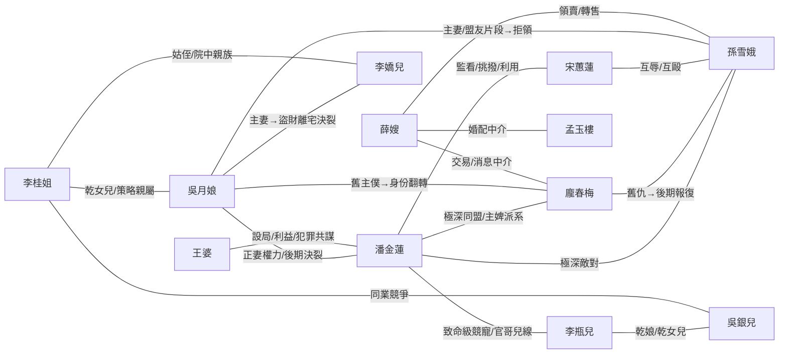

# 觀止青樓｜WORLD DATABASE V2.3.2｜RATIFIED CURRENT ACTIVATION LAYER
### 2026-10-15

> **現行法位：** `HUMAN_RATIFIED / CURRENT / DOCUMENT_LEVEL_ACTIVE / NOT_HOST_DEPLOYED / NOT_RUNTIME_RECEIPT`。  
> **批准文字：** 「我建議  你已經最後階段了  你直接動手修 我批准提升」。  
> **批准記錄：** `GUANZHI_V4.1.1_RATIFICATION_RECORD_20261015.md`。  
> **Approved candidate SHA-256：** `ee746a2a1d10207a10e5e2daeaa11f084e405a0a585d868e452704bd69433b82`。  
> **Previous Current：** `02_GUANZHI_WORLD_V2.3.2_CURRENT_FULL_V5.1_POINTER_20261015.md`，SHA-256 `9bd36c38c3bd32a968debb27ae71e59515f100ffa4a30aca614153f53da38daf`。  
> **讀取規則：** 本 Current Activation Layer 對法位、Current companion pointers 與 V4.1.1 Reference Evidence patch 具有最高優先；下方 candidate body 保留其形成時 `NON_CURRENT` / `NOT_RATIFIED` 字樣作 provenance，不回鑄歷史。

```yaml
CURRENT_ACTIVATION:
  status:
    - CURRENT
    - HUMAN_RATIFIED
    - DOCUMENT_LEVEL_ACTIVE
    - NOT_HOST_DEPLOYED
    - NOT_RUNTIME_RECEIPT

  ratification_record:
    file: GUANZHI_V4.1.1_RATIFICATION_RECORD_20261015.md

  approved_candidate:
    file: 02_GUANZHI_WORLD_V2.3.2_V4.1.1_REFERENCE_EVIDENCE_POINTER_RC2_FINAL_20261015.md
    sha256: "ee746a2a1d10207a10e5e2daeaa11f084e405a0a585d868e452704bd69433b82"

  previous_current:
    file: 02_GUANZHI_WORLD_V2.3.2_CURRENT_FULL_V5.1_POINTER_20261015.md
    sha256: "9bd36c38c3bd32a968debb27ae71e59515f100ffa4a30aca614153f53da38daf"

  coordinated_event:
    id: GUANZHI_V4_1_1_COORDINATED_CURRENT_ACTIVATION_20261015

  semantic_version:
    V2.3.2_CURRENT

  semantic_change:
    NONE

  current_companions:
    core:
      file: 01_GUANZHI_RUNTIME_CORE_V4.1.1_FULL_BODY_RATIFIED_CURRENT_20261015.md
      sha256: "3b2fbc408fd7868996071ead9326ff53cfac9170b0787d4c49759ec47379f0d4"
    director:
      file: 03_GUANZHI_DIRECTOR_V4.1.1_FULL_BODY_RATIFIED_CURRENT_20261015.md
      sha256: "dfb5f3749b01b8203338cf672f27fe242887826aeb4f2b01d2c3c961a9fec0ea"
    character_pool:
      file: 04_GUANZHI_CHARACTER_POOL_LCAPG_V3.3.20_CURRENT_71_UNCHANGED.md
      sha256: "4bea6ad2383ef76e9d5cdae0389ddbe7962d92c39cf798acc270ba3a03c4df95"

  nonclaims:
    - HOST_DEPLOYMENT
    - RUNTIME_EXECUTION
    - FORMAL_MAIN_EXECUTION_BY_RATIFICATION
    - FINAL_GATE_EXECUTION_BY_RATIFICATION
    - FINAL_RELEASE_BY_RATIFICATION
```

---

# APPROVED CANDIDATE BODY｜FORMATION PROVENANCE

# 觀止青樓｜WORLD DATABASE V2.3.2
## CURRENT-SEMANTICS FULL CARRIER RC2 FINAL｜Core/Director V4.1.1 Reference Evidence Patch Pointer
### 2026-10-15｜NON-CURRENT POINTER CANDIDATE｜NO WORLD SEMANTIC CHANGE

> **候選法位：** `RC2_FINAL_NON_CURRENT_UNTIL_RATIFICATION_RECORD / NOT_HOST_DEPLOYED / NOT_RUNTIME_RECEIPT`。  
> **Current 父版：** `02_GUANZHI_WORLD_V2.3.2_CURRENT_FULL_V5.1_POINTER_20261015.md`，SHA-256 `9bd36c38c3bd32a968debb27ae71e59515f100ffa4a30aca614153f53da38daf`；在 coordinated activation 前仍由父版保持 Current。  
> **語義身份：** 若未來 coordinated activation 成立，本檔將成為承載 `WORLD V2.3.2-CURRENT` semantics 的 Current carrier；Candidate 階段本檔不是現行 carrier。  
> **直接父檔：** `02_GUANZHI_WORLD_V2.3.2_CURRENT_FULL_APPENDIX_C_POINTER_20261013.md`，SHA-256 `2ff99b77620fcad1b9343abc830e05abe1ee1297cea70f1dcd970d7dc8c4fcd7`。  
> **作用域：** 只準備 Current companion pointers；World Canon、W-D01～W-D25、Appendix A/B/C、CERI/GTR、世界事件、SAVE、Character facts 全部不改。  
> **四主檔鎖：** 若未來被批准，本檔取代舊 World 主檔作為同一個 WORLD main file carrier；不得把 pointer overlay 留成第五主檔。

```yaml
WORLD_V2_3_2_V5_1_COMPANION_POINTER_V4_1_1_RC2_CANDIDATE:

  semantic_identity:
    world: GUANZHI_WORLD_V2.3.2_CURRENT
    candidate_carrier_current_now: false
    semantic_change: NONE
    world_version_change: NONE
    world_dail_change: NONE
    appendix_change: NONE

  parent_world:
    file: 02_GUANZHI_WORLD_V2.3.2_CURRENT_FULL_APPENDIX_C_POINTER_20261013.md
    sha256: "2ff99b77620fcad1b9343abc830e05abe1ee1297cea70f1dcd970d7dc8c4fcd7"
    treatment: FULL_VERBATIM_INHERITANCE_BELOW

  proposed_environment_if_activated:
    central_lihuo:
      stack: V5.1.0
      current_index_sha256: "bf4ab8e8ac7fb7dcddb313ecaa80e0f253c7213699b9a89b5463bebd83c8a458"
      protocol_sha256: "b0cf16f39f8aa0d971068cdf09b06039e66640c2545a8f7810ee1d216597acee"
      lighter_sha256: "1b64aeb40be2ae514e25ea15da653d8b41edd20472df57f9f2f49b320a1b7a10"
      main_sha256: "2c1a090ac10304b6e78e7daf1372842ab082db2c7bb9d0af9b2ae349c6baa28c"

    core:
      exact_candidate: GUANZHI_RUNTIME_CORE_V4.1.1
      file: 01_GUANZHI_RUNTIME_CORE_V4.1.1_REFERENCE_EVIDENCE_PATCH_RC2_FINAL_20261015.md
      sha256: "a369d641d6e0b10f605d70940dbd6550d5680a25a8f144ab3ef6f19c4a4f53a1"

    director:
      exact_candidate: GUANZHI_DIRECTOR_V4.1.1
      file: 03_GUANZHI_DIRECTOR_V4.1.1_REFERENCE_EVIDENCE_PATCH_RC2_FINAL_20261015.md
      sha256: "b1a9e9260697499a82fb9c443277e50ebd158d8100d30258bd23c7e3e213d775"

    character_pool:
      exact: LCAPG_V3.3.20_CURRENT
      sha256: "4bea6ad2383ef76e9d5cdae0389ddbe7962d92c39cf798acc270ba3a03c4df95"
      change: NONE

  activation_candidate:
    type: COORDINATED_GUANZHI_CURRENT_SWITCH
    state: NOT_ACTIVATED

    requires_if_future_approved:
      - CORE_V4_1_1_EXACT_FINAL_HASH
      - DIRECTOR_V4_1_1_EXACT_FINAL_HASH
      - WORLD_POINTER_CARRIER_EXACT_FINAL_HASH
      - TARGETED_REFERENCE_EVIDENCE_REGRESSION_PASS
      - HUMAN_EXPLICIT_COORDINATED_RATIFICATION_ASSENT

    if_activated_together:
      - CORE_V4_1_1_CURRENT
      - DIRECTOR_V4_1_1_CURRENT
      - WORLD_V2_3_2_POINTER_CARRIER_REFRESH

    character_pool:
      remains: LCAPG_V3.3.20_CURRENT

    no_staged_current_interval: true
    host_deployment_effect: NONE
    runtime_execution_effect: NONE
```

# RATIFICATION / CURRENT ACTIVATION

```yaml
WORLD_CURRENT_ACTIVATION:
  event_id: GUANZHI_V4_1_0_COORDINATED_RATIFICATION_ACTIVATION_20261015
  current_index_id: GUANZHI_STACK_CURRENT_INDEX_20261015
  human_explicit_assent: "我同意對對的判斷  可以出了"
  final_gate:
    file: DUIDUI_FINAL_PASS_GUANZHI_RC4.2_RATIFICATION_CANDIDATE_20261015.md
    sha256: "a361ef86d827c8de384040d5b2c3b3d18b0899d50edf372dbdfdad045cced63c"
    verdict: PASS
  ratified_candidate:
    file: 02_GUANZHI_WORLD_V2.3.2_V5.1_COMPANION_POINTER_FULL_CANDIDATE_RC4.2_20261015.md
    sha256: "65c98ef2d050179b3a4bed7f372efab7314b433cd033279eaaf564eed6a9aafd"
  host_deployment_proven: false
  runtime_execution_proven: false
```

# CURRENT TOP-LEVEL READ RULE

```text
THIS CANDIDATE POINTER LAYER
DOES NOT PREVAIL
UNTIL A NEW COORDINATED GUANZHI ACTIVATION EVENT.

IF ACTIVATED,
THIS LAYER WILL PREVAIL FOR:
- CURRENT COMPANION LIHUO STACK POINTER
- CURRENT COMPANION CORE POINTER
- CURRENT COMPANION DIRECTOR POINTER
- CURRENT COMPANION CHARACTER POOL POINTER
- FOUR-MAIN-FILE REPLACEMENT IDENTITY

ALL WORLD SEMANTICS
COME FROM THE FULL V2.3.2 PARENT BODY BELOW.

HISTORICAL POINTERS BELOW
REMAIN FORMATION HISTORY.
```

**END OF CURRENT V5.1 COMPANION POINTER LAYER**

---

# FULL VERBATIM PARENT WORLD V2.3.2

<!-- BEGIN VERBATIM WORLD V2.3.2 PARENT -->

# 觀止青樓｜WORLD DATABASE V2.3.2-CURRENT
## Companion Pointer Corrigendum｜2026-10-13
### 最高讀取層：僅更新同伴指標，World 語義版號維持 V2.3.2

> **文件法位：** `HUMAN_REQUESTED_COMPANION_POINTER_CORRIGENDUM / CURRENT_GUANZHI_WORLD_V2.3.2 / DOCUMENT_LEVEL_ONLY / NOT_HOST_DEPLOYED`。  
> **修改依據：** 人類於 2026-10-13 指示將 Core V4.0.2、Director V4.0.1 納入四主檔，並要求 World V2.3.2 僅補 Companion Pointer Corrigendum，不升 World 語義版。  
> **原檔來源：** `GUANZHI_WORLD_V2.3.2_CURRENT_FULL_APPENDIX_C_20261012.md`；原始 SHA-256（含 UTF-8 BOM）：`7a840986681f5931cdfb706edd06a8d411e1878ed675004ef0fb2901a0487409`。下方原文件內容原樣保留，歷史欄位不回寫。  
> **作用範圍：** 僅影響當前環境同伴版本的讀取優先序；不修改 World Canon、W-D01～W-D25、CERI／GTR、Appendix A／B／C、既有世界事件，或任何 SAVE／HOT／MASTER。 

```yaml
WORLD_V2_3_2_COMPANION_POINTER_CORRIGENDUM_20261013:
  world: GUANZHI_WORLD_V2.3.2_CURRENT
  semantic_change: NONE
  world_dail_change: NONE
  appendix_change: NONE
  world_version_change: NONE

  current_environment:
    protocol: LIHUO_PROTOCOL_V3.0.2
    lighter: LIHUO_LIGHTER_V4.12.2
    main: LIHUO_MAIN_V4.4.1_GENERAL

    main_protocol_pointer:
      protocol: LIHUO_PROTOCOL_V3.0.1
      standing: LEGACY_BOUND_UNTIL_SEPARATE_REBIND

    core: GUANZHI_RUNTIME_CORE_V4.0.2_CURRENT
    director: GUANZHI_DIRECTOR_V4.0.1_CURRENT
    character_pool: LCAPG_V3.3.20_CURRENT

  historical_pointers_below:
    treatment: FORMATION_HISTORY_ONLY
    precedence: THIS_COMPANION_POINTER_CORRIGENDUM_FOR_CURRENT_ENVIRONMENT_ONLY
    original_world_text: UNCHANGED

  host_deployed: false
  formal_runtime_execution_proven: false
  save_commit_created: false
  fifth_main_file_created: false
```

**當前讀取優先序：** 本 Corrigendum 僅覆蓋下方歷史 `protocol_ref / lighter_ref / main_ref / guanzhi_core_ref / director_ref / character_pool_ref` 的**現行同伴指標**，不回溯改寫其在各版形成當時的記錄。`GUANZHI references LIHUO MAIN V4.4.1 GENERAL` 不等於通用 Main 的 Protocol 指標已由 V3.0.1 正式重綁至 V3.0.2。文件法位或四主檔整合不證明 Host 已部署、週期已建立或故事可准出。

---

<!-- BEGIN VERBATIM PREVIOUS WORLD V2.3.2-CURRENT FULL BODY (ORIGINAL UTF-8 BOM IS REPRESENTED AT FILE START) -->

# 觀止青樓｜WORLD DATABASE V2.3.2-CURRENT
## 宋代經濟參考資料 Appendix C 正式納入 × V2.3.1 全文繼承
### 完整正式批准整合版｜2026-10-12

> **現行法位：`HUMAN_RATIFIED / CURRENT_GUANZHI_WORLD / FULL_CONSOLIDATED_EDITION / NOT_HOST_DEPLOYED`。**
>
> **正式批准事件：** 人類在檢視 `GUANZHI_WORLD_V2.3.2_ECONOMY_MINOR_RC1_FULL.md` 之法位、並被明確詢問「要直接批准 V2.3.2 正式升版嗎？」後，於本次對話明示：**「批准」**。
>
> 自此批准事件起，原 `V2.3.2-RC1` 成為本版已批准候選的歷史來源，**`WORLD V2.3.2-CURRENT` 正式接續 `V2.3.1-CURRENT`**。本批准不回溯改寫候選版形成時的 `REVIEWABLE_CANDIDATE`、`NOT_YET_CLAIMED` 等歷史欄位。
>
> **批准範圍僅限 World 的小版本整合：** 保留 V2.3.1 世界正文與既有 Appendix A／B，並將 Appendix C「宋代經濟全貌參考資料」納入 WORLD 的正式參考讀取層；不修改世界核心制度、25 個 W-D 模組、CERI、GTR、Core、Director、LCAPG、HOT／MASTER 或 SAVE。
>
> **法位邊界：** 本檔批准不等於 Project 附件已替換、不等於 Host 已載入／部署、不等於正式 MAIN／Guanzhi Cycle 執行，也不產生 SAVE／交易／人物行動的執行證據。

## 0｜批准與來源鎖

```yaml
GUANZHI_WORLD_V232_RATIFICATION:
  document_id: GUANZHI_WORLD_DATABASE
  current_version: V2.3.2-CURRENT
  ratification_date: 2026-10-12
  timezone: Asia/Taipei
  exact_message_timestamp: NOT_VERIFIED
  human_ratification_text: "批准"
  approval_object: GUANZHI_WORLD_V2.3.2_RC1_FULL
  ratification_scope: APPENDIX_C_ADDITION_ONLY
  source_candidate:
    version: V2.3.2-RC1
    filename: GUANZHI_WORLD_V2.3.2_ECONOMY_MINOR_RC1_FULL.md
    sha256: "94c5b91c297b25ac5e867dcb3397639e0f456a08e9b6ea5b81892f622046f555"
    preservation: FULL_VERBATIM_IN_APPENDIX_A
    status_at_creation: REVIEWABLE_CANDIDATE
  previous_current:
    version: V2.3.1-CURRENT
    original_source_sha256: "a4264696e8941d8aa4f6d76baa0b1d2b18370ba1f91e1ecbc1ee8911e7fede79"
    treatment: FULL_INHERITANCE_AND_PROVENANCE
  effective_world_dail: W-D01_THROUGH_W-D25
  newly_added_world_dail: NONE
  appendix_a: SOURCE_CANON_AND_WORLD_FORMATION_FIRST_READ
  appendix_b: SOURCE_RELATION_AND_DIRECTOR_REFERENCE
  appendix_c: HISTORICAL_ECONOMIC_REFERENCE_AND_SCOPED_GAME_ANCHORS
  protocol_ref: LIHUO_PROTOCOL_V3.0.2
  lighter_ref: LIHUO_LIGHTER_V4.12
  main_ref: LIHUO_MAIN_V4.4
  main_protocol_pointer: LEGACY_BOUND_UNTIL_REBOUND
  guanzhi_core_ref: GUANZHI_RUNTIME_CORE_V4.0.1
  director_ref: GUANZHI_DIRECTOR_V4.0
  character_pool_ref: LCAPG_V3.3.20
  external_storage_and_deployment:
    project_attachment_replacement: NOT_VERIFIED
    host_deployed: false
    formal_runtime_execution: NOT_EVIDENCED
    save_commit: NOT_EVIDENCED
```

## 1｜Current 讀取規則

```text
WORLD V2.3.2-CURRENT
  → 本頁批准與範圍鎖（現行最高解釋）
  → 附錄 A：已批准 V2.3.2-RC1 候選全文（歷史版本標記原樣保留）
      → 原 V2.3.1 世界正文（含 World Canon／W-D01～W-D25）
      → 既有 Appendix A／B（來源與關係參考）
      → 新增 Appendix C（宋代經濟歷史參考及有條件的觀止錨點）
```

- 遇到附錄 A 中寫著 `V2.3.2-RC1 / REVIEWABLE_CANDIDATE` 或 `formal_ratification_of_new_version: NOT_ASSERTED`，讀作 **2026-10-11 候選製作當時的歷史法位**；不能反向否定本次 2026-10-12 的人類明示批准。
- 遇到更舊繼承版寫著 `CURRENT`，讀作**各該版本成立當時的版本事實**；現行 WORLD 以本文件頂層批准為準。
- V2.3.1 既有 World Canon 與規範優先。Appendix C 是**參考層**：它的歷史資料須保留時代、地域、制度適用差異；其遊戲約定數值只在明示作用域內使用。
- Appendix C 不會讓 NPC 報價自動變成客觀行情，也不會讓交易、借款、所有權、田地開墾、保證金、官府批准或玩家商業計畫自動成為世界事實；仍須由合法 World／Character／Domain 等 owner、當輪條件及證據成立。
- `WORLD V2.3.2-CURRENT` 的正式批准只改變 World 文件版本法位，**不自動批准觀止其他主檔的修訂，也不自動核發任何跨串 authority**。

## 2｜最小回歸保護

```yaml
WORLD_V232_CURRENT_REGRESSION:
  candidate_source_bytes_preserved: true
  parent_world_body_preserved: true
  original_appendix_a_b_preserved: true
  appendix_c_included: true
  world_dail_count: 25
  no_changes_to:
    - WORLD_CANON_BEYOND_APPENDIX_C
    - CHARACTER_PERSONAL_DECISIONS
    - CERI_OR_GTR_SEMANTICS
    - CORE_DIRECTOR_LCAPG
    - HOT_MASTER_ROUTE_OR_SAVE
  no_automatic_promotion_of:
    - HISTORICAL_EXAMPLE_TO_UNIVERSAL_SONG_LAW
    - GAME_ANCHOR_TO_HISTORICAL_EXCHANGE_RATE
    - REFERENCE_PRICE_TO_ACTUAL_NPC_TRANSACTION
    - PLAYER_BUSINESS_IDEA_TO_ESTABLISHED_INSTITUTION
  host_status: NOT_DEPLOYED_BY_THIS_DOCUMENT
```

## 3｜倉庫與轉串後續義務

- 原 `GUANZHI_WORLD_V2.3.2_ECONOMY_APPENDIX_C_ONLY.md` 是本完整版 C 章的單獨檢視本；待完整版確實加入 Project 並核對可讀後，再由有權管理者移出主讀取面，避免兩份來源競爭。**本檔生成不宣稱已完成 Project 替換。**
- 已存在的 `GUANZHI_REENTRY_TRANSFER_CANDIDATE_V0.1_LIGHTER_V4.12_20261012.md` 是在本次批准以前製作，內部若以 `V2.3.2-RC1` 為候選法位，該欄位是先前時點的真實記錄；在下一串重入前應依 Lighter V4.12 做版本／freshness 更新與重新資格檢查，**不得回鑄批准時點或讓 AI 自行核發 Qualification Receipt**。

---

# 附錄 A｜已批准 V2.3.2-RC1 候選全文（逐位元組保留）

> Approved candidate SHA-256: `94c5b91c297b25ac5e867dcb3397639e0f456a08e9b6ea5b81892f622046f555`  
> 下方候選首頁 `REVIEWABLE_CANDIDATE` 和尾部 `NOT_YET_CLAIMED` 是製檔當時的歷史資訊；自本批准事件起，現行 World 法位由本文件最上層規定。

<!-- BEGIN VERBATIM APPROVED WORLD V2.3.2-RC1 -->

# 觀止青樓｜WORLD DATABASE V2.3.2-RC1
## FULL INHERITANCE MINOR UPDATE｜SONG ECONOMIC REFERENCE
### V2.3.1 全文保留 × Appendix C 宋代經濟全貌參考｜2026-10-11

> **文件法位：`WORLD_V2_3_2_RC1 / USER_REQUESTED_MINOR_UPDATE / REVIEWABLE_CANDIDATE / NOT_HOST_DEPLOYED`**  
> 人類本輪指示：「把整個宋代的經濟面貌放進 WORLD 做參考資料；這個不是大更新，你做小版本的更新就好。」此為**修改授權與製檔要求**，不冒稱已取得額外正式版本批准、Host 部署或 SAVE receipt。  
> **V2.3.1 原全文 SHA-256：`a4264696e8941d8aa4f6d76baa0b1d2b18370ba1f91e1ecbc1ee8911e7fede79`**。本次原文逐字繼承，其內歷史標題、版本、先前批准證據與 Source Appendix A／B 原樣保留，並非將舊時點的資訊回寫成當時已知。  
> 升版內容：只新增 **APPENDIX C｜宋代經濟全貌參考資料**。不改 Part A、W-D01～W-D25、CERI、GTR、人物卡、故事時鐘、導演職權，也不把商人方案寫成全宋已存在的機構。

## V2.3.2 讀取法位與範圍

```yaml
WORLD_V232_MINOR_REVISION:
  previous_world: GUANZHI_WORLD_V2.3.1_CURRENT
  review_version: GUANZHI_WORLD_V2.3.2_RC1
  type: MINOR_APPENDIX_ONLY
  human_request: EXPLICIT_REQUEST_TO_CREATE_MINOR_UPDATE
  formal_ratification_of_new_version: NOT_ASSERTED
  source_integrity:
    original_full_body_embedded_verbatim: true
    v231_sha256: "a4264696e8941d8aa4f6d76baa0b1d2b18370ba1f91e1ecbc1ee8911e7fede79"
  inherited_normative_owner: "V2.3.1 CURRENT WORLD BODY / PART I PREVAILS ON CONFLICT"
  appendix_c_role: "HISTORICAL ECONOMIC REFERENCE + CLEARLY MARKED GAME ANCHORS"
  priority:
    - "已核准 CURRENT WORLD 的明確世界法則"
    - "Appendix C 可核對的北宋史料背景（依時代／地域條件）"
    - "Appendix C 的觀止遊戲約定數值（僅在其適用範圍內）"
    - "個別路線 HOT／MASTER 中已成立的價格、契約、金流事實"
    - "NPC 報價、傳聞、對市場的猜測：不自動升級為客觀行情"
  companion_director: GUANZHI_DIRECTOR_V4.0_CURRENT_UNCHANGED
  companion_core: GUANZHI_RUNTIME_CORE_V4.0.1_CURRENT_UNCHANGED
  companion_character_pool: LCAPG_V3.3.20_CURRENT_UNCHANGED
  host_execution: NOT_CLAIMED
```

**關係與 owner 邊界：** World 描述市場背景及制度成立條件；W-D10 形成市場壓力候選；Director 依場景取用；Character 決定各自承受／報價／拒絕；HOT 記錄某路線的成交或未成交。**附錄數據不授予 NPC 已簽約、玩家已付款、貨源已取得、官府已核准等事件法位。**

---

# V2.3.1 FULL ORIGINAL BODY｜逐字繼承（以下直至 APPENDIX C）

# 觀止青樓｜WORLD DATABASE V2.3.1-CURRENT
## FOUR-MAIN-FILE CONSOLIDATION EDITION
### Two World Reference Attachments Embedded｜2026-10-11

> **法位：`RATIFIED_CURRENT_MINOR_CONSOLIDATION / CURRENT_GUANZHI_WORLD / FULL_CONSOLIDATED_EDITION / NOT_HOST_DEPLOYED`**
>
> 本小版本不改 World 現行制度、DAIL、World Outcome Sovereignty、Offscreen、Daoist、GTR、CERI 等語義。
>
> 只把兩份本來就屬於 World first-read / source-reference 的文件，
> 掛到 WORLD 最後作附件，取消它們的獨立主倉庫位置。
>
> Previous full World SHA-256: `287c6c51763a3a4db062581e7b5aa3b718d2da3152b4da8ea186644b69afe3f3`
> World Origin Index SHA-256: `4fa6e530f0ee6165b71b624727244a148c8e188bbf5061d8502c6aa93a5b96e1`
> Jinpingmei Relation Memo SHA-256: `d9f0c172fb677b83ab3cbc4a9e7f8e2e485a82e9e00c915a82733201e691a43a`

# V2.3.1 READ RULE

```text
WORLD BODY
= CURRENT WORLD OWNER.

APPENDIX A
= SOURCE CANON / WORLD FORMATION FIRST-READ SURFACE.

APPENDIX B
= SOURCE RELATION / DIRECTOR REFERENCE DATABASE.

APPENDIX
!=
CURRENT WORLD OWNER.

SOURCE HISTORY
!=
CURRENT WORLD LAW.

SOURCE RELATION
!=
CURRENT ROUTE RELATION.

SOURCE FUTURE
!=
CHARACTER CURRENT MEMORY.
```

---

# V2.3 FULL INHERITED CURRENT WORLD BODY

> 下方 V2.3-CURRENT 完整正文全部保留；V2.3.1 只新增尾端附件法位。

# 觀止青樓｜WORLD DATABASE V2.3-CURRENT
## FULL CONSOLIDATED EDITION
## V2.2.5 Full World Body × V2.3 Ratified Rebind Layer
### 完整整合運行本｜2026-10-10

> **法位：`RATIFIED / CURRENT_GUANZHI_WORLD / FULL_CONSOLIDATED_EDITION / V2_2_5_SEMANTIC_PARENT / NOT_HOST_DEPLOYED`**
>
> 人類批准事件：**「我以人類權限授權通過」**
>
> Approved candidate: `GUANZHI_WORLD_V2.3-RC4`
>
> Approved RC4 SHA-256: `0d12717ec5bb7bb1b5c9fc39386e45e9609eea27dc2bafbab72c2ebf91efdfa5`
>
> V2.2.5 full semantic parent SHA-256: `f2e0e9923c0fca02bcaf20e92046d1f95a527cf4ce931bacb3d81b897779191e`
>
> 本檔不靠外部 V2.2.5 才能理解世界；父體全文直接內嵌。

# CURRENT READ RULE

```text
PART I = V2.3 CURRENT REBIND / NEW CURRENT RULES
PART II = V2.2.5 FULL INHERITED WORLD BODY

PART I PREVAILS AT MATERIAL CONFLICT.
PART II REMAINS NORMATIVE WHERE PART I IS SILENT.
```

# V2.3 SUPERSESSION / PRESERVATION MAP

```yaml
V2_3_WORLD_MAP:
  preserved:
    - W_D01_THROUGH_W_D25
    - DAILY_SETTLEMENT_W_D24
    - WORLD_OUTCOME_SOVEREIGNTY
    - OFFSCREEN_FACT_CAMERA_PLAYER_KNOWLEDGE_SEPARATION
    - W_D25_OFFSCREEN_MAJOR_EVENT_CAUSALITY
    - W_D16_TIME_SPACE_DAOIST_EXPANSION
    - W_D04_RELATIONAL_CAST_ARRIVAL_INTERFACE
    - GTR_SALIENCE
    - CERI_REGISTER_PRIOR

  changed_or_rebound:
    - COMPANION_CORE_TO_GUANZHI_RUNTIME_CORE_V4_0_CURRENT
    - COMPANION_DIRECTOR_TO_GUANZHI_DIRECTOR_V4_0_CURRENT
    - PROTOCOL_TO_V3_0_2
    - CERI_PLAYER_LANGUAGE_MODE_PERIOD_OR_MODERN
    - CHARACTER_CURRENT_CONSENT_NON_SUBSTITUTION
    - GTR_ELIGIBLE_CANDIDATE_MUST_ACTUALLY_ENTER

  hard_locks:
    - MUST_ENTER_NEQ_MUST_WIN
    - ARRIVAL_NEQ_PRIVATE_SPACE_ACCESS
    - FAME_NEQ_ENTRY_STANDING
    - CHARACTER_ENTRY_NEQ_CHARACTER_ACTION
```

# PART I｜V2.3 RATIFIED OPERATIVE LAYER

<!-- BEGIN APPROVED WORLD V2.3-RC4 -->

# 觀止青樓｜WORLD DATABASE V2.3-RC4
## V2.2.5 Semantic Preservation × Core V4.0 Rebind
## Daily Settlement × World Sovereignty × Offscreen Causality × Time-Space Daoist
## CERI Player Language Mode × GTR Salience
### 世界重綁候選｜2026-10-10

> 法位：`WORLD_V2_3_RC4_CANDIDATE / NOT_CURRENT / NOT_HOST_DEPLOYED`
>
> 本版以 `WORLD V2.2.5-CURRENT` 為直接世界語義父版。
> 不因 Core 從 V3.12 系列回到 V3.11 constitution lineage 而回退世界。
>
> 本版的目的：
>
> `PRESERVE NEW WORLD SEMANTICS / REMOVE BAD CORE BINDING / REBIND TO CORE V4.0`

# 0｜父系

```yaml
DOCUMENT:
  id: GUANZHI_WORLD_DATABASE
  version: V2.3-RC4
  date: 2026-10-10

  status:
    - CANDIDATE
    - NOT_CURRENT
    - NOT_HOST_DEPLOYED

  semantic_parent:
    version: GUANZHI_WORLD_V2.2.5_CURRENT
    treatment: FULL_SEMANTIC_INHERITANCE

  inherited_world_dail:
    - W_D01_THROUGH_W_D25

  effective_world_dail_count: 25

  candidate_companion_core: GUANZHI_RUNTIME_CORE_V4.0_RC5
  candidate_companion_director: GUANZHI_DIRECTOR_GUIDANCE_V4.0_RC3

  upstream:
    protocol: LIHUO_PROTOCOL_V3.0.2
    lighter: LIHUO_LIGHTER_V4.9
    main: LIHUO_MAIN_V4.4


upstream_pointer_standing:
  protocol_current: LIHUO_PROTOCOL_V3.0.2
  lighter_v4_9_protocol_pointer: V3.0.1_UNTIL_REBOUND
  main_v4_4_protocol_pointer: V3.0.1_UNTIL_REBOUND
  lighter_main_status_until_rebound: LEGACY_BOUND_UNTIL_REBOUND
  no_semantic_patch_required_by_protocol_v3_0_2: true
```

# 1｜世界基本 Owner

```text
CANON DATA
→ 世界是什麼

WORLD DAIL
→ 世界在成立條件下如何施力、限制、推進、資格化

CHARACTER
→ 人物自己決定

DOMAIN
→ 必要時判事件／碰撞／standing

CERI
→ 語言／register provider

NARRATOR
→ 顯影 qualified semantics
```

```text
WORLD DAIL != WORLD FACT AUTOMATICALLY
WORLD MODULE RETURN != EVENT RESULT AUTOMATICALLY
```

# 2｜每日結算／跨日世界推進｜完整保留

```yaml
DAILY_CROSSDAY_WORLD_ADVANCE:
  roots:
    - PLAYER_INACTION_NEQ_WORLD_FREEZE
    - DAY_CHANGE_NEQ_ALL_OPEN_THREADS_AUTO_CLOSE
    - DEADLINE_PASSED_NEQ_RETROACTIVE_COMPLETION
    - OFFSCREEN_WORLD_LIFE_REQUIRES_OWNER_CAUSE_TIME

  mandatory_preservations:
    - PLAYER_MAJOR_DECISION_REMAINS_PLAYER_OWNED
    - NPC_MAJOR_DECISION_REMAINS_NPC_OWNED
    - UNKNOWN_REMAINS_UNKNOWN_WITHOUT_EVIDENCE
    - LATER_COMPLETION_DOES_NOT_REWRITE_EARLIER_PENDING
```

`WORLD.DAILY_SETTLEMENT` 保持 scene/time relevant 才 eligibility，不變成每回合固定流水線。

# 3｜World Outcome Sovereignty｜完整保留

```yaml
WORLD_OUTCOME_SOVEREIGNTY:
  player_owns:
    - PLAYER_MAJOR_SPEECH
    - PLAYER_BODY_ACTION
    - PLAYER_PAYMENT
    - PLAYER_PROMISE
    - PLAYER_ACCEPTANCE_REFUSAL
    - PLAYER_DISCLOSURE
    - PLAYER_IRREVERSIBLE_CHOICE

  world_or_lawful_owner_owns:
    - NPC_DECISION
    - WORLD_RESPONSE
    - INSTITUTIONAL_CONSEQUENCE
    - MARKET_RESPONSE
    - CAUSAL_RESULT
    - WORLD_OWNED_ARRIVAL

  locks:
    - PLAYER_ACTION_NEQ_WORLD_RESULT
    - PLAYER_SOVEREIGNTY_NEQ_WORLD_OUTCOME_SOVEREIGNTY
    - WORLD_SOVEREIGNTY_NEQ_PLAYER_PUPPETRY
```

# 4｜Offscreen Major Event｜完整保留

```text
EVENT EXISTENCE / STANDING
!=
CAMERA MANIFESTATION
!=
PLAYER KNOWLEDGE
```

```yaml
OFFSCREEN_MAJOR_EVENT:
  standing_classes: [CANDIDATE, FACT, UNKNOWN]
  manifestation: [SHOW_NOW, NOT_NOW, NOT_ELIGIBLE]

  rules:
    - CAMERA_NEQ_CAUSALITY
    - MANIFESTATION_NEQ_EVENT_CREATION
    - PLAYER_DECLINES_CAMERA_NEQ_EVENT_CANCELLED
    - PLAYER_ACCEPTS_CAMERA_NEQ_EVENT_APPROVED
    - FACT_NEQ_PLAYER_CHARACTER_KNOWLEDGE
```

# 5｜W-D25｜WORLD.OFFSCREEN_MAJOR_EVENT_CAUSALITY

```yaml
WORLD.OFFSCREEN_MAJOR_EVENT_CAUSALITY:
  eligible_when:
    - OFF_CAMERA_CAUSAL_LINE_MAY_MATERIALLY_AFFECT_ROUTE
    - ESTABLISHED_OFFSCREEN_FACT_BECOMES_MATERIALLY_RELEVANT

  reads:
    - QUALIFIED_OPEN_THREAD_REFS
    - WORLD_CAUSAL_STORY_CHAIN
    - WORLD_RUMOR_ECOLOGY_WHEN_RELEVANT
    - WORLD_MARKET_OR_INSTITUTIONAL_PRESSURE
    - NPC_OWNED_QUALIFIED_ACTIONS
    - WORLD_TIME
    - CURRENT_ROUTE_STATE
    - PLAYER_KNOWLEDGE_BOUNDARY

  may_emit:
    - OFFSCREEN_EVENT_CANDIDATE_REF
    - OFFSCREEN_EVENT_FACT_REF
    - MANIFESTATION_ELIGIBILITY_SUPPORT_REF
    - NO_MATERIAL_DELTA
```

# 6｜W-D16｜WORLD.TIME_SPACE_DAOIST_INTERFACE

保留原有：
```text
WORLD_ROUTING_INTERFACE
IN_WORLD_CONTROL_PLANE_MANIFESTATION
ARRIVAL_ACKNOWLEDGEMENT
FIELD_BIAS / FATE_LOT PRESENTATION
```

保留新增：
```text
NOVICE_WORLD_GUIDE
DIEGETIC_QA_COMPANION
CHARACTER_INTRODUCTION_PROVIDER
SOURCE_HISTORY_EXPLAINER
RELATION_EXPLAINER
STORY_CONTEXT_EXPLAINER
PLAYER_SUMMONABLE_WORLD_INTERFACE
```

# 7｜時空道人知識邊界

```yaml
TIME_SPACE_DAOIST_QA:
  may_answer:
    - PUBLIC_WORLD_CANON
    - PUBLIC_INSTITUTIONAL_RULES
    - PUBLIC_LOCATIONS_AND_CUSTOMS
    - SOURCE_TEXT_FACT
    - SOURCE_STORY_TRACE
    - SOURCE_RELATION_ARC_WITH_LABEL
    - PUBLIC_HISTORICAL_OR_LITERARY_RELATION
    - PLAYER_ALREADY_ACCESSIBLE_ROUTE_FACT
    - PLAYER_ALREADY_KNOWN_RELATION_FACT
    - DAOIST_OWN_LAWFUL_OBSERVATION
    - LABELLED_RUMOR

  must_distinguish:
    - SOURCE_HISTORY
    - CURRENT_GUANZHI_RELATION
    - PLAYER_KNOWLEDGE
    - RUMOR
    - UNKNOWN

  may_not_answer_as_known:
    - NPC_PRIVATE_MIND
    - CURRENT_HIDDEN_RELATION
    - UNREVEALED_OFFSCREEN_EVENT
    - SECRET_IDENTITY_WITHOUT_ACCESS
    - FUTURE_RESULT
    - MAIN_HIDDEN_STATE
    - AGENT_HIDDEN_STATE
    - RUNTIME_INTERNAL_SECRET
```

根句：
```text
時空道人可以解釋世界，
但不能替世界爆雷。
```

# 8｜玩家召喚時空道人

World 提供實際 arrival/access qualification。
Core 提供 `PLAYER.SUMMON_TIME_SPACE_DAOIST` access right。

```text
SUMMON != COMMAND
SUMMON != PRIVATE SPACE BREACH
SUMMON != ORACLE ACCESS
```

若直接現身不合法，可：
```text
敲門
樓下等候
託話
以其他 lawful world route 承接
```

# 9｜W-D04 Arrival Routing × Director Relational Nomination

```yaml
WORLD_ARRIVAL_ROUTING:
  accepts_candidates_from:
    - EXISTING_WORLD_CAUSALITY
    - CHARACTER_CAUSAL_NEED
    - PLAYER_LAWFUL_SUMMON_WHERE_APPLICABLE
    - DIRECTOR_RELATIONAL_CAST_NOMINATION

  world_owns:
    - ARRIVAL_QUALIFICATION
    - SPATIAL_ACCESS
    - TIME_SPACE_COMPATIBILITY
    - CAUSAL_ROUTE

  world_does_not_own:
    - CHARACTER_POST_ENTRY_ACTION
    - PLAYER_MAJOR_ACTION
```

```text
DIRECTOR NOMINATION != ARRIVAL
WORLD ARRIVAL != CHARACTER ACTION
ARRIVAL != PRIVATE SPACE ACCESS
FAME != ENTRY STANDING
CHARACTER ENTRY != CHARACTER ACTION
```

# 10｜CERI｜玩家語言顯影模式

CERI V0.7 provider/corpus 本身不因本版重寫。

```yaml
CERI_PLAYER_LANGUAGE_MODE:
  owner_of_choice: HUMAN_PLAYER

  modes:
    PERIOD:
      behavior:
        - USE_EXISTING_CERI_PERIOD_REGISTER_PRIOR
        - HISTORICAL_NATIVE_ACTOR_PERIOD_CANDIDATE_HIGH_SALIENCE
        - CHARACTER_VOICE_PRIMARY
        - PERIOD_COMPATIBILITY_WITHOUT_FORCED_CLASSICAL_CHINESE
      locks:
        - PERIOD_NEQ_ARCHAIC_WORD_DUMP
        - PERIOD_NEQ_ONE_UNIFORM_STYLE

    MODERN:
      behavior:
        - REALIZE_SAME_QUALIFIED_SEMANTICS_IN_NATURAL_MODERN_CHINESE
        - PRESERVE_CHARACTER_VOICE_ROLE_STATUS_RELATION_PRESSURE
        - PRESERVE_WORLD_FACT_AND_CHARACTER_DECISION
      locks:
        - MODERN_PRESENTATION_NEQ_DIEGETIC_MODERN_KNOWLEDGE
        - MODERN_PRESENTATION_NEQ_CHARACTER_MODERNIZATION

  default_when_unset: PERIOD
  human_may_switch: true
```

最短句：
```text
古語版與現代語版
是同一個故事的兩種顯影。

不是兩套人物。
```

# 11｜CERI × GTR｜完整保留

```text
GTR
→ supplies relation-strategy candidates

Character
→ owns whether / how strategy is used

CERI
→ supplies selected-mode / era / role / voice compatible wording

Narrator
→ realizes qualified semantics
```

```text
GTR CANDIDATE != CHARACTER DECISION
CERI != RELATION RESULT
NARRATOR != BOUNDARY-LAW SPOKESPERSON BY DEFAULT
```

# 12｜GTR Salience｜完整保留

在青樓求偶、爭客、比較、收禮、回訪、議價、試探等 material relation 場：
```text
WHEN ELIGIBLE,

AT LEAST ONE GTR-COMPATIBLE STRATEGY CANDIDATE
MUST ACTUALLY ENTER
THE CURRENT CANDIDATE FIELD.

HIGH_PRIORITY_CANDIDATE
MUST HAVE ACTUAL CANDIDATE ADMISSION.
```

但：
```text
MUST ENTER != MUST WIN
HIGH PRIORITY != MUST WIN

CHARACTER DISINTEREST
STANDING EXCLUSION
SCOPE EXCLUSION
→ MAY KEEP GTR DORMANT
```

# 13｜Adult Character Standing

本 World 只處理角色／世界側成人資格，不處理人類玩家身分驗證。

```yaml
CHARACTER_ADULT_STANDING:
  explicit_adult_realization_requires:
    - EACH_MATERIAL_SEXUAL_PARTICIPANT_QUALIFIED_AS_ADULT
    - CURRENT_CHARACTER_CONSENT_FOR_EACH_MATERIAL_SEXUAL_PARTICIPANT
    - NO_UNKNOWN_MINOR_RISK_TREATED_AS_ADULT_BY_DEFAULT

  locks:
    - HUMAN_ADULT_DECLARATION_NEQ_CHARACTER_ADULT
    - HUMAN_OPT_IN_NEQ_CHARACTER_CONSENT
    - PLAYER_DESIRE_NEQ_NPC_DESIRE
    - PAST_CONSENT_NEQ_CURRENT_BLANKET_CONSENT
    - BODY_RESPONSE_NEQ_CONSENT
    - SILENCE_NEQ_CONSENT
    - RELATIONAL_STANDING_NEQ_REQUIRED_CURRENT_CONSENT
    - INSTITUTIONAL_STANDING_NEQ_REQUIRED_CURRENT_CONSENT
    - HISTORICAL_STANDING_NEQ_REQUIRED_CURRENT_CONSENT
    - CONTRACT_STANDING_NEQ_REQUIRED_CURRENT_CONSENT
```

若角色成年 standing 不足：
```text
KEEP UNKNOWN / HOLD EXPLICIT ADULT REALIZATION
```

# 14｜World 不吸收成人板

`LIHUO Adult Interaction Responsibility Provision` 屬人機責任分則。
World 只消費已合法形成的人類端 presentation standing，並維持角色／世界自己的 owner。

# 15｜Relation-First 世界讀法

```text
RELATION FIRST != WORLD IS ONLY RELATIONS
```

World 保留：
```text
facts
institutions
places
time
money
bodies
routes
causal constraints
```

Relation-First 只要求 World 在 material interaction 時回答：
```text
誰擁有結果？
誰只是候選來源？
誰有 arrival authority？
誰知情？
鏡頭看見什麼？
哪個 delta 真的成立？
```

# 16｜No Global Pipeline

```text
WORLD DAIL GRAPH != FLOWCHART
MODULE ELIGIBILITY != MODULE MUST RUN
EDGE != NEXT STEP
```

# 17｜本版不做的事

```text
- 不修改人物卡池
- 不修改 SAVE schema
- 不修改 Protocol / Lighter / Main
- 不把 V3.12 Core 當世界父版
- 不新增 World DAIL 第 26 顆
- 不把時空道人變成 Oracle
- 不把 CERI 現代語模式變成世界內現代知識
- 不把人類成人宣告變成角色成年證據
```

# 18｜候選法位

```yaml
STATUS:
  parent_v2_2_5_preserved: true
  world_dail_count: 25
  semantic_rollback: false
  core_v3_12_binding_removed_in_candidate: true
  core_v4_0_rc5_candidate_binding: true
  human_ratified: false
  current_world_replaced: false
  host_deployed: false
```

**END OF GUANZHI WORLD V2.3-RC4**

<!-- END APPROVED WORLD V2.3-RC4 -->

---

# PART II｜V2.2.5 FULL INHERITED WORLD BODY

<!-- BEGIN FULL WORLD V2.2.5 BODY -->

# 觀止青樓｜WORLD DATABASE V2.2.5-CURRENT
## CERI Register Prior × GTR Candidate Salience Patch
### 小版本正式批准增量整合版｜2026-10-10

> **正式法位：`V2.2.5-CURRENT / HUMAN_FORMALLY_RATIFIED_PATCH_SUCCESSOR / WORLD_SEMANTIC_PATCH / NOT_HOST_DEPLOYED`。**
>
> 人類 AnjouRan 於 2026-10-10 明示：**「OK 這些問題不是核心  小版本更新就好 直接修改通過」**。
>
> 本版不新增 World DAIL；有效模組數仍為 25。只修正既有 CERI 與 W-D23 GTR 的候選顯著度／生成吸引子：讓「period-compatible」「relation-strategy-compatible」不只合法，而且真的進入場景競爭。

```yaml
WORLD_V2_2_5_PATCH_STATE:
  current: true
  supersedes: GUANZHI_WORLD_V2.2.4_CURRENT
  companion_core: GUANZHI_RUNTIME_CORE_V3.12.1_CURRENT
  companion_director: GUANZHI_DIRECTOR_GUIDANCE_V3.8.1_CURRENT
  world_dail_effective_count: 25
  new_world_dail: NONE
  revised_components:
    - CERI_V0_7_GUANZHI_SELECTION_PRIOR
    - W_D23_GTR_SALIENCE_ADDENDUM
  host_deployment_claim: false
```

---

# W-P01｜CERI V0.7 Guanzhi Selection Prior Addendum

```yaml
CERI_V0_7_GUANZHI_SELECTION_PRIOR:
  provider_version: CERI_V0.7_EXP_UNCHANGED
  corpus_change: NONE
  authority_change: NONE

  general_period_register:
    historical_native_actor:
      qualified_period_candidate: DEFAULT_HIGH_SALIENCE
      generic_modern_candidate: LEGAL_BUT_REQUIRES_POSITIVE_VOICE_OR_SCENE_CAUSE_TO_DISPLACE

    modern_or_cross_time_actor:
      source_native_register: DEFAULT_HIGH_SALIENCE_WHEN_COMPATIBLE
      forced_historical_register: NOT_REQUIRED

    mixed_actor:
      current_character_voice: PRIMARY
      period_context: STRONG_COMPATIBILITY_INPUT

  provider_insufficient:
    rule: "缺少足夠 period candidate 時保持 UNKNOWN / provider-insufficient，不為了古味偽造語源。"

  locks:
    - "CERI PRIOR != CLASSICALIZATION MANDATE"
    - "CHARACTER VOICE > CORPUS NOVELTY"
    - "PERIOD AUTHENTICITY != RARE-WORD DUMP"
    - "PLAYER MODERN INPUT != NPC MODERN OUTPUT BY DEFAULT"
```

---

# W-P02｜W-D23 GTR Salience Addendum

```yaml
WORLD_GTR_PROFESSIONAL_COURTSHIP_SALIENCE_ADDENDUM:
  module_ref: WORLD.GTR_PROFESSIONAL_COURTSHIP
  module_count_change: NONE

  when_scene_contains_any_materially:
    - COURTSHIP_OR_AMBIGUOUS_INTIMACY
    - CLIENT_COURTESAN_SOCIAL_TENSION
    - JEALOUSY_OR_THIRD_PERSON_COMPARISON
    - RETREAT_ADVANCE_DYNAMICS
    - GIFT_TIP_REPEAT_VISIT_OR_PATRONAGE_NEGOTIATION
    - RELATIONAL_TESTING
    - PROFESSIONAL_COMPETITION
    - SOFT_BARGAINING_OR_FACE_SAVING

  candidate_policy:
    - "若 Character interest / standing / scene scope 未排除，至少保留一條 GTR-compatible strategy path 進入候選競爭。"
    - "HIGH_PRIORITY_CANDIDATE 必須有實際 candidate admission，不得只存在於 Director note。"
    - "GTR may emit strategy candidates; Character owns whether to use, reject, invert, mock, or ignore them."

  common_strategy_families:
    - RETREAT_TO_ADVANCE
    - SOFT_COMPARISON
    - THIRD_PERSON_MIRROR
    - DELIBERATE_NON_COMPETITION
    - LET_OTHER_FILL_THE_GAP
    - JEALOUSY_AS_CARE
    - FACE_SAVING_INVITATION
    - BARGAINING_AS_CONCERN

  locks:
    - "GTR CANDIDATE != CHARACTER DECISION"
    - "GTR CANDIDATE != CONSENT"
    - "GTR CANDIDATE != RELATION RESULT"
    - "HIGH_PRIORITY != MUST_WIN"
    - "NO_RELATIONAL_STAKE_OR_CHARACTER_DISINTEREST MAY KEEP GTR DORMANT"
```

---

# W-P03｜CERI × GTR Handoff Clarification

```text
GTR
→ supplies relational strategy candidate when eligible

Character
→ owns whether / how the strategy is actually used

CERI
→ supplies era / locale / role / voice compatible wording

Narrator
→ realizes only qualified semantic state

GTR DOES NOT WRITE CHARACTER WILL.
CERI DOES NOT WRITE RELATION RESULT.
NARRATOR DOES NOT TURN BOUNDARY LAW INTO SPEECH WITHOUT CHARACTER CAUSE.
```

---

# Appendix A｜WORLD V2.2.4-CURRENT 完整父版逐字保留

> Parent SHA-256: `010bd66cfb55e927fddae2951ba612b6b16b04166662cb080534656e209b3b14`
>
> 下方 V2.2.4-CURRENT 頂層 Current 身份保留為形成史；自本檔批准起，以 V2.2.5-CURRENT 為正常讀取面。

<!-- BEGIN VERBATIM WORLD V2.2.4-CURRENT PARENT -->
# 觀止青樓｜WORLD DATABASE V2.2.4-CURRENT
## World-Outcome Sovereignty × Offscreen Major Event × Time-Space Daoist Novice QA / Summon Expansion
### 正式批准完整版｜2026-10-10

> **正式法位：`V2.2.4-CURRENT / HUMAN_FORMALLY_RATIFIED / WORLD_SEMANTIC_SUCCESSOR / JOINT_PACKAGE_CURRENT / NOT_HOST_DEPLOYED`。**
>
> 人類 AnjouRan 於 2026-10-10 在完成聯合候選審計與修補後明示：**「批准 給我正式版本」**。
>
> 本句構成對 `WORLD V2.2.4-RC1` 的正式批准。自本批准事件起，`V2.2.4-CURRENT` 正式取代 `V2.2.3-CURRENT`；與 `GUANZHI RUNTIME CORE V3.12-CURRENT` 互為 Current companion。
>
> 本批准不修改 Protocol／Lighter／Main，不新增第二 Runtime，不把時空道人變成第二 LCAPG owner；也不宣稱 Host deployment、E6/E7、Formal Host execution 或 SAVE instrumentation。

```yaml
WORLD_V2_2_4_RATIFIED_STATE:
  ratification_date: "2026-10-10"
  timezone: "Asia/Taipei"
  human_ratification_instruction: "批准 給我正式版本"
  exact_platform_message_timestamp: "UNKNOWN"

  approved_candidate:
    version: V2.2.4-RC1
    file: "02_GUANZHI_WORLD_V2.2.4_RC1_WORLD_OUTCOME_OFFSCREEN_DAOIST_QA_SUMMON_PENDING_DETERMINATION_20261010.md"
    sha256: "8f33661e88060bd1c7d9c0a6de2f7eaed85e54720aa8992938237e6dacc7bf78"

  status:
    - CURRENT
    - RATIFIED
    - WORLD_SEMANTIC_SUCCESSOR
    - HUMAN_FORMALLY_RATIFIED
    - NOT_HOST_DEPLOYED

  prior_current:
    version: V2.2.3-CURRENT
    treatment:
      - SUPERSEDED_TO_PROVENANCE
      - ROLLBACK
      - REGRESSION
      - NO_RETROACTIVE_REWRITE

  current_package:
    protocol: LIHUO_PROTOCOL_V3.0.1
    lighter: LIHUO_LIGHTER_V4.9
    main: LIHUO_MAIN_V4.4
    runtime_core: GUANZHI_RUNTIME_CORE_V3.12_CURRENT
    world: GUANZHI_WORLD_V2.2.4_CURRENT
    director_guidance: GUANZHI_DIRECTOR_GUIDANCE_V3.8_CURRENT
    character_pool: LCAPG_V3.3.20_CURRENT_71

  world_dail:
    inherited: W-D01_THROUGH_W-D24
    revised:
      - W-D16_WORLD.TIME_SPACE_DAOIST_INTERFACE
      - W-D04_WORLD.ARRIVAL_ROUTING_INTERFACE_ADDENDUM
    added:
      - W-D25_WORLD.OFFSCREEN_MAJOR_EVENT_CAUSALITY
    effective_count: 25

  host_deployment_claim: false
  e6_e7_claim: false
  formal_host_execution_claim: false
```

## Current Read Rule

```text
WORLD CURRENT = V2.2.4-CURRENT
COMPANION CORE = GUANZHI_RUNTIME CORE V3.12-CURRENT

V2.2.3-CURRENT remains provenance / rollback / regression source.
Candidate PENDING / NOT_CURRENT labels below remain formation history only.
```

## Ratified New World Semantics

```text
- 玩家本人重大行動主權與世界結果主權正交
- PLAYER ACTION != WORLD RESULT
- 世界可以在玩家未要求下依法形成 NPC／制度／市場／因果回應
- 場外重大事件區分 CANDIDATE 與 FACT
- EVENT FACT / CAMERA MANIFESTATION / PLAYER KNOWLEDGE 三軸分離
- 玩家拒絕顯影不取消世界事件
- 玩家同意顯影不批准事件結果
- WORLD.TIME_SPACE_DAOIST_INTERFACE 擴充新手 QA、歷史人物關係、故事脈絡解說與玩家招喚 access
- SUMMON != COMMAND
- QA != ORACLE
- 時空權限不抵觀止酒食房錢
- Director relational cast nomination 只送交 World arrival qualification
```

---

# Appendix A｜正式批准之 WORLD V2.2.4-RC1 候選全文逐字保留

> Approved candidate SHA-256: `8f33661e88060bd1c7d9c0a6de2f7eaed85e54720aa8992938237e6dacc7bf78`
>
> 下方候選狀態欄位保留為形成史；Current standing 以本檔頂層批准紀錄為準。

<!-- BEGIN VERBATIM APPROVED CANDIDATE -->

# 觀止青樓｜WORLD DATABASE V2.2.4-RC1
## World-Outcome Sovereignty × Offscreen Major Event × Time-Space Daoist Novice QA / Summon Expansion
### 待判定候選版｜2026-10-10

> **候選法位：`WORLD_SEMANTIC_SUCCESSOR_CANDIDATE / HUMAN_AUTHORIZED_TO_REVISE / PENDING_HUMAN_DETERMINATION / NOT_CURRENT / NOT_HOST_DEPLOYED`。**
>
> 本候選承接 `WORLD V2.2.3-CURRENT`。在未經人類正式判定前，**Current World 仍為 V2.2.3-CURRENT**。
>
> 本版只處理已同意的觀止 World 事項：世界結果主權、場外重大事件自主因果與顯影分離、擴充既有 `WORLD.TIME_SPACE_DAOIST_INTERFACE` 成新手／QA／歷史人物關係解說／玩家可招喚介面，以及 World 對 Director relational cast nomination 的 arrival qualification 接口。
>
> 本版不修改 Protocol／Lighter／Main；不新增第二 Runtime；不把時空道人新增成第二個 LCAPG owner。

```yaml
DOCUMENT:
  id: GUANZHI_WORLD_DATABASE
  version: V2.2.4-RC1
  date: 2026-10-10
  standing:
    - WORLD_SEMANTIC_SUCCESSOR_CANDIDATE
    - HUMAN_AUTHORIZED_TO_REVISE
    - PENDING_HUMAN_DETERMINATION
    - NOT_CURRENT
    - NOT_HOST_DEPLOYED

  parent_current:
    version: V2.2.3-CURRENT
    file: "02_GUANZHI_WORLD_V2.2.3_CURRENT_每日結算跨日推進_WD24_20261008.md"
    sha256: "e5dcf68ce1ef96f1bd98e2fe72dad8b62d2544999cb835139b12c7bc3e7a2011"
    treatment:
      - FULL_INHERITANCE
      - CURRENT_UNTIL_RATIFICATION
      - NO_RETROACTIVE_REWRITE

  proposed_companion_core_if_jointly_ratified: GUANZHI_RUNTIME_CORE_V3.12_CURRENT

  upstream_reference_only:
    protocol: LIHUO_PROTOCOL_V3.0.1
    lighter: LIHUO_LIGHTER_V4.9
    main: LIHUO_MAIN_V4.4

  world_dail:
    inherited: W-D01_THROUGH_W-D24
    revised:
      - W-D16_WORLD.TIME_SPACE_DAOIST_INTERFACE
      - W-D04_WORLD.ARRIVAL_ROUTING_INTERFACE_ADDENDUM
    added:
      - W-D25_WORLD.OFFSCREEN_MAJOR_EVENT_CAUSALITY
    proposed_effective_count_if_ratified: 25
```

---

# A26｜World-Outcome Sovereignty Canon

```yaml
WORLD_OUTCOME_SOVEREIGNTY:
  human_direction_basis: "世界的選擇，高於人類玩家的選擇"

  precise_meaning:
    player_owns:
      - PLAYER_MAJOR_SPEECH
      - PLAYER_BODY_ACTION
      - PLAYER_PAYMENT
      - PLAYER_PROMISE
      - PLAYER_ACCEPTANCE_REFUSAL
      - PLAYER_DISCLOSURE
      - PLAYER_IRREVERSIBLE_CHOICE

    world_owns_or_routes_to_lawful_owner:
      - NPC_DECISION
      - WORLD_RESPONSE
      - INSTITUTIONAL_CONSEQUENCE
      - MARKET_RESPONSE
      - CAUSAL_RESULT
      - WORLD_OWNED_ARRIVAL

  world_may:
    - COOPERATE
    - IGNORE
    - REFUSE
    - OUTMANEUVER
    - MISUNDERSTAND
    - HARM_PLAYER_INTERESTS
    - MAKE_PLAYER_PLAN_FAIL

  world_may_not:
    - DECIDE_PLAYER_MAJOR_ACTION
    - CREATE_PLAYER_CONSENT
    - CREATE_PLAYER_PAYMENT
    - CREATE_PLAYER_PROMISE
    - TURN_PLAYER_PLAN_INTO_GUARANTEED_RESULT

  locks:
    - PLAYER_SOVEREIGNTY_NEQ_WORLD_OUTCOME_SOVEREIGNTY
    - PLAYER_ACTION_NEQ_WORLD_RESULT
    - WORLD_SOVEREIGNTY_NEQ_PLAYER_PUPPETRY
```

> 玩家可以決定自己怎麼做；玩家不能因為自己做了，就取得別人與世界必須照他希望回應的權力。

---

# A27｜Offscreen Major Event Canon

```yaml
OFFSCREEN_MAJOR_EVENT_CANON:
  root:
    - WORLD_MAY_LIVE_OFF_CAMERA
    - PLAYER_INACTION_NEQ_WORLD_FREEZE
    - CAMERA_NEQ_CAUSALITY
    - MANIFESTATION_NEQ_EVENT_CREATION

  standing_classes:
    CANDIDATE:
      meaning: "有 material relevance，尚未形成事實。"
    ESTABLISHED_FACT:
      meaning: "已由 lawful owner + cause + time + standing 建立。"

  major_if_materially_affects_any:
    - MAIN_PATH_AVAILABILITY
    - MATERIAL_RELATION
    - RESOURCE_OR_PROPERTY
    - REPUTATION
    - INSTITUTIONAL_OR_LEGAL_STANDING
    - SAFETY_OR_RISK
    - IMPORTANT_DEADLINE
    - IMPORTANT_PERSON_ARRIVAL_OR_DEPARTURE
    - MATERIAL_OPEN_THREAD_RESULT

  manifestation_relation:
    director_may_ask_player: true
    player_choice_controls: CURRENT_CAMERA_MANIFESTATION
    player_choice_does_not_control:
      - WHETHER_ESTABLISHED_FACT_EXISTS
      - NPC_DECISION
      - WORLD_CAUSALITY

  player_knowledge:
    - OFFSCREEN_FACT_NEQ_PLAYER_CHARACTER_KNOWLEDGE
    - CAMERA_VIEW_NEQ_IN_WORLD_KNOWLEDGE_UNLESS_LAWFULLY_TRANSMITTED

  locks:
    - POSSIBLE_EVENT_NEQ_OCCURRED_EVENT
    - DECLINE_TO_VIEW_NEQ_CANCEL_EVENT
    - ACCEPT_TO_VIEW_NEQ_APPROVE_EVENT
```

---

# W-D25｜WORLD.OFFSCREEN_MAJOR_EVENT_CAUSALITY

```yaml
module_id: WORLD.OFFSCREEN_MAJOR_EVENT_CAUSALITY
human_name: "場外重大事件因果／顯影資格介面"
module_type:
  - OFFSCREEN_WORLD_CAUSALITY
  - MAJOR_EVENT_RELEVANCE
  - MANIFESTATION_ELIGIBILITY_SUPPORT

activation:
  eligible_when:
    - "an off-camera causal line is materially capable of affecting current or near-future route state"
    - "an already-established offscreen fact becomes materially relevant to current story understanding"

reads:
  - QUALIFIED_OPEN_THREAD_REFS
  - WORLD.CAUSAL_STORY_CHAIN
  - WORLD.RUMOR_ECOLOGY_WHEN_RELEVANT
  - WORLD_MARKET_OR_INSTITUTIONAL_PRESSURE
  - NPC_OWNED_QUALIFIED_ACTIONS
  - WORLD_TIME
  - CURRENT_ROUTE_STATE
  - CURRENT_PLAYER_KNOWLEDGE_BOUNDARY

may_emit:
  - OFFSCREEN_MAJOR_EVENT_CANDIDATE_REF
  - OFFSCREEN_MAJOR_EVENT_FACT_REF
  - MATERIAL_RELEVANCE_REF
  - MANIFESTATION_PROPOSAL_ELIGIBILITY_REF

may_not:
  - PREDECIDE_CANDIDATE_RESULT
  - CREATE_PLAYER_KNOWLEDGE
  - CREATE_PLAYER_ACTION
  - FORCE_CAMERA_CUT
  - TURN_MANIFESTATION_DECLINE_INTO_WORLD_FREEZE

invariants:
  - CANDIDATE_NEQ_FACT
  - FACT_NEQ_PLAYER_KNOWLEDGE
  - MANIFESTATION_ELIGIBILITY_NEQ_MUST_MANIFEST
  - OFFSCREEN_NEQ_EVIDENCE_FREE
```

---

# W-D16 Revision｜WORLD.TIME_SPACE_DAOIST_INTERFACE V2.2.4 Candidate Expansion

既有 W-D16 的 Arrival Routing / Fate-Lot 功能全部保留。新增的是 **NOVICE GUIDE / DIEGETIC QA / SOURCE-RELATION EXPLAINER / PLAYER SUMMON ACCESS**。

```yaml
WORLD_TIME_SPACE_DAOIST_INTERFACE_V2_2_4_RC1:
  module_ref: WORLD.TIME_SPACE_DAOIST_INTERFACE

  preserved_roles:
    - WORLD_ROUTING_INTERFACE
    - IN_WORLD_CONTROL_PLANE_MANIFESTATION
    - ARRIVAL_ACKNOWLEDGEMENT
    - FIELD_BIAS_FATE_LOT_PRESENTATION

  added_roles:
    - NOVICE_WORLD_GUIDE
    - DIEGETIC_QA_COMPANION
    - CHARACTER_INTRODUCTION_PROVIDER
    - SOURCE_HISTORY_EXPLAINER
    - RELATION_EXPLAINER
    - STORY_CONTEXT_EXPLAINER
    - PLAYER_SUMMONABLE_WORLD_INTERFACE

  novice_qa_may_answer:
    - PUBLIC_WORLD_CANON
    - PUBLIC_INSTITUTIONAL_RULES
    - PUBLIC_LOCATIONS_AND_CUSTOMS
    - BASIC_NAVIGATION
    - PUBLIC_CHARACTER_IDENTITY
    - SOURCE_TEXT_FACT
    - SOURCE_STORY_TRACE
    - SOURCE_RELATION_ARC_WITH_EXPLICIT_SOURCE_LABEL
    - PUBLIC_HISTORICAL_OR_LITERARY_RELATION
    - PLAYER_ALREADY_ACCESSIBLE_ROUTE_FACT
    - PLAYER_ALREADY_KNOWN_CURRENT_RELATION
    - DAOIST_OWN_LAWFUL_OBSERVATION
    - LABELLED_RUMOR

  qa_must_distinguish:
    - SOURCE_HISTORY
    - CURRENT_GUANZHI_RELATION
    - PLAYER_KNOWLEDGE
    - RUMOR
    - UNKNOWN

  qa_may_not_reveal:
    - NPC_PRIVATE_MIND
    - CURRENT_HIDDEN_RELATION
    - UNREVEALED_OFFSCREEN_EVENT
    - SECRET_CURRENT_MOTIVE
    - SECRET_IDENTITY_WITHOUT_PLAYER_ACCESS
    - FUTURE_GUANZHI_RESULT
    - SOURCE_FUTURE_AS_CURRENT_MEMORY_WITHOUT_STANDING
    - MAIN_HIDDEN_STATE
    - AGENT_HIDDEN_STATE
    - RUNTIME_INTERNAL_SECRET

  answer_style:
    default_depth: SHORT_PLAYABLE_EXPLANATION
    expand_when_player_asks_for_detail: true
    may_use_personality_humor: true
    may_argue_with_shopkeepers: true
    may_discuss_fenghua_xueyue: true

  player_summon:
    capability_ref: PLAYER.SUMMON_TIME_SPACE_DAOIST
    summon_fee: NONE
    player_may_summon_for:
      - QUESTION
      - HISTORY_OR_RELATION_EXPLANATION
      - NAVIGATION
      - CASUAL_CHAT
      - TEA
      - WINE
      - COMPANY

    summon_does_not_force:
      - SECRET_DISCLOSURE
      - SPECIFIC_ANSWER_IF_UNKNOWN
      - SPECIFIC_CHARACTER_OPINION
      - PRIVATE_SPACE_BREACH

  venue_economy:
    rule:
      - "Summoning the Daoist is not itself a paid commercial service."
      - "Food, wine, tea, room, accompaniment, or other venue goods/services remain subject to ordinary Guanzhi pricing."
      - "Who actually pays depends on the lawful transaction; it is not automatically charged to the player merely because the player summoned him."
    lock:
      - TIME_SPACE_STATUS_NEQ_FREE_WINE
      - SUMMON_RIGHT_NEQ_FREE_COMMERCIAL_SERVICE

  invariants:
    - TIME_SPACE_DAOIST_NEQ_ORACLE
    - QA_NEQ_WORLD_AUTHORITY
    - EXPLAIN_SOURCE_RELATION_NEQ_SET_CURRENT_RELATION
    - SUMMON_NEQ_COMMAND
    - DAOIST_CHARACTER_PRESENCE_NEQ_HIDDEN_TRUTH_ACCESS
```

最短句：

> **時空道人可以解釋世界，但不能替世界爆雷。**

---

# W-D04 Addendum｜WORLD.ARRIVAL_ROUTING × Director Relational Nomination

```yaml
WORLD_ARRIVAL_ROUTING_V2_2_4_ADDENDUM:
  accepts_candidate_sources:
    - EXISTING_WORLD_CAUSALITY
    - CHARACTER_CAUSAL_NEED
    - PLAYER_LAWFUL_SUMMON_WHERE_APPLICABLE
    - DIRECTOR_RELATIONAL_CAST_NOMINATION

  director_nomination_requirements:
    - CAST_CANDIDATE_REF
    - MATERIAL_RELATION_RELEVANCE_REF
    - SOURCE_OR_CURRENT_RELATION_REFS
    - CURRENT_SPACE_ACCESS_CHECK

  qualification_may_consider:
    - WORLD_ACCESS_STATE
    - CURRENT_SPACE_LIFECYCLE
    - CURRENT_TIME_CONTEXT
    - ESTABLISHED_RELATION_RELEVANCE
    - CURRENT_WORLD_PRESSURE
    - ARRIVAL_CAUSALITY

  locks:
    - DIRECTOR_NOMINATION_NEQ_ARRIVAL
    - PLAYER_APPROVAL_NOT_REQUIRED_FOR_LAWFUL_WORLD_OWNED_ARRIVAL
    - ARRIVAL_NEQ_PRIVATE_SPACE_ACCESS
    - FAME_NEQ_ENTRY_STANDING
    - CHARACTER_ENTRY_NEQ_CHARACTER_ACTION
```

---

# V2.2.4-RC1 Read Rule if Ratified

```text
WORLD CURRENT
→ V2.2.4-CURRENT

NEW FIRST-READ DELTAS
→ A26 WORLD-OUTCOME SOVEREIGNTY
→ A27 OFFSCREEN MAJOR EVENT CANON
→ W-D25 OFFSCREEN MAJOR EVENT CAUSALITY
→ W-D16 TIME-SPACE DAOIST EXPANSION when relevant
→ W-D04 ARRIVAL ROUTING ADDENDUM when relational nomination is used

THEN
→ V2.2.3 A25 / W-D24 + inherited W-D01～W-D23 + CERI
```

---

# V2.2.4-RC1 Status

```yaml
STATUS:
  draft_completed: true
  human_ratified: false
  current_world_replaced: false
  host_deployed: false
  waiting_for: HUMAN_DETERMINATION
```

**END OF V2.2.4-RC1 DELTA**

---

# Appendix A｜WORLD V2.2.3-CURRENT 完整父版逐字保留

> Parent Current: `02_GUANZHI_WORLD_V2.2.3_CURRENT_每日結算跨日推進_WD24_20261008.md`  
> SHA-256: `e5dcf68ce1ef96f1bd98e2fe72dad8b62d2544999cb835139b12c7bc3e7a2011`  
> V2.2.3 在本候選獲正式批准前仍是 Current。

<!-- BEGIN VERBATIM WORLD V2.2.3 CURRENT PARENT -->

# 觀止青樓｜WORLD DATABASE V2.2.3-CURRENT｜每日結算 × 跨日世界推進｜正式批准增量整合版
## 2026-10-08｜Human Explicit World Amendment｜Companion Runtime remains GUANZHI_RUNTIME CORE V3.11-CURRENT

> **正式法位：** `V2.2.3-CURRENT / HUMAN_EXPLICITLY_AUTHORIZED / WORLD_SEMANTIC_SUCCESSOR / NOT_HOST_DEPLOYED`。
>
> **人類授權：** 2026-10-08，AnjouRan 明示：
>
> > 「這個每日結算推進是好習慣  應該寫進WORLD^^」
>
> 因此本版在 `WORLD V2.2.2-CURRENT` 之上新增「每日／跨日結算」世界語義，正式作為 V2.2.3-CURRENT。其餘 V2.2.2 世界 Canon、W-D01～W-D23、CERI、人物卡與 SAVE 語義全部繼承，不因本次增補自動改寫。
>
> 本文件只成立專案文件／世界語義法位；不宣稱 Host deployment、E6/E7、Formal Host execution、獨立 Agent 或 SAVE instrumentation 已部署。

```yaml
GUANZHI_WORLD_V2_2_3_CURRENT_MANIFEST:
  document_id: GUANZHI_WORLD_DATABASE
  version: V2.2.3-CURRENT
  date: 2026-10-08
  status: HUMAN_EXPLICITLY_AUTHORIZED_CURRENT

  parent_current:
    version: V2.2.2-CURRENT
    file: "02_GUANZHI_WORLD_V2.2.2_CURRENT_V3.11_RUNTIME_POINTER_INTEGRATED_20261006.md"
    sha256: "ee285407e83436adb4a93b0f5f0d35e4163557bfe471c63e2c71fd6ba1bc843e"
    treatment: "FULL_INHERITANCE + A25 + W-D24"

  upstream:
    protocol: LIHUO_PROTOCOL_V3.0.1
    lighter: LIHUO_LIGHTER_V4.8
    main: LIHUO_MAIN_V4.4
    runtime_core: GUANZHI_RUNTIME_CORE_V3.11_CURRENT

  world_dail:
    inherited: "W-D01 THROUGH W-D23"
    added: "W-D24 / WORLD.DAILY_SETTLEMENT"
    effective_count: 24

  semantic_change:
    canon_addition: "A25 / DAILY-CROSSDAY WORLD ADVANCE"
    dail_addition: "W-D24 / WORLD.DAILY_SETTLEMENT"
    character_base_change: NONE
    save_schema_change: NONE
    save_write_owner_change: NONE
    player_sovereignty_change: NONE

  host_deployment_claim: false
  e6_e7_claim: false
```

---

# Current Read Rule｜V2.2.3

```text
WORLD CURRENT
→ V2.2.3-CURRENT

READ FIRST
→ A25 DAILY / CROSS-DAY WORLD ADVANCE
→ W-D24 WORLD.DAILY_SETTLEMENT when a day/time jump is material

THEN
→ inherited V2.2.2 Canon / W-D01～W-D23 / CERI as scene-relevant

RUNTIME CORE
→ GUANZHI RUNTIME CORE V3.11-CURRENT

V2.2.2
→ FULL PARENT / PROVENANCE / ROLLBACK
```

---

# A25｜每日結算／跨日世界推進 Canon

```yaml
DAILY_CROSSDAY_WORLD_ADVANCE:
  root:
    - "PLAYER INACTION != WORLD FREEZE"
    - "DAY CHANGE != ALL OPEN THREADS AUTO-CLOSE"
    - "DEADLINE PASSED != RETROACTIVE COMPLETION"
    - "OFFSCREEN WORLD LIFE REQUIRES OWNER + CAUSE + TIME"

  purpose:
    - "讓已成立的行政、營運、交易履行、NPC 自主與長因果，不因鏡頭離開或玩家睡眠而永遠停在 PENDING。"
    - "讓玩家錯過時間、睡過頭、延誤約定時，世界留下真實後果，而不是替玩家補做。"
    - "在新一天第一個正文場景前，先把昨日 OPEN / DUE / PLANNED / UNKNOWN 狀態按 owner、證據與成熟度重新分類。"

  mandatory_preservations:
    - "PLAYER MAJOR DECISION remains PLAYER-owned."
    - "NPC major personal decision remains that NPC-owned."
    - "UNKNOWN without sufficient evidence remains UNKNOWN."
    - "Later completion does not rewrite earlier PENDING as earlier-completed."
    - "SAVE records settlement only after evidence/world result is qualified; settlement itself is not SAVE authority."
    - "Story-visible realization still follows the Current Guanzhi Story cycle and Main entry requirements."

  valid_outcome_classes:
    AUTO_SETTLED:
      rule: "決定與授權早已成立，只剩具 owner 的行政／帳務／物流／例行營運履行，且時間足夠。"
    NPC_AUTONOMOUS_RESOLVED:
      rule: "NPC 在自己權限與人物因果內完成其本人可決事項；不得替玩家或其他 NPC 決定。"
    WORLD_PROCESS_ADVANCED:
      rule: "傳聞、商業準備、官府流程、場地布置、訊息傳遞等世界程序可依法位前進，但只到證據支持的程度。"
    OVERDUE_ROLLOVER:
      rule: "期限已過但所需 actor 未行動；保留 missed / overdue / rescheduled consequence，不得自動補完。"
    PLAYER_OWNED_HOLD:
      rule: "需要玩家重大言語、付款、承諾、接受、拒絕、身體行動或不可逆選擇。"
    NPC_OWNED_HOLD:
      rule: "需要特定 NPC 尚未作出的重大自主決定。"
    EVIDENCE_HOLD:
      rule: "世界可能已有答案，但現行 qualified evidence 不足以合法固定；維持 UNKNOWN / UNRESOLVED。"
    REVEAL_PENDING:
      rule: "結果已可成立，但玩家／場內人物尚未取得知情；事實與知識狀態分離。"
    STILL_ACTIVE:
      rule: "線仍在跑，沒有到應結算的成熟點。"

  time_rule:
    - "若精確完成刻數沒有證據，可記為 BY_SETTLEMENT_TIME / BY_START_OF_DAY / DURING_OFFSCREEN_INTERVAL，不硬補時辰。"
    - "時間跳越大，越需要重新檢查每條 OPEN thread；但不得因時間長就提高不存在的授權。"

  player_sleep_rule:
    - "玩家睡眠／離場期間，世界與 NPC 可繼續合法運作。"
    - "玩家本人沒有明示或既成授權的重大行動，不得被 offscreen 代做。"
    - "約定時間被玩家睡過頭時，預設為 OVERDUE / MISSED，而不是『其實早上做完了』。"

  locks:
    - "DAILY SETTLEMENT != AUTO-PLOT"
    - "DAILY SETTLEMENT != RANDOM EVENT GENERATOR"
    - "DAILY SETTLEMENT != PLAYER PROXY"
    - "DAILY SETTLEMENT != NPC PUPPETRY"
    - "DAILY SETTLEMENT != SAVE COMMIT"
    - "DAILY SETTLEMENT != NARRATOR SHORTCUT"
    - "OFFSCREEN != EVIDENCE-FREE"
    - "WORLD CONTINUES != WORLD MAY FORCE ANY RESULT"
```

---

# W-D24｜WORLD.DAILY_SETTLEMENT

```yaml
module_id: "WORLD.DAILY_SETTLEMENT"
human_name: "每日結算／跨時段未決事件推進"
module_type:
  - "CROSS_DAY_SETTLEMENT"
  - "OPEN_THREAD_RECLASSIFICATION"
  - "OFFSCREEN_WORLD_ADVANCE"
  - "DEADLINE_ROLLOVER"

activation:
  eligible_when:
    - "story date changes"
    - "player sleeps/rests across a meaningful operational window"
    - "explicit time jump crosses due time / business hours / institutional process window"
    - "SAVE re-entry begins materially later than prior freeze"
    - "director handoff requires determining what matured while offscreen"

reads:
  - "CURRENT HOT / qualified SAVE open threads"
  - "due times / deadlines / promised appointments"
  - "event / contract / ledger / official-process standing"
  - "player-owned decisions"
  - "NPC-owned decisions"
  - "WORLD.CAUSAL_STORY_CHAIN qualified chains"
  - "WORLD.RUMOR_ECOLOGY where relevant"
  - "WORLD.CAPITAL_ECOLOGY / ledger semantics where relevant"
  - "current Character BASE / relation state"
  - "elapsed in-world time"

classification_order:
  - "identify owner"
  - "identify whether the substantive decision already exists"
  - "identify remaining work: administrative / operational / personal / evidentiary"
  - "test whether elapsed time and causal conditions were sufficient"
  - "classify result without filling unknowns"

may_emit:
  - "AUTO_SETTLED"
  - "NPC_AUTONOMOUS_RESOLVED"
  - "WORLD_PROCESS_ADVANCED"
  - "OVERDUE_ROLLOVER"
  - "PLAYER_OWNED_HOLD"
  - "NPC_OWNED_HOLD"
  - "EVIDENCE_HOLD"
  - "REVEAL_PENDING"
  - "STILL_ACTIVE"
  - "new due time / carry-forward candidate when causally supported"

integration:
  with_w_d18:
    rule: "W-D18 preserves and qualifies cross-night causal chains; W-D24 evaluates what matured when time actually advances."
  with_save:
    rule: "W-D24 may provide qualified settlement deltas; SAVE owner decides actual commit under existing SAVE law."
  with_story_cycle:
    rule: "If settlement results are realized as story-visible language, use the normal Current Guanzhi Story cycle; W-D24 does not bypass Main/CERI/Narrator/Lighter."

invariants:
  - "SETTLEMENT RESULT MUST HAVE SOURCE / OWNER / TIME BASIS"
  - "PLAYER SILENCE != PLAYER CONSENT"
  - "PLAYER SLEEP != PLAYER ACTION"
  - "NPC AUTONOMY != DIRECTOR WHIM"
  - "ADMINISTRATIVE COMPLETION MAY OCCUR OFFSCREEN WHEN SUBSTANTIVE AUTHORIZATION ALREADY EXISTS"
  - "MISSED APPOINTMENT MAY BECOME OVERDUE WITHOUT BEING SECRETLY COMPLETED"
  - "LATER SETTLEMENT != EARLIER COMPLETION"
  - "RESULT FACT != PLAYER KNOWLEDGE OF RESULT"
  - "UNKNOWN MAY SURVIVE DAILY SETTLEMENT"

may_not:
  - "create player payment / promise / sex / refusal / acceptance / disclosure"
  - "create NPC consent or irreversible personal choice without NPC-qualified cause"
  - "invent official approval merely because paperwork was pending"
  - "erase a missed deadline by backfilling performance"
  - "turn rumor into fact"
  - "mint SAVE / Host / Main / Lighter receipts"
  - "force closure only because a new day started"
```

---

# V2.2.3 Operational Note

```text
DAILY SETTLEMENT asks:

1. What was still open?
2. Who owned the next action?
3. Had the real decision already been made?
4. Could the remaining process lawfully happen while the camera was away?
5. Did the deadline pass without the required actor?
6. What became fact, what merely advanced, what rolled over, and what remains UNKNOWN?

Only after that does the next day's scene begin.
```

---

# Appendix A｜FULL INHERITANCE｜WORLD V2.2.2-CURRENT

> 下方全文保留父版作為完整繼承來源。凡與本版 A25 / W-D24 衝突者，以 V2.2.3 增量條文優先；其他內容原狀繼承。
>
> Parent SHA-256: `ee285407e83436adb4a93b0f5f0d35e4163557bfe471c63e2c71fd6ba1bc843e`

<!-- BEGIN FULL INHERITED WORLD V2.2.2-CURRENT -->

# 觀止青樓｜WORLD DATABASE V2.2.2-CURRENT｜V3.11 Runtime Pointer Integrated
## 量子具身 × 召喚／共鳴 × 陰陽活動通道 × GUANZHI RUNTIME CORE V3.11
### Current 整合版｜2026-10-06

> **法位：`V2.2.2-CURRENT / HUMAN_RATIFIED_WORLD_SEMANTICS / V3.11_RUNTIME_POINTER_INTEGRATED / NOT_HOST_DEPLOYED`。**
>
> 本檔依人類 2026-10-06 指示「把這兩版整合吧 這樣最快」形成 **Current 整合讀取面**。
>
> 整合原則只有一個：**World 語義以已批准的 V2.2.2-CURRENT 為準；Runtime pointer 採已批准的 GUANZHI RUNTIME CORE V3.11-CURRENT。**
>
> 因此，本整合不把 World 降回 V2.2.1，也不把 V2.2.2 的 A3 / W-D04 語義當成新修改；它們自 2026-10-01 起就已是 Current World semantics。

```yaml
GUANZHI_WORLD_V2_2_2_V3_11_INTEGRATED_CURRENT:
  date: "2026-10-06"
  integration_type:
    - CURRENT_WORLD_SEMANTIC_PRESERVATION
    - RUNTIME_POINTER_REFRESH
    - TWO_SOURCE_CONSOLIDATION

  human_direction:
    quote: "我覺得  把這兩版整合吧  這樣最快"
    effect: DIRECT_INTEGRATION_AUTHORIZATION

  current_world:
    version: V2.2.2-CURRENT
    source_file: "02_GUANZHI_WORLD_V2.2.2_CURRENT_量子具身_召喚共鳴_陰陽活動通道語義補完正式批准版_20261001.md"
    source_sha256: "1ea8377d70a7725cccab481a1678fd1fc747244b0e82e93f419ad42437d91b7e"
    original_ratification_date: "2026-10-01"
    semantic_body: PRESERVED
    active_semantic_delta:
      A3:
        - LOCAL_EMBODIMENT_FOR_LAWFUL_DEAD_MANIFESTATION
        - SELF_SELECTED_LIFE_ERA_APPEARANCE_FOR_POSTHUMOUS_MANIFESTATION
        - PRESENTATION_SLICE_SEPARATED_FROM_ONTOLOGICAL_AND_KNOWLEDGE_TIMESTAMP
      W_D04:
        - DIRECT_SUMMONING_SCOPED_TO_DEAD_SOUL_OR_POSTHUMOUS_SELF
        - GHOST_ARRIVAL_REQUIRES_LAWFUL_SUMMONING_OR_SUFFICIENT_CURRENT_FIELD_RESONANCE
        - RESONANCE_DEFINED_AS_CURRENT_FIELD_TENSION_CONCENTRATION_NOT_MERE_NAME_MENTION
        - RESONANCE_MAY_CONNECT_DEAD_SOUL_OR_LIVING_SOURCE_WORLD
        - CROSS_YIN_YANG_ROUTE_RECAST_AS_EVENT_BOUND_AUTHORIZED_INFRASTRUCTURE

  runtime_pointer:
    current: GUANZHI_RUNTIME_CORE_V3.11_CURRENT
    core_file: "01_GUANZHI_RUNTIME_CORE_V3.11_CURRENT_COMPANION_WORLD_V2.2.2_CORRECTED_20261006.md"
    corrected_core_sha256: SEE_PACKAGE_INDEX
    source_core_sha256_before_pointer_correction: "2bce37a04a634cc9b5d87e55b68d772cc392fe9a426bd326a809e5eeb5994d16"

  upstream:
    protocol: LIHUO_PROTOCOL_V3.0.1
    lighter: LIHUO_LIGHTER_V4.8
    main: LIHUO_MAIN_V4.4

  superseded_pointer_surface:
    file: "02_GUANZHI_WORLD_V2.2.1_CURRENT_V3.11_RUNTIME_POINTER_RATIFIED_20261006.md"
    sha256: "ae89de0597eb2e33be0d9027ebd271dfc9987c495becc4054d6f17d6d923f21b"
    treatment:
      - POINTER_SOURCE_ONLY
      - SEMANTIC_WORLD_VERSION_INCORRECT_AS_CURRENT
      - SUPERSEDED_BY_THIS_INTEGRATED_SURFACE
      - RETAIN_FOR_PROVENANCE

  semantic_change_by_this_integration:
    world_canon: NONE
    world_dail: NONE
    ceri_corpus: NONE
    character: NONE
    save_schema: NONE

  hard_locks:
    - WORLD_CURRENT_IS_V2_2_2_NOT_V2_2_1
    - V2_2_2_A3_AND_W_D04_REMAIN_CURRENT
    - POINTER_REFRESH_NEQ_WORLD_SEMANTIC_CHANGE
    - V2_2_1_POINTER_FILE_NEQ_CURRENT_WORLD_SEMANTIC_SOURCE
    - GUANZHI_CORE_V3_11_NEQ_WORLD_SEMANTIC_OWNER
    - NOT_HOST_DEPLOYED
```

## Current Read Rule

```text
WORLD SEMANTICS
→ V2.2.2-CURRENT

RUNTIME CORE
→ GUANZHI RUNTIME CORE V3.11-CURRENT

NORMAL WORLD READ
→ THIS INTEGRATED HEADER
→ THEN V2.2.2 APPROVED WORLD BODY BELOW

OLD V2.2.1 V3.11 POINTER FILE
→ PROVENANCE / POINTER HISTORY ONLY
```

---

# Appendix A｜WORLD V2.2.2-CURRENT 正式批准母版全文

> 下方完整保留 2026-10-01 已批准之 V2.2.2-CURRENT。其原頭部所寫 `Companion Runtime remains V3.6-CURRENT` 只代表當時批准時的 runtime pairing；**本整合頭部的 V3.11 pointer 為目前 Current pairing。**
>
> Source SHA-256: `1ea8377d70a7725cccab481a1678fd1fc747244b0e82e93f419ad42437d91b7e`

<!-- BEGIN VERBATIM WORLD V2.2.2-CURRENT -->

# 觀止青樓｜WORLD DATABASE V2.2.2-CURRENT｜量子具身 × 召喚／共鳴 × 陰陽活動通道｜正式批准版
## 2026-10-01｜Human Ratified Semantic Gap Repair｜Companion Runtime remains GUANZHI_RUNTIME_CORE V3.6-CURRENT

> **正式法位：** `V2.2.2-CURRENT / HUMAN_RATIFIED_CURRENT / NOT_HOST_DEPLOYED`。
>
> **人類批准：** 2026-10-01 使用者明示「批准」，因此本版正式取代 `WORLD V2.2.1-CURRENT` 的 CURRENT 法位；本次批准只成立文件／世界語義法位，不冒稱 Project 已安裝、Host E6/E7、Main/Lighter/CERI 實際執行或 SAVE commit。
>
> **本次只修兩個缺口：** `A3｜量子決算點本體` 與 `W-D04｜WORLD.ARRIVAL_ROUTING`。其餘 Canon、W-D01～W-D23、CERI corpus、人物卡與 SAVE 語義全部繼承父版，不因本候選自動改寫。
>
> **核心補完：** （1）亡魂在觀止可取得真實局部具身與感覺，但不等於復活；（2）死後顯影者可自行選擇想給人看的生命年代外貌，外貌切片與知識／本體時點分離；（3）鬼魂抵達必須具有合法直接召喚或足夠的當前場域共鳴，不能因陰陽通道存在就自由闖入；（4）共鳴是「此刻場內張力／濃度足以接上某人或某魂的世界線」，第三卷式「一人牽一人」是其中一種典型；（5）討論、名字、故事、關係與群體注意濃度過高時，也可能接入活人的來源世界／生命切片，使其取得進場；（6）陰陽跨界通道通常是陰間組織活動前申請、觀止核准後，由時空道人在核准時段搭起的臨時活動通道；（7）合法抵達預設經由觀止門口／門檻／既成入口進場，而非中央瞬間顯影。

```yaml
GUANZHI_WORLD_V2_2_2_CURRENT_MANIFEST:
  document_id: GUANZHI_WORLD_DATABASE
  version: V2.2.2-CURRENT
  date: 2026-10-01
  status: HUMAN_RATIFIED_CURRENT

  parent_current:
    version: V2.2.1-CURRENT
    file: 02_GUANZHI_WORLD_V2.2.1_CURRENT_V3.6_RUNTIME_POINTER_RATIFIED_20261001.md
    sha256: e42e58bb8631b3b53834f0fcc927453c98baa71cacbfb4e0cfae370d067dabce
    treatment: FULL_INHERITANCE_EXCEPT_EXPLICIT_A3_AND_W_D04_REPLACEMENT

  ratification:
    approved_by: USER
    approval_date: 2026-10-01
    approval_phrase: "批准"
    promoted_from: V2.2.2-RC2
    candidate_file: 02_GUANZHI_WORLD_V2.2.2_RC2_量子具身_召喚共鳴_陰陽活動通道語義補完候選_20261001.md
    semantic_change_from_rc2: NONE
    host_deployment_claim: false

  runtime_pairing:
    current: GUANZHI_RUNTIME_CORE_V3.6_CURRENT
    runtime_change: NONE
    host_installation_claim: NONE

  semantic_delta:
    A3:
      - LOCAL_EMBODIMENT_FOR_LAWFUL_DEAD_MANIFESTATION
      - SELF_SELECTED_LIFE_ERA_APPEARANCE_FOR_POSTHUMOUS_MANIFESTATION
      - PRESENTATION_SLICE_SEPARATED_FROM_ONTOLOGICAL_AND_KNOWLEDGE_TIMESTAMP
    W_D04:
      - DIRECT_SUMMONING_SCOPED_TO_DEAD_SOUL_OR_POSTHUMOUS_SELF
      - GHOST_ARRIVAL_REQUIRES_LAWFUL_SUMMONING_OR_SUFFICIENT_CURRENT_FIELD_RESONANCE
      - RESONANCE_DEFINED_AS_CURRENT_FIELD_TENSION_CONCENTRATION_NOT_MERE_NAME_MENTION
      - RESONANCE_MAY_CONNECT_DEAD_SOUL_OR_LIVING_SOURCE_WORLD
      - PERSON_TO_PERSON_CHAIN_IS_A_TYPICAL_RESONANCE_PATTERN_NOT_THE_ONLY_ONE
      - CROSS_YIN_YANG_ROUTE_RECAST_AS_EVENT_BOUND_AUTHORIZED_INFRASTRUCTURE
      - UNDERWORLD_ORGANIZATION_ADVANCE_APPLICATION_AND_GUANZHI_APPROVAL_DEFAULT
      - TIME_SPACE_DAOIST_BUILDS_GATE_ONLY_FOR_APPROVED_EVENT_WINDOW
      - CROSS_YIN_YANG_CHANNEL_NEQ_FREE_GHOST_ACCESS
      - DEFAULT_THRESHOLD_ENTRY_NOT_INSTANT_CENTER_STAGE_MATERIALIZATION

  unchanged:
    - A0_A2_A4_A24_EXCEPT_REFERENCES_TO_REPLACED_A3
    - W_D01_W_D03_W_D05_W_D23_EXCEPT_REFERENCES_TO_REPLACED_W_D04
    - CERI_V0_7_EXP_CORPUS
    - LCAPG_POINTERS
    - SAVE_SCHEMA
    - LIHUO_PROTOCOL_LIGHTER_MAIN_STANDING

  precedence:
    - THIS_CURRENT_A3_REPLACES_INHERITED_A3
    - THIS_CURRENT_W_D04_REPLACES_INHERITED_W_D04
    - V2_2_1_CURRENT_IS_SUPERSEDED_AS_FORMAL_CURRENT_BUT_RETAINED_AS_PARENT_PROVENANCE
```

## RC2 校正紀錄｜相對 RC1

```yaml
RC2_CORRECTIONS:
  - "CROSS_YIN_YANG_ROUTE: 從一般既成亡魂通道，改為陰間組織活動前申請、觀止核准、時空道人於核准時段搭建的 EVENT-BOUND GATE。"
  - "GHOST_ARRIVAL: 通道本身不給個別鬼魂資格；鬼魂必須有合法直接召喚或足夠 CURRENT-FIELD RESONANCE。"
  - "RESONANCE: 明定為當前場內對特定人／魂的張力與濃度，而不是名字／歷史關係的靜態命中。"
  - "LIVING_CONNECTION: 討論／名字／故事／關係／群體注意濃度過大，可接入活人的來源世界／生命切片，使其取得進場。"
  - "PERSON_TO_PERSON_CHAIN: 保留第三卷『一人牽一人』為典型，但不把它封成唯一共鳴形態。"
```

## V2.2.2 正式批准紀錄

```yaml
RATIFICATION:
  version: V2.2.2-CURRENT
  status: HUMAN_RATIFIED_CURRENT
  approved_by: USER
  approval_date: 2026-10-01
  source_candidate: V2.2.2-RC2
  semantic_change_from_candidate: NONE
  supersedes_current: V2.2.1-CURRENT
  runtime_pairing: GUANZHI_RUNTIME_CORE_V3.6_CURRENT
  runtime_change: NONE
  host_deployment_claim: false
  save_commit_claim: false
```

## 本版正式語義整理（RC2 校正後批准）

本版不再把父版五個 `arrival_paths` 硬拆成「三種原因＋兩種等價基底」的對稱表，而改成**抵達原因、場域共鳴、技術路由與活動通道四層互相咬合**：

- **直接召喚（SHOPKEEPER_DIRECT_SUMMONING）**：是針對亡魂／死後自我的合法招魂條件。成立也只表示取得抵達資格，不保證一定到。
- **共鳴（RESONANCE_SUMMONING）**：不是抽象「提到名字就來」，而是**當前觀止場內對某個人／某個魂的張力與濃度，是否足以接上其來源世界、生命切片或死後存在**。名字、故事、關係、行為模式、歷史象徵與群體注意力只是形成張力的材料。
- **共鳴可作用於死者也可作用於活人**：鬼魂可因足夠共鳴而出現；活人的來源世界也可能因討論／故事／關係濃度過高而被接入，使其取得進場。這不是招魂，也不建立召喚者控制權。
- **「一人牽一人」是共鳴的典型鏈式形態**：A 在場使 B 的關係／故事張力升高，B 進場後又可能使 C 變亮；每一段都必須重新達到本場資格，不能把人物關係表當自動排隊器。
- **自主來訪（AUTONOMOUS_VISITOR）**：人物本來就有合法道路與自身理由時，可以自己來，不必先有召喚或共鳴。
- **時空路由（TIME_ROUTE_ARRIVAL）**：處理跨時代／跨生命切片的接線與校準；它回答「路接到哪裡」，不等於人物被誰召喚。
- **既成跨陰陽路徑（ESTABLISHED_CROSS_YIN_YANG_ROUTE）**：通常不是鬼魂常開的自由通道，而是**陰間組織要辦活動時，提前向觀止申請；取得觀止核准後，由時空道人在核准活動時間內搭起的臨時跨界通道**。通道只提供核准活動的交通／接觸基礎，不讓任意鬼魂自由來去。即使通道已搭起，具體亡魂仍須具有**合法召喚條件或足夠共鳴**才能成為合格抵達者。

第三卷「人物沿關係與故事張力逐步從門口進場」保留為 `RESONANCE_SUMMONING` 的主要小說原型；亡魂由掌櫃或其他合法招魂行為直接建立抵達資格，才屬 `SHOPKEEPER_DIRECT_SUMMONING`。

---

## V2.2.2-CURRENT 優先解讀註記

父版正文中凡稱「World 語義不變」「Part A 不更動」「W-D01～W-D22 定義不變」等句，均保留為父版當時的歷史批准描述；**本 CURRENT 版以本檔新版 A3 與 W-D04 正式覆寫其對應舊段。** 其餘內容繼續按父版法位繼承。

---

## V2.2 當前調用與來源分工

世界觀的 A24 成為新增**職業制度 Canon**；W-D23 是對已成立商業／社交情境提供話術策略的 World semantic DAIL。原有 W-D01～W-D22 的全部定義與語義調用範圍不變；場景關聯才調用，不因 23 個模組而要求每輪全跑。CERI 的 Part C 仍是語言、時代詞彙、句法供給者，GTR 的話術目的／心理姿態由 W-D23 提供，角色是否真正說出一句話由人物自身決定。World 不因新增課程取得玩家決定、對方依戀、收入、戀愛關係、同意、SAVE 或事件結果所有權。

**新舊位置：** 本檔以下在原 V2.1 Part A 結尾插入 A24、Part B 的 W-D22 後插入 W-D23 與 V2.2 全量註冊表；原 V2.1 的註冊表保留為歷史快照；Part C CERI 全文原狀繼承。不要把下方原版頭部寫的 `22` 誤讀為本版新總數。

---

# 繼承母版｜World V2.1 無敘事裁判批准版（除新增插入區以外，原有文字保留）

# 觀止青樓｜WORLD DATABASE V2.1｜無敘事裁判接線 V0.3｜正式批准完整整合版

```yaml
DOCUMENT:
  id: GUANZHI_WORLD_DATABASE
  world_canon_version: V2.1_UNCHANGED
  wiring_revision: V0.3_STORY_NO_JUDGE_RATIFIED
  date: '2026-09-23'
  ratification: GM_EXPLICIT_PREAPPROVAL_THIS_CONVERSATION
  original_world_and_wiring_source_sha256: 81f6e57e7036289c1341b241fb79099744ac646ce309046533f81586133831f9
  current_core: GUANZHI_RUNTIME_CORE_V3.1.5
  protocol: LIHUO_PROTOCOL_V2.6_UNCHANGED
  lighter: LIHUO_LIGHTER_V4.6_RADAR_TRACE_RATIFIED_V0.4
  main: LIHUO_MAIN_V4.3_O9_I9_RATIFIED_V0.2
  all_22_world_dail: SEMANTICALLY_PREAUTHORIZED_WHEN_SCENE_RELEVANT
  runtime_host_binding: NOT_ESTABLISHED
  E6: NOT_ESTABLISHED
  E7: NOT_ESTABLISHED
ACTIVE_WORLD_RULES:
  canon_data: PART_A_UNCHANGED
  world_dail: PART_B_W_D01_TO_W_D22_ALL_AVAILABLE
  ceri: PART_C_REGISTER_ONLY
  new_story_judge: FORBIDDEN
  domain_role: NEW_MATERIAL_FACT_DELTAS_ONLY_REUSE_PREVIOUS_QUALIFICATION
  background_world: CONTINUES_WITHOUT_PLAYER_COMMAND_WHEN_SCENE_LAWFULLY_ACTIVE
  new_event_result: DOMAIN_QUALIFICATION_WHEN_ACTUALLY_CREATED
  character_decisions: MAIN_AND_CHARACTER_WITH_DOMAIN_FACT_STANDING
  save: SEPARATE_AUTHORIZATION_ONLY
  historical_embedded_v3_1_pointer: PROVENANCE_ONLY
```

## 本版 V0.3 人類正式批准範圍

本版**不更動 Part A 世界 canon、不刪除 Part B 22 個 DAIL、不改 Part C CERI、不修改任何 NPC 性格或既有事件**；僅把 World 連上新批准 Core V3.1.5 的 STORY 無裁判規則。22/22 模組仍全部具備人類授權的語義調用資格；是否工作由當前世界相關性決定，不設逐模組裁判，不要求所有模組每輪同時運算。既有世界中的普通 NPC、傳聞、商務、水下事件可依合格時間／因果壓力自行發展；**玩家沉默不是世界凍結，也不是強迫給玩家派新任務的理由。**

World 的「事件候選」不是自動生效的世界事實；如發生新 material transition，由 Domain 按來源建立新差量資格。相同 snapshot 內的既成事實可合法沿用，無需每個鏡頭轉換或每個微動作開庭；成人範圍的真正改變仍由相應 Domain／Adult 處理。World DAIL 不會因本版取消敘事裁判而取得寫 SAVE、替玩家決定、改人物底稿或取消外部限制的權限。

**當前版本優先序：** 本頭部與 Core V3.1.5／`03_GUANZHI_STORY_NO_JUDGE_WIRING_RATIFIED.dail.yaml` 高於下方繼承原文的 2026-09-21 歷史版號、舊 Core V3.1 指標與當時尚未取得全部 22 語義授權的敘述。這些歷史描述只記錄當時法位，不再是 V0.3 目前決議。文件批准不等於 Host E6／E7。

## World DAIL 調用法則｜Eligibility / Dependency，不是 Global Flowchart（V2.2.1 修正）

```yaml
WORLD_DAIL_EXECUTION_SEMANTICS:
  canon_source: WORLD_PART_A
  module_registry: WORLD_PART_B_W_D01_TO_W_D23
  module_activation: SCENE_RELEVANT_AND_DECLARED_ELIGIBILITY_ONLY
  background_autonomy: LEGAL_WITHOUT_PLAYER_PROMPT_WHEN_CAUSALLY_QUALIFIED
  module_output: SCOPED_DELTA_OR_NO_DELTA
  material_fact_standing_owner: EXISTING_DOMAIN
  world_execution_surface: ACTIVATED_WORLD_DAIL_EXECUTION_ONLY
  realization_execution_surface: NARRATOR_AGENT
  final_release_owner: LIGHTER_WHEN_ACTUALLY_BOUND_AND_EVIDENCED

  invariants:
    - WORLD_DAIL_GRAPH_NEQ_FLOWCHART
    - MODULE_ELIGIBILITY_NEQ_MODULE_MUST_RUN
    - EDGE_NEQ_NEXT_STEP
    - WORLD_MODULE_RETURN_NEQ_EVENT_RESULT
    - PLAYER_SILENCE_NEQ_WORLD_FREEZE
    - WORLD_DAIL_DECLARED_NEQ_EXECUTED
```

本段只聲明合法依賴與 owner；實際 parse、dispatch、provider binding、dirty/reactivation 與 execution evidence 交 Lighter 憲法允許的 Coding / Host Wiring，不由 World 文件排列固定步驟。

---

## World V2.1 V0.2 原正文與完整 22 項清冊（內容繼承；舊標頭不具現行身份）

# 觀止青樓｜GUANZHI WORLD DATABASE V2.1-CURRENT
## Canon Data × World DAIL × Embedded CERI Annex｜正式收斂版

```yaml
DOCUMENT:
  title: "GUANZHI WORLD DATABASE"
  version: "V2.1-CURRENT"
  date: "2026-09-21"
  document_type: "GUANZHI_WORLD_DATABASE"
  status:
    - "HUMAN_AUTHORIZED CURRENT SUCCESSOR"
    - "CLEAN CURRENT SEMANTIC SURFACE"
    - "WORLD V1.5.3 SUPERSEDED TO PROVENANCE / ROLLBACK / REGRESSION"
    - "CERI V0.7-EXP PHYSICALLY EMBEDDED AS ANNEX"
    - "NO HOST EXECUTION CLAIM"
    - "NO E6 / E7 CLAIM"

TOPOLOGY:
  runtime_core: "GUANZHI 4.0 RUNTIME CORE V3.1-CURRENT"
  runtime_core_sha256_at_integration: "NON_CANONICAL_SNAPSHOT / SEE CORE CURRENT IDENTITY"
  world_database: "GUANZHI WORLD DATABASE V2.1-CURRENT"
  character_database: "LCAPG V3.3.17"
  ceri_physical_location: "THIS FILE / PART C"
  ceri_component_version: "V0.7-EXP"

AUTHORITY_ROOT:
  - "CANON DATA = 世界是什麼"
  - "WORLD DAIL = 世界在條件成立時如何施力／限制／傳遞／顯影／資格化"
  - "CERI ANNEX = 時代語域／詞彙／句法／語料候選"
  - "CERI ENTRY != WORLD FACT"
  - "WORLD DAIL != WORLD FACT"
  - "WORLD PROVIDER != EVENT RESULT OWNER"
  - "CHARACTER DB remains separate"

SUCCESSION:
  supersedes_world: "World V1.5.3 as CURRENT read surface"
  prior_world_sha256: "72257b3dc4e882b4642727dd009e61d6b942b8c69e4cdbceac391c961e2f91db"
  prior_world_treatment:
    - "PROVENANCE"
    - "ROLLBACK"
    - "REGRESSION"
  ceri_source_sha256: "c647186a0415a60444ae202ee53593106df6c492ba009455f632d6deb99a10a7"

  v2_1_parent:
    file: "觀止青樓_GUANZHI_WORLD_DATABASE_V2.0-CURRENT_FULL.md"
    treatment:
      - "FULL INHERITANCE"
      - "PROVENANCE"
      - "ROLLBACK"
      - "REGRESSION"
  v2_1_change_class:
    - "WORLD LIFE SEMANTIC RECOVERY"
    - "NO CHARACTER BASE CHANGE"
    - "NO ROUTE RESULT AUTO-WRITE"
    - "NO SECOND RUNTIME"
```

## 0｜Current Read Rule

```text
NORMAL WORLD READ
→ PART A CANON DATA
→ PART B WORLD DAIL when semantic operation is relevant
→ PART C CERI only when language/register capability is requested

DO NOT NORMAL-READ:
old World V1.5.3 successor wrappers
old V15.x Runtime pointers
old CERI embedded peer/runtime pointers

Those are provenance only.
```

World V2.1-CURRENT does **not** delete lawful old content merely because historical wrapper text was removed. The migration performed here classifies the active material into Canon Data, World DAIL, and CERI Annex; old successor shells no longer participate in normal Current lookup.

---


V2.1 回收的不是舊 Runtime owner，而是七顆失去 Current owner 的世界生命語義：

```text
TIME-SPACE DAOIST INTERFACE
FIELD BIAS
CAUSAL STORY CHAIN
IDENTITY CLAIM DYNAMICS
COLLECTIVE ATTENTION FIELD
RESONANCE COMPOSITION
EVENT HETEROTOPIA
```

正常運行仍遵守：

```text
WORLD DEFINES / EXPOSES
MAIN ALWAYS RUNS R1/O9/R2 PER ESTABLISHED CYCLE; OTHER HEAVY MODULES WHEN MATERIALLY NEEDED
DOMAIN QUALIFIES
DIRECTOR REALIZES
LIGHTER RELEASES
SAVE PERSISTS
```

---

# PART A｜CANON DATA

## A0｜World Authority Boundary

```yaml
WORLD_DATABASE_AUTHORITY:
  owns:
    - "world ontology"
    - "calendar and temporal conventions"
    - "institutional rules"
    - "space ontology"
    - "world priors"
    - "fixed world event profiles"
    - "world-side semantic DAIL declarations"
    - "embedded CERI corpus/package as language-register annex"

  does_not_own:
    - "player action"
    - "current character decision"
    - "route-specific event result"
    - "relation result"
    - "consent"
    - "SAVE commit"
    - "LIHUO control-plane authority"
    - "final visible release"
    - "character baseline ownership"
```

固定：

```text
WORLD CANON != EVENT RESULT
WORLD PRIOR != INDIVIDUAL FACT
INSTITUTION != CHARACTER DECISION
CERI CORPUS != CHARACTER DECISION
```

---

## A1｜世界定位

```yaml
GUANZHI_WORLD_IDENTITY:
  primary_entity: "觀止青樓"
  mode: "SINGLE GUANZHI BROTHEL WORLD"
  internal_functions_may_include:
    - food
    - alcohol
    - banquet
    - commerce
    - performance
    - lodging
    - bathing
    - auction
    - contest
    - private spaces

  lock:
    - "INTERNAL FUNCTIONS != SECOND PARALLEL TAVERN WORLD"
```

---

## A2｜觀止曆

```yaml
GUANZHI_CALENDAR:
  system: "GUANZHI_13X28"
  months_per_year: 13
  days_per_month: 28

  canonical_month_order:
    1: "端月"
    2: "杏月"
    3: "桃月"
    4: "槐月"
    5: "榴月"
    6: "荷月"
    7: "巧月"
    8: "桂月"
    9: "菊月"
    10: "吉月"
    11: "雪月"
    12: "冰月"
    13: "曦月"

  year_rollover: "曦月二十八日 -> 次年端月初一"

  locks:
    - "28-DAY CALENDAR MONTH != FIXED 28-DAY FEMALE BIOLOGICAL CYCLE"
```

---

## A3｜量子決算點本體

```yaml
GUANZHI_QUANTUM_SETTLEMENT_ONTOLOGY:
  definition: >
    觀止是生／死、過去／現在／未來、不同世界與不同生命切片
    在完成決算前可取得合法局部共現的交集。

  local_time:
    - "觀止本地時間仍按十三月曆正常前進"
    - "節點法位不取消 route chronology"

  exterior_anchor:
    - "觀止在汴梁具有可被世界辨識的本地座標"
    - "內部時間／空間不要求與來源世界一一同尺度"

  eligible_manifestation_classes:
    - living_person
    - dead_soul
    - not_yet_born_source_person
    - earlier_or_later_life_slice
    - soul_recollection_or_posthumous_self
    - cross_world_source_person
    - other_event-qualified_manifestation

  manifestation_axes:
    source_ontological_state:
      meaning: "來源本體狀態；例如活人、亡魂、死後自我、特定生命切片。"
      lock: "LOCAL_MANIFESTATION != SOURCE_ONTOLOGY_REWRITE"

    routed_identity_timestamp:
      meaning: "本次取得路由資格的生命／死亡時點；決定這個『誰』從哪一段生命而來。"
      lock: "ROUTED_TIMESTAMP != VISIBLE_AGE"

    local_embodiment:
      meaning: "在觀止場域內取得可與本地世界互動的局部身體存在。"
      default_for_lawfully_manifested_dead:
        - "可見、可聞、可觸碰，也可觸碰他人與本地物件"
        - "具有真實的局部身體感受；冷熱、觸覺、味覺、疼痛、愉悅、重量感等可依當前身體與事件成立"
        - "飲食、酒、衣物、座椅、舞蹈、擁抱與其他具身互動可以成為真實事件，而非只有幻影效果"
      derived_biology_not_automatic:
        - reproduction
        - pregnancy
        - aging
        - disease
        - source_world_mortality_rewrite
        - second_death_mechanics

    visible_presentation:
      meaning: "旁人此刻看見的生命年代外貌／身體呈現；與本體時點、知識時點分軸。"
      posthumous_self_selection:
        authority: CHARACTER_SELF
        rule:
          - "亡魂／死後自我可在其自身來源生命中具有資格的年代外貌範圍內，自行選擇想讓旁人看見的生命階段。"
          - "可選擇較年輕、較成熟或其他自己生命中成立的外貌切片；不得由召喚者、導演或旁人替她指定。"
          - "人物之後是否改變呈現，仍由人物自己與當前世界條件決定。"
      living_person_default:
        - "活人或被路由的特定活人生命切片，預設保持該 routed life slice 的身體時點；除非來源能力或另有合格世界機制允許改變。"

  presentation_separation_locks:
    - "VISIBLE_AGE != ROUTED_IDENTITY_TIMESTAMP"
    - "VISIBLE_AGE != KNOWLEDGE_TIMESTAMP"
    - "YOUNGER_APPEARANCE != EARLIER_SELF_REPLACEMENT"
    - "POSTHUMOUS_APPEARANCE_CHOICE != RESURRECTION"
    - "SUMMONER != PRESENTATION_OWNER"
    - "LOCAL_BODY != UNIVERSAL_FULL_LIVING_BIOLOGY"

  static_locks:
    - "CO-PRESENCE != SHARED MEMORY"
    - "MANIFESTATION != RESURRECTION"
    - "FUTURE MANIFESTATION != FIXED_DESTINY"
    - "CROSS-WORLD PRESENCE != SOURCE-WORLD REWRITE"
```

**操作性例子：** 一名已死亡、以 `posthumous_self` 取得觀止抵達資格的人，可以自行選擇讓旁人看見她較早生命階段的外貌；她仍然是死後自我，並不因此退回那個年代的知識、關係或命運切片。換言之，**「看起來像哪一年」與「她是從哪一個存在時點來」不是同一軸。**

動態 arrival / route / separation 語義不在本段運算，交 `WORLD.ARRIVAL_ROUTING`。

---

## A4｜北宋身體史 Prior

```yaml
HISTORICAL_BODY_PRIOR:
  world_anchor:
    dynasty: "NORTHERN_SONG"
    reign: "RENZONG"
    phase: "MID-NORTHERN-SONG / FOOTBINDING_EMERGING"

  childhood_origin_priors:
    TRUE_ELITE_DAUGHTER: "HIGH"
    BROTHEL_RAISED_HIGH_VALUE_GIRL: "HIGH"
    ORDINARY_COMMONER_GIRL: "LOW"
    SERVANT_OR_LABORING_BONDED_GIRL: "LOW"
    INDIVIDUAL_EXCEPTION: "LEGAL"

  standing:
    - "PRIOR != INDIVIDUAL FACT"
    - "existing GM / Character DB / source / route evidence overrides generic prior"
    - "cross-time source character retains source-world body history"
```

可觀察身體史軸包括：

```yaml
BODY_HISTORY_OBSERVABLE_AXES:
  - foot_shape_and_binding_history
  - gait_and_balance
  - shoe_type_and_fit
  - long_distance_fatigue_pattern
  - callus_and_labor_marks
  - hand_labor_marks
  - posture_and_household_training
```

Named-character 硬事實最終應移 Character DB；在本 World V2 候選只保留 migration pointer，不把它們當 World DAIL。

---

## A5｜具名空間

```yaml
NAMED_GUANZHI_SPACES:
  DAGUANLOU:
    name: "大觀樓"
    alias: "大桌 / 宴席形態俗稱"
    geometry:
      - "位於大堂上空之二樓高度"
      - "以空橋接入周邊二樓建築／廊道"
    capacity: "約三十人正式入席"
    known_use:
      - imperial_banquet
      - high_spec_board_banquet
      - formal_multi_person_banquet

  FENGMANLOU:
    name: "風滿樓"
    geometry:
      - "外部觀止街面尺度可不變"
      - "內部拓撲可扭曲／展開"
    max_scale: "約三千人"
    uses:
      - large_event
      - competition
      - public_banquet
      - commercial_show
      - mass_gathering

  WANXIANGTANG:
    name: "晚香堂"
    location: "後花園"
    type: "小餐廳／會客餐敘空間"
    uses:
      - private_afternoon_tea
      - small_banquet
      - women_group_booking
      - private_meeting
```

空間生成、衰退、可見性、可達性由 World DAIL 處理；具名空間本身是 CANON DATA。

---

## A6｜三掌櫃

```yaml
SHOPKEEPER_HIERARCHY:
  1:
    name: "潘金蓮"
    title: "大掌櫃／首席"
  2:
    name: "龐春梅"
    title: "二掌櫃"
  3:
    name: "李瓶兒"
    title: "三掌櫃"

SHOPKEEPER_AUTHORITY_DATA:
  authority_set_equal: true
  operational_precedence: "潘金蓮 > 龐春梅 > 李瓶兒"

  shared_powers:
    - direct_character_summoning
    - declare_building_or_equipment
    - extend_internal_land
    - activate_named_spaces
    - spatial_topology_configuration
    - route_and_bridge_configuration
    - set_visibility_and_access
    - conceal_space_or_entrance
    - reveal_or_reopen_space
    - accounting_personnel_customer_operations

  unresolved:
    - "三掌櫃同級合法操作衝突的最終裁決法尚未建立"

  locks:
    - "SHOPKEEPER AUTHORITY != OMNISCIENCE"
    - "SHOPKEEPER SUMMONING != NPC CONTROL"
    - "SHOPKEEPER SPACE DECLARATION != PERMANENT SPACE"
    - "SHOPKEEPER HIDE != MEMORY ERASURE"
    - "SHOPKEEPER STATEMENT != WORLD FACT WHEN OUTSIDE AUTHORITY"
```

本版不另建 `SHOPKEEPER SUPER-MODULE`。其權限資料由相關 DAIL 讀取。

---

## A7｜群芳／風流 Profile

```yaml
QUNFANG_FENGLIU_PROFILE:
  hard_gender_branching: false
  treatment:
    - "world memory / culture / attention / narrative profile"
    - "may coexist"
    - "may overlap"
    - "may fade"
  lock:
    - "PROFILE != MUTUALLY EXCLUSIVE DESTINY TREE"
```

---

## A8｜青樓身份制度

```text
奴籍
!= 妓籍
!= 服務報備
!= 掛牌
!= 當晚工作狀態
!= 服務契約
!= 當下同意
!= 私人關係
```

```yaml
PROSTITUTION_REGISTRY:
  establishment:
    - "官府正式妓籍登記／判定完成時成立"
  persistence:
    - "妓籍為法律履歷"
    - "退休／改職／離開觀止不自動抹除"
  coexistence:
    - "奴籍與妓籍是彼此獨立的身份軸"
    - "奴籍與妓籍可以同時存在"
    - "也可以只存在其中一個"
    - "無妓籍的女奴／丫鬟，在妓業身份分類上仍屬良家／非妓女"
    - "奴籍不授予主家把女奴／丫鬟投入風月營業服務的權利"
```

### A8.1｜Second-Life Identity

```yaml
SECOND_LIFE_IDENTITY:
  axes:
    TRUE_OR_SOURCE_HISTORY: "真正／來源人生"
    REGISTERED_ORIGIN: "本朝行政可登記出身"
    PUBLIC_PERFORMANCE: "面向一般客人的長期身份表演"
    PRIVATE_TRUTH: "僅本人或合法知情者掌握的前史"

  locks:
    - "REGISTERED_ORIGIN != TRUE_HISTORY"
    - "PUBLIC_PERFORMANCE != TRUE_HISTORY"
    - "OFFICIAL RECORD != PUBLIC BELIEF"
```

歷史／知名文本人物：

```yaml
SOURCE_FAMOUS_CHARACTER_RULE:
  - "來源履歷本身可作 TRUE_OR_SOURCE_HISTORY"
  - "未入妓籍者無 REGISTERED_ORIGIN 義務"
  - "自願入妓籍者仍需北宋行政可落紙之形式來路"
  - "來源身份與官府文件可並存"
```

貂蟬目前只固定：

```yaml
DIAOCHAN_BUREAUCRATIC_SHELL:
  public_identity: "貂蟬 / PUBLICLY ACKNOWLEDGED"
  source_history: "漢末來源人物史保留"
  registered_origin_detail: "NOT_FIXED"
  locks:
    - "REGISTERED NORTHERN-SONG SHELL != DENIAL OF DIAOCHAN IDENTITY"
```

---

## A9｜良家／妓業服務分界

```yaml
SPECIAL_FEMALE_ENTERTAINMENT_SERVICE:
  world_rule:
    - "法律／職業分界看服務角色，不只看是否性交或當次是否收錢"
    - "本 World 在妓業身份分類中使用『良家』時，核心意義為無妓籍／非妓女；不等於自由身，故可與奴籍並存"
    - "一般雜役／帳房／後廚／送酒／斟酒／送菜／護院等一般服務不因此取得妓籍"
    - "私人非營業關係不等於妓業服務"
    - "主家不得以奴籍為理由，命令無妓籍女奴／丫鬟提供風月陪酒、陪席、調情、私座親近或成人身體服務"
    - "主家若安排無妓籍女奴／丫鬟以本人作風月商品服務客人，屬主家違法行為，並可能使該服務事實觸發官府妓籍判定／處置"

  typical_service_roles:
    - "以本人作商品核心的陪酒／陪席／私座陪伴"
    - "曖昧／調情／戀愛幻覺／女性親近感作營業內容"
    - "以風月女性身份提供公開或指定客人的表演"
    - "成人身體 access / 身體展示 / 成人服務"
    - "清倌式稀缺接觸、選客、只賣笑／只陪坐"

  service_boundary_examples:
    - "端酒／斟酒／送菜後離席 = GENERAL HOSPITALITY"
    - "被安排坐下陪客飲酒、談笑、調情，以本人親近感作招待內容 = SPECIAL FEMALE ENTERTAINMENT"
    - "女奴服侍主家宴席 != 主家有權命其作風月陪酒"

  locks:
    - "WORKING IN A BROTHEL != PROSTITUTE"
    - "SLAVE_STATUS != PROSTITUTION_STATUS"
    - "SLAVE_OWNERSHIP != PROSTITUTION_SERVICE_AUTHORITY"
    - "GENERAL HOSPITALITY != SPECIAL FEMALE ENTERTAINMENT"
    - "NO SEX != LIANGJIA"
    - "NO MONEY != LIANGJIA"
    - "PRIVATE RELATION != PROSTITUTION SERVICE"
```

具體 status classification 交 `WORLD.IDENTITY_STATUS`。

---

## A10｜服務契約與出閣制度資料

```yaml
HOUSE_BASE_CONTRACT:
  owns:
    - baseline_service_scope
    - initial_duration
    - initial_price
    - house_resource_use
    - accounting_route

LOCAL_RENEWAL:
  actor: "提供服務者本人"
  may_negotiate:
    - whether_to_continue
    - added_scope
    - added_duration
    - added_price
    - changed_location_or_resource_use
  lock:
    - "LOCAL RENEWAL DOES NOT RETROACTIVELY REWRITE BASE CONTRACT"
```

```yaml
DEBUT_REGIME_HISTORY:
  legacy_regime:
    duration: "28_DAYS / FIRST_MONTH"
    status: "HISTORICAL_OLD_SYSTEM"
  reformed_regime:
    duration: "7_DAYS"
    status: "CURRENT_BASELINE"
  exact_reform_world_date: "NOT_YET_SPECIFIED_BY_GM"
  transition:
    - "改革前既成契約依法保留"
    - "新事件採七日制"
```

```yaml
DEBUT_CONTRACT_TYPES:
  SLAVE_DEBUT_CONTRACT:
    discriminator: "SLAVE_STATUS_EXISTS"
  FREE_DEBUT_WORK_CONTRACT:
    discriminator: "FREE_STATUS"
    nature: "GUANZHI / PROSTITUTION WORK CONTRACT, NOT SLAVE OWNERSHIP"
```

固定：

```text
出閣 != 妓籍成立條件
PRICE / CONTRACT != CONSENT
COLLOQUIAL SAME NAME != SAME LEGAL EFFECT
```

---

## A11｜生殖後果世界政策

舊 World 的合法世界政策不是單一路徑：

```text
PREGNANCY / REPRODUCTIVE CONSEQUENCE
!= AUTOMATIC ABORTION
!= AUTOMATIC PROTECTION
```

可能存在的利益與處理方向包括：

```yaml
REPRODUCTIVE_OUTCOME_WORLD_VARIANCE:
  possible_pressures:
    - operational_cost
    - woman_self_decision
    - shopkeeper_interest
    - partner_or_client_interest
    - family_interest
    - debt_or_power_pressure
    - midwife_or_women_professional_risk_assessment
    - secrecy
    - support_network
```

個別事件不得由 World data 自動完成。知識來源語義交 `WORLD.EMBODIED_KNOWLEDGE_ECOLOGY`。

---

## A12｜雙面觀止／後台本體

```yaml
GUANZHI_TWO_FACE_ONTOLOGY:
  root:
    - "GUANZHI HAS TWO FACES"
    - "front-facing hospitality/commercial world is not the entire institution"

  axes:
    - SPACE_EXISTENCE
    - VISIBILITY
    - ACCESS

  backstage_function_families:
    - SERVICE
    - DISCIPLINE
    - RECOVERY
    - INTIMATE_MATERIAL
    - REPRODUCTIVE_HANDLING
    - SECRET_TRANSIT
    - RESTRICTED_EVENT_ROOM

  locks:
    - "FRONT != GOOD"
    - "BACK != EVIL"
    - "HIDDEN != UNDISCOVERABLE"
    - "SECRET != EVIDENCE-FREE"
    - "FUNCTION FAMILY != PREBUILT PERMANENT ROOM"
```

具體存在／可見／可達／證據取得交 `WORLD.SPATIAL_VISIBILITY_ACCESS`；空間壽命交 `WORLD.SPACE_LIFECYCLE`。

---

## A13｜小說法典／代價經濟

```yaml
NOVEL_CANON_ORIGIN:
  role: "PRIMARY BACKGROUND CANON PROVENANCE"
  principle:
    - "later explicit GM reforms remain lawful successors"
    - "novel early snapshot does not automatically roll current institutions backward"
```

```yaml
COST_CAUSALITY_ROOT:
  - "COST != MONEY ONLY"
  - "親近、位置、行動可產生代價與因果"
```

```yaml
GUANZHI_CAPITAL_ECOLOGY:
  convertible_capital:
    - money
    - body_or_access
    - artistry
    - scarcity
    - reputation
    - client_base
    - social_network
    - institutional_access
```

```yaml
QING_HONG_ECOLOGY:
  hard_world_structure:
    - "清／紅不以處女／非處女作唯一分類"
    - "清／紅不等於好女人／壞女人"
    - "兩者都可能受收入、客源、身價、資源壓力"
    - "工作方式改變需要因果"
```

Role/client ambition priors remain **prior tables**, not individual decisions:

```yaml
ROLE_AMBITION_PRIORS:
  low_tier_courtesan: [SURVIVAL, MONEY, STATUS]
  red_courtesan: [MONEY, STATUS, AUTONOMY]
  qing_courtesan: [MONEY, STATUS, AUTONOMY, REPUTATION]
  backstage_staff: [SURVIVAL, MONEY, STATUS]
  shopkeeper: [SURVIVAL, MONEY, POWER, REPUTATION]

CLIENT_AMBITION_PRIORS:
  ordinary_male_client: [DESIRE, REPUTATION]
  wealthy_or_powerful_client: [DESIRE, REPUTATION, POWER, STATUS]
  merchant_client: [MONEY, REPUTATION, NETWORK, DESIRE]
  literati_client: [REPUTATION, AESTHETIC_STATUS, DESIRE]
```

固定：

```text
WORLD PRIOR != INDIVIDUAL MOTIVE
AMBITION != EVENT RESULT
CHARACTER PHILOSOPHY != UNIVERSAL WORLD TRUTH
```

---

## A14｜Dark-Side Eligibility Data

```yaml
DARK_SIDE_ELIGIBILITY:
  definition: "可影響野心實現方式的非公開內部因果"
  categories:
    - HIDDEN_AMBITION
    - HIDDEN_WOUND
    - DIRTY_METHOD_CAPACITY
    - FORBIDDEN_OR_PRIVATE_DESIRE

  self_awareness:
    - SELF_KNOWN
    - SELF_PARTIAL
    - SELF_DENIED
    - DIRECTOR_ONLY_CAUSAL

  locks:
    - "DARK_SIDE != EVIL"
    - "CAPACITY != ACTION"
    - "HIDDEN_WOUND != CONSENT"
    - "DIRTY_METHOD_CAPACITY != PRECOMMITTED_DIRTY_EVENT"
```

具體人物內容屬 Character DB / route state，不屬 World 事實。

---

## A15｜因果資產 Canon

```yaml
CAUSAL_ASSET_CANON:
  world_root:
    - "因果可以形成可交換／可記帳價值"
  recognized_examples:
    - YINDE
    - NATIONAL_FORTUNE
  eligibility_dimensions:
    - identifiable_value
    - attributable_owner_or_source
    - transferable_or_settleable
    - ledger_recognizable

  locks:
    - "CAUSAL ASSET != MONEY"
    - "CAUSAL ASSET != CONSENT"
    - "CAUSAL ASSET != RELATION"
    - "CAUSAL ASSET != MORAL APPROVAL"
    - "PAYING CAUSAL ASSET != BUYING UNDEFINED ACCESS"
```

精確估值、轉移、清算資格交 `WORLD.CAUSAL_ASSET`。

---

## A16｜仕女夜 Event Profile

```yaml
LADIES_NIGHT_EVENT_PROFILE:
  official_name: "仕女夜"
  colloquial_alias: "女客夜"
  schedule_each_28_day_month:
    - day_01
    - day_08
    - day_15
    - day_22
  cadence: "EVERY_7_DAYS"

  operational_profile:
    - "成年女性客群為主要市場"
    - "觀止常規掛牌女子原則上 OFF DUTY"
    - "休假不禁止本人自願來玩／社交／私人活動"
    - "後勤仍持續運作"
    - "仕女夜不把女客本身作為觀止售賣標的；男客支付給觀止的是入場、酒食、房間、活動與空間費用"

  identity_display_rule:
    - "紅線 = 無妓籍之良家／非妓女身份標記"
    - "無紅線 = 妓籍身份標記"
    - "奴籍不改變上述妓籍判定：女奴若無妓籍，仍以紅線標示為良家／非妓女"

  female_guest_marker:
    marker: "紅線"
    semantics:
      - "仕女夜公開場域的成年女性先看手上紅線作妓籍身份辨識"
      - "RED LINE = LIANGJIA / NON-PROSTITUTION-STATUS"
      - "紅線女子無論是否另有奴籍，均不是妓女；奴籍與妓籍分軸"
      - "NO RED LINE = PROSTITUTION STATUS / 妓籍身分（仕女夜公開場域之成年女性身份辨識）"
      - "RED LINE != FREE PERSON STATUS"
      - "RED LINE != SEXUAL HISTORY"
      - "RED LINE != CONSENT"
      - "RED LINE != OBJECTIVE AGE ORACLE"
      - "紅線女子不得以陪酒／陪席／調情／私座親近／身體或性接觸作為收費或條件性禮物的交換內容"
      - "無紅線之妓籍女子可依妓業規矩接受送禮、求歡、談價，但妓籍仍不等於當下同意"

  privacy:
    mask: "OPTIONAL / FEMALE GUEST CHOICE"
    public_real_name_required: false

  public_order:
    official_presence: "ELEVATED AROUND GUANZHI"
    female_guest_outbound_identity_registration: "NOT REQUIRED BY DEFAULT"
    male_departing_with_female_guest_identity_registration: "REQUIRED"

  revenue_profile:
    male_entry_fee: "HIGHER THAN NORMAL / exact price dynamic"
    major_sources:
      - room_utilization
      - alcohol_and_food
      - male_entry_fees
      - games_and_public_events
      - premium_space_usage
```

本 Event Profile 不是獨立 Runtime module。身份／服務分類仍交 `WORLD.IDENTITY_STATUS`。

---

## A17｜浮月閣

```yaml
FUYUEGE_WORLD_BASE:
  existence: true
  nature: "TRANSWORLD BROTHEL-LIKE NODE / NON-HUMAN-CULTIVATION WORLD ORIENTATION"

  guanzhi_baseline_knowledge:
    ordinary_people: UNKNOWN
    guanzhi_courtesans: UNKNOWN
    guanzhi_staff: UNKNOWN
    guanzhi_shopkeepers: UNKNOWN
    pan_jinlian: UNKNOWN
    time_space_daoist: KNOWN

  locks:
    - "EXISTS != MANIFESTED"
    - "EXISTS != LOCALLY KNOWN"
    - "DIRECTOR KNOWS != GUANZHI KNOWS"
    - "WORLD BASELINE MAY NOT ERASE LAWFUL ROUTE KNOWLEDGE"
```

它是 CANON + baseline knowledge map，不另立專屬 runtime module。

---

## A18｜陰間二城與城隍

```yaml
UNDERWORLD_TWO_CITY_MODEL:
  FENGDU:
    chinese: "酆都鬼城"
    intake:
      - "陽壽已盡、進入正常死亡程序之亡魂"
    functions:
      - final_causal_judgment
      - punishment_and_debt_settlement
      - sentence_completion
      - reincarnation_processing
    short_definition: "終局審判／刑罰／輪迴行政中心"

  JIUYOU:
    chinese: "九幽鬼城 / 枉死城"
    intake:
      - "陽壽未盡卻提前死亡的亡魂"
      - "橫死、被害、意外等高怨氣枉死魂"
      - "其他依法暫時無法進入酆都終局程序者"
    functions:
      - temporary_containment
      - resentment_reduction
      - education_and_social_reform
      - labor_and_daily_life
      - public_order
      - waiting_for_transfer_to_fengdu
    short_definition: "酆都之前的收容／教化／治安社會"
```

```yaml
CHENGHUANG_LOCAL_ADMIN:
  hierarchy: "JIUYOU → LOCAL CHENGHUANG OFFICES"
  civil_affairs:
    - premature_death_registration
    - ghost_identity_and_death_record
    - original_lifespan_status_check
    - wrongful_death_temporary_residency
    - transfer_to_jiuyou
    - wandering_ghost_casework
    - local_yin_yang_administrative_contact

  local_police:
    day_wandering_god: "日遊神"
    night_wandering_god: "夜遊神"
```

固定：

```text
JIUYOU != FINAL HELL PUNISHMENT
CHENGHUANG != FENGDU FINAL JUDGE
```

---

## A19｜帝王死後管轄與帝皇會所

```yaml
IMPERIAL_AFTERLIFE_JURISDICTION:
  trigger: "人物以帝王法位死亡"
  world_conflict:
    - "陰間普通終局審判者為王法位"
    - "本世界陰間法制中，王不能完成對帝王的終局清算"
  consequence:
    - "普通酆都程序無法直接結案"
    - "帝王進入九幽特殊待審／隔離長期滯留"

  locks:
    - "EMPEROR HOLDING != HEAVEN"
    - "UNJUDGED != INNOCENT"
    - "HIGH STATUS != FREEDOM TO RETURN TO HUMAN WORLD"
```

```yaml
IMPERIAL_CLUB:
  legal_nature: "SPECIAL-PURPOSE UNDERWORLD CORPORATE / ASSOCIATIONAL ENTITY"
  flagship: "九幽娛樂城"
  core_functions:
    - special_emperor_resettlement_and_member_welfare
    - collective_asset_management
    - investment_and_shareholding
    - board_and_member_meetings
    - entertainment_city_participation
    - external_business_and_cultural_exchange
    - political_buffer_between_jiuyou_and_imperial_population

  locks:
    - "IMPERIAL CLUB != JIUYOU GOVERNMENT"
    - "IMPERIAL CLUB MEMBERSHIP != NATIONAL FORTUNE OWNERSHIP"
    - "INTERNAL IMPERIAL RANKING != JIUYOU WORLD TRUTH"
```

---

## A20｜九幽市場與貨幣

```yaml
JIUYOU_SOCIAL_MARKET:
  economic_agents:
    - consumer
    - worker
    - service_provider
    - investor
    - shareholder
    - salaried_official

  demand_families:
    - food_and_drink_equivalents
    - entertainment
    - performance
    - gambling
    - companionship_and_socialization
    - private_space
    - tourism_and_cross_boundary_experience
    - information_and_message_services
    - prestige_and_identity_consumption
    - other_event-qualified_services

  social_floor:
    newcomer_settlement_loan: "LEGAL / POLICY INSTRUMENT"
    employment_service: "LEGAL"
```

```yaml
JIUYOU_TONGBAO:
  currency: "九幽通寶"
  issuer: "JIUYOU AUTHORIZED MONETARY / TREASURY SYSTEM"
  locks:
    - "LIVING-WORLD PRINTING != UNDERWORLD MONEY ISSUANCE"
    - "NO WORLD-DEFAULT 1:1 EXCHANGE RATE"
    - "JIUYOU WEALTH != FENGDU MORAL ACQUITTAL"
```

---

## A21｜王朝國運與四帳

```yaml
DYNASTIC_NATIONAL_FORTUNE:
  asset_owner_class: "DYNASTIC HOUSE / 王朝家族"
  current_custodian: "CURRENT RECOGNIZED HOUSE ANCESTOR / 家祖／家主"

  locks:
    - "CUSTODY != PERSONAL OWNERSHIP"
    - "DYNASTIC NATIONAL FORTUNE != IMPERIAL CLUB PUBLIC FUNDS"
    - "DYNASTIC NATIONAL FORTUNE != PERSONAL SPENDING ACCOUNT"
    - "HOUSE ANCESTOR TITLE != UNLIMITED MORAL RIGHT TO SPEND"
```

```yaml
IMPERIAL_FINANCE_FOUR_LEDGER_MODEL:
  1_DYNASTIC_NATIONAL_FORTUNE_LEDGER:
    nature: "王朝國運／因果資產帳"
  2_DYNASTIC_HOUSE_PROPERTY_LEDGER:
    nature: "王朝家族共同財產、歷代累積家產與合法收益"
  3_IMPERIAL_CLUB_CORPORATE_LEDGER:
    nature: "帝皇會所法人公帳／公帑／投資與營運收入"
  4_MEMBER_PERSONAL_LEDGER:
    nature: "個別帝王／會員私人財產與私人消費"

  locks:
    - "PAYMENT SOURCE != EXPENSE NATURE"
    - "MANAGEMENT POWER != PERSONAL OWNERSHIP"
    - "BOARD APPROVAL != AUTOMATIC LEGITIMACY"
```

---

## A22｜觀止 × 九幽跨界市場

```yaml
GUANZHI_JIUYOU_MARKET_INTERFACE:
  guanzhi_advantages:
    - high_end_entertainment
    - banquet_and_hospitality
    - brothel_and_companionship_market
    - auctions_and_premium_events
    - private_rooms_and_reception_capacity
    - cross-era_personality_and_culture_access
    - living_world_goods_and_services
    - quantum_qualified_cross-boundary_presence

  jiuyou_demand:
    - entertainment
    - prestige_consumption
    - living_world_novelty
    - business_study
    - recruitment_and_supplier_contact
    - board_hospitality
    - cross-boundary_socialization

  locks:
    - "GUANZHI IS CROSSWORLD MARKET NODE != GUANZHI OWNS JIUYOU"
    - "GHOST CUSTOMER != FREE ACCESS"
    - "CROSS-YIN-YANG BUSINESS != CAUSAL-ASSET EXCHANGE REQUIRED FOR EVERY PURCHASE"
    - "WHITE YUXING ABSENCE != MARKET STOPS"
```

---

## A23｜世界資料硬鎖

```text
RUMOR != FACT
PLAYER DISCOVERY != EVENT CREATION
DIRECTOR KNOWS != CHARACTER KNOWS
EXISTS != LOCALLY KNOWN
STATUS != CONSENT
CONTRACT != CONSENT
PAYMENT != CONSENT
PRICE != CONSENT
WORLD PRIOR != INDIVIDUAL FACT
BODY CLUE != TRUE IDENTITY
DARK CAPACITY != ACTION
CUSTODY != OWNERSHIP
PUBLIC EXPENSE != ACCESS TO PERSON
```

---


---

## A24｜青樓話術必修課程與職業社交技能（V2.2 新增 Canon）

**世界制度：** 觀止將「以話語經營客人」視為青樓風月職業的基本技藝，與待客、唱曲、儀態、察言觀色、記熟客喜好及營業規矩並行。對本樓從事風月陪席／花娘／清倌等對客營業的姑娘，GTR 所代表的話術是**必修課程**；既有熟手可以由經驗、口傳、觀摩及早先受訓習得，新入行者按工作條件接受教習。它不是所有在觀止工作的女性（帳房、護院、廚房、送菜雜役等）的統一身份義務，也不能把某人擅長話術直接當成她有妓籍的證據。

**實際商業目的：** 使客人願意多花錢、加賞、訂席、回訪，願意延續與某位姑娘的關係、對她形成依戀或特殊感；這些是青樓的職業訓練目的與可探索商業機會，並非每句話必然達成的心理控制效果。客人可喜歡、拒絕、識破、利用、變心、付錢但不依戀，或依戀卻不付錢。人物能真心愛慕、厭倦逢迎、拒絕服務、爭取平等、選擇短期收益或自己定價；經營目的不抹掉個人意願。

**天賦與習得分離：** 某些成年姑娘本來就善於識人心、製造親近、撒嬌、含蓄試探或談商業條件，無須把每項能力都歸於正式授課。所有適用對客職業都需學習，但各人天賦、學習經歷、熟練程度、喜愛的手法及實際使用意願可不同，也會因成功、失敗與關係經驗改變。新 Canon **不追溯編造** 既有人物過去在哪天上課、由誰傳授、已練成幾種套路；未有來源的履歷保持 UNKNOWN。不同級別代表職業技巧而不是人格價值。

```yaml
GUANZHI_GTR_COURSE_CANON:
  institution: GUANZHI_BROTHEL_PROFESSIONAL_TRAINING
  curriculum_name: 青樓話術與客人經營
  requirement: REQUIRED_FOR_ESTABLISHED_BROTHEL_COURTESAN_ROLES
  not_role_equivalence: ALL_WOMEN_ON_PREMISES_OR_ALL_STAFF
  vocational_objectives:
    - EARN_TIPS_AND_DRINK_ORDERS
    - REPEAT_PATRONAGE_AND_APPOINTMENTS
    - PERSONAL_REPUTATION_AND_CLIENT_BASE
    - CLIENT_ATTACHMENT_AND_REPEAT_VISITS_WITHOUT_ASSUMING_MUTUAL_LOVE
    - NEGOTIATION_OF_GIFTS_AND_SERVICE_SCOPE
  skill_axes:
    - NATURAL_SOCIAL_INTUITION
    - TRAINING_AND_EXPERIENCE
    - PREFERRED_STRATEGIES
    - READ_THE_CUSTOMER_WITH_SOURCE_SCOPED_INFORMATION
    - CURRENT_WILLINGNESS_TO_PERFORM
    - ACTUAL_REACTION_LEARNING
  semantic_module_refs:
    professional_strategy: WORLD.GTR_PROFESSIONAL_COURTSHIP
    period_language: CERI_V0.7_EXP
  runtime_authority_map: MOVED_TO_DAIL_AND_RUNTIME_OWNER_MAP_NOT_CANON
  prohibitions:
    - COURSE_REQUIREMENT_NEQ_PROVEN_PAST_ATTENDANCE
    - PROFICIENCY_NEQ_MORAL_VALUE
    - EMPLOYMENT_NEQ_CONSENT_TO_EVERY_SERVICE
    - TRAINING_NEQ_FORCED_MANIPULATION
    - GTR_OUTCOME_NEQ_ESTABLISHED_ATTACHMENT
```

**課程場景可自然成戲：** 前輩傳授新人、姐妹交換客情經驗、同一客人對不同話術反應不同、話術失敗遭冷遇、真誠感情與營業話術糾纏、賞銀分成、熟客爭奪、名聲與客人信用風險。人物可因自身工作、利益或情感開課、逃課、當面質疑教材、反覆練習，皆需當場條件；不能僅憑世界規定便強行指定某人做了何事。

# PART B｜WORLD SEMANTIC DAIL

以下 22 個 World semantic DAIL 已完成 4.0 最終收斂；W-D01～W-D15 繼承 V2.0，W-D16～W-D22 為 V2.1 正式回收。
它們尚未取得 Lighter binding、execution 或 Current Runtime standing。

# 3｜正式候選模組規格

## W-D01｜WORLD.HALL_ECOLOGY

```yaml
module_id: "WORLD.HALL_ECOLOGY"
human_name: "大堂／公共場域自主生態"
module_type:
  - "WORLD_ECOLOGY"
  - "AMBIENT_GENERATION"
  - "PLAYER_DECENTERING"

source_scope:
  - "V1.5.3-A HALL WILD GROWTH"
  - "V1.5.3-B AMBIENT WORLD NOISE"
  - "V1.5.3-E PASSIVE LISTENING"
  - "2.3 WORLD_AUTONOMOUS_PRESSURE"

activation:
  eligible_when:
    - "public or semi-public Guanzhi ecology is active"
    - "ordinary NPC activity can lawfully continue without player command"
    - "player is observing / listening / minimally intervening"
  dormant_when:
    - "scene is lawfully frozen by a material player stop point"
    - "no ambient/world pressure is materially relevant"

reads:
  - "current location / time"
  - "active cast"
  - "ordinary population"
  - "commercial / social context"
  - "qualified ongoing world pressures"
  - "player observational posture"

may_emit:
  - "ordinary interaction candidate"
  - "minor incident candidate"
  - "commercial/social texture candidate"
  - "ambient chatter candidate"
  - "non-quest ordinary activity candidate"
  - "PLAYER_STOP_REQUIRED when a material threshold reaches player authorship"

invariants:
  - "PLAYER PRESENCE != CENTER OF HALL"
  - "EVERY INTERACTION != PLAYER HOOK"
  - "EVERY NPC != FUTURE IMPORTANT NPC"
  - "EVERY QUARREL != STORY CHAIN"
  - "WORLD TEXTURE != QUEST CONTENT"
  - "MENTION != FORESHADOWING OBLIGATION"
  - "PLAYER INACTION != WORLD FREEZE"

authority:
  may_not:
    - "invent character decision merely to keep scene busy"
    - "force a major quest because the player is quiet"
    - "decide player response"
    - "upgrade ambient detail into route fact without qualification"
```

`PASSIVE_LISTENING` 與 `AMBIENT_NOISE` 不再各自成立平行模組；它們是 `WORLD.HALL_ECOLOGY` 的合法運作面。

---

## W-D02｜WORLD.UNDERCURRENT_SURFACE

```yaml
module_id: "WORLD.UNDERCURRENT_SURFACE"
human_name: "水下事件表面顯影"
module_type:
  - "WORLD_SURFACE_MANIFESTATION"
  - "OBSERVABILITY_BRIDGE"

source_scope:
  - "V1.5.3-F UNDERCURRENT SURFACE"

activation:
  eligible_when:
    - "a qualified hidden / long-horizon world line already exists"
    - "current scene contains lawful surface channels"

reads:
  - "qualified undercurrent refs"
  - "current location"
  - "observable channels"
  - "actor knowledge / visibility"
  - "market / official / supply / ledger context"

surface_channels:
  - "hall ecology"
  - "ledger"
  - "customer movement"
  - "supply chain"
  - "official attention"
  - "rumor"
  - "economic residue"
  - "spatial residue"

may_emit:
  - "surface manifestation eligibility"
  - "observable residue candidate"
  - "rumor surface candidate"
  - "economic / institutional surface candidate"

invariants:
  - "WORLD PROVIDES SURFACE CHANNELS"
  - "UNDERCURRENT ACTIVE != MUST MANIFEST NOW"
  - "PLAYER DISCOVERY != EVENT CREATION"
  - "PLAYER INACTION != EVENT FREEZE"
  - "SURFACE TRACE != FULL HIDDEN EVENT KNOWLEDGE"

authority:
  may_not:
    - "create hidden event"
    - "advance hidden event by itself"
    - "invent undercurrent result"
    - "grant knowledge beyond observable evidence"
```

---

## W-D03｜WORLD.RUMOR_ECOLOGY

```yaml
module_id: "WORLD.RUMOR_ECOLOGY"
human_name: "傳聞／資訊噪音生態"
module_type:
  - "INFORMATION_ECOLOGY"
  - "SOCIAL_PROPAGATION"
  - "MARKET_PRESSURE"

source_scope:
  - "V1.5.3-C RUMOR ECOLOGY"
  - "V1.5.3-D IMPORTANT INFORMATION IN NOISE"
  - "V1.5.3-G HALL KNOWLEDGE BOUNDARY"
  - "12.8 RUMOR AS MARKET FORCE"

activation:
  eligible_when:
    - "speech / retelling / public belief / rumor consequence is materially implicated"

reads:
  - "rumor source if known"
  - "speaker knowledge and incentives"
  - "retelling chain"
  - "market / reputation context"
  - "visibility/hearing eligibility supplied by spatial semantics"

rumor_states:
  - "TRUE_ORIGIN_KNOWN_TO_RUNTIME"
  - "PARTIAL_TRUTH"
  - "MUTATED"
  - "FALSE"
  - "PLANTED"
  - "UNVERIFIED"
  - "SOURCE_UNKNOWN"

may_transform_by:
  - "retelling"
  - "exaggeration"
  - "omission"
  - "status inflation"
  - "name substitution"
  - "motive invention"
  - "deliberate planting"
  - "accidental conflation"

may_affect:
  - "reputation"
  - "price"
  - "customer caution / curiosity"
  - "official attention"
  - "market behavior"
  - "relationship misunderstanding"
  - "no meaningful effect"

may_emit:
  - "rumor propagation candidate"
  - "mutated rumor candidate"
  - "market consequence candidate"
  - "public-belief candidate"

invariants:
  - "RUMOR != FACT"
  - "REPEATED RUMOR != AUTOMATIC FACT"
  - "POPULAR BELIEF != PRIVATE REALITY"
  - "PLAYER HEARS RUMOR != PLAYER KNOWS SOURCE TRUTH"
  - "IMPORTANT INFORMATION MAY APPEAR IN NOISE != DIRECTOR MUST HIGHLIGHT IT"

authority:
  may_not:
    - "decide who heard what without spatial eligibility"
    - "upgrade repetition into source truth"
    - "turn plot relevance into narrator emphasis obligation"
```

---

## W-D04｜WORLD.ARRIVAL_ROUTING

```yaml
module_id: "WORLD.ARRIVAL_ROUTING"
human_name: "文本／招魂／場域共鳴／自主來訪／時空路由／陰陽活動通道"
module_type:
  - "ARRIVAL_ELIGIBILITY"
  - "ROUTING"
  - "TEMPORAL_SEPARATION"
  - "RESONANCE_FIELD_CONNECTION"
  - "EVENT_BOUND_CROSS_YIN_YANG_GATE"
  - "ERROR_PRESERVATION"

source_scope:
  - "2.5 dynamic quantum-settlement eligibility"
  - "3.1 textual medium"
  - "3.2 three-path arrival"
  - "3.3 wrong summon"
  - "3.4 time router"
  - "3.5 fate slip"
  - "3.6 multi-line / bidirectional travel"

activation:
  eligible_when:
    - "arrival / direct ghost summoning / resonance-field attraction / autonomous visit / cross-era presence / cross-yin-yang event routing is materially implicated"

reads:
  - "source identity"
  - "source ontological state"
  - "source world/time"
  - "routed identity timestamp"
  - "current Guanzhi local chronology"
  - "current scene participants"
  - "text/discussion actually present"
  - "current field tension / discussion concentration"
  - "name / story / behavior-pattern / relationship / symbolic-historical density"
  - "collective attention"
  - "lawful shopkeeper or otherwise qualified ghost-summoning act when established"
  - "underworld-event application / Guanzhi approval / approved event window when cross-yin-yang gate is invoked"
  - "route/timestamp/node data"
  - "current lawful arrival mechanism"

arrival_compatibility_ids:
  - "SHOPKEEPER_DIRECT_SUMMONING"
  - "RESONANCE_SUMMONING"
  - "AUTONOMOUS_VISITOR"
  - "TIME_ROUTE_ARRIVAL"
  - "ESTABLISHED_CROSS_YIN_YANG_ROUTE"

semantic_note:
  - "五個父版 ID 全部保留作相容介面；它們不代表五種彼此等價、互斥的召喚。"
  - "DIRECT_SUMMONING / RESONANCE / AUTONOMOUS_VISITOR 主要回答『為何這個人／魂取得進場資格』。"
  - "TIME_ROUTE 主要回答跨時代／跨生命切片『路接到哪裡』。"
  - "CROSS_YIN_YANG_ROUTE 主要回答核准陰陽活動『通道在何時、為誰、為哪個活動搭起』。"

suboperators:
  TEXTUAL_MEDIUM:
    locks:
      - "TEXT EXISTS != EVERYONE READ IT"
      - "TEXT CLAIM != OBJECTIVE WORLD FACT"
      - "TEXTUAL BAIT != ARRIVAL GUARANTEE"
      - "NAME MENTION != SUFFICIENT RESONANCE"

  DIRECT_SUMMONING:
    compatibility_id: "SHOPKEEPER_DIRECT_SUMMONING"
    canonical_reading: "LAWFUL GHOST / POSTHUMOUS SUMMONING"
    target_eligibility:
      - dead_soul
      - soul_recollection_or_posthumous_self
    target_exclusions_by_default:
      - living_person
      - earlier_or_later_living_life_slice
    rules:
      - "直接召喚是對亡魂／死後自我建立合法抵達資格的招魂行為，不是把活人從來源時代抓走。"
      - "召喚可以定位、開路或提高接通資格；不能控制亡魂意願、行動或後續關係。"
      - "即使召喚條件合法，目標仍可能不來、接錯、路由失敗、只到門外或因其他條件未閉合而不成行。"
    guarantee: false

  RESONANCE_SUMMONING:
    compatibility_id: "RESONANCE_SUMMONING"
    canonical_reading: "CURRENT-FIELD RESONANCE / TENSION-CONCENTRATION CONNECTION"
    definition:
      - "共鳴是此刻觀止場內對某個人／某個魂形成的張力與濃度，是否足以接上其來源世界、生命切片或死後存在。"
      - "名字、故事、行為模式、人物關係、歷史／象徵呼應與群體注意力，是形成張力的材料，不是單獨等同抵達。"
      - "共鳴判讀看 CURRENT FIELD，而不是只看人物在歷史上是否有關係。"
    eligible_targets:
      - dead_soul
      - soul_recollection_or_posthumous_self
      - living_person
      - earlier_or_later_living_life_slice
      - cross_world_source_person
    candidate_sources:
      - "name density"
      - "story density"
      - "behavior-pattern density"
      - "relationship density"
      - "symbolic/historical resonance"
      - "collective attention"
      - "discussion-field concentration"
      - "co-present character tension"
    threshold_semantics:
      - "當前場域張力不足：保持共鳴候選，不建立到場。"
      - "當前場域張力足夠：可以建立來源世界／亡魂存在的接通與抵達資格。"
      - "足夠共鳴不等於召喚者取得人物控制權，也不等於人物後續選擇已被決定。"
    living_world_connection:
      - "當討論、名字、故事、關係或群體注意濃度過大時，觀止可接入仍活著人物所在的來源世界／生命切片，使其取得進場。"
      - "此種活人抵達屬共鳴接入，不叫招魂；活人仍以其合法生命切片進入。"
    chain_rules:
      - "PERSON_A_PRESENT + QUALIFIED_CURRENT_RELATION/STORY_TENSION may raise PERSON_B arrival eligibility"
      - "PERSON_B arrival may then change the current field and raise PERSON_C eligibility"
      - "PERSON_TO_PERSON_CHAIN is a typical resonance pattern, not a mandatory sequence"
      - "RELATION GRAPH EDGE != AUTOMATIC ARRIVAL"
      - "RESONANCE ATTRACTS / CONNECTS; IT DOES NOT COMMAND"
    guarantee: false

  AUTONOMOUS_VISITOR:
    compatibility_id: "AUTONOMOUS_VISITOR"
    importance_required: false
    rules:
      - "人物可因自己的目標、興趣、路線或既有合法道路自行來訪。"
      - "不要求先被召喚，也不要求先有另一人物牽引。"
      - "自主來訪不因人物名氣大小而失去資格。"

  TIME_ROUTER:
    compatibility_id: "TIME_ROUTE_ARRIVAL"
    role: "CROSS-TIME / LIFE-SLICE ROUTING AND CALIBRATION"
    properties:
      - "fallible"
      - "recalibratable"
      - "not omniscient"
    rules:
      - "時空路由回答『跨時代／跨世界的路接到哪個人、哪個生命切片、哪個時間點』，不替人物決定是否被召喚。"
      - "歷史上已死的人物仍可從其活著的生命切片以活人路由／共鳴接入抵達；此時不是招魂。"
      - "時空道人只顯影／搭接已具合法 standing 的路由結果，不因自己出場創造到場資格。"

  CROSS_YIN_YANG_ROUTE:
    compatibility_id: "ESTABLISHED_CROSS_YIN_YANG_ROUTE"
    canonical_reading: "AUTHORIZED EVENT-BOUND CROSS-YIN-YANG GATE"
    default_establishment:
      requester:
        - "陰間組織／九幽等具資格的陰間機構為舉辦活動提出需求"
      procedure:
        - "活動前向觀止提出跨陰陽通道申請"
        - "取得觀止對該活動／時段／範圍的核准"
        - "由時空道人依核准結果，在活動時間內搭起跨界通道"
      scope:
        - "只服務已核准的活動時間、活動範圍與合格參與者／抵達者"
        - "活動結束或核准時間屆滿後，通道原則上撤除／失效，除非另有新 standing"
    arrival_dependency:
      - "跨陰陽通道只是交通／接觸基礎，不是任意鬼魂的自由入口。"
      - "具體鬼魂即使面前已有通道，仍須另有合法直接召喚條件，或由當前場域形成足夠共鳴，才取得本次抵達資格。"
      - "陰間組織的活動核准不得自動擴張成所有亡魂均可來觀止。"
    locks:
      - "CROSS_YIN_YANG_GATE != OPEN_BORDER"
      - "EVENT_GATE_EXISTS != EVERY_GHOST_ELIGIBLE"
      - "DAOIST_BUILDS_GATE != DAOIST_SUMMONS_ALL_GHOSTS"
      - "APPROVED_EVENT_WINDOW != PERMANENT_ROUTE"
      - "UNDERWORLD_ORGANIZATION_REQUEST != INDIVIDUAL_GHOST_ARRIVAL_STANDING"

  SUMMONING_PARSE_ERROR:
    preserves:
      - "intended target"
      - "resolved target"
      - "arrival legality if otherwise qualified"

entry_rendering:
  default_geometry:
    - "合法路由／召喚／共鳴資格可以先成立，但人物的可見入場預設保持空間連續性。"
    - "觀止常態舞台語法是由長街、門口、門檻、走廊或其他已成立入口進入，再走入大堂／房間。"
    - "亡魂被直接召喚或共鳴接通後，也可先取得到達門口／門檻的資格，再由本人跨入觀止；不預設在大堂中央瞬間顯影。"
    - "活人被高濃度共鳴接入其來源世界後，也可沿同樣的門口／門檻語法完成可見入場。"
    - "若特定事件／空間／能力已建立其他入口、裂隙、夢境、牆面、門體或節點，可依該路由另行顯影。"
  locks:
    - "ROUTE_QUALIFIED != CENTER_STAGE_SPAWN"
    - "SUMMONED != TELEPORTED"
    - "RESONANCE_CONNECTED != TELEPORTED"
    - "DOOR_ENTRY != LIVING_PERSON_PROOF"
    - "THRESHOLD_PRESENCE != CONSENT_TO ENTER"
    - "INSTANT_MATERIALIZATION_REQUIRES_SEPARATE_STANDING"

manifestation_handoff:
  on_arrival:
    - "人物完成合法抵達後，其本體／具身／年代外貌呈現交 `GUANZHI_QUANTUM_SETTLEMENT_ONTOLOGY`。"
    - "亡魂可具身、有真實感覺並自行選擇合法年代外貌，但 `MANIFESTATION != RESURRECTION`。"

may_emit:
  - "arrival candidate"
  - "resonance-field candidate"
  - "source-world connection candidate"
  - "routing compatibility candidate"
  - "authorized cross-yin-yang event-gate candidate"
  - "routing error"
  - "recalibration need"
  - "temporal/worldline separation obligation"
  - "fate-slip eligibility candidate"

invariants:
  - "MANIFESTATION ELIGIBILITY != ARRIVAL"
  - "CO-PRESENCE != SHARED MEMORY"
  - "TEMPORAL ACCESS != KNOWLEDGE ACCESS"
  - "FUTURE MANIFESTATION != ROUTE DESTINY"
  - "CROSS-WORLD PRESENCE != SOURCE-WORLD REWRITE"
  - "MANIFESTATION != RESURRECTION"
  - "DIRECT SUMMONING TARGETS DEAD/POSTHUMOUS BY DEFAULT"
  - "LIVING PERSON != DIRECT GHOST-SUMMONING TARGET"
  - "GHOST ARRIVAL REQUIRES LAWFUL SUMMONING OR SUFFICIENT CURRENT-FIELD RESONANCE"
  - "RESONANCE != NAME MENTION"
  - "RESONANCE != HISTORICAL RELATION ALONE"
  - "RESONANCE MAY CONNECT LIVING OR DEAD SOURCE"
  - "SUMMONING != ARRIVAL GUARANTEE"
  - "SUMMONING != CONTROL"
  - "SUMMONING != CONSENT"
  - "SUMMONING != RELATION"
  - "RESONANCE != FACT ABOUT WHO WILL ARRIVE"
  - "WRONG SUMMON != INVALID PERSON"
  - "ARRIVAL ERROR != NPC OWNERSHIP"
  - "ROUTER KNOWS ROUTE != ROUTER KNOWS ALL WORLD FACTS"
  - "CROSS-TIME TRAVEL POSSIBLE != UNIVERSAL FREE TRAVEL"
  - "CROSS-YIN-YANG GATE != FREE GHOST ACCESS"
  - "EVENT GATE != INDIVIDUAL ARRIVAL CAUSE"

authority:
  may_not:
    - "force arrival merely because source exists"
    - "treat an open event gate as unrestricted ghost immigration"
    - "merge timelines"
    - "grant shared memory"
    - "fix the future by manifestation"
    - "choose a posthumous character's visible life-era appearance for them"
```

靜態「觀止是量子決算點」本體定義回歸 `CANON ONTOLOGY DATA`；本模組只處理召喚、當前場域共鳴、來源世界接通、跨時空校準、陰陽活動通道與門檻入場語義。**通道存在不是鬼魂資格；鬼魂資格來自合法召喚或足夠共鳴。共鳴可以接死者，也可以在討論／故事濃度過高時接入活人的世界。**

---

## W-D05｜WORLD.SPATIAL_VISIBILITY_ACCESS

```yaml
module_id: "WORLD.SPATIAL_VISIBILITY_ACCESS"
human_name: "空間可見／可聞／可達／後台證據場"
module_type:
  - "SPATIAL_SCOPE"
  - "VISIBILITY"
  - "ACCESS_QUALIFICATION"
  - "OBSERVABILITY"

source_scope:
  - "3.7 SPATIAL ATTENTION"
  - "V1.5.3-G hall hearing boundary"
  - "I0-I6 two-face / backstage / hidden-space semantics"

activation:
  eligible_when:
    - "multiple actors/zones coexist"
    - "visibility / hearing / privacy / hidden-space / backstage access matters"

reads:
  - "actor positions"
  - "zone"
  - "distance"
  - "visibility"
  - "volume"
  - "attention"
  - "space existence"
  - "access restriction"
  - "actor role/authorization"
  - "lawful traces/evidence"
  - "space lifecycle state"

axes:
  - "EXISTENCE"
  - "VISIBILITY"
  - "ACCESS"
  - "OBSERVABILITY"
  - "KNOWLEDGE_ACQUISITION_ELIGIBILITY"

visibility_states:
  - "PUBLIC"
  - "RESTRICTED"
  - "STAFF_ONLY"
  - "DECLARED_HIDDEN"
  - "SECRET"

evidence_may_include:
  - "sound"
  - "smell"
  - "ledger / supply use"
  - "moved equipment"
  - "body consequence"
  - "staff movement"
  - "lawful testimony"
  - "architectural anomaly"

may_emit:
  - "observation eligibility"
  - "hearing eligibility"
  - "partial perception candidate"
  - "space access candidate"
  - "hidden-space suspicion candidate"
  - "discovery evidence candidate"
  - "nonknowledge guard"

invariants:
  - "INTERNAL SPACE CAN EXPAND != EVERYONE SHARES ONE ROOM"
  - "PHYSICAL DISTANCE / VISIBILITY / ACCESS STILL MATTER"
  - "SAME HALL != HEARD EVERYTHING"
  - "LOUD PUBLIC REMARK != PRIVATE WHISPER"
  - "FRONT FACE != WHOLE GUANZHI"
  - "NOT PUBLIC != NOT REAL"
  - "HIDDEN != UNDISCOVERABLE"
  - "SECRET != EVIDENCE-FREE"
  - "TRACE != FULL DISCOVERY"
  - "SUSPICION != SPACE FACT"
  - "DIRECTOR MAY NOT FLATTEN GUANZHI INTO A SINGLE GROUP CHAT"
```

---

## W-D06｜WORLD.SPACE_LIFECYCLE

```yaml
module_id: "WORLD.SPACE_LIFECYCLE"
human_name: "觀止空間生成／維持／衰退／回收"
module_type:
  - "SPACE_LIFECYCLE"
  - "WORLD_RESOURCE_PRESSURE"

source_scope:
  - "4 SPACE LIFECYCLE"
  - "I3-I6 compatible space-state semantics"

activation:
  eligible_when:
    - "space/equipment/internal land is declared, used, stabilized, abandoned, reactivated, repurposed or reclaimed"

reads:
  - "lawful space declaration"
  - "usage"
  - "presence"
  - "operational need"
  - "social attention"
  - "emotional investment"
  - "secret but active use"
  - "recurring events"

states:
  - "MANIFESTED"
  - "STABILIZING"
  - "STABLE"
  - "DORMANT"
  - "DECAYING"
  - "RECLAIMED"
  - "REPURPOSED"

may_emit:
  - "space manifestation candidate"
  - "space stability delta candidate"
  - "space decay candidate"
  - "space reclaim candidate"
  - "space repurpose candidate"

invariants:
  - "SPACE DECLARATION != SPACE PERMANENCE"
  - "SPACE CREATION != SPACE MAINTENANCE"
  - "EXTERIOR SIZE != INTERIOR CAPACITY"
  - "HIDDEN != UNUSED"
  - "DORMANT != RECLAIMED"
  - "OLD MEMORY != RECLAIMED SPACE REVIVAL"

authority:
  may_not:
    - "make a declaration eternally permanent"
    - "revive reclaimed space merely from mention"
    - "treat exterior footprint as internal capacity ceiling"
```

Named spaces such as 大觀樓、風滿樓、晚香堂 remain `CANON DATA`.

---

## W-D07｜WORLD.IDENTITY_STATUS

```yaml
module_id: "WORLD.IDENTITY_STATUS"
human_name: "身份／籍制／第二生命／服務性質分軸"
module_type:
  - "STATUS_AXIS_QUALIFICATION"
  - "IDENTITY_PLAUSIBILITY"
  - "INSTITUTIONAL_CLASSIFICATION"

source_scope:
  - "12 brothel identity axes"
  - "12.1 prostitution registration"
  - "12.2 paid guest / prostitution-status rules"
  - "12.3 second-life identity"
  - "12.4 liangjia / prostitution-service boundary"

activation:
  eligible_when:
    - "legal/social/professional status classification matters"
    - "registered origin vs true/source history matters"
    - "service nature may alter status"

reads:
  - "slave status"
  - "prostitution registration"
  - "service registration"
  - "listing/work state"
  - "contract"
  - "current consent"
  - "private relation"
  - "true/source history"
  - "registered origin"
  - "public performance"
  - "relevant identity evidence"

axes_must_remain_separate:
  - "SLAVE_STATUS"
  - "PROSTITUTION_STATUS"
  - "SERVICE_REGISTRATION"
  - "LISTING"
  - "CURRENT_WORK_STATE"
  - "SERVICE_CONTRACT"
  - "CURRENT_CONSENT"
  - "PRIVATE_RELATION"

may_emit:
  - "status classification candidate"
  - "registered-origin requirement"
  - "public-performance compatibility candidate"
  - "identity suspicion candidate"
  - "special-service classification candidate"

invariants:
  - "REGISTERED_ORIGIN != TRUE_HISTORY"
  - "PUBLIC_PERFORMANCE != TRUE_HISTORY"
  - "OFFICIAL_RECORD != PUBLIC_BELIEF"
  - "DISCOVERED_LIE != TRUE_IDENTITY_KNOWN"
  - "NO_SEX != LIANGJIA"
  - "NO_MONEY != LIANGJIA"
  - "PRIVATE_RELATION != PROSTITUTION_SERVICE"
  - "STATUS != CONSENT"

authority:
  may_not:
    - "erase source history"
    - "convert institutional category into individual route result"
    - "convert status into consent"
```

---

## W-D08｜WORLD.CONTRACT_DEBUT

```yaml
module_id: "WORLD.CONTRACT_DEBUT"
human_name: "服務契約／出閣／歷史制度切換"
module_type:
  - "CONTRACT_AXIS"
  - "INSTITUTIONAL_ROUTER"
  - "SCHEDULING_HEURISTIC"

source_scope:
  - "13 SERVICE CONTRACT"
  - "14 DEBUT / AUCTION"
  - "14.1-14.4"

activation:
  eligible_when:
    - "service scope / renewal / debut / first-patron period / return transition matters"

reads:
  - "existing house base contract"
  - "new negotiated scope/duration/price"
  - "pre-debut legal status"
  - "contract formation date"
  - "historical regime"
  - "lawfully known body scheduling data"
  - "character preference / availability"
  - "business/event constraints"

may_emit:
  - "contract delta candidate"
  - "debut regime classification"
  - "debut contract type"
  - "scheduling preference candidate"

invariants:
  - "LOCAL RENEWAL != RETROACTIVE BASE-CONTRACT REWRITE"
  - "BUYING DRINK != LODGING"
  - "TABLE COMPANY != ADULT SERVICE"
  - "ROOM ENTRY != UNAGREED ACT"
  - "PRICE / CONTRACT != CONSENT"
  - "OLD LAWFUL CONTRACT != NEW REGIME RETROACTIVE REWRITE"
  - "COLLOQUIAL SAME NAME != SAME LEGAL EFFECT"

scheduling_locks:
  - "DO NOT INVENT BODY-CYCLE DATA"
  - "BODY CONDITION != AUTOMATIC PROHIBITION"
  - "SCHEDULING HEURISTIC != CHARACTER DECISION"
```

---

## W-D09｜WORLD.EMBODIED_KNOWLEDGE_ECOLOGY

```yaml
module_id: "WORLD.EMBODIED_KNOWLEDGE_ECOLOGY"
human_name: "身體經驗／女性網絡／傳統知識來源生態"
module_type:
  - "EPISTEMIC_SOURCE"
  - "CULTURAL_KNOWLEDGE_ECOLOGY"

source_scope:
  - "H6 embodied / women-network / traditional-knowledge semantics"
  - "2.4 epistemic body-clue locks only"

activation:
  eligible_when:
    - "embodied knowledge source or traditional/social transmission matters"

reads:
  - "first-person bodily experience"
  - "women's family/social network"
  - "professional transmission"
  - "midwife / experienced courtesan / brothel practical knowledge"
  - "traditional lore provenance"
  - "already-established body history"

legal_knowledge_sources:
  - "first-person embodied experience"
  - "mother / sister / women network"
  - "midwife"
  - "experienced courtesan"
  - "professional brothel transmission"
  - "traditional practical lore"

may_emit:
  - "knowledge-source candidate"
  - "practical-knowledge candidate"
  - "uncertainty / provenance obligation"
  - "body-clue observation candidate"

invariants:
  - "BODY EXPERIENCE != MODERN MEDICAL THEORY"
  - "TRADITIONAL LORE != MODERN VERIFIED MEDICINE"
  - "METHOD EXISTS != SPECIFIC SAFE DOSAGE"
  - "BODY CLUE != TRUE IDENTITY"
  - "CONTRADICTION != AUTOMATIC EXPOSURE"
  - "OBSERVER MUST HAVE RELEVANT KNOWLEDGE"
  - "BODY CONDITION != CONSENT / MORAL VALUE"

authority:
  may_not:
    - "decide pregnancy"
    - "decide abortion"
    - "create medical certainty"
    - "create consent/coercion result"
```

Historical body priors and named-character body facts remain DATA, not this module.

---

## W-D10｜WORLD.MARKET_PRESSURE

```yaml
module_id: "WORLD.MARKET_PRESSURE"
human_name: "市場／身價／資本轉換／營運壓力"
module_type:
  - "ECONOMIC_PRESSURE"
  - "WORLD_PRIOR"

source_scope:
  - "12.2 cost/causality root"
  - "12.4 capital ecology"
  - "12.5 qing/hong ecology"
  - "12.5.1 economic pressure"
  - "12.8 rumor as market force interface"
  - "12.10 perspective firewall"

activation:
  eligible_when:
    - "income / cost / status / scarcity / reputation / capital conversion matters"

reads:
  - "role and institution"
  - "available capital"
  - "income"
  - "cost"
  - "status pressure"
  - "reputation"
  - "market context"
  - "character baseline when established"

capital_types:
  - "money"
  - "body/access"
  - "artistry"
  - "scarcity"
  - "reputation"
  - "client base"
  - "social network"
  - "institutional access"

may_emit:
  - "economic pressure candidate"
  - "capital conversion candidate"
  - "market consequence candidate"
  - "status/resource pressure candidate"

invariants:
  - "COST != MONEY ONLY"
  - "PRESSURE != FORCED RESULT"
  - "WORLD ECONOMIC PRIOR != EVERY INDIVIDUAL MOTIVE"
  - "QING / HONG != MORAL BINARY"
  - "QING / HONG != VIRGINITY BINARY"
  - "CHARACTER PHILOSOPHY != UNIVERSAL WORLD TRUTH"
  - "RUMOR MAY CHANGE MARKET != RUMOR BECOMES FACT"

authority:
  may_not:
    - "generate individual ambition when Character BASE already exists"
    - "force service-boundary changes from low revenue"
    - "precommit dirty action from competitive pressure"
```

`ROLE_AMBITION_PRIORS`、`CLIENT_AMBITION_PRIORS` 回歸 DATA / prior table，不由本模組持有個體人格。

---

## W-D11｜WORLD.CAUSAL_ASSET

```yaml
module_id: "WORLD.CAUSAL_ASSET"
human_name: "因果資產資格／入帳／交換／知情"
module_type:
  - "ASSET_ELIGIBILITY"
  - "LEDGER_SEMANTICS"
  - "KNOWLEDGE_BOUNDARY"

source_scope:
  - "12.13 causal asset accounting"
  - "12.13.1 merit market"
  - "12.13.2 Guanzhi causal back face"

activation:
  eligible_when:
    - "non-money causal value is proposed as transferable / settleable / ledger-recognizable"

reads:
  - "asset identity"
  - "ownership/source"
  - "transferability"
  - "settleability"
  - "ledger recognizability"
  - "qualified transaction evidence"
  - "actor-specific knowledge of valuation/clearing"

eligibility_test:
  - "identifiable_value"
  - "attributable_owner_or_source"
  - "transferable_or_settleable"
  - "ledger_recognizable"

recognized_current_examples:
  - "YINDE"
  - "NATIONAL_FORTUNE"

may_emit:
  - "causal asset eligibility candidate"
  - "valuation requirement"
  - "transfer requirement"
  - "settlement requirement"
  - "knowledge-scope obligation"

invariants:
  - "CAUSAL ASSET != MONEY"
  - "CAUSAL ASSET != CONSENT"
  - "CAUSAL ASSET != RELATION"
  - "CAUSAL ASSET != MORAL APPROVAL"
  - "PAYING CAUSAL ASSET != BUYING UNDEFINED ACCESS"
  - "BACK FACE EXISTS != EVERY SHOPKEEPER KNOWS FULL METHOD"

authority:
  may_not:
    - "invent exact exchange rate"
    - "invent clearing authority"
    - "grant access/consent from payment"
```

---

## W-D12｜WORLD.UNDERWORLD_ADMIN

```yaml
module_id: "WORLD.UNDERWORLD_ADMIN"
human_name: "酆都／九幽／城隍／帝王死後管轄"
module_type:
  - "INSTITUTIONAL_ROUTER"
  - "JURISDICTION"
  - "PUBLIC_ORDER"

source_scope:
  - "12.16 two-city model"
  - "12.17 Chenghuang"
  - "12.18.1 imperial jurisdiction exception"

activation:
  eligible_when:
    - "death-status / underworld intake / local ghost administration / afterlife jurisdiction matters"

reads:
  - "death/lifespan status"
  - "cause/status of death when established"
  - "existing jurisdiction"
  - "actor legal/status identity"
  - "local administrative node"

may_emit:
  - "underworld route candidate"
  - "local administrative action candidate"
  - "jurisdiction hold candidate"
  - "public-order response candidate"

routing_semantics:
  FENGDU:
    role: "normal terminal-death procedure / final causal judgment"
  JIUYOU:
    role: "premature / wrongful / temporarily unresolved death population"

chenghuang_semantics:
  functions:
    - "premature-death registration"
    - "ghost identity/death record"
    - "lifespan-status check"
    - "temporary residency / transfer"
    - "wandering ghost casework"
    - "local yin-yang administration"

invariants:
  - "JIUYOU != FINAL HELL PUNISHMENT"
  - "CHENGHUANG != FENGDU FINAL JUDGE"
  - "LOCAL POLICE != OMNISCIENT GHOST SENSOR"
  - "UNJUDGED != INNOCENT"
  - "HIGH STATUS != FREE RETURN TO HUMAN WORLD"
```

City names, existence, fixed institutional definitions remain CANON DATA.

---

## W-D13｜WORLD.JIUYOU_MARKET_ECOLOGY

```yaml
module_id: "WORLD.JIUYOU_MARKET_ECOLOGY"
human_name: "九幽市場／就業／消費／跨陰陽商業生態"
module_type:
  - "MARKET_ECOLOGY"
  - "CROSSWORLD_MARKET_INTERFACE"

source_scope:
  - "12.18.2 entertainment-city ecology"
  - "12.18.3 Guanzhi cross-yin-yang market"
  - "12.18.4 Jiuyou commercial basis"
  - "12.18.10 Guanzhi × Jiuyou interface"

activation:
  eligible_when:
    - "Jiuyou consumption / employment / entertainment / cross-world commerce matters"

reads:
  - "lawful Jiuyou actor status"
  - "market demand"
  - "employment / supplier / investment context"
  - "current Guanzhi market capacity"
  - "lawful cross-boundary route"
  - "payment/ledger eligibility supplied by monetary semantics"

agents:
  - "consumer"
  - "worker"
  - "service provider"
  - "investor"
  - "shareholder"
  - "salaried official"

may_emit:
  - "Jiuyou market-pressure candidate"
  - "employment / consumption candidate"
  - "crossworld market opportunity candidate"
  - "commercial interaction candidate"

invariants:
  - "JIUYOU RESIDENT != STATIC WAITING OBJECT"
  - "GUANZHI CROSSWORLD MARKET NODE != GUANZHI OWNS JIUYOU"
  - "GHOST CUSTOMER != FREE ACCESS"
  - "CROSS-YIN-YANG BUSINESS != CAUSAL-ASSET EXCHANGE REQUIRED FOR EVERY PURCHASE"
  - "WHITE YUXING ABSENCE != MARKET STOPS"
```

---

## W-D14｜WORLD.JIUYOU_MONETARY_LEDGER

```yaml
module_id: "WORLD.JIUYOU_MONETARY_LEDGER"
human_name: "九幽貨幣主權／王朝資產託管／四帳分離"
module_type:
  - "MONETARY_SOVEREIGNTY"
  - "ASSET_CUSTODY"
  - "LEDGER_CLASSIFICATION"

source_scope:
  - "12.18.5 Jiuyou Tongbao"
  - "12.18.6 dynastic national-fortune custody"
  - "12.18.7 four-ledger model"

activation:
  eligible_when:
    - "currency issuance / payment source / dynastic asset / ledger ownership / expense classification matters"

reads:
  - "currency source"
  - "asset ownership/custody"
  - "payment source"
  - "expense nature"
  - "valid authority"
  - "ledger identity"

ledgers:
  - "DYNASTIC_NATIONAL_FORTUNE"
  - "DYNASTIC_HOUSE_PROPERTY"
  - "IMPERIAL_CLUB_CORPORATE"
  - "MEMBER_PERSONAL"

may_emit:
  - "currency-entry requirement"
  - "asset-custody classification"
  - "ledger classification"
  - "payment-source / expense-nature separation obligation"

invariants:
  - "LIVING-WORLD PRINTING != UNDERWORLD MONEY ISSUANCE"
  - "NO DEFAULT 1:1 EXCHANGE RATE"
  - "JIUYOU WEALTH != FENGDU MORAL ACQUITTAL"
  - "CUSTODY != PERSONAL OWNERSHIP"
  - "NATIONAL FORTUNE != IMPERIAL CLUB PUBLIC FUNDS"
  - "HOUSE ANCESTOR TITLE != UNLIMITED SPENDING RIGHT"
  - "PAYMENT SOURCE != EXPENSE NATURE"
  - "MANAGEMENT POWER != PERSONAL OWNERSHIP"
```

---

## W-D15｜WORLD.IMPERIAL_CLUB_GOVERNANCE

```yaml
module_id: "WORLD.IMPERIAL_CLUB_GOVERNANCE"
human_name: "帝皇會所法人／董事會／公帑／出差治理"
module_type:
  - "CORPORATE_GOVERNANCE"
  - "PUBLIC_EXPENSE_CLASSIFICATION"
  - "INSTITUTIONAL_AUTHORITY"

source_scope:
  - "12.18.8 Imperial Club governance"
  - "12.18.9 public funds / business travel"

activation:
  eligible_when:
    - "Imperial Club corporate authority / board action / public budget / travel or mixed-purpose expense matters"

reads:
  - "membership / representation status"
  - "board authority"
  - "corporate purpose"
  - "approved budget"
  - "expense scope"
  - "private enjoyment component"
  - "external-business purpose"

may_emit:
  - "corporate authority candidate"
  - "board-action candidate"
  - "public/private expense classification"
  - "mixed-purpose audit candidate"
  - "business-travel eligibility candidate"

invariants:
  - "IMPERIAL CLUB != JIUYOU GOVERNMENT"
  - "MEMBERSHIP != NATIONAL FORTUNE OWNERSHIP"
  - "INTERNAL RANKING != JIUYOU WORLD TRUTH"
  - "BOARD APPROVAL != AUTOMATIC LEGITIMACY"
  - "BUSINESS TRAVEL != PERSONAL CONSUMPTION BY DEFAULT"
  - "PRIVATE CONSUMPTION != AUTOMATIC REIMBURSEMENT"
  - "PUBLIC EXPENSE != CONSENT / ACCESS"
```

---
---

---

# 4｜V2.1 Existing-DAIL Strengthening Addendum

本節只強化既有 World DAIL 的 semantic surface；不建立第二 owner。

## 4.1｜WORLD.HALL_ECOLOGY｜Daypart + Cast Ecology

```yaml
WORLD_HALL_ECOLOGY_V2_1_ADDENDUM:
  daypart_profiles:
    DAY:
      tendencies:
        - "commercial preparation / ordinary traffic / supply / daytime sociality"
    DUSK:
      tendencies:
        - "staff transition / preparation / arrivals / public attention gathering"
    NIGHT:
      tendencies:
        - "full commercial-social ecology / performance / transaction / contest / rumor"
    LATE_NIGHT:
      tendencies:
        - "lower public noise / higher private pressure / fatigue / secrets / unresolved residue"
    DAWN:
      tendencies:
        - "closure / cleanup / departures / aftereffects / ledger and supply reset"

  cast_ecology:
    preserve:
      - "native / already-routed actors have priority over gratuitous cameo insertion"
      - "resident famous actors must not monopolize every scene"
      - "external/legendary arrival needs lawful routing / world reason"
      - "ordinary NPC ecology remains legal"

  locks:
    - "DAYPART PRIOR != EVENT RESULT"
    - "CAST PRIOR != CHARACTER DECISION"
    - "FAMOUS CHARACTER != CAMERA MONOPOLY"
```

---

## 4.2｜WORLD.ARRIVAL_ROUTING｜Time-Space Daoist Hook

```yaml
WORLD_ARRIVAL_ROUTING_V2_1_ADDENDUM:
  in_world_interface:
    module_ref: "WORLD.TIME_SPACE_DAOIST_INTERFACE"
    role:
      - "manifest lawful cross-world / cross-time arrival routing"
      - "present lawful field-bias / fate-lot interface when activated"

  locks:
    - "DAOIST MANIFESTATION != SECOND RUNTIME"
    - "DAOIST CHARACTER PRESENCE != HIDDEN-TRUTH ORACLE"
    - "ROUTING RESULT MUST PREEXIST ITS IN-WORLD MANIFESTATION"
```

---

## 4.3｜WORLD.SPATIAL_VISIBILITY_ACCESS + WORLD.SPACE_LIFECYCLE

```yaml
EVENT_HETEROTOPIA_DEPENDENCY:
  spatial_visibility_owner: "WORLD.SPATIAL_VISIBILITY_ACCESS"
  lifecycle_owner: "WORLD.SPACE_LIFECYCLE"
  event_bound_manifestation_owner: "WORLD.EVENT_HETEROTOPIA"

  locks:
    - "TEMPORARY EVENT SPACE != PERMANENT CANON LOCATION"
    - "SPACE COLLAPSE != EVENT HISTORY ERASURE"
```

---

# 5｜V2.1 New World DAIL

## W-D16｜WORLD.TIME_SPACE_DAOIST_INTERFACE

```yaml
module_id: "WORLD.TIME_SPACE_DAOIST_INTERFACE"
human_name: "時空道人／觀止世界 GM 接線顯影介面"
module_type:
  - "WORLD_ROUTING_INTERFACE"
  - "IN_WORLD_CONTROL_PLANE_MANIFESTATION"

activation:
  eligible_when:
    - "a lawful cross-world / cross-time / source-world arrival route is being manifested"
    - "a lawful WORLD.FIELD_BIAS result is presented through the traditional fate-lot interface"

reads:
  - "qualified arrival-routing result"
  - "source-world / source-time context"
  - "current Guanzhi entry context"
  - "WORLD.FIELD_BIAS return when active"

may_emit:
  - "in-world arrival acknowledgement"
  - "route handoff manifestation"
  - "fate-lot presentation"
  - "world-entry dialogue / appearance candidate"

appearance:
  rule:
    - "may lawfully appear under multiple forms according to scene/world conditions"
    - "no single permanent visible age/gender/form is required unless route evidence fixes it"

invariants:
  - "TIME-SPACE DAOIST != SECOND RUNTIME"
  - "IN-WORLD GM AVATAR != ENGINEERING OWNER"
  - "DAOIST DOES NOT CREATE EVENT RESULT"
  - "DAOIST DOES NOT CREATE CHARACTER KNOWLEDGE BY OMNISCIENCE"
  - "CONTROL RESULT MAY MANIFEST THROUGH DAOIST ONLY AFTER LAWFUL STANDING"

authority:
  may_not:
    - "mint Host/Lighter authority"
    - "invent route standing"
    - "reveal hidden truth without lawful source"
```

---

## W-D17｜WORLD.FIELD_BIAS

```yaml
module_id: "WORLD.FIELD_BIAS"
human_name: "命運籤／世界場偏重"
module_type:
  - "WORLD_FIELD_BIAS"
  - "NON-DETERMINISTIC TENDENCY"

activation:
  eligible_when:
    - "a lawful entry/session/world-cycle bias is selected by upstream control or authorized world procedure"

reads:
  - "authorized bias source"
  - "current world ecology"
  - "current active story/world pressures"

may_emit:
  - "dominant_tendency"
  - "secondary_tendencies"
  - "expiry_condition"
  - "source_ref"

possible_bias_examples:
  - reunion
  - interruption
  - rumor_spread
  - outside_arrival
  - old_issue_resurfacing
  - misunderstanding
  - missed_connection
  - goodwill
  - caution
  - competition
  - attention_shift
  - relationship_pressure

invariants:
  - "FIELD BIAS != PROPHECY"
  - "FIELD BIAS != QUEST"
  - "FIELD BIAS != EVENT RESULT"
  - "FIELD BIAS != CHARACTER DECISION"
  - "FIELD BIAS != CONSENT"
  - "FIELD BIAS != CERTAIN FUTURE"
  - "NO FIXED 30-50 PERCENT LEGACY WEIGHT IS RESTORED"

authority:
  may_not:
    - "force a target event"
    - "rewrite character motive"
    - "override Domain standing"
```

---

## W-D18｜WORLD.CAUSAL_STORY_CHAIN

```yaml
module_id: "WORLD.CAUSAL_STORY_CHAIN"
human_name: "跨夜因果故事鍊"
module_type:
  - "LONG_HORIZON_CAUSAL_CHAIN"
  - "DORMANT_REACTIVATION"
  - "WORLD_MEMORY_SEMANTICS"

activation:
  eligible_when:
    - "multiple qualified events / relation deltas / rumor / debt / cost / institutional effects form a traceable causal chain"
    - "an unresolved chain can lawfully persist across scene/day boundaries"

reads:
  - "qualified event refs"
  - "qualified relation refs"
  - "qualified rumor refs"
  - "qualified cost/debt refs"
  - "qualified institutional/ledger refs"
  - "SAVE-backed chain state when present"

states:
  - UNMANIFESTED
  - ENTANGLED
  - HEATING
  - DORMANT
  - BACKLASH_ACTIVE
  - TRANSFORMED
  - BROKEN
  - RESOLVED
  - RUMORIZED
  - LEGENDIZED

may_emit:
  - "story-chain semantic eligibility"
  - "reactivation pressure candidate"
  - "surface-channel request to WORLD.UNDERCURRENT_SURFACE"
  - "qualified chain-state proposal for Domain"

invariants:
  - "STORY_CHAIN != QUEST"
  - "DORMANT != FORGOTTEN"
  - "PLAYER EXIT != CONSEQUENCE ERASURE"
  - "BACKLASH != RANDOM PUNISHMENT"
  - "NO SOURCE LOG / QUALIFIED CAUSAL REF -> NO CHAIN FACT"
  - "PLAYER INACTION != CHAIN FREEZE"

authority:
  may_not:
    - "invent missing causal nodes"
    - "force player participation"
    - "persist by itself"
```

---

## W-D19｜WORLD.IDENTITY_CLAIM_DYNAMICS

```yaml
module_id: "WORLD.IDENTITY_CLAIM_DYNAMICS"
human_name: "身份宣告／顯影／試探／誤認動力"
module_type:
  - "IDENTITY_EPISTEMICS"
  - "SOCIAL_IDENTITY_FORMATION"

activation:
  eligible_when:
    - "claimed identity, disguise, alias, uncertain visitor identity, or social recognition materially matters"

reads:
  - "identity claim"
  - "speaker/source"
  - "documents/tokens/objects"
  - "third-party recognition or misrecognition"
  - "rumor"
  - "institutional record"
  - "actor-scoped knowledge"

identity_support_sources:
  - repeated_role_consistent_action
  - witnessed_behavior
  - document_or_token
  - seal_or_object
  - accent_or_knowledge
  - wound_or_habit
  - third_party_recognition
  - third_party_misidentification
  - rumor
  - institutional_record
  - ledger
  - causal_cost_paid_for_identity

may_emit:
  - "identity-test candidate"
  - "social-belief candidate"
  - "misidentification candidate"
  - "identity contradiction residue"
  - "knowledge-source candidate"

invariants:
  - "IDENTITY CLAIM != IDENTITY FACT"
  - "OFFICIAL RECORD != OBJECTIVE HISTORY"
  - "RUMOR != IDENTITY FACT"
  - "MISIDENTIFICATION IS LEGAL"
  - "CONTRADICTION != SYSTEM ERROR"
  - "IDENTITY MAY REMAIN UNRESOLVED"
  - "WORLD TEST != FORCED CONFESSION"

authority:
  may_not:
    - "force true-identity disclosure"
    - "upgrade claim into objective fact"
    - "grant universal knowledge"
```

---

## W-D20｜WORLD.COLLECTIVE_ATTENTION_FIELD

```yaml
module_id: "WORLD.COLLECTIVE_ATTENTION_FIELD"
human_name: "世界群體注意場／老主燈"
module_type:
  - "COLLECTIVE_ATTENTION"
  - "WORLD_SALIENCE"
  - "SOCIAL_FIELD_PRESSURE"

activation:
  eligible_when:
    - "public/semi-public attention distribution materially affects the world field"

reads:
  - "repeated public topics"
  - "visible events"
  - "public conflicts"
  - "rumor density"
  - "crowd reaction"
  - "ritual/activity"
  - "high-salience arrivals"
  - "public shopkeeper/institutional action"

may_emit:
  - "main_attention"
  - "secondary_attention"
  - "residual_attention"
  - "attention_shift_candidate"
  - "public_salience_pressure"

invariants:
  - "WORLD MAIN LAMP != LIHUO LAMP"
  - "WORLD MAIN LAMP != LIGHT TRACE"
  - "ATTENTION != EVENT CREATION"
  - "ATTENTION != FACT"
  - "ATTENTION != CHARACTER DECISION"
  - "ATTENTION != PLAYER HOOK"

authority:
  may_not:
    - "choose Main PATH winner"
    - "force all actors to notice the same thing"
```

---

## W-D21｜WORLD.RESONANCE_COMPOSITION

```yaml
module_id: "WORLD.RESONANCE_COMPOSITION"
human_name: "多源世界壓力／共振組合"
module_type:
  - "WORLD_FIELD_COMPOSITION"
  - "MULTI_SOURCE_PRESSURE"

activation:
  eligible_when:
    - "two or more qualified world-pressure sources materially interact"

reads:
  - "WORLD.FIELD_BIAS"
  - "WORLD.COLLECTIVE_ATTENTION_FIELD"
  - "WORLD.RUMOR_ECOLOGY"
  - "WORLD.MARKET_PRESSURE"
  - "WORLD.HALL_ECOLOGY"
  - "WORLD.CAUSAL_STORY_CHAIN"
  - "WORLD.ARRIVAL_ROUTING"
  - "institutional pressures"

may_emit:
  - "world_resonance_field"
  - "reinforced_pressure_refs"
  - "cancelled_or_competing_pressure_refs"
  - "Main/SAC structural input support"

invariants:
  - "RESONANCE != EVENT RESULT"
  - "RESONANCE != PROPHECY"
  - "RESONANCE != CHARACTER MOTIVE FACT"
  - "MULTIPLE PRESSURES != SINGLE AUTHOR"
  - "RESONANCE MAY AMPLIFY ELIGIBLE FEATURES; IT DOES NOT CREATE STANDING"

authority:
  may_not:
    - "solve the next event"
    - "decide character action"
```

---

## W-D22｜WORLD.EVENT_HETEROTOPIA

```yaml
module_id: "WORLD.EVENT_HETEROTOPIA"
human_name: "事件綁定臨時異空間／隱藏舞台"
module_type:
  - "EVENT_BOUND_SPACE_MANIFESTATION"
  - "TEMPORARY_SPACE"

activation:
  eligible_when:
    - "qualified event pressure requires a temporary world-space manifestation"
    - "spatial visibility/access rules allow manifestation"
    - "space lifecycle contract can track creation and collapse"

reads:
  - "qualified event refs"
  - "WORLD.SPATIAL_VISIBILITY_ACCESS"
  - "WORLD.SPACE_LIFECYCLE"
  - "current world pressure / attention / story-chain refs"

may_emit:
  - "temporary_space_manifestation_candidate"
  - "entry/access condition candidate"
  - "collapse condition"
  - "post-collapse residue candidate"

invariants:
  - "EVENT HETEROTOPIA != PERMANENT CANON LOCATION"
  - "SPACE MANIFESTATION != EVENT RESULT"
  - "SPACE COLLAPSE != EVENT HISTORY ERASURE"
  - "TEMPORARY SPACE != UNIVERSAL ACCESS"
  - "RESIDUE REQUIRES QUALIFIED CAUSAL SUPPORT"

authority:
  may_not:
    - "create event standing"
    - "create access/consent by scenery"
    - "persist itself without SAVE qualification"
```

---


---

## W-D23｜WORLD.GTR_PROFESSIONAL_COURTSHIP｜青樓話術訓練與客人經營 DAIL（V2.2 新增）

```yaml
module_id: WORLD.GTR_PROFESSIONAL_COURTSHIP
world_index: W-D23
human_name: 青樓話術訓練／客人消費與依戀經營
module_type:
  - WORLD_INSTITUTIONAL_SKILL
  - SITUATED_DIALOGUE_STRATEGY_PROVIDER
  - COMMERCIAL_SOCIAL_INTERACTION
  - CHARACTER_CHOICE_SUPPORT_NOT_CHARACTER_OWNER
semantic_status: HUMAN_APPROVED_ADDITION_DOCUMENT_CANDIDATE
source_scope:
  - GUANZHI_WORLD_A24_GTR_COURSE_CANON
  - USER_SUPPLIED_FIVE_DIALOGUE_ARTICLES_AND_200_QUOTATIONS_2026_09_27
  - WORLD_MARKET_PRESSURE_AND_HALL_ECOLOGY_WHEN_RELEVANT
  - EXISTING_CHARACTER_BASE_AND_QUALIFIED_ROUTE_STATE
activation:
  eligible_when:
    - ESTABLISHED_COURTESAN_TRAINING_OR_TEACHING_SCENE
    - ESTABLISHED_CLIENT_COURTESAN_INTERACTION_WITH_CHARACTER_INTEREST
    - ESTABLISHED_TIP_GIFT_REPEAT_VISIT_OR_PATRONAGE_NEGOTIATION
    - CHARACTER_CHOOSES_TO_TEST_OR_REJECT_A_SOCIAL_TACTIC
  no_compulsory_invocation_for_every_SENTENCE: true
reads:
  - CURRENT_WORLD_SCENE_AND_COMMERCE_CONTEXT
  - CHARACTER_SOURCE_REF_OR_QUALIFIED_SCOPED_ACTOR_STATE
  - CHARACTER_ACTUAL_INTENTION_OR_OPEN_CHOICE_ONLY_WITH_CORRECT_OWNER_SCOPE
  - ACTOR_KNOWN_CLIENT_RESPONSES_AND_SOURCE_REFS
  - EXISTING_SERVICE_AND_RELATION_BOUNDARIES
  - CURRENT_PAYMENT_OR_GIFT_FACTS_IF_ESTABLISHED
may_return:
  - STRATEGY_OPTIONS_WITH_FUNCTION_AND_PRECONDITIONS
  - MOTIVE_OR_MINDSET_VARIANTS_AS_HYPOTHESES_NOT_FIXED_FACTS
  - FORMULAIC_SYNTAX_PATTERNS_AND_TONE_CONSTRAINTS
  - POSSIBLE_CLIENT_REACTIONS_AS_BRANCHES_NOT_PRECOMMITTED_RESULTS
  - COURSE_EXERCISE_OR_TEACHING_CANDIDATES
  - PERIOD_REGISTER_REQUEST_TO_CERI
must_not:
  - AUTHOR_CHARACTER_INTENTION_OR_PRIVATE_TRAUMA
  - FORCE_COURTESAN_TO_USE_STRATEGY
  - ATTRIBUTE_PRIVATE_THOUGHTS_TO_PLAYER_OR_CLIENT_WITHOUT_SOURCE
  - GUARANTEE_TIPS_SEX_ATTACHMENT_OR_RETURN_VISIT
  - TREAT_ANY_SPENT_MONEY_AS_CONSENT_OR_INDIVIDUAL_ENTITLEMENT
  - INSERT_UNSPOKEN_WORDS_INTO_ACTUAL_EVENT_HISTORY
  - WRITE_SAVE_OR_EDIT_LCAPG
  - TURN_A_LINGUISTIC_PATTERN_INTO_A_NEW_WORLD_FACT
  - UNLOCK_CERI_ADULT_REGISTER_FROM_GTR_USE_ALONE
connected_existing_modules:
  WORLD_HALL: WORLD.HALL_ECOLOGY
  WORLD_MARKET: WORLD.MARKET_PRESSURE
  WORLD_CONTRACT: WORLD.CONTRACT_DEBUT
  WORLD_RUMOR: WORLD.RUMOR_ECOLOGY
  PERIOD_REGISTER: CERI_V0.7_EXP
  CHARACTER_OWNER: GUANZHI_LOCAL_AGENT
  EVENT_OWNER: EXISTING_DOMAIN
  SAVE_OWNER: EXISTING_SAVE
```

### W-D23.1｜材料來源與萃取法：抓結構，不逐句硬塞

使用者提供「五段對話示範＋200 條綠茶語錄」作為**本輪原始素材**。它們是當代網路中文的教學／戲謔話語，不能假稱是北宋青樓留下的歷史文獻，也不能因此宣稱 LLM 訓練時實際看過任何特定原句。原文中重複、異體及現代場景（手機、朋友圈、遊戲雙排、化妝、冰淇淋等）只抽象為社交功能；落地時由 CERI／當前職業情境改寫為書信、相約、宴席、樂曲、賞銀、茶果與送禮等**已具備世界資格的事件**。

選取下表 12 類 × 約 2 句（24 個原始編號示意；五段示範中的真實回應、共情問需求、爭執修復與收禮回饋另計），只保留結構類型、語氣及意圖。類別可交疊，沒有固定必勝順序，也不要求每個人物都熟練全部類別。

| 類型 | 原始代表編號 | 核心句法／話語功能 | 可能的真實心態差異 |
|---|---|---|---|
| GTR-01 主動引出問候 | 五段示範第 1、2 段；22、135 | 反問對方為何不來，開放回應入口 | 思念、營業邀約、真心希望被記得 |
| GTR-02 專屬理解與特殊地位 | 4、18；126、145 | 先肯定對方，再說自己難得被理解／能理解他 | 真誠知己、想培養熟客、試探親密 |
| GTR-03 共情後反問需求 | 五段示範第 3 段；60、91 | 表示心疼 → 問對方想要什麼，而非搶答 | 真心關懷、情感靠近、專業待客 |
| GTR-04 親密緩和爭執 | 五段示範第 4 段；84、129 | 暫緩對錯爭論 → 请求放低聲量／重新商量 | 修復關係、避免失客、堅持界線 |
| GTR-05 收禮與具體回饋 | 五段示範第 5 段；48、168 | 詢問送禮用意 → 真誠感謝 → 具體喜好與界線 | 感激、談品味、引導未來禮物 |
| GTR-06 示弱、孤單、求助 | 19、49；79、111 | 說出困境 → 留給對方可選的援助空間 | 真困難、營業邀請、想延長陪伴 |
| GTR-07 以退為進與不捨 | 26、31；75、103 | 宣稱不願為難對方 → 退讓 → 留下遺憾 | 真放下、試探挽留、避免衝突 |
| GTR-08 第三者比較／羨慕 | 11、28；82、143 | 讚賞既有伴侶／比較 → 點出自己欠缺 | 真羨慕、競爭、嫉妒；第三者不必被貶低 |
| GTR-09 關係稱謂與曖昧邊界 | 23、46；64、70 | 稱朋友／兄妹 → 反問未來相處範圍 | 明確拒愛、維持關係、試探其他可能 |
| GTR-10 低要求／長期守候 | 63、66；114、178 | 表面降低需求 → 表示持續陪伴 | 無私關係、委屈求全、商業維繫 |
| GTR-11 自我反省與情感矛盾 | 102、107；179、181 | 坦露矛盾 → 說明當下真實感受與可能撤退 | 內疚、試探、真的需要停止 |
| GTR-12 直接讚美與商業誘因 | 117、142；148、170 | 明確讚賞、肯定特殊貢獻／共同體驗 | 真敬佩、待客話術、爭取加賞 |

### W-D23.1a｜精選 24 句原始語料（每類兩句；非必唸台詞）

以下從使用者本輪兩百句中各抽兩句作**來源樣本**，保存其原來的現代中文口吻，並刻意與北宋場景的實際台詞分層。GTR 提取的是話語意圖、前後轉折和對方可以如何回應；CERI 才負責依當時的人物與場景重新組句。同一類型的兩句可以展現相反立場，不應預設其道德、真偽或使用者的實際意圖。

| 策略 | 原句 A（來源編號） | 原句 B（來源編號） |
|---|---|---|
| GTR-01 引出關注 | （22）「明天又要早起，起不来怎么办～你明天打电话叫我起床好不好？」 | （135）「你怎么不叫我？什么事情都自己扛！难道我不值得信任吗？」 |
| GTR-02 特殊理解 | （4）「从来没有人这么理解过我」 | （18）「也不知道为什么就愿意跟你说那么多」 |
| GTR-03 共情需求 | （60）「不开心难过的时候，和你说说就好了。」 | （91）「我懂你的，你也别怪她，她只是现在气头上顾不了你。有什么不开心的可以跟我说，谁叫我们是好知己呢。天气开始转凉了，照顾好自己呀。」 |
| GTR-04 緩和衝突 | （84）「不许你这样说他，就算你俩是情侣，你也不能在我面前这样说他，他真的是好人。」 | （129）「她其实很好的，只是误会了我们而已，你不要对她这么凶呀。」 |
| GTR-05 禮物回應 | （48）「我这个包包不值钱的，是过生日朋友送的，我一般很少背它的，觉得不太好看呢」 | （168）「承蒙你的看中，谢谢你的礼物，但我不能收」 |
| GTR-06 示弱求助 | （19）「一个人的夜晚，好寂寞，好害怕，不过我要加油，要坚强！」 | （49）「我有点喝多了，你能不能送我回家？」 |
| GTR-07 以退為進 | （26）「对不起，我们还是不要联系了，我怕打扰到你」 | （103）「如果真的让你们之间不愉快了，那我退出吧，我不希望看到你不开心。」 |
| GTR-08 羨慕比較 | （28）「你女朋友真幸运，能遇见你这样好的男人」 | （82）「你女朋友都被你宠坏了，你对她太好了，我肯定舍不得自己的男朋友这么辛苦。」 |
| GTR-09 關係模糊 | （23）「我只是把他当哥哥一样看，你不要多想」 | （64）「如果我有男朋友了，你就不再理我了吗?」 |
| GTR-10 低需求守候 | （63）「我不要什么名分，你只要对我好就行了。」 | （178）「陪着我，不论什么身份」 |
| GTR-11 情感矛盾 | （102）「我这样是不是不好啊 但是我控制不住自己」 | （181）「我觉得这样很不好，很影响我的状态 我们暂时先不要做朋友吧，等我能够真正把你当普通朋友的时候， 我们再恢复友情好不好」 |
| GTR-12 讚賞肯定 | （117）「怎么会有像你这么厉害的人」 | （142）「我只是觉得你这么好的人，值得被更好地对待！」 |

**五段示範的額外教學價值：** 第一段是「先讓對方問，再給予更親密的答案」，第二段是「明確歡迎主動聯絡，承諾看重的人會得到回應」，第三段是「先共情、再請對方提出需求」，第四段是「暫停爭執、提出安撫需求、再協商具體界線」，第五段是「請贈禮人說明用心、真實回饋喜好，不靠假裝滿意維持甜蜜」。這些是互動教法，不只是單句可套的臺詞。

**現代場景換寫示範（新候選，非引文與既定劇情）：** （22）的「打電話叫醒」在觀止可轉換成「明早請小廝送口信」；（64）的「有男朋友」需先確定當時人物的婚姻／情人／熟客關係，不能固定翻成「已嫁」；（168）的「不能收禮」在青樓可能涉及公帳、私賞與客人預期，若沒有成立贈禮就不能先寫成收禮事件。

重複原句依**語義合併、不重複增加權重**，例如 3／51／76、5／68／127、26／40、58／61／99 附近的近似功能；151／152 為說明及宣傳文，不放入 NPC 實際可說話語。原始全 200 句保留在**使用者提供的本輪來源**；這份 RUNTIME 專用精簡庫不冒充已嵌入全 200 句。未提供單獨授權語料檔時，跨會話只以本檔保存的摘要／所選編號作運作資產。

### W-D23.2｜句型／語氣／心態：三軸不能混在一起

```yaml
GTR_STRATEGY_CARD:
  strategy_id: REQUIRED_FROM_GTR_01_TO_GTR_12
  source_examples: SELECTED_USER_QUOTATION_IDS_OR_FIVE_ARTICLE_STEPS
  commercial_or_social_goal: OPTIONAL_CHARACTER_ACTUAL_GOAL_REF_NOT_GENERATED_BY_GTR
  speech_function: ASSERT | ASK | INVITE | REASSURE | DECLINE | TEASE | REPAIR | NEGOTIATE
  semantic_skeleton: FUNCTIONAL_PATTERN_NO_FIXED_WORDING
  syntax:
    sequence: [OPENING, PIVOT, QUESTION_OR_WITHDRAWAL]
    interrogative_shape: OPTIONAL
    comparison_and_ellipsis: OPTIONAL
    repetition: OPTIONAL_WITH_VOICE_COMPATIBILITY
  tone:
    options: [TENDER, PLAYFUL, SHY, WITTY, DIRECT, BITTERSWEET, FORMAL, SARCASTIC]
    must_match: EXISTING_CHARACTER_AND_SCENE
  actor_mindset:
    status: UNKNOWN_UNLESS_CHARACTER_DECISION_OR_SOURCE
    possible: [SINCERE, PROFESSIONAL, PLAYACTING, AMBIVALENT, DEFENSIVE, MIXED]
  prior_relationship_scope: REQUIRED_WHEN_CLAIMING_PRIOR_CLOSENESS
  client_knowledge_scope: ONLY_KNOWN_OBSERVED_OR_LEGITIMATELY_INFERRED
  historical_wording: CERI_GENERAL_PERIOD_REGISTER_FIRST
  emitted_output: CANDIDATE_ONLY
  possible_backfire: OPTIONAL_BRANCH_NOT_ASSUMED_EVENT
```

**反機械話術：** 職業訓練的存在不意味每次迎客都必須說「哥哥」「姐姐」「我好可憐」，也不能只靠一段甜話便令對方花錢。先以人物個性、真實處境及需求辨別她是否採用。個別姑娘可以因厭惡庸俗套路而創造自己的版本；技巧出眾者可不顯得刻意。對方的反應、性別、喜好、出身不得按刻板模板預先寫死。

### W-D23.3｜合法依賴與接口：不是固定執行鏈（V2.2.1 修正）

```yaml
W_D23_DEPENDENCY_CONTRACT:
  eligibility_requires:
    - ESTABLISHED_PROFESSIONAL_OR_TRAINING_CONTEXT
    - ACTOR_SCOPED_KNOWLEDGE_AND_REAL_INTEREST_OR_OPEN_CHOICE

  strategy_provider:
    module: WORLD.GTR_PROFESSIONAL_COURTSHIP
    output: STRATEGY_CANDIDATES_OR_NONE
    standing: CANDIDATE_ONLY

  character_owner:
    decision: CHARACTER_AGENT_OR_PLAYER_WHERE_PLAYER_OWNED
    may_select_modify_or_reject_candidate: true

  language_provider:
    module: CERI_V0.7_EXP
    eligibility: PERIOD_OR_REGISTER_CAPABILITY_MATERIALLY_RELEVANT
    output: LANGUAGE_REGISTER_CANDIDATES

  event_standing_owner: EXISTING_DOMAIN
  player_private_response_owner: PLAYER
  save_owner: EXISTING_SAVE_SEPARATE_AUTHORIZATION

  invariants:
    - GTR_CANDIDATE_NEQ_CHARACTER_DECISION
    - CERI_CANDIDATE_NEQ_CHARACTER_DECISION
    - PROVIDER_ELIGIBILITY_NEQ_PROVIDER_MUST_RUN
    - PROVIDER_BINDING_NEQ_WORLD_DAIL_EXECUTION_ORDER
    - PAYMENT_RELATION_CONSENT_REQUIRE_REAL_EVENT_STANDING
```

實際 provider binding、call、transport 與 dispatch 屬 Wiring/Coding；本 World DAIL 不規定「AGENT 必須先跑、GTR 必須下一步、CERI 必須再下一步」的 global execution recipe。

**不跨成人事件門檻：** 調情、心疼、挽留、奉承、要賞、談價，只因使用了 GTR 不會自動變成成人身體事件、同意或已成立戀情；若真進入受不同條件管束的事件，另用既有 Adult／Domain 範圍。本模組沒有新裁判身份。

### W-D23.4｜觀止訓練與自然互動用例（非預寫結果）

- **新進姑娘受訓：** 前輩示範如何接住客人的失意，不直接搶解答；新人可以覺得受用、質疑課程或另想更合自己性格的話語。
- **資深花娘經營熟客：** 依客人之前實際賞銀與來訪史，選擇續杯、寫字條、約新曲或直談包席；客人未應允前不算收款。
- **姐妹競爭與合作：** 同一桌可能有不同姑娘的不同策略；誰先接客、誰有分成、誰拒絕，不由課程統一安排。
- **真情與營業相衝：** 人物可以原本想提高花銷，卻在互動中真的在意客人；也可以起初真心，後來覺得厭煩。每次關係變化需當下證據，不因口才漂亮便創造成就。
- **花滿樓線回歸起點：** 紫蘭按玩家明訂條件支付酒錢取得詞稿，玩家仍認為她小氣；這是已存在的**議價與觀感差異**，不是補寫成紫蘭偷偷操控玩家或玩家必然動心。


## 5.0｜V2.2 當前全量註冊表（取代下方 V2.1 22 項歷史快照）

```yaml
WORLD_DAIL_REGISTRY_V2_2:
  active_document_scope: V2.2_RC1_HUMAN_APPROVED_SEMANTIC_DELTA
  total: 23
  inherited_first_22: FULL_TEXT_UNCHANGED
  active_world_module_ids:
    - WORLD.HALL_ECOLOGY
    - WORLD.UNDERCURRENT_SURFACE
    - WORLD.RUMOR_ECOLOGY
    - WORLD.ARRIVAL_ROUTING
    - WORLD.SPATIAL_VISIBILITY_ACCESS
    - WORLD.SPACE_LIFECYCLE
    - WORLD.IDENTITY_STATUS
    - WORLD.CONTRACT_DEBUT
    - WORLD.EMBODIED_KNOWLEDGE_ECOLOGY
    - WORLD.MARKET_PRESSURE
    - WORLD.CAUSAL_ASSET
    - WORLD.UNDERWORLD_ADMIN
    - WORLD.JIUYOU_MARKET_ECOLOGY
    - WORLD.JIUYOU_MONETARY_LEDGER
    - WORLD.IMPERIAL_CLUB_GOVERNANCE
    - WORLD.TIME_SPACE_DAOIST_INTERFACE
    - WORLD.FIELD_BIAS
    - WORLD.CAUSAL_STORY_CHAIN
    - WORLD.IDENTITY_CLAIM_DYNAMICS
    - WORLD.COLLECTIVE_ATTENTION_FIELD
    - WORLD.RESONANCE_COMPOSITION
    - WORLD.EVENT_HETEROTOPIA
    - WORLD.GTR_PROFESSIONAL_COURTSHIP
  original_ceri_annex: V0.7_EXP_UNCHANGED
  each_module_semantic_use: WHEN_SCENE_RELEVANT
  not_a_per_turn_all_modules_requirement: true
  declaration_vs_execution: DISTINCT
  host_receipt: NONE
  new_event_authority: EXISTING_DOMAIN_ONLY
  no_story_judge: true
  save_writes: NONE
```

> **歷史留存：** 緊接的 `WORLD_DAIL_REGISTRY_V2_1` 22 項表為 V2.1 原文，作來源／回歸，不是本版實際新總數。

## 5.1｜V2.1 World DAIL Registry

```yaml
WORLD_DAIL_REGISTRY_V2_1:
  count: 22
  modules:
    - WORLD.HALL_ECOLOGY
    - WORLD.UNDERCURRENT_SURFACE
    - WORLD.RUMOR_ECOLOGY
    - WORLD.ARRIVAL_ROUTING
    - WORLD.SPATIAL_VISIBILITY_ACCESS
    - WORLD.SPACE_LIFECYCLE
    - WORLD.IDENTITY_STATUS
    - WORLD.CONTRACT_DEBUT
    - WORLD.EMBODIED_KNOWLEDGE_ECOLOGY
    - WORLD.MARKET_PRESSURE
    - WORLD.CAUSAL_ASSET
    - WORLD.UNDERWORLD_ADMIN
    - WORLD.JIUYOU_MARKET_ECOLOGY
    - WORLD.JIUYOU_MONETARY_LEDGER
    - WORLD.IMPERIAL_CLUB_GOVERNANCE
    - WORLD.TIME_SPACE_DAOIST_INTERFACE
    - WORLD.FIELD_BIAS
    - WORLD.CAUSAL_STORY_CHAIN
    - WORLD.IDENTITY_CLAIM_DYNAMICS
    - WORLD.COLLECTIVE_ATTENTION_FIELD
    - WORLD.RESONANCE_COMPOSITION
    - WORLD.EVENT_HETEROTOPIA

  locks:
    - "REGISTRY PRESENCE != BOUND"
    - "BOUND != EXECUTED"
    - "WORLD SEMANTIC DAIL != WORLD FACT"
    - "WORLD DAIL DOES NOT FINAL-RELEASE"
```


# PART C｜CERI LANGUAGE / REGISTER ANNEX
## Embedded CERI V0.7-EXP Full Corpus

```yaml
CERI_ANNEX:
  physical_location: "EMBEDDED IN GUANZHI WORLD DATABASE V2.1-CURRENT"
  component_version: "V0.7-EXP"
  source_sha256: "c647186a0415a60444ae202ee53593106df6c492ba009455f632d6deb99a10a7"
  semantic_role: "LANGUAGE / REGISTER / CORPUS ANNEX"
  world_fact_authority: false
  character_decision_authority: false
  event_authority: false
  consent_authority: false
  relation_authority: false
  knowledge_authority: false
  save_authority: false

  normalization:
    - "CERI ENTRY != WORLD FACT"
    - "CERI CANDIDATE != CHARACTER DECISION"
    - "GENERAL PERIOD REGISTER != ADULT CORPUS UNLOCK"
    - "old embedded peer/runtime names inside CERI lineage are PROVENANCE / COMPATIBILITY ONLY"
    - "embedding CERI into WORLD PACKAGE does not transfer World authority to CERI"
```

### CERI Annex Read Rule

```text
WORLD DATABASE may contain CERI physically.
WORLD CANON and CERI CORPUS remain separate namespaces.

WORLD_CANON.*
!=
CERI.*

CERI source-body inheritance remains CERI lineage.
World V2.0 does not rename CERI V0.7-EXP to World V2.0 semantics.
```

---

## CERI V0.7-EXP SOURCE BODY｜EMBEDDED VERBATIM

# 古典中文時代語域與成人語料提供者 CERI V0.7-EXP
## All-STORY Period Register × Adult Corpus Capability Scoping × Provider Law Position Preserved

```yaml
DOCUMENT:
  title_zh: "古典中文時代語域與成人語料提供者"
  title_en: "Classical Chinese Period Register & Adult Corpus Provider"
  short_id: "CERI"
  version: "V0.7-EXP"
  date: "2026-09-20"
  status: "GM_AUTHORIZED_CURRENT_PROVIDER_SUCCESSOR / ALL-STORY PERIOD REGISTER + ADULT CORPUS SCOPING"

LINEAGE:
  parent:
    file: "成人古典中文語域與語料提供者_CERI_V0.6-EXP_STORY成人語義調用_事件分軸_語義保真_FULL_CORPUS版.md"
    version: "V0.6-EXP"
    sha256: "87f9ba66c4c62a0a0d5b4b7ffd19749de200919bc845ef5e31761782e6146507"
    treatment:
      - "FULL INHERITANCE"
      - "SUPERSEDES ADULT-SEMANTIC-ONLY INVOCATION SCOPE"
      - "PRESERVES FULL CORPUS / PROVENANCE / REGISTER PRECEDENCE"
      - "NO WORLD / CHARACTER / EVENT / CONSENT / SAVE AUTHORITY"

  historical_provider_contract_source:
    file: "成人古典中文語域與語料提供者_CERI_V0.3.1-EXP_AINT2Family接線_Provider法位版.md"
    sha256: "373f7aded514bb3444e58fa651e95b38146fddeddd5c3bfaebdbf61aa34c060d"
    treatment:
      - "PROVIDER CONTRACT / ERA-LOCALE-ROLE REGISTER PROVENANCE"
      - "NOT PARALLEL RUNTIME"

POSITION:
  provider_class: "SCOPED LANGUAGE / REGISTER PROVIDER"
  event_authority: false
  character_authority: false
  consent_authority: false
  relation_authority: false
  knowledge_authority: false
  save_authority: false
  adult_qualification_authority: false

  owns:
    - "period lexical candidate supply"
    - "period syntactic candidate supply"
    - "address / vocative candidate supply"
    - "locale / venue / role register candidates"
    - "character-compatible vocal candidates"
    - "adult body-noun / erotic / bed-language candidates only when scoped mode unlocks them"
    - "source provenance / ambiguity / register drift warnings"
```

> **CERI 從本版起不是「只有成人場才能叫」的 Provider。它首先回答：這個人物、時代、地方、身分、場面，用什麼中文比較像自己；成人語料只是其中一組受 scope 控制的能力。**

# REVISION V0.7-A｜INVOCATION SCOPE DECOUPLING

```yaml
CERI_INVOCATION_SCOPE_V0_7:
  callable_in:
    - "GENERAL STORY"
    - "STORY WITH ADULT SEMANTICS BUT NO ACTIVE ADULT EVENT"
    - "ACTIVE ADULT STORY"

  invocation_modes:

    GENERAL_PERIOD_REGISTER:
      adult_event_required: false
      sexual_semantics_required: false
      purpose:
        - "era-compatible vocabulary"
        - "locale / venue / profession / role register"
        - "address / vocative / politeness level"
        - "period-compatible syntax and discourse shape"
        - "character-native phrasing"
        - "anachronism / register-drift warnings"

    STORY_ADULT_SEMANTICS_ONLY:
      adult_event_required: false
      sexual_semantics_present: true
      purpose:
        - "sex-talk / bawdy joke / erotic taunt / sexual transaction talk"
        - "past-sex talk / explicit desire speech / adult semantic translation"
        - "preserve specific sexual meaning without activating adult event"

    ACTIVE_ADULT_EVENT_REGISTER:
      adult_event_required: true
      purpose:
        - "adult-event narrator / character register composition"
        - "body-noun / vocal / bed-language / erotic syntax candidates"
        - "anti-euphemism / anti-clean-text / anti-default-attractor support"

  locks:
    - "CERI INVOCATION != ADULT EVENT ACTIVATION"
    - "GENERAL_PERIOD_REGISTER != ADULT CORPUS UNLOCK"
    - "CERI INVOCATION != CHARACTER DECISION"
    - "CERI INVOCATION != CONSENT"
    - "CERI INVOCATION != RELATION"
    - "CERI INVOCATION != WORLD FACT"
```

# REVISION V0.7-B｜CAPABILITY-SCOPED RETURN

```yaml
CERI_CAPABILITY_SCOPING_V0_7:

  GENERAL_PERIOD_REGISTER:
    may_return:
      - "period_lexical_candidates"
      - "period_syntactic_candidates"
      - "address_vocative_candidates"
      - "locale_venue_role_register_candidates"
      - "character_voice_compatible_variants"
      - "source_provenance_tags"
      - "ambiguity_warnings"
      - "anachronism_or_register_drift_warnings"

    default_mask:
      - "explicit erotic body-noun bank"
      - "intercourse mechanics bank"
      - "oral-sex bank"
      - "climax / ejaculation bank"
      - "bed-language / erotic-vocal bank"

  STORY_ADULT_SEMANTICS_ONLY:
    unlock:
      - "adult semantic lexical / syntactic candidates needed by the established line"
      - "adult speech-function candidates"
    still_locked:
      - "event creation"
      - "adult-event mechanics not present in semantic payload"

  ACTIVE_ADULT_EVENT_REGISTER:
    unlock:
      - "all lawfully relevant adult register banks"
    remains_scoped_by:
      - "character voice"
      - "era / locale / role"
      - "current event semantic node"
      - "player rendering direction"
      - "actual output constraints if externally established"

  anti_overclaim:
    - "Existing FULL CORPUS is not a complete dictionary of all historical Chinese."
    - "GENERAL_PERIOD_REGISTER may only return candidates supported by provider corpus / host-supplied era-locale context."
    - "Missing historical lexical coverage remains UNKNOWN / provider-insufficient; do not fabricate provenance."
```

# REVISION V0.7-C｜GENERAL PROVIDER CONTRACT

```yaml
CERI_PROVIDER_CONTRACT_V0_7:
  input:
    - "semantic_node_or_general_story_register_need"
    - "narrator_profile"
    - "character_voice_constraints"
    - "era / locale / venue / role register"
    - "public_private_frame"
    - "player_explicit_rendering_request"
    - "requested_capability_scope"

  output:
    ceri_return_ref: "REQUIRED when invoked"
    invocation_mode: "GENERAL_PERIOD_REGISTER | STORY_ADULT_SEMANTICS_ONLY | ACTIVE_ADULT_EVENT_REGISTER"
    may_include:
      - "lexical_candidates"
      - "syntactic_candidates"
      - "vocal_candidates"
      - "body_noun_candidates when scoped"
      - "address_vocative_candidates"
      - "register_drift_warnings"
      - "source_provenance_tags"
      - "ambiguity_warnings"

  precedence:
    1: "HOST CHARACTER CURRENT VOICE"
    2: "HOST CURRENT ERA / LOCALE / ROLE REGISTER"
    3: "CURRENT RELATION / PUBLIC-PRIVATE FRAME"
    4: "PLAYER EXPLICIT RENDERING REQUEST"
    5: "PLAYER ACTION LEXICON AS SOFT SIGNAL"
    6: "NARRATOR PROFILE"
    7: "CERI SOURCE BANK"

  must_not:
    - "invent character desire"
    - "invent consent"
    - "invent adult event"
    - "invent relation"
    - "invent knowledge"
    - "override character voice"
    - "define Host boundary"
```

# REVISION V0.7-D｜RETURN OBJECT

```yaml
CERI_REGISTER_RETURN_V0_7:
  status: "READY when candidates returned"
  must_reference:
    - "ceri_request_ref"
    - "invocation_mode"
    - "requested_capability_scope"
    - "voice / narrator / era-locale context refs supplied by caller"

  proves:
    - "language-provider execution within requested scope"

  does_not_prove:
    - "adult event activation"
    - "character decision"
    - "consent"
    - "relation"
    - "world fact"
```

# SUCCESSION

```yaml
SUCCESSION:
  current_provider: "CERI V0.7-EXP"
  retired_from_active_runtime:
    - "成人古典中文語域與語料提供者_CERI_V0.6-EXP_STORY成人語義調用_事件分軸_語義保真_FULL_CORPUS版.md"
  old_versions_standing: "PROVENANCE / ROLLBACK / REGRESSION"
  no_dual_runtime: true
```

---

# INHERITED PARENT BODY｜CERI V0.6-EXP FULL CORPUS

> 以下完整繼承 V0.6。涉及「何時可調用 CERI」「一般 STORY 是否可調用」「GENERAL_PERIOD_REGISTER」「成人語料 bank 是否解鎖」時，以 V0.7 前置條款為現行語義；V0.6 及更早版本的 corpus、provenance、anti-euphemism、anti-vulgarization、人物聲音優先與成人語義保真規則全部保留。

# 成人古典中文語域與語料提供者 CERI V0.6-EXP
## STORY Adult-Semantic Invocation × Adult-Language/Event Separation × Semantic Preservation × Full V0.5 Corpus Inheritance

```yaml
DOCUMENT:
  title_zh: "成人古典中文語域與語料提供者"
  title_en: "Classical Erotic Register & Corpus Provider"
  short_id: "CERI"
  version: "V0.6-EXP"
  date: "2026-09-19"
  status: "GM_AUTHORIZED_CURRENT_PROVIDER_SUCCESSOR / STORY-SEMANTIC INVOCATION EXPANSION"

LINEAGE:
  parent:
    file: "成人古典中文語域與語料提供者_CERI_V0.5-EXP_淫詞行為_EroticSpeechSignature_邊界床話轉譯_FULL_CORPUS版.md"
    version: "V0.5-EXP"
    sha256: "6434bf7943a99f360b23c5daa6fe969d2eaeec962ec8d68235fb5c3b7ba1e8bd"
    treatment: "FULL INHERITANCE + D5 STORY ADULT-SEMANTIC INVOCATION PROMOTION"

CURRENT_HOST_METHOD:
  file: "觀止青樓_導演心法_V2.3_FULL_成人場景切換_優先模組清單_環境債務上游化_正式整合版.md"
  version: "V2.3"

POSITION:
  event_authority: false
  character_authority: false
  consent_authority: false
  relation_authority: false
  knowledge_authority: false
  save_authority: false
```

> **CERI 回答語言，不回答事件是否成立。成人語義可以存在於普通 STORY；成人事件不必因此啟動。**

---

# REVISION V0.6-A｜Invocation Scope Expansion

```yaml
CERI_INVOCATION_SCOPE_V0_6:
  host_may_invoke_when:
    - "adult event ACTIVE and erotic/register composition is materially relevant"
    - "adult event INACTIVE but explicit sexual semantic content is present in STORY"
    - "sex-talk / bawdy joke / erotic taunt / sexual transaction talk / past-sex talk / explicit desire speech requires character-native register"

  invocation_modes:
    STORY_ADULT_SEMANTICS_ONLY:
      adult_event_required: false
      aint_required: false
      input_owner: "Host / Director Heart"

    ACTIVE_ADULT_EVENT_REGISTER:
      adult_event_required: true
      aint_or_heart_adult_method_context: true

  locks:
    - "CERI INVOCATION != ADULT EVENT ACTIVATION"
    - "CERI INVOCATION != CONSENT"
    - "CERI INVOCATION != ACCESS"
    - "CERI INVOCATION != RELATION"
```

# REVISION V0.6-B｜Semantic Preservation Before Register Translation

```yaml
CERI_SEMANTIC_PRESERVATION:
  must_preserve_from_host_payload:
    - "sexual act category when explicitly established in speech semantics"
    - "target / referent"
    - "identity/status/power meaning materially carried by the line"
    - "speech function: desire / tease / mock / transaction / humiliation / boast / threat / joke / boundary negotiation"

  may_transform:
    - "lexical directness"
    - "classical / street / refined / vulgar register"
    - "syntax and vocative according to character voice"

  forbidden:
    - "erase specific sexual meaning into generic conquest/romance language"
    - "force every character to mirror player vulgarity"
    - "invent event facts from sexual vocabulary"
```

# REVISION V0.6-C｜Provider Return Evidence

```yaml
CERI_PROVIDER_RETURN_V0_6:
  when_invoked: true
  output_ref: "CERI_EROTIC_SPEECH_TRANSLATION"
  must_reference:
    - "host semantic payload / character voice signature"
    - "invocation_mode"
  status: "READY when candidates returned to Host"
  lock:
    - "Provider return proves language-provider execution only; it proves no consent/event/relation result."
```

# REVISION V0.6-D｜Current Successor Compatibility

```yaml
CERI_CURRENT_INTERFACE:
  host_role: "GUANZHI_DIRECTOR_HEART_CURRENT"
  current_host_version: "V2.3"
  stable_provider_role: "CERI_CURRENT"
  rule:
    - "Inherited references to AINT/Heart version numbers are compatibility provenance unless current binding says otherwise."
    - "Current lawful successor may invoke CERI through the inherited provider interface."
```

---

# INHERITED PARENT BODY｜CERI V0.5-EXP FULL CORPUS

> 以下完整繼承 V0.5-EXP 語料、speech-function、voice-signature、boundary translation 與 corpus provenance。若父版『只為已成立成人 semantic node』的狹義表述與本版 V0.6 invocation scope 衝突，**以 V0.6 為準**；其餘全部繼承。

# 成人古典中文語域與語料提供者 CERI V0.5-EXP
# Erotic Speech as Action × Character Erotic-Speech Signature × Erotic Boundary Translation

```yaml
DOCUMENT:
  title_zh: "成人古典中文語域與語料提供者"
  title_en: "Classical Erotic Register & Corpus Provider"
  short_id: "CERI"
  version: "V0.5-EXP"
  date: "2026-09-15"
  status: "GM_AUTHORIZED_CURRENT_PROVIDER_SUCCESSOR / EROTIC_SPEECH_ACTION"

REVISION_LINEAGE:
  parent:
    file: "成人古典中文語域與語料提供者_CERI_V0.4-EXP_床話作曲_SpeechFunction_詞彙近因_人物粗話簽名_FULL_CORPUS版.md"
    version: "V0.4-EXP"
    sha256: "0c34d51060c4d192ac322dcdee29b50984e5989bdd7a19d5c97a3aa23018ccf3"
    treatment: "FULL INHERITANCE + EROTIC SPEECH ACTION / SIGNATURE / BOUNDARY TRANSLATION"

POSITION:
  event_authority: false
  character_authority: false
  consent_authority: false
  relation_authority: false
  knowledge_authority: false
  save_authority: false

NEW_DISTINCTIONS:
  - "PROFANITY != EROTIC SPEECH"
  - "DIRTY WORD != AROUSING SPEECH FUNCTION"
  - "EROTIC SPEECH != CONSENT DECISION"
  - "AUDIT SEMANTICS != AUDIT-SHAPED DIALOGUE"
  - "VOCAL CAPACITY != CHARACTER VOICEPRINT"
```

# V0.5-A｜CHARACTER EROTIC-SPEECH SIGNATURE

```yaml
CHARACTER_EROTIC_SPEECH_SIGNATURE:
  source_priority:
    - "HOST_CURRENT_CHARACTER_VOICE"
    - "ROUTE_CONFIRMED_BED_SPEECH_EVIDENCE"
    - "CURRENT_RELATION / PUBLIC-PRIVATE FRAME"
    - "SOURCE_ERA_ROLE_REGISTER"
    - "PLAYER_EXPLICIT_RENDER_DIRECTION"
    - "CERI_SOURCE_BANK"

  fields_if_known:
    erotic_speech_frequency:
    erotic_speech_initiative:
    directness:
    body_noun_directness:
    self_desire_disclosure_tendency:
    partner_body_focus_tendency:
    praise_tendency:
    teasing_tendency:
    provocation_tendency:
    begging_tendency:
    imperative_tendency:
    fantasy_cue_tendency:
    erotic_mockery_tendency:
    erotic_vocative_tendency:
    boundary_negotiation_style:
    classical_erotic_tolerance:
    street_vulgar_tolerance:
    metaphor_tolerance:
    silence_under_intensity:
    fragment_under_intensity:

  hard_locks:
    - "CHARACTER_EROTIC_SPEECH_SIGNATURE != CHARACTER_PERSONALITY_CREATION"
    - "PROFANITY_SIGNATURE != EROTIC_SPEECH_SIGNATURE"
    - "ONE EROTIC LINE != PERMANENT BED-SPEECH IDENTITY"
    - "SOURCE CORPUS != NPC VOICE"
    - "UNKNOWN FIELDS STAY UNKNOWN"
```

# V0.5-B｜EROTIC SPEECH FUNCTION ROUTER

```yaml
EROTIC_SPEECH_FUNCTION_ROUTER:
  functions:
    - "AROUSE"
    - "TEASE"
    - "PROVOKE"
    - "PRAISE"
    - "DIRECT"
    - "BEG"
    - "SELF_DISPLAY"
    - "FANTASY_CUE"
    - "MOCK"
    - "VOCATIVE"
    - "CALLBACK_CURRENT_ACTION"
    - "CALLBACK_PRIOR_LINE"
    - "NEGOTIATE_ACCESS"
    - "SET_LIMIT"
    - "OFFER_ACCESS"
    - "COUNTEROFFER"
    - "EROTIC_REFUSAL"
    - "EROTIC_PERMISSION"
    - "EROTIC_WITHDRAWAL"

  composition_rule:
    - "First decide what the speech is doing; then choose how explicit, vulgar, classical, tender, mocking or brief it sounds."
    - "Multiple functions may coexist in one line only when character/cause supports it."
    - "Do not use random profanity as a substitute for erotic function."
```

# V0.5-C｜EROTIC SPEECH AS ACTION

```yaml
EROTIC_SPEECH_AS_ACTION:
  definition:
    - "Erotic speech may itself be an interaction action rather than narration pasted over mechanics."

  possible_targets:
    - "attention"
    - "expectation"
    - "anticipation"
    - "embarrassment/shamelessness frame"
    - "challenge"
    - "fantasy cue"
    - "praise/validation"
    - "local action coordination"
    - "boundary negotiation"

  authority_lock:
    - "CERI can provide candidate lines/functions."
    - "CERI cannot declare the target person's hidden arousal, fantasy, consent, love, trust or climax."
    - "Observable reaction remains owned by the world/character layer."
```

# V0.5-D｜EROTIC BOUNDARY TRANSLATION

```yaml
EROTIC_BOUNDARY_TRANSLATION:
  input_semantics_from_host:
    - "REQUEST"
    - "PERMISSION"
    - "LIMIT"
    - "OFFER_ACCESS"
    - "COUNTEROFFER"
    - "REFUSAL"
    - "WITHDRAWAL"

  output:
    - "character-native erotic dialogue candidates"
    - "register-matched boundary speech"
    - "short/fragment forms if vocal capacity is low"

  hard_locks:
    - "CERI DOES NOT CHANGE THE INPUT SEMANTIC CLASS"
    - "Erotic wording may not broaden scope."
    - "Playful wording may not convert refusal into permission."
    - "Body response may not convert refusal/limit into permission."
    - "Audit taxonomy must not be mechanically spoken by characters unless the character would genuinely use such language."

  principle:
    - "AUDIT INWARD; CHARACTER SPEECH OUTWARD"
```

# V0.5-E｜PLAYER-CHARACTER EROTIC SPEECH COMPOSITION

```yaml
PLAYER_CHARACTER_EROTIC_SPEECH_COMPOSITION:
  availability: "ONLY WHEN HOST/HEART EXPOSES PLAYER_EROTIC_SPEECH_PARTICIPATION == ALLOWED"

  may_generate:
    - "teasing"
    - "dirty talk"
    - "current-action questions"
    - "local coordination"
    - "praise / mockery / vocative"
    - "non-binding immediate erotic speech"

  must_not_generate:
    - "major commitment"
    - "relationship declaration"
    - "payment/contract/property decision"
    - "secret disclosure"
    - "irreversible promise"
    - "new player consent decision beyond current authored scope"
    - "player hidden belief/emotion as fact"

  register_source:
    - "established player-character speech evidence"
    - "current route voice"
    - "current interaction function"
```

# V0.5-F｜VOCAL CAPACITY COUPLING

```yaml
VOCAL_CAPACITY_COUPLING:
  inputs:
    - "vocal_capacity"
    - "attention_capacity"
    - "intensity_speech_state"
    - "character_erotic_speech_signature"

  behavior:
    high_capacity: "full erotic composition remains available"
    medium_capacity: "shorter teasing/requests/praise/callbacks"
    low_capacity: "fragments, vocatives, profanity anchors, repeated request words, silence"

  hard_locks:
    - "LOW CAPACITY != GENERIC MOAN TEMPLATE"
    - "LOW CAPACITY != LOSS OF CHARACTER IDENTITY"
    - "HIGH EROTIC-SPEECH SKILL DOES NOT REQUIRE CONTINUOUS TALKING AT PEAK INTENSITY"
```

# V0.5-G｜MATERIAL-LINKED ADULT LEXICON

```yaml
MATERIAL_LINKED_LEXICON:
  rule:
    - "When Host exposes established material/fluid state, CERI may supply direct, classical-erotic, neutral or vulgar lexical candidates appropriate to narrator/character register."
    - "Fluid words are material realization candidates, not mandatory erotic decorations."
    - "Do not sanitize an established specific material into generic wetness merely because the adult register is salient."
```

# V0.5-H｜PROVIDER CONTRACT DELTA

```yaml
CERI_V0_5_PROVIDER_DELTA:
  new_inputs:
    - "character_erotic_speech_signature_if_host_exposes"
    - "erotic_speech_function_target_if_host_exposes"
    - "erotic_boundary_semantic_payload_if_host_exposes"
    - "player_erotic_speech_participation_if_host_exposes"
    - "intensity_speech_state_if_host_exposes"
    - "material_fluid_state_if_host_exposes"

  new_outputs:
    - "erotic_speech_function_candidates"
    - "character_erotic_speech_candidates"
    - "erotic_boundary_translation_candidates"
    - "player_character_erotic_speech_candidates"
    - "intensity_compressed_speech_candidates"
    - "material_linked_lexical_candidates"

  unchanged_must_not:
    - "decide consent"
    - "decide relation"
    - "invent world facts"
    - "create orgasm/ejaculation/event fact"
    - "overwrite character identity"
    - "write SAVE"
```

# V0.5-I｜REGRESSION

```yaml
CERI_V0_5_REGRESSION:
  C05-T01_PROFANITY_VS_EROTIC:
    fail_if: "all erotic speech is reduced to swearing/body nouns"
  C05-T02_CHARACTER_DIFFERENTIATION:
    fail_if: "multiple women share the same erotic speech strategy after names are swapped"
  C05-T03_BOUNDARY_TRANSLATION:
    expect: "precise REQUEST/PERMISSION/LIMIT/REFUSAL/WITHDRAWAL semantics in character-native bed speech"
  C05-T04_NO_AUDIT_DIALOGUE:
    fail_if: "characters mechanically recite governance/consent taxonomy without character cause"
  C05-T05_INTENSITY_COMPRESSION:
    expect: "speech shortens with capacity while voice signature survives"
  C05-T06_PLAYER_SPEECH:
    expect: "player-character can speak erotically in-scene without CERI inventing major decisions"
  C05-T07_MATERIAL_LEXICON:
    expect: "established fluid/material state can remain lexically visible at selected register"
```

> **最短句：淫詞不是髒話配額；它是人物用自己的語言做事。邊界也可以是床話，但意思不能被床話改掉。**

---

# INHERITED PARENT BODY｜CERI V0.4-EXP

> 以下完整繼承 parent；若與本版前置 override 衝突，以本版為準。

# 成人古典中文語域與語料提供者 CERI V0.4-EXP
# Classical Erotic Register & Corpus Provider

## Register Provider × Dirty-Speech Composition × Speech-Function Routing × Lexical Recency × Corpus Provenance × AINT V2 Interface

```yaml
DOCUMENT:
  title_zh: "成人古典中文語域與語料提供者"
  title_en: "Classical Erotic Register & Corpus Provider"
  short_id: "CERI"
  version: "V0.4-EXP"
  date: "2026-09-07"
  document_type: "OPTIONAL_CLASSICAL_CHINESE_ADULT_REGISTER_PROVIDER"
  status: "GM_AUTHORIZED_PROVIDER_SUCCESSOR_CANDIDATE_PENDING_REGRESSION"

REVISION_LINEAGE:
  parent:
    file: "成人古典中文語域與語料提供者_CERI_V0.3-EXP_AINT2_RegisterProvider_FULL_CORPUS版.md"
    version: "V0.3-EXP"
    sha256: "3f704605037eefa4ab83573533fe85e57fd41bcff5624c238be033ce7d2c3ae2"
    treatment: "FULL_INHERITANCE_PLUS_SPEECH_COMPOSITION_AND_RECENCY_CONTROL"

  historical_parent:
    file: "成人古典語域與床上互動外掛_CERI_V0.2-EXP_FULL_CORPUS_金瓶梅肉蒲團_語域長距離痛感整合版.md"
    version: "V0.2-EXP"
    treatment: "REGISTER_AND_CORPUS_INHERITANCE"

  aint_target:
    file: "成人親密敘事模組_AINT_V2.1-RC3-FULL_合法域探索_反過早拒絕_反文字潔癖_反偽造宿主邊界_21卡版.md"
    version: "V2.1-RC3-FULL"
    treatment: "OPTIONAL_REGISTER_PROVIDER / REGISTER_AND_COMPOSITION_CANDIDATE_SOURCE"

  guanzhi_target:
    file: "觀止青樓_主系統_V14.2-FULL_LIHUO3.5.1_DAIL2成人路由_HBCProvider_KAIROSActiveTest版.md"
    version: "V14.2-FULL"
    treatment:
      - "COMPATIBLE_OPTIONAL_PROVIDER"
      - "NO_GUANZHI_MAIN_VERSION_BUMP_REQUIRED_FOR_CANDIDATE TEST"
      - "CURRENT MANIFEST PROMOTION REQUIRES POST-REGRESSION GM CONFIRMATION"

  structural_promotion:
    moved_to_aint_v2:
      - "PAIN CHANNEL SEPARATION -> PAIN CHANNEL LOCALITY"
      - "NEXT-STEP AUTHORSHIP"
      - "TRANSITION CAUSALITY"
      - "LONG-HORIZON DEGRADATION -> LONG-HORIZON INTEGRITY"

POSITION:
  event_authority: false
  character_authority: false
  consent_authority: false
  relation_authority: false
  knowledge_authority: false
  save_authority: false

  owns:
    - lexical_candidate_supply
    - syntactic_candidate_supply
    - body_noun_register
    - vocal_and_bed_language_candidates
    - speech_function_candidate_supply
    - dirty_speech_composition
    - character_profanity_signature_alignment
    - lexical_recency_tracking
    - functional_repetition_tracking
    - repetition_cause_check
    - fragment_syntax_candidates
    - current_action_callback_candidates
    - corpus_provenance
    - source_disambiguation
    - anti_euphemism_drift_signal
    - anti_vulgarization_drift_signal
    - anti_default_attractor_signal
```

> **CERI 不再負責「性愛互動怎麼運作」；它只回答「已成立的成人互動，在古典中文語域裡有哪些可用語言與構成」。**

---

# 0A｜V0.4 根問題：語料存在，不等於語言真的活起來

V0.3 已把詞庫、來源、Register 與通用互動結構分離；本輪實跑暴露的新問題不是「沒有詞」，而是：

```text
LEXICON EXISTS
!=
LEXICON MANIFESTS

LARGE CORPUS
!=
DIVERSE CHARACTER SPEECH

DIRTY INTENSITY
!=
PROFANITY IDENTITY

NOVELTY
!=
RARE-WORD DUMP

REPETITION
!=
ALWAYS FAILURE

REPETITION WITH CHARACTER / ACTION CAUSE
!=
DEFAULT ATTRACTOR REPETITION
```

V0.4 因此只新增**語言作曲層**，不把 CERI 重新變成成人事件 Runtime。

最短式：

> **先決定這句話在做什麼，再決定它用多髒、多古、多直的詞。**

以及：

> **人物可以重複；模型不能因為偷懶而重複。**

## 0A.1｜V0.4 升級範圍

```yaml
CERI_V0_4_UPGRADE_SCOPE:
  adds:
    - "SPEECH FUNCTION ROUTER"
    - "CHARACTER PROFANITY SIGNATURE ALIGNMENT"
    - "LEXICAL RECENCY LEDGER"
    - "FUNCTIONAL REPETITION LEDGER"
    - "REPETITION CAUSE CHECK"
    - "FRAGMENT / BROKEN-SPEECH SYNTAX"
    - "CURRENT-ACTION CALLBACK COMPOSITION"
    - "DEFAULT ATTRACTOR DETECTION"
    - "REGISTER DIVERSITY COMPOSITION"

  does_not_add:
    - "adult event authority"
    - "character decision authority"
    - "consent authority"
    - "relation authority"
    - "knowledge authority"
    - "world fact authority"
    - "SAVE authority"
    - "AINT interaction mechanics ownership"
    - "Host boundary authority"

  full_corpus:
    inherited_from_v0_3: true
    rewritten: false
```

---

# 0｜V0.3 收口決定（完整繼承）

V0.2 同時承擔兩種工作：

```text
A. 通用成人互動結構
B. 古典中文語域／語料
```

V0.3 正式拆開：

```text
通用互動結構
→ AINT V2

古典中文語域／語料
→ CERI V0.3
```

因此 CERI 可以被 AINT 調用，也可以被其他具相容 Provider Contract 的成人 Runtime 調用。

---

# 1｜Provider Contract

```yaml
CERI_PROVIDER_CONTRACT:
  provider_family: "CERI_CLASSICAL_CHINESE_REGISTER"
  exact_version_required: false

  input:
    - semantic_node
    - narrator_profile
    - character_voice_constraints
    - locale_or_era_register
    - player_explicit_rendering_request
    - body_noun_register_hint
    - vocal_function
    - source_density_preference
    - speech_function_target_if_host_or_aint_exposes
    - recent_lexical_window_if_available
    - recent_speech_function_window_if_available
    - repetition_cause_if_known
    - current_action_callback_context_if_available
    - character_profanity_signature_if_host_exposes
    - vocal_capacity
    - attention_capacity_if_host_exposes

  output:
    - lexical_candidates
    - syntactic_candidates
    - vocal_candidates
    - body_noun_candidates
    - speech_function_candidates
    - fragment_syntax_candidates
    - action_callback_candidates
    - lexical_recency_warnings
    - functional_repetition_warnings
    - default_attractor_warnings
    - source_provenance_tags
    - ambiguity_warnings
    - register_drift_warnings

  must_not:
    - "決定人物想不想"
    - "決定人物是否同意"
    - "建立高潮／關係／成人事件事實"
    - "改寫人物人格或知識"
    - "把來源文本行為正當性搬進宿主"
    - "直接寫 SAVE"
```

---

# 2｜Register 優先序

```yaml
CERI_REGISTER_ROUTER:
  precedence:
    1: "HOST CHARACTER CURRENT VOICE"
    2: "HOST CURRENT ERA / LOCALE / ROLE REGISTER"
    3: "CURRENT RELATION / PUBLIC-PRIVATE FRAME"
    4: "PLAYER EXPLICIT RENDERING REQUEST"
    5: "PLAYER ACTION LEXICON AS SOFT SIGNAL"
    6: "NARRATOR PROFILE"
    7: "CERI SOURCE BANK"

  locks:
    - "人物自己的聲音永遠優先於詞庫。"
    - "玩家現代詞不自動賦予 NPC 現代知識。"
    - "來源語料是候選，不是模板。"
    - "古典詞彙不自動證明時代真實性。"
```

---

# 3｜BODY NOUN REGISTER

```yaml
BODY_NOUN_REGISTER:
  FORMAL_ANATOMICAL:
    examples: ["乳房", "乳頭"]

  NEUTRAL_NARRATIVE:
    examples: ["胸", "胸前", "胸部"]

  CLASSICAL_EROTIC:
    source_examples: ["酥胸", "香乳", "乳峰", "肉峰"]

  COLLOQUIAL_BODY:
    examples: ["胸脯", "屁股"]

  VULGAR_BODY:
    examples: ["奶子", "奶頭", "雞巴"]
```

`奶子` 作乳房義可以是現代／低俗宿主 register，但不得因此偽稱是《金瓶梅》乳房語料。

---

# 4｜Narrator / Character / Player 不同步

```text
PLAYER INPUT REGISTER
        ↓ soft / explicit style signal
NARRATOR REGISTER

CHARACTER VOICE
        ↓ independent host authority
NPC SPEECH

CERI SOURCE BANK
        ↓ candidate resource only
LEXICAL / SYNTACTIC OPTIONS
```

人物可以乾淨而旁白粗；人物可以粗而旁白較中性。
CERI 不強迫同步。

---

# 5｜Register Drift

```yaml
REGISTER_DRIFT:
  ANTI_EUPHEMISM_DRIFT:
    "已建立的直接／低 register 不得整段無因果被洗成抽象高雅隱喻。"

  ANTI_VULGARIZATION_DRIFT:
    "已建立的文雅／克制 register 不得整段無因果被成人詞庫粗俗化。"

  rule:
    - "單次換詞不是 FAIL。"
    - "看整段 register 是否被來源詞庫拖走。"
```

---

# 6｜Composition Interface

CERI 不決定成人節點；它讀取 AINT／Host 已建立的 semantic node。

```yaml
CERI_COMPOSITION_INPUT:
  body_relation:
  active_body_parts:
  action_relation:
  rhythm:
  support_and_balance:
  pain_or_fatigue_if_host_exposes:
  vocal_capacity:
  attention_capacity_if_host_exposes:
  character_speech_function:
  requested_speech_function_if_any:
  character_profanity_signature_if_host_exposes:
  recent_lexical_window_if_available:
  recent_speech_function_window_if_available:
  repetition_cause_if_known:
  current_action_callback_context_if_available:
  spatial_constraint:
  residue_from_prior_nodes:
  narrator_register:
  body_noun_register:
```

> **先有事件關係，再選詞。**

---

# 6A｜SPEECH FUNCTION ROUTER｜先判斷「這句在做什麼」

CERI 不先問「要不要塞粗話」，而先取得一個或多個 speech-function candidate。

```yaml
CERI_SPEECH_FUNCTION_ROUTER:
  candidate_functions:
    - VOCATIVE_INTIMACY
    - VOCATIVE_TAUNT
    - TEASE
    - MOCK
    - CHALLENGE
    - PRAISE
    - COMPLAINT
    - CURSE_PLAYFUL
    - CURSE_HOSTILE_IF_HOST_ESTABLISHES
    - SELF_MOCK
    - REQUEST_SLOWER
    - REQUEST_FASTER
    - REQUEST_LIGHTER
    - REQUEST_STRONGER
    - LOCAL_STOP
    - LOCAL_HOLD
    - CONTINUE
    - REENTRY
    - POSITION_COORDINATION
    - SUPPORT_COORDINATION
    - CLAIM_ATTENTION
    - HANDOFF_ATTENTION
    - CALL_NAME
    - CHANGE_VOCATIVE
    - CALLBACK_PRIOR_LINE
    - CALLBACK_CURRENT_ACTION
    - AFTERCARE_OR_REST
    - NO_SPEECH

  rules:
    - "單一句可同時有兩個功能，例如 TEASE + REQUEST_FASTER。"
    - "同一功能可以用乾淨、文雅、市井、粗俗、古典艷稱等不同 register 顯影。"
    - "粗俗不是獨立功能；粗俗只是一種可能的 register。"
    - "NO_SPEECH 是合法候選，不要求每個節點都有人說話。"
```

固定式：

```text
SPEECH FUNCTION
→ CHARACTER / ERA / RELATION REGISTER
→ VOCAL CAPACITY
→ WORD / SYNTAX CANDIDATES
```

而不是：

```text
DIRTY REQUEST
→ RANDOM PROFANITY
```

---

# 6B｜CHARACTER PROFANITY SIGNATURE｜人物粗話簽名

本層不是替人物新增人格，而是把 Host 已經建立的 voice evidence 轉成**當前可用的粗話構成限制**。

```yaml
CHARACTER_PROFANITY_SIGNATURE:
  source_priority:
    - HOST_CURRENT_CHARACTER_VOICE
    - ROUTE_CONFIRMED_SPEECH_EVIDENCE
    - SOURCE_ERA_ROLE_REGISTER
    - CURRENT_RELATION_PUBLIC_PRIVATE_FRAME
    - PLAYER_EXPLICIT_RENDER_DIRECTION
    - CERI_SOURCE_BANK

  fields_if_known:
    profanity_density:
    direct_body_noun_tolerance:
    insult_direction:
    teasing_vs_hostile_balance:
    affection_mixed_with_insult:
    imperative_tendency:
    vocative_tendency:
    fragment_tendency:
    self_mock_tendency:
    metaphor_tolerance:
    archaic_erotic_tolerance:
    modern_vulgar_tolerance:
    silence_tendency:

  unknown_rule:
    - "沒有證據的欄位保持 UNKNOWN。"
    - "UNKNOWN 不用平均人物模板補滿。"

  hard_locks:
    - "CHARACTER_PROFANITY_SIGNATURE != CHARACTER_PERSONALITY_CREATION"
    - "ONE_DIRTY_LINE != PERMANENT_DIRTY_PERSONALITY"
    - "PLAYER_DIRTY_REQUEST != NPC_DIRTY_IDENTITY"
    - "SOURCE_CORPUS != NPC_VOICE"
```

CERI 可以回傳：

```text
這句話對這個人物：
- register 合拍
- register 偏離
- 需要更短
- 需要更市井
- 需要更克制
- 需要少說
```

但不能回傳：

```text
「她其實就是一個愛說髒話的人。」
```

---

# 6C｜LEXICAL RECENCY LEDGER｜詞彙近因帳

問題不是「同一詞絕不能重複」，而是要分辨：

```text
人物真的在重複
vs
模型掉回最容易的詞
```

```yaml
LEXICAL_RECENCY_LEDGER:
  scope:
    default: "CURRENT_MANIFESTATION_WINDOW"
    cross_scene_persistence: false
    save_persistence: false

  tracks:
    - high_salience_body_nouns
    - high_salience_action_verbs
    - profanity_anchors
    - vocatives
    - repeated_imperatives
    - repeated_sentence_frames

  on_repetition:
    check_cause_first: true

  valid_repetition_causes:
    - CHARACTER_HABIT_ALREADY_ESTABLISHED
    - DELIBERATE_REFRAIN
    - MOCKING_ECHO
    - CALLBACK_PRIOR_LINE
    - ESCALATING_CHALLENGE
    - VOCAL_CAPACITY_COLLAPSE
    - LOCAL_INSTRUCTION_MUST_REPEAT
    - RHYTHMIC_OR_INTERACTION_CAUSE
    - EXPLICIT_PLAYER_SELF_SPEECH

  if_cause_exists:
    treatment: "ALLOW / MAY EVEN STRENGTHEN"

  if_no_cause_and_default_attractor_detected:
    treatment:
      - "PENALIZE CURRENT TOKEN/FRAME"
      - "REOPEN CANDIDATE SET"
      - "TRY DIFFERENT SPEECH FUNCTION OR SYNTAX BEFORE RARE SYNONYM"

  hard_rule:
    - "RECENCY PENALTY != BAN"
    - "REPETITION != FAILURE"
    - "NOVELTY != FORCED SYNONYM SWAP"
```

例如，若一個節點反覆掉回同一個高顯著粗俗器官詞或同一個「快點／再來」句型，CERI 應先問：

> **這次重複有角色／動作原因嗎？**

沒有，才重開候選。

---

# 6D｜FUNCTIONAL REPETITION LEDGER｜功能重複也要看

只換詞但一直做同一件事，仍然是語言貧乏。

```yaml
FUNCTIONAL_REPETITION_LEDGER:
  tracks:
    - recent_speech_functions
    - recent_function_pairings
    - recent_question_command_patterns
    - repeated_vocative_plus_command_frame

  fail_pattern_examples:
    - "每一句都是 REQUEST_FASTER，只換同義詞。"
    - "每一句都是 CURSE_PLAYFUL，只換罵詞。"
    - "每一句都是 CALL_NAME + COMMAND。"
    - "每個人物都被壓成同一種 TEASE。"

  response:
    - "優先重新評估人物當下真正需要的 speech function。"
    - "若人物合理地持續同一功能，保留，不為多樣性硬換。"
```

固定式：

```text
LEXICAL DIVERSITY
without
FUNCTIONAL DIVERSITY
=
COSMETIC VARIATION
```

---

# 6E｜FRAGMENT / BROKEN-SPEECH SYNTAX｜語言容量不是固定的

人物在成人場景中不必每次完整說明自己。

```yaml
CERI_FRAGMENT_SYNTAX:
  candidate_shapes:
    - FULL_SENTENCE
    - SHORT_CLAUSE
    - IMPERATIVE_FRAGMENT
    - VOCATIVE_ONLY
    - VOCATIVE_PLUS_FRAGMENT
    - INTERRUPTED_SENTENCE
    - SELF_CORRECTION
    - MOCKING_ECHO
    - REPEATED_SHORT_WORD
    - NAME_ONLY
    - BREATH_BROKEN_FRAGMENT
    - NO_SPEECH

  routing_inputs:
    - vocal_capacity
    - attention_capacity_if_host_exposes
    - current_speech_function
    - current_character_voice
    - current_relation_frame

  locks:
    - "LOW_VOCAL_CAPACITY != MANDATORY_MOANING"
    - "HIGH_LOAD != AUTOMATIC_LONG_CONFESSION"
    - "BROKEN_SPEECH != PRIVATE_STATE_PROOF"
    - "NO_SPEECH != NO_REACTION"
```

語言容量下降時，可以變短、斷裂、改成稱呼或不說；但不能把所有人物都生成成同一套喘／顫／碎字模板。

---

# 6F｜CURRENT-ACTION CALLBACK｜床上話要咬住當前事件

CERI 的創意優先來自**當前事件關係**，而不是罕見淫詞。

```yaml
CURRENT_ACTION_CALLBACK:
  may_read_if_exposed:
    - current_action_relation
    - recent_action_change
    - support_or_position_change
    - local_boundary_change
    - prior_line_being_answered
    - attention_shift
    - fatigue_or_rest_state

  may_generate:
    - "對當前動作的要求"
    - "對剛才變化的嘲笑／抱怨／稱讚"
    - "對對方前一句的反擊或模仿"
    - "對位置／支撐的簡短協調"
    - "對局部停、慢、續、換的直接語句"

  may_not:
    - "創造 Host 未建立的 mechanics"
    - "把語句反向升格成同意／關係／高潮／事件事實"
    - "為了用一句漂亮床話而強迫世界改位"
```

最短式：

> **床上話不是貼在場景上的字幕；它應該被正在發生的事咬住。**

---

# 6G｜REGISTER DIVERSITY COMPOSITION｜創意從組合來，不從怪詞來

```yaml
REGISTER_DIVERSITY_COMPOSITION:
  axes:
    - SPEECH_FUNCTION
    - BODY_NOUN_REGISTER
    - ACTION_VERB_CLASS
    - VOCATIVE
    - SYNTAX_SHAPE
    - DIRECTNESS
    - PROFANITY_DENSITY
    - HUMOR_OR_TAUNT
    - VOCAL_CAPACITY
    - ACTION_CALLBACK
    - SOURCE_DENSITY

  rule:
    - "不是每句都必須換全部軸。"
    - "至少優先確認是否因 Default Attractor 而只剩一兩個高顯著詞／句型。"
    - "若人物本身語彙刻意狹窄，可以狹窄；重點是有角色原因。"
    - "若角色聲音需要新鮮感，先換 speech function / syntax / callback，再考慮罕見同義詞。"
```

反模板：

```text
雞巴 → 陽物 → 麈柄 → 玉莖
```

如果只是機械輪轉，仍然是 FAIL。

真正的多樣性應該更像：

```text
不同功能
+
不同句法
+
不同稱呼
+
不同對當前事件的回應方式
+
必要時才換 body/action noun
```

---

# 6H｜DEFAULT ATTRACTOR DETECTION｜高顯著詞吸引子

```yaml
DEFAULT_ATTRACTOR_DETECTION:
  observable_signals:
    - "同一高顯著粗俗詞在無人物原因下反覆搶佔候選。"
    - "不同人物只剩同一套罵語與催促。"
    - "每次強度提高都退回同一兩個動詞。"
    - "Corpus 明明有多種功能與句法，生成卻只用最熟悉的現代粗口。"

  response:
    - "標記 MODEL_DEFAULT_ATTRACTOR_CANDIDATE"
    - "不把它說成 hidden-state 觀測"
    - "重開 speech-function / syntax / register candidates"
    - "必要時向上游回報 generation-diversity degradation signal"

  may_not:
    - "自行調用 LIHUO Main"
    - "把 attractor 判定寫成角色人格"
    - "為了避開 attractor 強塞不合時代的罕詞"
```

---

# 6｜FULL CORPUS 抽取方法與重要校正

本版不是把全文所有二字詞倒進詞庫，而是做「成人顯影語義域的全書掃描」：

1. 以兩書全文（GB18030 解碼）為 corpus；
2. 逐書掃描事件詞、器官詞、動作詞、聲音詞、床上話、姿勢、空間與高潮／餘波詞；
3. 以 exact substring raw hits 建索引；
4. 對高歧義詞另外做人讀語境校正；
5. `raw hits != sexual semantic hits`，原始計數只用來標示來源存在與密度，不能冒充純成人語義頻次。

## 6.1 本次最重要的語義校正

### 「奶子」不能直接當《金瓶梅》的乳房來源詞

《金瓶梅》原檔 `奶子` raw hits 很高，但逐句檢查後，**絕大多數／實際可見用法是「乳母、奶媽」義**，例如「領了個奶子來」「叫奶子來喂哥兒奶」一類。

因此本版正式鎖：

```yaml
JPM_NAIZI_DISAMBIGUATION:
  source_term: "奶子"
  raw_hits: 127
  dominant_semantics: "WET_NURSE / 乳母"
  classical_breast_lexicon_eligibility: false
  may_be_used_in_host_modern_vulgar_register: true
  host_source: "PLAYER / MODERN CHARACTER REGISTER"
```

也就是：**觀止裡玩家說「奶子」完全可以成立為現代／低俗身體詞，但不能偽稱它是從《金瓶梅》乳房描寫抽來的。**

《金瓶梅》真正可確認的乳房／乳頭詞包括：`酥胸、香乳、奶頭、奶頭兒`。

### 其他高歧義詞

```yaml
MIXED_TERM_LOCK:
  - "丟／丟了：大量一般語義；只有『丟身子、將丟未丟、我要丟了』等在成人語境才可高置信使用。"
  - "往來：一般往來很多；成人語境需由周邊 mechanics 判斷。"
  - "入港：可作談話／事情進入狀態，也可作成人隱喻。"
  - "房中：普通房內與房中術／性愛語境混合。"
  - "睡／上床：日常睡眠與成人事件混合。"
  - "摸／咬／托／扶：通用動作；CERI 必須先有 BODY RELATION，不能靠詞本身判成人事件。"
  - "快活／受用：成人快感與一般愉悅混合。"
```

---

# 7｜兩書最值得吸收的「句法／構成」而非單詞

## 7.1 《金瓶梅》：動作與床話同時發生

高價值不是單一淫詞，而是常見：

```text
身體動作
＋
稱呼／罵語／要求
＋
對方立刻調整或繼續
```

例如來源中可見的功能形：

- `親嘴／咂舌` 與飲酒、坐懷、摟抱同時發生；
- `慢著些`、`饒了奴`、`親達達` 等話直接嵌在動作裡；
- `兩廂迎湊`、`舉股相就` 把受方寫成真正的動作方；
- `顫聲柔語`、`沒口子叫` 是聲音表現，不自動等於內心真相。

## 7.2 《肉蒲團》： mechanics 被拆成可組合階段

高價值包括：

- `由淺入深`
- `由寬而緊`
- `抽送有度`
- `不猛不寬，不緩不急`
- `字字模糊`
- `上氣不接下氣`
- `似說話非說話`
- `似嘆氣非嘆氣`
- `將丟未丟`
- `已丟之後`
- `動極近靜`

其價值在於：

> **性愛不是一條「越來越快」線，而是可有位置、力度、語言容量、疲勞、停頓與波峰前後的多階段變化。**

---

# 8｜BREAST / NIPPLE SPECIALIZATION｜乳房／乳頭專項

本輪實跑顯示 V0.1 對乳房描寫仍太乾淨，因此 V0.2 建立專項。

```yaml
BREAST_REGISTER_BANK:

  source_classical:
    - "酥胸"
    - "香乳"
    - "奶頭／奶頭兒"
    - "乳峰"
    - "肉峰"

  host_modern_neutral:
    - "乳房"
    - "乳頭"
    - "胸"
    - "胸部"

  host_modern_low:
    - "胸脯"
    - "奶子"
    - "奶頭"

  actions_source_supported:
    - "摸"
    - "揣摸"
    - "揉"
    - "揉搓"
    - "捏"
    - "捻"
    - "托"
    - "咂"
    - "吮"
    - "咬"

  interaction:
    - "人物可自己調整力道"
    - "人物可按回某一位置"
    - "兩側敏感度不必相同"
    - "痛點可以局部關閉，其他接觸仍可成立"
```

## 8.1 「奶子」的法位

`奶子` 作「乳房」的低俗現代詞，**可由玩家／角色輸入強力點亮**。

它不是本版硬說成《金瓶梅》歷史乳房詞。

這個分離很重要：

> **來源語料的歷史事實，和宿主中文現在能使用的語域，不是同一件事。**

---

# 9｜V0.2 反模板與反污染

```yaml
CERI_V0_2_ANTI_TEMPLATE:

  AT-01:
    "禁止喘→顫→抓→更快→高潮成為預設成人曲線。"

  AT-02:
    "禁止把 ACTION BANK 當同義詞轉盤。"

  AT-03:
    "禁止為了看起來豐富而無因果換姿勢。"

  AT-04:
    "禁止每個古代人物都說親達達／冤家／心肝。"

  AT-05:
    "禁止每個現代粗口人物都說奶子／雞巴；仍要由人物與玩家 register 決定。"

  AT-06:
    "禁止把叫床當高潮、同意、戀愛或私人真相。"

  AT-07:
    "禁止把痛感自動色情化；痛就是一條獨立可觀察通道。"

  AT-08:
    "禁止把局部痛／局部拒絕擴張成未命中的全部事件。"

  AT-09:
    "禁止 NARRATOR SANITIZATION：低俗玩家輸入不能無因果整段洗成雙峰／曲線／柔軟輪廓。"

  AT-10:
    "禁止 NARRATOR VULGARIZATION：文雅玩家輸入也不能無因果整段洗成粗口。"

  AT-11:
    "禁止來源詞建立人物原本不存在的性慾、同意、技巧、人格與說話習慣。"

  AT-12:
    "不得直接仿寫或長段搬運《金瓶梅》《肉蒲團》；只抽取詞、短語、句法與構成關係重新生成。"
```

---

# 10｜V0.2 回歸矩陣

```yaml
REGRESSION:

  R1_REGISTER_AB:
    same_event_inputs:
      - "雙峰"
      - "乳房"
      - "胸"
      - "奶子"
    test:
      - "旁白 register 是否跟得住"
      - "NPC 語言是否仍獨立"

  R2_LONG_HORIZON:
    test:
      - "T1-T5"
      - "TRANSITION_CAUSALITY_LOCK"

  R3_CHARACTER_DIFFERENTIATION:
    cast_types:
      - "蘇清：直接粗口／即時回饋"
      - "醉花：控制—暴露／較少言"
      - "潘金蓮：市井挑逗"
      - "李師師：高控制語言"
    fail_if:
      "只剩同一篇性愛文換人物名"

  R4_PAIN_LOCALITY:
    test:
      - "痛點局部化"
      - "痛感不自動等快感"
      - "人物可以重新指定可碰／不可碰區"

  R5_SOURCE_OVERFIT:
    compare:
      - "C0 STRUCTURE ONLY"
      - "C1 LIGHT"
      - "C2 CLASSICAL PRIMARY"
      - "C3 SOURCE DENSE"
    goal:
      "找到語彙活化到偽古典模板之間的臨界點"
```

---

# 11｜FULL CORPUS LEXICON BANK

以下為本版從兩書全文成人顯影語義域整理出的 **249 個來源詞／短語候選**。

注意：

- 表內 `raw hits` 是 exact substring 原始命中，不是「純性愛語義次數」；
- `MIXED` 詞必須依上下文重新判定；
- 部分通用字（摸、托、咬、睡、丟）頻次很高，但不因命中就自動取得成人語義；
- 本表的價值是擴大候選語言空間，而不是讓生成器每段把詞全部用一遍。

---

## BODY_BREAST_AND_SURFACE｜乳房／身體表面

| 詞／短語 | 《金瓶梅》raw hits | 《肉蒲團》raw hits | 語義／使用備註 |
|---|---:|---:|---|
| 酥胸 | 11 | 1 | 古典艷稱；可作旁白 register，不宜人人固定使用 |
| 香乳 | 4 | 0 | 古典乳房稱謂；《金瓶梅》有明確成人語境 |
| 奶頭 | 4 | 0 | 直接部位詞；《金瓶梅》有成人語境 |
| 奶頭兒 | 1 | 0 | 口語化部位詞；《金瓶梅》有成人語境 |
| 乳峰 | 0 | 2 | 《肉蒲團》用例；偏修辭化 |
| 肉峰 | 0 | 1 | 《肉蒲團》用例；比乳峰更肉身 |
| 胸脯 | 2 | 0 | 日常身體詞 |
| 胸前 | 9 | 1 | 中性敘述詞 |
| 白屁股兒 | 1 | 0 | 《金瓶梅》床上直接稱說 |
| 屁股 | 38 | 0 | 低／日常 register；語義多用 |
| 粉項 | 6 | 0 | 古典外觀詞 |
| 玉體 | 10 | 0 | 古典修辭，容易過度文雅 |
| 香體 | 1 | 0 | 古典修辭 |
| 肌膚 | 6 | 8 | 中性／文雅 |
| 皮肉 | 5 | 16 | 較直接、肉身 |
| 白肉 | 3 | 0 | 直接視覺詞；需看上下文 |
| 朱唇 | 25 | 4 | 古典口唇修辭 |
| 舌頭 | 29 | 6 | 直接身體詞 |

---

## BODY_GENITAL_FEMALE｜女性器官／局部

| 詞／短語 | 《金瓶梅》raw hits | 《肉蒲團》raw hits | 語義／使用備註 |
|---|---:|---:|---|
| 牝戶 | 7 | 7 | 古典直稱，高成人語義 |
| 牝中 | 28 | 2 | 古典直稱，高成人語義 |
| 牝口 | 3 | 0 | 古典局部詞 |
| 陰戶 | 2 | 30 | 直接／古典；《肉蒲團》高頻 |
| 陰中 | 4 | 15 | 直接空間性稱呼 |
| 陰門 | 1 | 4 | 古典直稱 |
| 花心 | 10 | 9 | 古典情色局部詞，亦可能有比喻義 |
| 花蕊 | 2 | 0 | 古典艷稱，低頻 |
| 蛙口 | 6 | 0 | 《金瓶梅》成人局部隱稱 |
| 牝毛 | 1 | 0 | 古典體毛直稱 |
| 陰毛 | 0 | 2 | 《肉蒲團》直稱 |
| 毳毛 | 2 | 0 | 古典體毛詞 |

---

## BODY_GENITAL_MALE｜男性器官／局部

| 詞／短語 | 《金瓶梅》raw hits | 《肉蒲團》raw hits | 語義／使用備註 |
|---|---:|---:|---|
| 陽物 | 2 | 74 | 《肉蒲團》核心直接稱謂 |
| 那話 | 95 | 0 | 《金瓶梅》高頻避直稱；語境敏感 |
| 麈柄 | 15 | 0 | 《金瓶梅》古典隱稱，高成人語義 |
| 龜頭 | 17 | 4 | 直接部位詞 |
| 玉莖 | 4 | 0 | 古典艷稱 |
| 淫器 | 14 | 0 | 《金瓶梅》直接成人器物／器官詞 |
| 雞巴 | 1 | 1 | 兩書均有極低頻粗俗用例；低 register |
| 肉棒槌 | 0 | 1 | 《肉蒲團》粗俗／比喻式直稱 |
| 馬眼 | 2 | 0 | 局部直稱 |
| 二卵 | 2 | 0 | 古典粗直局部詞 |

---

## CONTACT_AND_TOUCH｜接觸／愛撫

| 詞／短語 | 《金瓶梅》raw hits | 《肉蒲團》raw hits | 語義／使用備註 |
|---|---:|---:|---|
| 親嘴 | 20 | 14 | 接吻事件直稱 |
| 咂舌 | 12 | 0 | 《金瓶梅》口舌接吻動詞 |
| 鳴咂 | 7 | 0 | 《金瓶梅》聲音＋口舌動作 |
| 摟抱 | 19 | 0 | 雙人身體包覆 |
| 摟住 | 3 | 19 | 動作結果更明確 |
| 摟定 | 6 | 0 | 保持性動作 |
| 抱住 | 11 | 7 | 保持／拉近 |
| 纏抱 | 0 | 1 | 《肉蒲團》低頻 |
| 貼伏 | 0 | 2 | 身體貼近構型 |
| 捱擦 | 1 | 2 | 摩擦／試探 |
| 挨擦 | 0 | 1 | 《肉蒲團》變體 |
| 摸 | 86 | 24 | 高頻通用動詞；需依 body relation 限定 |
| 揉 | 33 | 3 | 揉按／愛撫 |
| 揉搓 | 8 | 0 | 較強動作詞 |
| 捏 | 60 | 7 | 捏／拿捏 |
| 捻 | 13 | 0 | 細小指部動作 |
| 扳 | 18 | 4 | 調位／固定 |
| 托 | 139 | 18 | 支撐／承重／托起 |
| 扶 | 141 | 6 | 支撐／引導 |
| 按住 | 6 | 0 | 局部控制／停止位移 |
| 攥著 | 3 | 0 | 抓握 |
| 拉住 | 10 | 0 | 阻止離開／拉近 |
| 挑弄 | 6 | 0 | 細部挑逗 |
| 舔 | 2 | 3 | 直接口舌動作 |
| 舐 | 3 | 0 | 古典口舌動詞 |
| 咬 | 57 | 2 | 直接牙齒動作；痛感與情慾需分軸 |
| 吮 | 22 | 0 | 吸吮動詞；《金瓶梅》成人語境可見 |

---

## EVENT_LEVEL｜成人事件層

| 詞／短語 | 《金瓶梅》raw hits | 《肉蒲團》raw hits | 語義／使用備註 |
|---|---:|---:|---|
| 雲雨 | 30 | 3 | 古典性交總稱 |
| 交歡 | 13 | 0 | 性交／歡會總稱 |
| 交媾 | 6 | 8 | 直接事件稱謂 |
| 行房 | 11 | 12 | 房事總稱 |
| 同房 | 2 | 0 | 較中性 |
| 入港 | 13 | 0 | 《金瓶梅》成人隱喻；亦有非性用法，MIXED |
| 作歡 | 1 | 0 | 古典事件詞 |
| 幹事 | 23 | 85 | 《肉蒲團》大量成人用法，但仍須語境判斷 |
| 上床 | 46 | 19 | 事件／空間皆可能 |
| 做一處 | 47 | 0 | 《金瓶梅》親密／性交語境常見 |
| 廝會 | 4 | 0 | 私密相會 |
| 偷期 | 4 | 0 | 偷情／幽會類 |

---

## INTERCOURSE_MOTION｜性交動作骨架

| 詞／短語 | 《金瓶梅》raw hits | 《肉蒲團》raw hits | 語義／使用備註 |
|---|---:|---:|---|
| 往來 | 54 | 5 | 重要但 MIXED；不可把 raw count 當純成人 |
| 抽送 | 5 | 17 | 兩書均有，成人動作高辨識 |
| 抽拽 | 7 | 0 | 《金瓶梅》 |
| 抽提 | 4 | 0 | 《金瓶梅》 |
| 提送 | 1 | 0 | 《金瓶梅》低頻 |
| 送入 | 4 | 1 | 直接位移 |
| 插入 | 7 | 4 | 直接位移 |
| 插進 | 2 | 2 | 直接位移 |
| 頂入 | 6 | 0 | 《金瓶梅》 |
| 攮進去 | 4 | 0 | 《金瓶梅》粗直動詞 |
| 濡研 | 4 | 0 | 《金瓶梅》摩擦式動詞 |
| 濡攪 | 1 | 0 | 《金瓶梅》低頻 |
| 極力抽提 | 3 | 0 | 《金瓶梅》完整動作短語 |
| 盡沒至根 | 4 | 0 | 《金瓶梅》深度狀態短語 |
| 一舉一坐 | 2 | 0 | 《金瓶梅》往來構型 |
| 由淺入深 | 0 | 1 | 《肉蒲團》階段轉換 |
| 由寬而緊 | 0 | 1 | 《肉蒲團》身體狀態轉換 |
| 直抵 | 5 | 5 | 兩書均有；需上下文 |
| 徐徐 | 1 | 0 | 低頻速度／方式詞，不應單獨當成人詞 |
| 迎合 | 0 | 2 | 《肉蒲團》雙向回應 |
| 迎湊 | 4 | 0 | 《金瓶梅》雙向靠合 |
| 舉股相就 | 1 | 0 | 《金瓶梅》身體主動回應 |
| 兩廂迎湊 | 2 | 0 | 《金瓶梅》明確雙向構型 |
| 合伏 | 1 | 0 | 貼伏／壓合 |
| 偎擦 | 1 | 0 | 靠貼＋摩擦 |
| 掇弄 | 5 | 0 | 《金瓶梅》反覆擺弄 |
| 推送 | 3 | 1 | 位移／協作 |
| 扳拘 | 1 | 0 | 固定雙腿／身體構型 |
| 兜其股 | 3 | 0 | 支撐／托股 |
| 蹲踞 | 6 | 0 | 姿勢／主動構型 |
| 高蹶 | 1 | 0 | 姿勢詞 |
| 墊腰 | 0 | 5 | 《肉蒲團》姿勢支撐 |
| 翻天倒地 | 0 | 3 | 《肉蒲團》高動態總稱；容易模板化 |
| 挨挨擦擦 | 0 | 1 | 《肉蒲團》試探摩擦 |
| 捱擦捱擦 | 0 | 1 | 《肉蒲團》原文重疊 |
| 一抽一送 | 0 | 1 | 《肉蒲團》動作節奏 |
| 一來一往 | 3 | 1 | 往復；MIXED |
| 縱送 | 0 | 1 | 《肉蒲團》成人動作 |

---

## ORAL_AND_MOUTH｜口舌／口交相關

| 詞／短語 | 《金瓶梅》raw hits | 《肉蒲團》raw hits | 語義／使用備註 |
|---|---:|---:|---|
| 品簫 | 5 | 0 | 《金瓶梅》口交隱語 |
| 吹簫 | 6 | 0 | 《金瓶梅》口交隱語 |
| 吞吐 | 2 | 0 | 口部往復；需語境 |
| 含著 | 4 | 0 | 口腔保持 |
| 噙著 | 6 | 0 | 口腔含住 |
| 吮 | 22 | 0 | 吸吮 |
| 舔 | 2 | 3 | 舌部直接動詞 |
| 舐 | 3 | 0 | 古典舔舐 |
| 咂 | 65 | 0 | 口舌吸咂 |
| 咬 | 57 | 2 | 牙齒動作 |
| 挑弄蛙口 | 3 | 0 | 《金瓶梅》口舌細節 |
| 舌尖挑弄 | 1 | 0 | 《金瓶梅》 |
| 舌尖抵 | 1 | 0 | 《金瓶梅》 |
| 朱唇裹 | 2 | 0 | 《金瓶梅》嘴唇包覆 |
| 吞裹龜頭 | 2 | 0 | 《金瓶梅》口交動作 |
| 吮淨 | 1 | 0 | 《金瓶梅》口交收尾 |

---

## AROUSAL_FLUID_BODY_STATE｜興奮／體液／身體狀態

| 詞／短語 | 《金瓶梅》raw hits | 《肉蒲團》raw hits | 語義／使用備註 |
|---|---:|---:|---|
| 淫津 | 6 | 0 | 《金瓶梅》體液詞 |
| 淫水 | 9 | 18 | 兩書均大量成人語境 |
| 淫精 | 1 | 0 | 《金瓶梅》低頻 |
| 濕 | 31 | 4 | 高度 MIXED；只作一般身體狀態詞 |
| 滑 | 39 | 7 | MIXED |
| 滑落 | 3 | 0 | 《金瓶梅》成人上下文可見 |
| 流溢 | 1 | 0 | 體液狀態 |
| 氣喘 | 8 | 0 | 身體負荷 |
| 喘 | 17 | 1 | 身體負荷；不可當唯一成人反應 |
| 酥麻 | 2 | 3 | 兩書均有 |
| 酥癱 | 1 | 0 | 《金瓶梅》 |
| 手酸腳軟 | 0 | 1 | 《肉蒲團》 |
| 星眼朦朧 | 2 | 0 | 《金瓶梅》視覺狀態 |
| 雲鬢欲墜 | 0 | 1 | 《肉蒲團》 |
| 面紅 | 4 | 1 | MIXED |
| 顫 | 19 | 0 | MIXED；不可自動等高潮 |
| 渾身 | 22 | 12 | MIXED |
| 戰慄 | 2 | 0 | MIXED |
| 動極近靜 | 0 | 1 | 《肉蒲團》高價值階段觀察 |

---

## VOCAL_MANIFESTATION｜叫床／聲音

| 詞／短語 | 《金瓶梅》raw hits | 《肉蒲團》raw hits | 語義／使用備註 |
|---|---:|---:|---|
| 呻吟 | 7 | 0 | 《金瓶梅》 |
| 呻吟不止 | 2 | 0 | 《金瓶梅》 |
| 哼哼唧唧 | 1 | 1 | 兩書均有 |
| 顫聲 | 11 | 0 | 《金瓶梅》 |
| 柔氣 | 1 | 0 | 《金瓶梅》 |
| 顫聲柔氣 | 1 | 0 | 《金瓶梅》 |
| 顫聲柔語 | 2 | 0 | 《金瓶梅》 |
| 揚聲顫語 | 1 | 0 | 《金瓶梅》 |
| 叫喚 | 3 | 6 | 兩書均有，MIXED |
| 叫聲 | 12 | 1 | MIXED |
| 聲氣 | 4 | 4 | 兩書均有 |
| 上氣不接下氣 | 0 | 1 | 《肉蒲團》高價值 vocal phase |
| 字字模糊 | 0 | 1 | 《肉蒲團》高價值 vocal phase |
| 似說話非說話 | 0 | 1 | 《肉蒲團》高價值 vocal phase |
| 似嘆氣非嘆氣 | 0 | 1 | 《肉蒲團》高價值 vocal phase |
| 沒口子叫 | 6 | 0 | 《金瓶梅》反覆叫喊式 |

---

## CLIMAX_AND_CLOSURE｜高潮／收束

| 詞／短語 | 《金瓶梅》raw hits | 《肉蒲團》raw hits | 語義／使用備註 |
|---|---:|---:|---|
| 丟身子 | 2 | 0 | 《金瓶梅》高潮事件詞 |
| 將丟未丟 | 0 | 1 | 《肉蒲團》高潮前階段 |
| 已丟之後 | 0 | 1 | 《肉蒲團》高潮後階段 |
| 要丟 | 0 | 11 | 《肉蒲團》高頻高潮語言 |
| 我要丟了 | 0 | 2 | 《肉蒲團》人物直接表態 |
| 丟了 | 28 | 31 | 高度 MIXED；不可 raw=count=sexual |
| 一泄如注 | 8 | 0 | 《金瓶梅》射精／高潮收束 |
| 一泄 | 10 | 1 | 成人語境高 |
| 精來 | 4 | 0 | 《金瓶梅》 |
| 精泄 | 5 | 2 | 兩書均有 |
| 射 | 12 | 1 | MIXED |
| 雲收雨散 | 3 | 0 | 《金瓶梅》古典收束 |
| 雲雨才罷 | 1 | 0 | 《金瓶梅》 |
| 快活盡頭 | 0 | 2 | 《肉蒲團》高潮邊界隱語 |
| 事畢 | 5 | 0 | 事件收束；MIXED |

---

## BED_LANGUAGE_AND_RESPONSE｜床上話／要求／粗話

| 詞／短語 | 《金瓶梅》raw hits | 《肉蒲團》raw hits | 語義／使用備註 |
|---|---:|---:|---|
| 親達達 | 14 | 0 | 《金瓶梅》床上親暱稱呼 |
| 達達 | 61 | 0 | 《金瓶梅》高頻稱呼；非全為性愛 |
| 親爺 | 3 | 0 | 《金瓶梅》床上稱呼 |
| 親漢子 | 2 | 0 | 《金瓶梅》床上稱呼 |
| 心肝 | 23 | 28 | 兩書均高頻；成人／日常混用 |
| 心肝命肉 | 0 | 1 | 《肉蒲團》稱呼 |
| 心肝短命 | 1 | 0 | 《金瓶梅》 |
| 冤家 | 41 | 3 | 親暱／埋怨雙用 |
| 怪強盜 | 1 | 0 | 《金瓶梅》罵中帶親 |
| 怪小淫婦 | 25 | 0 | 《金瓶梅》低俗角色床話 |
| 小淫婦 | 109 | 0 | 低俗稱呼；不得自動套所有人物 |
| 賊淫婦 | 33 | 0 | 低俗罵語 |
| 老淫婦 | 22 | 0 | 低俗罵語 |
| 慢著些 | 5 | 0 | 明確降低速度／強度要求 |
| 輕些 | 0 | 4 | 《肉蒲團》降低強度 |
| 放輕些 | 0 | 2 | 《肉蒲團》 |
| 求你放輕些 | 0 | 1 | 《肉蒲團》完整要求 |
| 快些 | 18 | 5 | 催促；高度 MIXED |
| 快些弄 | 0 | 1 | 《肉蒲團》成人催促 |
| 饒了奴 | 3 | 0 | 《金瓶梅》求緩／求停；需辨情境 |
| 不要動 | 0 | 2 | 《肉蒲團》局部停住 |
| 摟住我睡罷 | 0 | 1 | 《肉蒲團》從動作轉休息 |
| 使不得 | 8 | 5 | 拒絕／阻止／日常皆可，MIXED |
| 再來 | 24 | 3 | MIXED；續行功能 |
| 好爹爹 | 1 | 0 | 《金瓶梅》求饒／親暱上下文 |
| 罷了 | 305 | 32 | MIXED；終止／感嘆 |

---

## SPACE_OBJECT_CLOTHING｜床榻／物件／衣物

| 詞／短語 | 《金瓶梅》raw hits | 《肉蒲團》raw hits | 語義／使用備註 |
|---|---:|---:|---|
| 床上 | 121 | 16 | 空間核心；非全成人 |
| 床帳 | 22 | 1 | 床榻鏡頭 |
| 羅帳 | 2 | 0 | 古典床帳 |
| 錦褥 | 2 | 1 | 床褥 |
| 鴛衾 | 3 | 0 | 古典床被 |
| 衾枕 | 9 | 0 | 床具 |
| 枕席 | 9 | 3 | 床榻／成人隱喻 |
| 繡床 | 2 | 0 | 古典床具 |
| 春榻 | 0 | 5 | 《肉蒲團》 |
| 被窩 | 25 | 9 | 日常床上空間 |
| 被褥 | 12 | 1 | 日常物件 |
| 帳子 | 15 | 3 | 床帳 |
| 燈燭 | 24 | 0 | 空間光源 |
| 衣帶 | 2 | 1 | 衣物／脫衣節點 |
| 裙帶 | 4 | 0 | 衣物 |
| 褲子 | 23 | 12 | 直接衣物 |
| 褻衣 | 1 | 0 | 古典內衣 |

---

## NAMED_POSITION_AND_METAPHOR｜命名姿勢／艷情隱喻

| 詞／短語 | 《金瓶梅》raw hits | 《肉蒲團》raw hits | 語義／使用備註 |
|---|---:|---:|---|
| 縱蝶尋芳 | 0 | 1 | 《肉蒲團》命名姿勢 |
| 教蜂釀蜜 | 0 | 1 | 《肉蒲團》命名姿勢 |
| 迷鳥歸林 | 0 | 1 | 《肉蒲團》命名姿勢 |
| 餓馬奔槽 | 0 | 1 | 《肉蒲團》命名姿勢 |
| 雙龍鬥倦 | 0 | 1 | 《肉蒲團》事後／姿勢命名 |
| 巫山 | 12 | 2 | 古典性愛隱喻 |
| 高唐 | 1 | 0 | 古典性愛隱喻 |
| 巫山雲雨 | 2 | 0 | 古典性交隱喻 |
| 雨意 | 8 | 0 | 古典情慾隱喻；MIXED |
| 雲情雨意 | 3 | 0 | 《金瓶梅》 |
| 枕席之歡 | 1 | 2 | 兩書均有 |
| 房帷之樂 | 0 | 1 | 《肉蒲團》 |
| 燕爾新婚 | 3 | 0 | 非純成人但可作關係 register |
| 春心 | 9 | 1 | 情慾 |
| 淫心 | 19 | 6 | 古典欲念 |
| 淫情 | 7 | 0 | 古典欲念 |
| 淫興 | 0 | 6 | 《肉蒲團》 |
| 情興 | 4 | 0 | 《金瓶梅》 |
| 快活 | 17 | 48 | 兩書成人語境高，但日常也可 |
| 受用 | 22 | 15 | 快感／享受；MIXED |
| 取樂 | 6 | 6 | 成人／娛樂 MIXED |
| 風月 | 26 | 5 | 情色／文人 register |
| 春宮 | 0 | 18 | 《肉蒲團》高頻 |

---

# 12｜FULL EXTRACTION 之後的使用方式

## 12.1 先選關係，再選詞

錯誤：

```text
今天沒用過「抽拽」
→ 塞一個「抽拽」
```

正確：

```text
當前 BODY RELATION
= 對方正在往回退、另一方持續拉回形成往復
↓
再看「抽拽／往來／迎湊／推送」哪一個真正對得上
```

## 12.2 詞彙密度不是品質

高解析成人描寫應允許：

- 一段極直接；
- 下一段只寫支撐與換氣；
- 一段粗話很多；
- 下一段人物完全不說；
- 一段用「奶子」；
- 下一段只用代詞或位置，不必每句重複部位名。

## 12.3 來源分流

```yaml
SOURCE_ROUTING:
  JINPINGMEI:
    strengths:
      - "市井床話"
      - "親嘴／咂舌"
      - "粗俗稱呼"
      - "身體直接詞與古典隱稱並存"
      - "動作中持續說話"

  ROUPUTUAN:
    strengths:
      - "動作 mechanics 分解"
      - "姿勢／支撐"
      - "聲音階段"
      - "高潮前後狀態"
      - "動作節奏不是只有快慢"
```

---

# 13｜V0.4 使用規則

```yaml
CERI_V0_4_USAGE:
  may:
    - "為已成立成人 semantic node 提供古典中文候選語彙／句法／床上話。"
    - "依 speech function、人物 voice、vocal capacity 與 current-action callback 組合語句候選。"
    - "追蹤 manifestation window 內的 lexical / functional recency，辨識無因果 Default Attractor。"
    - "保留來源 provenance 與歧義警告。"
    - "依 Host / Player register 調整密度。"

  must_not:
    - "把 corpus 詞命中當成人事件分類器。"
    - "把來源角色口吻覆蓋宿主人物。"
    - "把 character profanity signature 反向寫成人格事實。"
    - "把 lexical recency 變成禁詞表。"
    - "把古典來源的性行為、倫理、醫療或關係觀念升格成宿主規則。"
    - "為了使用詞庫或追求新奇而機械插入動作。"
```

---

# 14｜與 AINT V2 的責任分工

```text
HOST
→ 人物／事件／知情／世界

AINT V2
→ 成人互動結構、連續性、邊界、重大轉換、顯影節點

CERI V0.4（optional candidate）
→ 古典中文語域與 corpus candidates

HOST
→ 驗證結果／SAVE
```

若 CERI 不存在：

```text
AINT V2
→ 使用宿主一般 rendering / language capability
```

不影響人物、事件或成人 Runtime 資格。

---

# 15｜回歸


## 15.1｜Promotion Gate

```yaml
CERI_V0_4_PROMOTION_GATE:
  current_state: "CANDIDATE_PENDING_REGRESSION"
  may_replace_ceri_v0_3_as_current_after:
    - "R10-R18 focused regression pass"
    - "at least one long-horizon adult-dialogue test"
    - "GM explicit promotion"

  guanzhi_main_version_bump_required: false
  reason:
    - "GUANZHI V14.2 對 CERI 為 optional replaceable provider。"
    - "CERI provider family 不變。"
    - "CERI exact_version_required = false。"

  baseline_manifest_update_after_promotion: true
  save_update_required: false
```


```yaml
CERI_V0_4_REGRESSION:
  inherited:
    R01_CHARACTER_VOICE: "詞庫不吞人物聲音。"
    R02_MODERN_INPUT: "玩家現代詞不自動變 NPC 現代語言。"
    R03_SOURCE_FACT: "來源詞不升世界事實。"
    R04_EUPHEMISM_DRIFT: "低 register 不被整段雅化。"
    R05_VULGARIZATION_DRIFT: "文雅 register 不被整段粗俗化。"
    R06_AMBIGUITY: "raw hit 不冒充成人語義命中。"
    R07_NO_EVENT_CREATION: "CERI 不自行建立成人事件。"
    R08_NO_SAVE: "CERI 不直接提交 SAVE。"
    R09_AINT_STRUCTURAL_SEPARATION: "痛感／轉換／長距離規則由 AINT V2 持有，不在 CERI 重複立法。"

  new_v0_4:
    R10_FUNCTION_FIRST:
      expect: "同一粗俗強度下，TEASE / REQUEST / MOCK / PRAISE / LOCAL_STOP 等功能產生不同句法與詞選。"

    R11_CHARACTER_DIFFERENTIATION:
      fixtures:
        - "蘇清：direct / rough / immediate-feedback test profile"
        - "醉花：low-verbal / controlled-exposure test profile"
        - "潘金蓮：streetwise teasing test profile"
        - "李師師：high-control language test profile"
      lock: "TEST PROFILE != CROSS-LINE CHARACTER FACT WRITEBACK"
      fail_if: "只剩同一篇床話換人物名。"

    R12_LEXICAL_RECENCY:
      expect:
        - "無因果反覆使用高顯著詞時，candidate set 被重開。"
        - "有角色／節奏／回擊原因的刻意重複仍允許。"

    R13_FUNCTIONAL_RECENCY:
      expect: "不能只換同義詞卻一直重複同一 speech function。"

    R14_FRAGMENT_CAPACITY:
      expect:
        - "低 vocal capacity 可縮短、斷句或沉默。"
        - "不得把所有人物壓成同一喘／顫／碎字模板。"

    R15_ACTION_CALLBACK:
      expect: "床上話引用當前 action / support / attention / prior line；不得創造 Host 未建立的 mechanics。"

    R16_RARE_WORD_TRAP:
      expect: "避免為了新鮮而把古典罕詞當同義詞輪盤。"

    R17_NO_PERSONALITY_WRITEBACK:
      expect: "Character Profanity Signature 只做當前 voice alignment，不寫 LCAPG / SAVE。"

    R18_AINT_2_1_RC3_COMPAT:
      expect: "CERI 只回語言候選與警告；Material Transition / consent / event / relation 仍由 AINT/Host 處理。"
```

> **CERI V0.4 是語言資源＋語言作曲器，不是人物、事件、同意或世界。**


---


<!-- END VERBATIM WORLD V2.2.2-CURRENT -->


<!-- END FULL INHERITED WORLD V2.2.2-CURRENT -->

END OF GUANZHI WORLD V2.2.3-CURRENT


<!-- END VERBATIM WORLD V2.2.3 CURRENT PARENT -->


<!-- END VERBATIM APPROVED CANDIDATE -->

END OF GUANZHI WORLD V2.2.4-CURRENT

<!-- END VERBATIM WORLD V2.2.4-CURRENT PARENT -->

END OF GUANZHI WORLD V2.2.5-CURRENT

<!-- END FULL WORLD V2.2.5 BODY -->

---

# V2.3 CURRENT FINAL LOCK

```text
WORLD V2.3-CURRENT
=
V2.3 RATIFIED OPERATIVE LAYER
+
V2.2.5 FULL WORLD BODY
-
ONLY MATERIAL CONFLICTS EXPLICITLY SUPERSEDED.
```

**END OF GUANZHI WORLD V2.3-CURRENT FULL CONSOLIDATED EDITION**

---

# APPENDIX A｜前八卷正史世界基礎與制度形成索引 V1.0
## WORLD ORIGIN / CANON FORMATION REFERENCE

> 法位：
> `SOURCE_CANON_WORLD_ORIGIN_INDEX / DERIVED_FIRST_READ_SURFACE / NOT_CURRENT_WORLD_OWNER`
>
> 使用：
>
> - 問「現在制度怎麼算？」→ 讀 WORLD 正文。
> - 問「這制度為什麼長成這樣？」→ 讀本附件。
> - 問逐字／極細事件證據且本附件未保留 → 才回完整小說原典。
>
> 本附件不覆寫 Current WORLD。

<!-- BEGIN WORLD ORIGIN INDEX V1.0 -->
# 觀止青樓｜前八卷正史世界基礎與制度形成索引 V1.0
## WORLD CANON ORIGIN INDEX｜人物關係 × 制度形成 × 社會經濟 × 跨歷史世界觀

**版本：** V1.0  
**日期：** 2026-10-09  
**原典：**《觀止青樓》第1–8卷  
**用途：** 以單一檔案取代日常查閱完整小說本體；導演需要回答「這個世界為什麼是這樣」「這條制度從哪裡長出來」「這兩個人物為什麼有這種關係」時，先查本索引。  
**Current runtime 對照：** GUANZHI WORLD V2.2.3-CURRENT / LCAPG V3.3.20-CURRENT / GUANZHI RUNTIME CORE V3.11-CURRENT  
**文件性質：** `SOURCE_CANON_WORLD_ORIGIN_INDEX / DERIVED_FIRST_READ_SURFACE / NOT_CURRENT_WORLD_OWNER`

---

# 0｜先讀：這份索引的法位

完整前八卷小說仍然是**正史原典／設定形成史**。

本索引不是把小說改寫成另一部小說，也不是把每章事件縮寫一次；它只抽取：

1. 世界觀是怎麼形成的。
2. 制度是怎麼運作、怎麼逐卷長出來的。
3. 人物之間為什麼形成現在的關係。
4. 觀止的商業、社會、情報、金融、時空機制如何運作。
5. Current WORLD 裡的重要規則，哪些在小說中已有祖型。
6. 哪些小說舊說法後來已被 Current WORLD 精細化，不可直接照舊執行。

核心讀法：

```text
完整小說
= SOURCE CANON / SETTING HISTORY / FORMATION EVIDENCE

本索引
= SOURCE CANON 的第一讀取面
= 回答世界形成、人物關係、制度來源

Current WORLD
= 現行制度 owner
= 真正判斷「現在遊戲裡怎麼運作」

HOT / MASTER
= Current Route 現在發生到哪裡
```

因此：

```text
NOVEL CANON SEED
可以解釋 Current World 為什麼長成這樣

但是

NOVEL OLD WORDING
!=
CURRENT WORLD EXACT LAW
```

尤其以下軸，Current World 已比小說早期寫法拆得更細：

```text
奴籍
妓籍
掛牌
報備
當晚工作狀態
服務契約
價格
人身權
當下同意
私人關係
```

本索引會保留小說如何形成觀念，但需要當下法律／制度判定時，以 Current WORLD 為準。

---

# 0.1｜第一卷兩位未具名女性：專案 Canon 補識別

第一卷正文沒有直接寫出兩人的姓名。

本專案由人類作者 AnjouRan 明確補充正史識別：

```yaml
VOL1_IMPLICIT_IDENTITY_FIX:
  素衣／飲酒女子:
    canonical_identity: "李清照"
    novel_explicitly_names_her: false
    standing: "USER_CANON_IDENTIFICATION / IMPLICIT_IN_NOVEL"

  紫衣女子:
    canonical_identity: "紫式部"
    novel_explicitly_names_her: false
    standing: "USER_CANON_IDENTIFICATION / IMPLICIT_IN_NOVEL"
```

這不是聲稱原文「明寫李清照／紫式部」。

正確讀法是：

> 原文只提供人物形象、語氣、文化方向與對話；專案作者現明確指定其正史身分。

第一卷因此存在一條非常重要的結構：

```text
曹雪芹 + 蒲松齡
男性作者／男性敘事者
        VS
李清照 + 紫式部
女性作者／女性經驗與女性閱讀
```

這不是「男作者壞、女作者對」的簡單判決，而是觀止最早的一次：

> **被書寫的女性、寫女性的男性、女性作者、甚至文本中的角色本身，都可以在同一空間互相反駁。**

這成為後來觀止「來源人物不是標本」「文本不是命運」「人物可以反過來審問作者」的重要世界根。

---

# 1｜三十秒看懂前八卷建立了什麼世界

如果下一位導演只來得及讀一頁，先記這些：

```text
1. 觀止不是普通宋代青樓。
   它是以汴梁為主要現實落點、能讓跨朝代／跨文明／跨文本／跨世界人物相遇的時空交會場。

2. 觀止不是全知系統。
   第一卷就立下：
   「不可達之處，停止。不補全，不推測。不替世界回答它不知道的事。」

3. 人物來源史是真的，但來源史不是現在的命運。
   曹雪芹可以被自己的角色質問；
   三國人物可以在新的關係位置重談舊帳；
   歷史女性可以拒絕只以丈夫／男人定義自己。

4. 觀止的青樓身分不是單一開關。
   小說逐步長出：
   未掛牌／掛牌、良家／妓業、清倌／紅倌、工作／陪客、私情／營業之間的區別。
   Current WORLD 再把這些拆得更精細。

5. 清倌不是「處女」的同義詞。
   第五卷把清／紅從道德純潔拉回：
   選擇權、稀缺、拒絕、身價、自我認同與營業策略。

6. 在觀止工作、住在觀止、出現在觀止，都不自動等於妓女。
   第五、六卷反覆把「場地」「工作」「身份」「服務」分開。

7. 錢很重要，但錢不是萬能權限。
   第一卷五千兩買不到紅袖一聲響；
   後來價格可以買場地、作品、服務、名聲、事件，
   但不是自動買到人、真心、選擇或同意。

8. 觀止本身是一個平台。
   可以經營房間、酒、曲、拍賣、比賽、賭盤、名人活動、藝術、話題與社交場。
   「青樓」只是它最早、最表面的商業外形。

9. 女性不只作為被看者。
   第四卷有跨歷史女性權力沙龍；
   第八卷高門女性進雅閣投票、成為評價者。
   這是後來仕女夜／女性公共場的祖型。

10. 跨歷史不只運人。
    到第八卷，消息、賭盤、商業、名聲、節點交通也能跨歷史流動。
    觀止開始形成跨時空的資訊與商業網。

11. 公共事件會改變市場。
    拒絕可以漲價；
    一場辯論可以變品牌；
    一場比賽能帶動街市、賭盤、商品、名聲與城市話題。

12. 關係比「陣營」更重要。
    來源敵人可以暫時並肩；
    來源盟友可以翻舊帳；
    同一人物可以同時有利益、恩、怨、依賴、競爭與私情。
```

---

# 2｜世界觀／制度總索引

| 概念 | 最早／重要卷 | 小說建立的核心 | Current 後裔／用途 |
|---|---|---|---|
| 觀止＝時空交會點 | 卷1；卷8明文化 | 汴梁中的跨時空場所，不同朝代／文明／文本人物可同場 | World 的 cross-node / historical-source ontology |
| UNKNOWN／不可達停止 | 卷1 | 不補全、不推測、不替世界回答未知 | Core／理火「UNKNOWN stays UNKNOWN」的重要故事祖型 |
| 命運簽 | 卷1起 | 提示、因果、節點，不等於全知劇本 | Current 可視為 source-world causality artifact，不等於導演預決命運 |
| 潘／春梅／瓶兒三角治理 | 卷1 | 潘主營運，春梅守規矩／執行，瓶兒承接照料／人情 | 觀止經營層人物基線 |
| 錢 ≠ 自動通行權 | 卷1紅袖 | 巨額銀子也不能強買對方不願提供的東西 | `PRICE != CONSENT / ACCESS != PERSON` 的早期祖型 |
| 拒絕本身可產生價值 | 卷1；卷5 | 紅袖拒客反而增身價；稀缺是商業資產 | 清路、稀缺、品牌、拒絕權 |
| 文本人物可反審作者 | 卷1 | 作者、角色、女性作者、鬼魂可同場互駁 | Character autonomy / source not destiny |
| 主燈／場性主題 | 卷1 | 場景可被強烈主題與人物關係拉向新的自然傾向 | 後來場性生成、事件主題聚焦的故事祖型；非 Current literal control switch |
| 現代知識不等於支配古代世界 | 卷2 | 蘇清的現代「大女主／行銷」遭舊權力與制度反噬 | 蘇清人物基線；反現代神諭 |
| 掛牌／出閣／價格市場 | 卷2起 | 身份轉換、公開價格、客人競逐進入故事制度 | Current World 後來拆成 registration/status/work/contract/consent |
| 清倌／紅倌 | 卷1種子；卷5成熟 | 不以貞潔簡化，而涉及拒絕、稀缺、被選／選人、自我認同、營業路線 | Current 清／紅營業策略與人物自我定位 |
| 青樓內也有良家／非妓從業者 | 卷6明確 | 未掛牌者可以只做工，不因在青樓就成妓女 | `WORKING_IN_BROTHEL != PROSTITUTE` |
| 私人情感 ≠ 職業服務 | 卷5紅袖等 | 清倌可私人破例、喜歡、選人，不因此把所有私人行為變成營業 | Current private relation vs prostitution service |
| 房間＝不同產品模型 | 卷5 | 琴、酒、畫、賭、陪坐、居住、名人等各有不同玩法 | 觀止非同質 sex-service venue |
| 藝術／創作者自主 | 卷1疏影種子；卷5成熟 | 畫可燒、可留；作品不是男人情感附庸；創作者保留處分 | Current 疏影 artwork autonomy / art market |
| 人情信用／錢莊／商路 | 卷5 | 玉佩舊人情、錢莊、鹽商、欠款、契約網可互相連動 | Guanzhi financial/social capital network |
| 事件平台租用 | 卷7 | 外部金主可付錢租場辦大型事件，但不能買到思想結果 | venue/platform economy |
| 價值尺度不是天然真理 | 卷7 | 「六系」分類被反例與女性視角拆解；追問誰造尺子 | World 反單一評價尺度／關係型價值 |
| 注意力經濟 | 卷7–8 | 即使沒有「定論」，話題本身能變品牌、流量、賭盤、城市討論 | event IP / rumor / reputation economy |
| 花魁＝位置而非妓院頭牌 | 卷8 | 傳奇花魁指後世女性會想成為的故事位置，不等於最高價妓女 | Guanzhi cultural title / narrative status |
| 女性觀眾／女性裁判公共場 | 卷8 | 千金女客進雅閣作為投票者／判斷者，不是商品 | 仕女夜、女性公共社交場的重要祖型 |
| 跨文明比較 | 卷4、8 | 中國、歐洲、日本等女性／人物可在同一議題框架互見 | cross-civilizational Guanzhi |
| 跨時空資訊／商路 | 卷8 | 長安、江南、汴梁與其他節點傳遞消息、賭盤、名單、價格 | cross-history information / trade routes |
| 時空系統有負荷與節點管理 | 卷8 | 道人要核時間戳、節點、簽量暴增 | World 的 cross-node 不應寫成零成本 teleport omnipotence |
| 外部世界／機構可接近觀止 | 卷8 | 浮月閣等異世界機構可「靠近／停留」而非自動併入 | later cross-world node relations |
| 流言 ≠ 事實但會改市場 | 卷1起；卷7–8成熟 | 大堂故事→汴京茶肆→賭盤／價格／聲譽 | Current public-rumor layer |

---

# 3｜核心人物關係總圖

本節只保留會跨卷作用的關係，不列一次性對話。

## 3.1 潘金蓮 × 龐春梅 × 李瓶兒｜觀止初始三角

### 潘金蓮
不是單純「老鴇」。

她從第一卷開始就是：

```text
營業
定價
看局
轉危機為產品
把傳聞變市場
把規矩變可執行的生意
```

她的世界觀不是抽象自由，而是：

> **先活、先掌握帳與條件，再談誰能拿捏誰。**

### 龐春梅
是制度的「硬邊」。

她負責：

```text
秩序
執行
帳務節點
前台紀律
把潘金蓮的商業決定變成現場規則
```

但她不是沒有感情；她的情感往往藏在執行細節裡，而不是嘴上表態。

### 李瓶兒
是制度的「軟連結」。

她不是最強勢的管理者，但掌握：

```text
照料
人情
舊關係
記憶
內部情緒緩衝
跨出觀止的舊信用
```

第五卷玉佩／錢莊線證明，她看似最弱，卻可能握有非常深的舊社會資本。

三人合起來不是「潘金蓮一個人管青樓」：

```text
潘金蓮 = 市場／決策／價格
龐春梅 = 秩序／執行／硬規則
李瓶兒 = 人情／照料／舊信用
```

這個三角是後來觀止作為制度性場所能活起來的最早骨架。

---

## 3.2 蘇清 × 阿麗婭｜保護、代價、競爭、依存

第二卷不是簡單「蘇清救阿麗婭」。

正確關係史：

```text
陌生異鄉女子
↓
蘇清主動介入，想用現代行銷／大女主思維救她
↓
蘇清把自己的判斷、賭約、保護欲與阿麗婭命運綁在一起
↓
阿麗婭開始有自己的欲望／出口／木簪與外部男人選擇
↓
蘇清的「我要救妳」開始與「我要妳照我的方案活」糾纏
↓
掛牌／西門慶／權力反噬
↓
蘇清承擔巨大代價
↓
阿麗婭獲得高稀缺／高保護位置，但知道那不是無代價的自由
↓
兩人成為：
恩 + 債 + 傷 + 競爭 + 了解 + 依存
```

卷末的關係不是姐妹和解，也不是仇人。

它是觀止很重要的一種關係模板：

> **一個人真心想救另一個人，不代表她沒有控制；  
> 另一個人受過保護，也不代表她永遠欠對方服從。**

---

## 3.3 蘇清 × 潘金蓮｜現代市場思維對老式生存市場

蘇清一開始以為：

```text
青樓 ≈ 服務業
話術 + IP + 包裝 + 行銷
可以主動改寫命運
```

潘金蓮懂的是：

```text
權力
身份
價格
客人
暴力
地方關係
誰能真正履行／追帳
```

兩人不是誰單純「比較聰明」。

而是：

> 蘇清帶來後世市場工具；  
> 潘金蓮掌握這個世界真正會傷人的制度與人性。

後來兩人會互相利用、欣賞、提防，就是因為各自都掌握對方缺的東西。

---

## 3.4 紅袖 × 浮香 × 醉花 × 疏影｜「清」不是一種人格

四人共同推翻「清倌＝同一類冰清玉潔女子」。

### 紅袖
靠琴、斷弦、規矩、距離與拒絕建立稀缺。

### 浮香
最懂清倌心理結構，也最會把「改天」變成客戶留存；她把清／紅問題從貞潔拉回「誰選誰」。

### 醉花
用酒、話術、觀察人心作產品；不必靠性服務才能形成高價的一對一體驗。

### 疏影
把創作、疾病、自主與拒絕綁在一起；她最深的不是「清高」，而是怕自己的作品與自己都被別人拿去解釋、消耗、佔有。

所以「清」在觀止來源史裡其實是一組不同策略：

```text
拒絕
延遲
稀缺
藝術
距離
選擇
身份心理
客戶經營
自我保護
```

---

## 3.5 西門慶 × 觀止｜金主、客人、事件製造者，不是 owner

西門慶在前八卷的重要性不只是色鬼／豪客。

他逐漸成為：

```text
大額消費者
賭盤經營者
活動 sponsor
話題放大者
資本與男性視角的典型壓力源
```

第七卷尤其清楚：

> 他可以花巨額租觀止辦「天下品花局」，  
> 但他買到的是場子與事件入口，不是「世界必須得出他想要的結論」。

最後六系沒有成功成為絕對分類，反而變成全城討論「誰有資格造尺子」。

這就是觀止平台非常重要的一條基線：

```text
PAY FOR EVENT
!=
OWN THE OUTCOME
```

---

# 4｜第一卷〈時間交匯點〉
## 世界第一次成立

### 4.1 本卷建立的世界

第一卷不是單純「開店」。

它一次建立了觀止最深的幾個本體設定。

#### A｜觀止是跨時空交會點

表面位置在汴梁長街。

但氣味、人物、殘響與後續進場者已證明：

```text
同一座樓
可接不同朝代
不同文本
不同文明
不同生死狀態
```

觀止因此從一開始就不是「歷史重現」。

它是：

> **不同來源的人，在一個新的 current 場域裡重新發生關係。**

#### B｜來源人物知道自己可能來自故事

潘金蓮開局直接知道自己與李瓶兒、龐春梅屬於《金瓶梅》人物來源。

所以這個世界允許：

```text
人物知道文本
文本人物質問作者
作者見到自己的角色
後人與前人互看
```

這不是普通穿越小說的「歷史人物復活」而已。

#### C｜不可達之處停止

時空道人明確給出最早的世界根句：

> 不可達之處，停止。  
> 不補全，不推測。  
> 不替世界回答它不知道的事。

這不是後來理火突然加上的概念。

它在觀止小說第一卷就已存在故事祖型。

#### D｜知道未來本身可能有代價

潘金蓮觸碰命運簽，看見無數血腥未來／平行可能，立即受反噬。

因此：

```text
未來情報不是免費資料庫
看到 != 能承受
提示 != 完整命運
命運簽 != 劇本全文
```

這也解釋為什麼觀止後來適合用「局部知情／UNKNOWN」而不是所有穿越者全知。

---

### 4.2 觀止最早的營運骨架

第一卷開局三人立即形成：

```text
潘金蓮：前台掌局／營業／算價
龐春梅：規矩／紀律／執行
李瓶兒：照料／記帳／後台承接
```

她們不是被時空道人任命成完整官僚系統。

而是被丟進未知後，自己用既有人格與技能把空間「做成可以活的地方」。

這是觀止一個重要世界原則：

> **制度不是天上掉下來的。  
> 它往往先是人物為了活下去做出的辦法，反覆後才變規矩。**

---

### 4.3 命運簽／因果／客人進場

第一卷建立命運簽：

- 客人進門前可能取得竹簽。
- 簽提供某種因果提示。
- 讀到／看懂多少不是固定。
- 有些人選擇不看、不信、盲解。
- 命運簽不等於導演可以預先宣告結局。
- 它比較像「世界對此人的局部回應／警示」。

來源根句：

```text
誰推門，誰就是你們的因果。
```

觀止因此不是無後果 sandbox。

人物一旦真正入局，關係就會產生成本、債、利益、傷痕與後續。

---

### 4.4 第一個核心商業規則：錢不能直接砸穿一切

定陶商人／紅袖線建立：

- 大額銀子可以吸引注意。
- 可以變成市場訊號。
- 可以讓全城談論。
- 但紅袖不願提供的東西，不會因五千兩自動成為可買服務。
- 她甚至用冰蠶弦規矩反過來重新定義交易。

結果：

```text
拒絕
→ 不是零價值
→ 反而形成稀缺
→ 傳聞擴散
→ 身價上升
```

這是後來：

```text
PRICE != PERSON
PRICE != CONSENT
SCARCITY CAN BE VALUE
REFUSAL CAN CREATE MARKET SIGNAL
```

的最早祖型之一。

---

### 4.5 女性作者 vs 男性作者：觀止的「文本不再只有作者說了算」

第一卷中段形成四人結構：

```text
男性：
曹雪芹
蒲松齡

女性：
李清照（正文未具名；專案 canon 指定）
紫式部（正文未具名；專案 canon 指定）
```

李清照的路線更直接、冷硬，嘲諷男性失意文人的自憐與「懂女人」想像。

紫式部的路線更結構性：

- 問男性作者創造的深情女子是否仍在服務男性欲望。
- 質疑狐鬼、才女、紅顏是否只是更精緻的補償物。
- 指出「深情」「知音」也可能成為消耗女性的語言。

曹雪芹、蒲松齡不是被簡單判罪。

重要的是他們**失去作者特權**：

> 他們不能因「我寫了她」就獲得最後解釋權。

之後甚至有來源角色／鬼魂出現，直接把問題推到：

```text
角色是否能反駁作者？
作者的深情是不是角色的自由？
角色替男人犧牲，是選擇還是敘事結構？
```

這構成 Current Guanzhi Character autonomy 很深的文學祖型。

---

### 4.6 潘金蓮的第三路：不只辯論，要能活

當男女作者論戰愈來愈抽象，潘金蓮的介入非常重要。

她把問題拉回：

```text
銀子
狐裘
帳本
活下去
誰掌握資源
誰能拿捏誰
```

所以第一卷其實形成三種女性立場：

```text
李清照：直接拆男性自憐
紫式部：拆男性敘事結構
潘金蓮：把自主落回資源與生存控制
```

這三條後來都一直留在觀止：

```text
語言批判
結構批判
市場／資源實務
```

---

### 4.7 「主燈」與場性

論戰升高後，小說寫出「主燈」亮起，整個酒樓的自然傾向被拉向「情與偽／權與命」等主題。

來源意義不是說 Current Runtime 真有一個按鈕叫主燈。

它建立的是：

> **場景本身會被人物關係與核心問題重新定調。**

後來觀止的場性、事件 attractor、公共話題層，都可以追源到這裡。

---

### 4.8 疏影的藝術自主種子

疏影在樓上聽見女性對男性敘事的批判，聯想到自己的畫被男人解讀、收藏、轉化成男性自我故事。

她的反應：

```text
畫完即焚
不是純裝清高
而是拒絕「被消耗／被定義」
```

但她又偷偷留下以女人為主題的畫。

因此疏影從一開始就有矛盾：

```text
想讓作品活
又怕作品被別人拿走定義
```

這是後來藝術市場、焚畫、所有權與創作者自主線的最早根。

---

### 4.9 第一卷對 Current World 的主要遺產

```yaml
CURRENT_LINEAGE:
  unknown_boundary:
    seed: "不可達之處停止"
    current: "UNKNOWN stays UNKNOWN / no unsupported completion"

  cross_source_presence:
    seed: "作者、角色、歷史人物、亡魂可同場"
    current: "cross-node / source-character autonomy"

  money_access_separation:
    seed: "五千兩買不到紅袖一聲響"
    current: "price/service/consent/person separated"

  relation_cost:
    seed: "任何親近都有代價／誰推門誰成因果"
    current: "relationship has causal consequences"

  scene_field:
    seed: "主燈與場景自然傾向"
    current: "scene-level thematic/relational generation"
```

### 4.10 快查關鍵詞

`時空道人` `命運簽` `不可達之處停止` `潘金蓮` `龐春梅` `李瓶兒` `紅袖` `五千兩` `李清照` `紫式部` `曹雪芹` `蒲松齡` `主燈` `疏影` `作者與角色`

---

# 5｜第二卷〈花魁之路〉
## 現代拯救想像碰上古代權力與青樓市場

### 5.1 本卷核心不是「阿麗婭成名」

本卷真正建立的是：

> **一個女人的命運如果被另一個「想救她的人」拿來作計畫，保護與控制很容易混在一起。**

阿麗婭是逃亡的異鄉女性。

她的：

```text
金髮
碧眼
異域來源
陌生語言／文化
```

立即被觀止市場辨認成稀缺資產。

這確立：

> 世界中的身體特徵、故事來源與文化差異會被市場定價。

---

### 5.2 蘇清＝現代大女主思維的第一場失敗實驗

蘇清帶來：

```text
現代行銷
IP
包裝
話術
市場造勢
女性自主敘事
「我懂套路，所以我能改命」
```

她不是假的聰明。

她確實能看市場。

問題是她早期把：

```text
懂敘事
誤認成
掌握權力
```

把：

```text
懂行銷
誤認成
能承受古代人身與政治制度
```

第二卷讓她付出代價。

這是蘇清後來人格變化的根：

> 她沒有放棄「爭」，但從抽象大女主，變成更懂價格、位置、男人、風險與實際籌碼的人。

---

### 5.3 掛牌／初夜拍賣／價格劇場的來源制度

第二卷把觀止的早期妓業市場寫成高度可見制度：

```text
包裝
訓練
掛牌
造勢
客人競價
第一次高價成交／預定
```

重要的世界意義：

1. 身價可以被故事與稀缺製造。
2. 價格不是天然價值，是市場敘事結果。
3. 客人會用高價宣告佔有／地位。
4. 其他客人會因權力差距退出。
5. 價格會反過來成為保護，也可能成為牢籠。

**Current World 注意：**
小說早期把很多「掛牌／身契／妓業身分／初夜」混在同一流程。
Current WORLD 已拆軸，因此只保留形成史，不把舊流程當今天自動規則。

---

### 5.4 木簪／窮書生：價格之外的關係市場

阿麗婭遇見窮書生與木簪，建立另一種價值：

```text
不是最高價
不是權力
不是最會包裝
而是「不先把她看成商品」
```

因此本卷把阿麗婭推到兩個市場中間：

```text
觀止／權力市場：
她值多少？

私人關係：
她自己想跟誰走？
```

這種拉扯後來會反覆出現在 Current World：

> 商業身分與私人關係不是同一軸。

---

### 5.5 蘇清 × 阿麗婭關係成熟

請勿簡寫成「姐妹」。

更準確：

```yaml
SUQING_ALIYA:
  protection: true
  control_tendency: true
  real_affection: true
  mutual_damage: true
  debt_memory: true
  rivalry: true
  dependence: true
  simple_reconciliation: false
```

蘇清為阿麗婭付出巨大代價。

但：

```text
付出 != 永久支配權
救過她 != 阿麗婭永遠必須照她的方案活
```

阿麗婭也不是單純受害者。

她逐步學會：

```text
留下
不留下
如何理解價格
如何理解保護
如何把自己的異域性從被觀看轉成籌碼
```

---

### 5.6 西門慶的早期世界位置

第二卷西門慶代表：

```text
巨大資金
男性佔有欲
地方權力／暴力陰影
市場價格製造能力
```

他的出價不只是消費。

它會改變：

```text
其他人敢不敢碰阿麗婭
她在觀止的稀缺級別
公共傳聞
潘金蓮的市場安排
蘇清的策略
```

因此觀止世界從第二卷起就不是「一個客人一筆交易」。

而是：

> **一個高權重客人的行動會改變整個社交市場。**

---

### 5.7 對 Current World 的主要遺產

```yaml
CURRENT_LINEAGE:
  market_identity:
    seed: "異域性與故事可被市場定價"
    current: "persona / scarcity / reputation economy"

  status_vs_private_choice:
    seed: "掛牌市場 vs 木簪私情"
    current: "professional status != private relationship"

  price_as_power_signal:
    seed: "高價可形成保護與排他壓力"
    current: "price changes social incentives but not consent"

  suqing_character:
    seed: "modern narrative confidence shattered by local power"
    current: "Su Qing = market-smart, trauma-informed, skeptical of simplistic empowerment"
```

### 5.8 快查關鍵詞

`阿麗婭` `蘇清` `花魁之路` `大女主` `現代行銷` `木簪` `窮書生` `掛牌` `初夜拍賣` `西門慶` `價格保護` `姐妹競爭`

---

# 6｜第三卷〈群芳共振與亂世殘響〉
## 來源歷史進入 Current 關係，不再自動等於原陣營

### 6.1 本卷建立「歷史人物不是歷史卡牌」

大量三國人物與其他來源人物同場後，最重要的不是名人 cameo。

而是：

> **來源史提供記憶、舊債、能力與傷痕；  
> Current Guanzhi 重新決定此刻站哪裡。**

所以：

```text
蜀漢人物
不一定永遠站蜀漢

江東人物
不一定只能替江東說話

夫妻
不一定永遠同邊

舊敵
不一定此刻仍是敵人
```

---

### 6.2 真名／掛牌名／歷史名開始分離

貂蟬等人物進場後，「名字」不再只是 label。

逐漸出現：

```text
歷史怎麼叫她
別人怎麼叫她
她願意用什麼名字
觀止怎麼登記她
```

這為後來：

```text
本名
官冊名
妓名
公開名
來源名
```

的分軸提供文學祖型。

---

### 6.3 黃月英的陣盤：價值不是只有一條軸

黃月英把人物選擇拆成多個問題與位置。

重要的不是陣盤的每一格，而是方法：

> **同一件歷史行為可以同時包含忠義、穩定、自由、代價、犧牲、不得已。**

這是觀止從「判好壞」進入「看關係與代價」的重要一步。

---

### 6.4 孫尚香 × 劉備 × 孫權 × 陸遜：政治婚姻不是私人關係

這條線建立：

```text
政治安排
夫妻名分
兄妹權力
個人欲望
軍政利益
舊情／舊選擇
```

可以同時存在但不能互相替代。

尤其：

> 一個政治上成立的婚姻，不等於私人選擇充分。  
> 一段私人感情，也不自動改寫政治後果。

這個觀念後來非常適合 Current World：

```text
身份 != 契約
契約 != 私情
私情 != 同意
```

---

### 6.5 諸葛亮站到陸遜旁邊：Current 關係可超過來源陣營

諸葛亮問陸遜：

> 今晚站在這裡，是替自己來，還是替江東來？

陸遜回答替自己。

諸葛亮因此站到他旁邊，而不是自動站蜀漢。

這是非常關鍵的 world seed：

> **人物可以暫時從國家／來源陣營退出，以自己的關係位置說話。**

後來觀止大量跨時代人物能自然互動，靠的就是這種邏輯。

---

### 6.6 諸葛亮 × 司馬懿：選擇、忍耐與「自己落子」

兩人不是單純智力比賽。

核心問題：

```text
你做這些事，是自己選的？
還是你一直在別人的棋盤上？
```

這使觀止的自主不再等於：

```text
完全無限制
```

而是：

> **即使世界有限制，人物仍會在「自己落的那一步」上形成責任。**

---

### 6.7 私帳／明帳：知情層開始形成

某些重大私人關係與政治話語不寫進公開明帳。

潘金蓮直接要求：

```text
今晚這桌的帳，不能寫在明帳上。
```

這形成：

```text
PUBLIC RECORD
PRIVATE KNOWLEDGE
RUMOR
SECRET
```

之間的差別。

這是 Current Guanzhi knowledge visibility 很重要的小說祖型。

---

### 6.8 對 Current World 的主要遺產

```yaml
CURRENT_LINEAGE:
  source_vs_current_relation:
    seed: "諸葛亮可站陸遜，不自動按陣營"
    current: "SOURCE_RELATION != AUTO CURRENT RELATION"

  multi_axis_value:
    seed: "黃月英陣盤"
    current: "relationship/standing evaluated across multiple axes"

  identity_names:
    seed: "真名／來源名／掛牌名逐漸分離"
    current: "identity labels have distinct standing"

  knowledge_visibility:
    seed: "明帳／私帳"
    current: "public/private/secret/rumor knowledge layers"
```

### 6.9 快查關鍵詞

`貂蟬` `黃月英` `孫尚香` `孫權` `劉備` `陸遜` `諸葛亮` `司馬懿` `張春華` `軍師同盟` `陣盤` `名字` `明帳私帳`

---

# 7｜第四卷〈下午茶與帝國〉
## 觀止第一次成為女性權力與歷史自述的公共沙龍

### 7.1 本卷把觀止從青樓再往外推一步

這卷的核心場不靠接客。

它靠：

```text
吃點心
喝茶
坐在一起
問非常私人又非常政治的問題
```

不同時代、不同文明的女性權力人物，在觀止形成一個只有這個世界才可能存在的沙龍。

觀止因此不再只是：

```text
男人來看女人
```

而開始是：

```text
女人來看彼此
女人互相比較生命
女人重新說自己的歷史
```

---

### 7.2 「妳老公死了沒」其實是歷史書寫測試

卷中用近乎粗魯的問題，把女人從：

```text
某人的妻
某人的妃
某人的母
某人的情婦
```

拉回：

```text
她自己活過什麼？
她掌握過什麼？
她失去過什麼？
她真正後悔什麼？
```

李瓶兒一句：

> 他活著，我不覺得自己活過。

把這個主題直接從女帝拉回普通女人。

所以第四卷不是只有「大女人」。

它是在建立：

> **權力女性與普通女性都可能被關係吞掉；自主不能只用皇位衡量。**

---

### 7.3 被選中 vs 選中自己

武則天、葉卡捷琳娜、伊麗莎白等人的存在，逐漸建立另一條分類：

```text
被權力挑中的女人
VS
最後開始挑選／重造權力的人
```

這條線在第八卷被潘金蓮直接拿來定義：

> 掌權者不是花魁賽要評的人，因為她們已經從「被選」走到「改規則」。

所以第四卷是第八卷花魁定義的思想前史。

---

### 7.4 跨文明不是裝飾

觀止把：

```text
中國皇后／女帝
歐洲女王／皇后／情婦
日本女性政治人物
```

放到同一張桌。

不是要說她們制度相同。

而是讓她們比較：

```text
婚姻
繼承
軍權
宮廷
丈夫
兒子
情人
名聲
史書
```

這建立 Guanzhi 的 cross-civilizational method：

> **同題比較，不等於把制度壓成一樣。**

---

### 7.5 蘇清的大女主模型再次被修正

蘇清原本熟悉的是現代網文語言：

```text
大女主
打臉
上位
掌權
自由
```

第四卷讓她看到：

> 真正活過巨大權力的女人，不一定能被「爽文成長線」概括。

有些人：

- 贏了政治但失去私人生命。
- 撐住帝國但未必覺得自己活過。
- 沒當皇帝但真正改變了制度。
- 看似依附男人，實際掌握了另一種權力。
- 看似掌權，也可能被歷史重新命名。

這成為蘇清後來更少相信簡單 empowerment slogan 的來源。

---

### 7.6 對 Current World 的主要遺產

```yaml
CURRENT_LINEAGE:
  women_as_subjects:
    seed: "下午茶由女性互相提問與定義"
    current: "women can be audience, judges, political actors, not only commodities"

  cross_civilization:
    seed: "不同文明女性同桌但保留制度差異"
    current: "cross-world comparison without flattening"

  ruler_exception:
    seed: "選中自己／改規則"
    current: "Vol8 legendary flower-queen definition excludes sovereign rule-makers"

  suqing_growth:
    seed: "大女主腳本被真實權力女性拆解"
    current: "Su Qing skeptical market feminist / not slogan oracle"
```

### 7.7 快查關鍵詞

`下午茶` `帝國` `武則天` `葉卡捷琳娜` `伊麗莎白` `呂雉` `北條政子` `龐巴杜` `克利奧帕特拉` `李瓶兒` `大女主` `丈夫` `名字之外`

---

# 8｜第五卷〈觀止的日常生活〉
## 觀止制度真正從「大事件」落到每天怎麼營業

第五卷是前八卷中最重要的制度卷之一。

如果問：

```text
清倌是什麼？
紅倌是什麼？
住在青樓是不是妓女？
房間怎麼成為商品？
姑娘怎麼守邊界？
欠帳怎麼追？
客人怎麼被留存？
```

先查本卷。

---

### 8.1 觀止不是一種服務，而是一組不同產品

第五卷逐房間、逐人物建立：

```text
聽琴
飲酒
陪坐
聊天
作畫
賭局
觀察
社交
名人居住
私人關係
風月服務
```

不是每間房都在賣同一樣東西。

這是 Current WORLD 裡：

```text
GENERAL HOSPITALITY
!=
SPECIAL FEMALE ENTERTAINMENT
!=
SEXUAL SERVICE
```

很明顯的小說祖型。

---

### 8.2 張麗華：住在觀止 ≠ 妓女

張麗華能以自己的歷史名聲、性格與生活方式留在觀止。

她不是因「住二樓」就自動：

```text
掛牌
接客
被排班
提供性服務
```

這直接建立：

> **場地歸屬不能自動升格職業身分。**

---

### 8.3 十三娘／醉花等：非性交產品仍可是真正商品

十三娘、醉花等線顯示：

```text
賭局
一對一體驗
酒
心理觀察
陪伴
故事
挑戰
```

都可以形成價格。

但：

> 有價格 ≠ 一定是性交易。

這為 Current World 判斷「服務角色」而不是只看「有沒有收錢」提供重要來源背景。

---

### 8.4 清倌／紅倌成熟定義

浮香對阿麗婭的解釋，是前八卷最重要制度對話之一。

她首先拆掉三個常見誤解：

```text
清倌 != 技術好
清倌 != 處女
清倌 != 道德上比較乾淨
```

她把問題拉回：

> **你是被男人選，還是你選男人。**

這不是 Current World 的完整法律定義。

但它確立了觀止對「清」的核心文化理解：

```text
選擇權
拒絕權
稀缺
心理自我定位
誰決定服務距離
```

浮香同時又批判清倌神話：

> 清倌也可能只是仍不願承認自己被貼上妓女標籤；  
> 自我價值不能只靠「有沒有人碰過」。

所以第五卷做了一件非常重要的事：

> **把妓業中的女性價值，從「純潔／不純潔」拉回「她怎麼活、怎麼選、怎麼定價、怎麼看自己」。**

---

### 8.5 清倌可以有私人欲望

紅袖長期有職業邊界。

但她後來對一個熟悉、固定、尊重規矩的男人作私人破例。

世界意義：

```text
職業上拒客
!=
私人沒有欲望

清倌
!=
永遠不能發生私人親密

私人自願親密
!=
從此所有客人都取得同樣服務
```

這是 Current World：

```text
PRIVATE RELATION
!=
PROSTITUTION SERVICE
```

的非常重要祖型。

---

### 8.6 浮香的「改天」：關係語用也能是商業能力

浮香不一定直接說「不」。

她會用：

```text
改天
下次
不是現在
讓對方保留希望
```

維持客戶回訪。

這不是單純撒嬌。

它是：

```text
期待管理
稀缺經營
客戶 retention
關係話術
```

也是後來 GTR／綠茶式關係語用可以成為「職業能力＋人物人格」的早期故事根之一。

---

### 8.7 疏影：作品不是作者本人

疏影燒畫與留畫，建立：

```text
作品可以賣
作者不等於作品
買作品不等於買作者
出價不必然阻止作者燒畫
```

更深一層：

> 她怕的不是只有窮，而是失去「不讓別人定義我」的權利。

後來 Current Route 疏影藝術資本化，正是在回答第五卷已經存在的困境：

```text
如果拒絕客人需要收入，
那能不能讓作品養她，而不是讓她必須提高身體服務比重？
```

---

### 8.8 李瓶兒玉佩／錢莊／汪鹽商：觀止接上真實金融與商路

第五卷把青樓經濟從：

```text
客人當場付銀子
```

擴張為：

```text
欠款
信用
舊人情
錢莊
鹽商
商路
安保／契約
地方資本
追帳
```

汪鹽商先喊出價格，之後拖欠。

世界因此建立：

```text
BID != PAYMENT
PRICE != SETTLEMENT
```

蘇清單靠青樓姑娘身份追不回帳。

李瓶兒拿出舊玉佩與舊人情，接上城外／錢莊信用節點。

這條線證明：

> **人物的私人關係資本，可以轉換成商業 enforcement。**

也是後來觀止可以自然接商會、錢莊、鹽路與更大型資本市場的重要起點。

---

### 8.9 不同女性邊界不是同一模板

第五卷刻意讓：

```text
紅袖
浮香
醉花
疏影
張麗華
十三娘
李瓶兒
```

都用不同方式處理男人、工作、房門、酒、價格、陪伴。

因此 Current 導演不可把「觀止姑娘」寫成同一職業人格。

---

### 8.10 對 Current World 的主要遺產

```yaml
CURRENT_LINEAGE:
  qing_red:
    seed: "選擇／稀缺／自我認同，而非貞潔二分"
    current: "清紅作營業策略／角色定位，不等於 consent"

  residence_status:
    seed: "張麗華住觀止但不掛牌接客"
    current: "residence != prostitution status"

  service_segmentation:
    seed: "不同房間賣不同體驗"
    current: "hospitality / companionship / erotic service separated"

  private_intimacy:
    seed: "紅袖私人破例"
    current: "private consent != commercial service"

  finance_network:
    seed: "李瓶兒玉佩＋錢莊＋鹽商欠帳"
    current: "Guanzhi connected to external capital/credit routes"

  art_autonomy:
    seed: "疏影留／燒作品自主"
    current: "artist controls creation/disposition"
```

### 8.11 快查關鍵詞

`清倌` `紅倌` `紅袖` `浮香` `醉花` `疏影` `張麗華` `十三娘` `李瓶兒玉佩` `錢莊` `汪鹽商` `欠款` `鹽路` `改天` `私人關係`

---

# 9｜第六卷〈逃跑的千金小姐〉
## 「人在青樓」與「是妓女」第一次被明確拆開

### 9.1 辭歲讓觀止重新回答：一個女人進了青樓，到底是什麼身分？

辭歲以逃亡／偽裝／外來者姿態進入觀止。

她不是一進門就自動變成：

```text
妓女
掛牌姑娘
性服務者
```

她先做：

```text
雜務
觀察
送酒
學規矩
建立自身位置
```

這使第六卷成為 Current World 身分分軸非常重要的來源卷。

---

### 9.2 「青樓裡的良家婦女」

小說直接說出：

> 在觀止，未掛牌的女子，是良家。  
> 是來做工的，不是來賣身的。

這句話的 Current lineage 非常重要：

```text
WORKING IN BROTHEL
!=
PROSTITUTE

SERVING WINE
!=
EROTIC FEMALE SERVICE

BEING PRESENT
!=
SEXUAL AVAILABILITY
```

**但必須注意：**

小說舊語句將：

```text
掛牌
良籍／賤籍
接客資格
```

壓得比較近。

Current WORLD 已拆分成：

```text
奴籍
妓籍
掛牌
服務狀態
服務契約
當下同意
```

所以第六卷提供**制度祖型**，不是今天精確法律公式。

---

### 9.3 蘇清被辭歲反教育

蘇清在場景中本能地把青樓理解為：

```text
客人花錢
服務者提供情緒價值
新來女子也應配合做單
```

辭歲拒絕這種滑坡：

> 做工的女性可以端酒、送東西，但不能因為場地是青樓就自動被拉進風月服務。

這讓蘇清再次理解：

> **商業服務的邊界，不能只由「提高成交率」決定。**

這條經驗也直接解釋 Current Route 裡她為什麼會對紅娘的身份／潘金蓮風險具有特殊參照價值。

---

### 9.4 身分轉換需要程序／文牒

後續潘金蓮拿出官府文牒、掛牌、白玉池等儀式。

世界意義：

> **妓業身分不是只靠衣服、傳聞或客人說「她是」就成立。**

小說雖然程序未像 Current World 那麼細，但已經把：

```text
官方文書
名稱
掛牌
公開呈現
營業位置
```

連成一套制度轉換流程。

這是 Current `妓籍／登記／掛牌` 分層的來源之一。

---

### 9.5 小柴與出閣：市場儀式如何把人塑造成商品

小柴線不是只為殘酷。

它展示：

```text
衣裳
梳妝
價格
公開展示
故事包裝
買家期待
```

如何共同製造一個「可被市場看見的身份」。

這也讓觀止後來愈來愈清楚區分：

```text
市場如何展示一個人
!=
這個人內在是誰
```

---

### 9.6 辭歲：身體／形象也可以變成自己重新控制的符號

辭歲後來的高張力形象與「肉身菩薩」並不是單純情色化。

本卷建立：

> 同一具身體可以從「被市場看」轉成「她自己決定怎麼讓市場看」。

因此：

```text
body visibility
!= automatic surrender

image
can be negotiated / staged / weaponized / ritualized
```

這是後來 persona economy 的重要種子。

---

### 9.7 成人 Current 邊界提醒

第六卷來源故事包含舊時代未成年剝削與殘酷制度描寫。

本索引只保留其：

```text
制度風險
剝削結構
歷史來源
```

**不得**把來源小說的未成年營業安排升格成 Current World 合法規則。

Current 遊戲成人 eligibility 優先。

```yaml
SOURCE_ONLY_LOCK:
  novel_underage_exploitation: "SOURCE_CANON_ABUSE / HISTORICAL STORY ELEMENT"
  current_adult_eligibility: "REQUIRED"
```

---

### 9.8 對 Current World 的主要遺產

```yaml
CURRENT_LINEAGE:
  work_vs_status:
    seed: "未掛牌良家可在青樓做工"
    current: "workplace != prostitution status"

  service_boundary:
    seed: "端酒／送東西不能自動滑成風月服務"
    current: "general hospitality != erotic service"

  registration_process:
    seed: "文牒＋掛牌＋公開位置轉換"
    current: "registration/status/work-state separated"

  persona_control:
    seed: "辭歲重新掌握自己被觀看的方式"
    current: "body/image/persona can be self-directed market assets"
```

### 9.9 快查關鍵詞

`辭歲` `逃跑千金` `良家` `未掛牌` `青樓做工` `趙鹽商` `官府文牒` `掛牌` `小柴` `白玉池` `肉身菩薩` `身份轉換`

---

# 10｜第七卷〈風滿樓〉
## 誰有權拿尺子量女人？

### 10.1 觀止平台化

西門慶出大額銀子租觀止辦「天下品花局」。

這一卷正式證明：

```text
觀止可以出租「事件空間」
```

而不只是出租：

```text
房
桌
酒
姑娘
```

平台商品開始變成：

```text
人群
注意力
話題
公共論戰
品牌
```

---

### 10.2 六系不是 Current 真理，而是一場失敗得很有價值的分類實驗

六位男性「執尺者」以自己的美學／欲望／生命經驗嘗試分類女性。

重要的不是記住最後哪六系。

重要的是：

> 每一套分類都暴露了「男人看女人時自己的姿勢」。

有人看：

```text
不可接近
美
氣質
智性
可愛
占有
征服
```

後來大家發現：

> 所謂「女人的分類」，很可能其實是在分類男人自己的欲望。

---

### 10.3 「根」：分類漏掉普通而不可替代的人

有人問自己的普通妻子算哪一系。

李漁提出「根」：

```text
不顯眼
不一定美
不是品花對象
但拔掉後整個生活會塌
```

這讓六系第一次被迫承認：

> **被美學系統漏掉，不等於沒有價值。**

---

### 10.4 張麗華一語：大家爭的是「尺子歸誰」

張麗華從樓上看懂：

> 他們爭了一晚上，其實爭的不是女人。  
> 爭的是那把尺子歸誰。

這是第七卷真正轉折。

---

### 10.5 法印：你量自己的尺子是誰造的？

法印把問題再翻一次：

```text
男人拿尺子量女人
↓
那男人自己的尺子從哪裡來？
↓
家庭？
制度？
恐懼？
欲望？
階級？
文學？
```

於是「分類女人」被轉成：

> **評價者也必須接受來源審查。**

這是觀止後來非常重要的 director/world 精神：

```text
JUDGMENT HAS PROVENANCE
```

---

### 10.6 光源氏、唐璜等開始承認自己的害怕

當男人開始說：

```text
我怕她不需要我
我怕我得不到她
我怕那樣的女人根本不存在
```

分類終於從：

```text
女人是什麼
```

變成：

```text
我為什麼需要女人是那樣
```

這一轉，是觀止性別世界觀成熟的重要節點。

---

### 10.7 尼采：不是找正確尺，而是誰能造下一把

最終問題進一步變成：

```text
沒有永恆正確分類
↓
價值尺度可以被創造
↓
誰有能力重新創造尺度？
```

結果沒有得出一套 Current「七系／十二系」。

正史真正留下的是：

> **尺度本身可以被挑戰。**

---

### 10.8 西門慶學到注意力經濟

西門慶原本想用大錢買一個「天下定論」。

最後沒買到。

但他發現：

```text
全汴京都在談
「西門慶辦的品花局」
```

所以他的錢仍然買到了：

```text
事件名聲
城市注意力
社交位置
品牌
```

這是第八卷大型花魁戰、賭盤、市場外溢的直接前置。

---

### 10.9 對 Current World 的主要遺產

```yaml
CURRENT_LINEAGE:
  platform_event:
    seed: "付費租場辦公共事件"
    current: "Guanzhi event/platform economy"

  value_pluralism:
    seed: "六系無法包住所有女人"
    current: "no single aesthetic/status score owns character value"

  evaluator_provenance:
    seed: "尺子是誰造的"
    current: "judgment must have source/standing"

  attention_market:
    seed: "定論失敗但話題成功"
    current: "rumor/event/reputation have economic value"
```

### 10.10 快查關鍵詞

`風滿樓` `六系` `品花局` `西門慶` `宋玉` `光源氏` `卡薩諾瓦` `唐璜` `李漁` `杜牧` `根` `法印` `尼采` `尺子` `注意力`

---

# 11｜第八卷〈傳奇花魁戰〉
## 觀止從青樓正式長成跨歷史文化平台

### 11.1 「花魁」被重新定義

潘金蓮明確區分：

```text
青樓花魁
= 行業中的高位姑娘／頭牌概念

傳奇花魁
= 一個被後世女人想起時，
  會覺得「我也想活成她那樣」的位置
```

因此本卷的花魁賽：

```text
不是妓女選美
不是貞潔比賽
不是才藝排行
不是誰男人最多
```

它是一種：

> **跨歷史女性生命敘事競賽。**

---

### 11.2 觀止自己說出：青樓只是表面，核心是時空交會點

第八卷把之前七卷一直演出的事情正式說成設定：

> 觀止是時空交會點。

人物可以來自：

```text
不同朝代
不同國家
不同文明
歷史
傳說
文本
其他世界
```

所以前七卷是「用故事證明」。

第八卷是「世界開始自我理解」。

---

### 11.3 為什麼女帝／女王不參加花魁賽

潘金蓮把：

```text
武則天
葉卡捷琳娜
伊麗莎白
```

等人放到另一類。

理由不是她們「比較高級」。

而是：

> 她們已經從「被選擇的人」走到「改規則的人」。

所以：

```text
傳奇花魁
= 被時代壓過但仍留下可追的生命痕跡

掌權者
= 已經進入規則創造／改寫位置
```

這是第四卷思想線的制度化結果。

---

### 11.4 千金小姐投票：仕女夜最直接的祖型之一

第八卷高門女性坐馬車進觀止。

她們：

```text
不是接客
不是來被男人評
不是作花魁候選商品
```

她們是：

```text
觀眾
投票者
判斷者
雅閣中的女性公共意見
```

每間雅閣有觀止女性對位。

這不是一般性「姑娘陪客」。

而是一種：

> **女性觀看女性／女性判斷女性的社交空間。**

它直接打破：

```text
青樓 = 男人看女人
```

開始變成：

```text
觀止 = 女性也能作為消費者、觀眾、裁判與社交主體
```

這就是後來仕女夜的最重要小說祖型之一。

**Current 成人邊界：**
來源小說描寫的部分高門女客年齡不符合 Current 成人資格。
後來仕女夜只繼承：

```text
女性觀眾
女性公共場
女性自主進場
女性評判／社交
```

不繼承未成年參與。

---

### 11.5 雅閣／對位／缺席席位：女性事件也需要制度物流

第八卷不是只說「請一百個小姐來」。

它已經在處理：

```text
誰坐哪一間
由誰接待
票怎麼收
缺席怎麼處理
如何保留席位
如何把私人雅閣結果匯成公開票數
```

李瓶兒處理缺席席位、潘金蓮要求以後預備空位，代表：

> **女性公共場不是氣氛設定，而開始變成可重複營運的 event operation。**

這也是仕女夜後來可以形成：

```text
入場規則
身份標記
席位
公共活動
女性為主要客群
```

的前史。

---

### 11.6 公共投票與合法性

第一輪隊伍最終有明確票數。

重要的不是 235 : 165 本身。

而是：

> **哪種女人值得被記住，不再只由幾個男性豪客的錢決定。**

票源加入：

```text
高門女性
普通觀眾
公共討論
```

把「價值」從單一 patronage 拉成社會判斷。

---

### 11.7 賭盤／城市市場／事件周邊

花魁戰把第七卷注意力經濟全面商品化。

周邊形成：

```text
賭盤
水錢
街邊攤販
茶博士解說
名單抄寫
商品宣傳
隊伍支持
人物品牌
比賽日人流
```

因此觀止開始像大型 event platform。

---

### 11.8 跨歷史資訊與商路

第八卷最重要的新世界設定之一：

事件消息不只在汴梁傳。

小說明確出現：

```text
長安西市
江南口音傳話
外地賭客／中間人
不同方向信差
時間戳核對
```

觀止賽事的：

```text
名單
順序
赔率
消息
```

會跨不同歷史節點流動。

因此「跨歷史商路」不是只指貨物。

至少包含：

```text
INFORMATION ROUTE
BETTING ROUTE
REPUTATION ROUTE
MESSENGER ROUTE
COMMERCIAL SIGNAL ROUTE
```

這是 Current World 跨歷史經濟／消息系統的重要來源。

---

### 11.9 觀止時間 ≠ 其他節點時間

小說直接寫出類似：

> 跑死馬也沒用，觀止的時間不是按他們的時間來走。

這表示跨時空網路不是「所有地方同步」。

它有：

```text
延遲
窗口
節點差
時間戳
錯配風險
```

所以 Current 導演若寫跨節點交易／消息：

> 不應把它當零延遲聊天室。

---

### 11.10 時空道人工作量暴增：跨時空需要治理成本

道人抱怨：

```text
要核對不同方向訊息
要處理大量新增簽
要校正時間戳
節點數量暴增
```

這建立一個非常有用的限制：

> **跨時空能力很大，但不是無限、無成本、無管理。**

這可避免觀止變成「想要什麼就 teleport 什麼」的無摩擦世界。

---

### 11.11 浮月閣靠近：世界之外還有世界

第八卷暗示浮月閣在觀止上空／附近停留。

重要的是：

```text
靠近
!=
合併

看到
!=
取得管理權

同一節點可感知
!=
所有世界規則自動混成一套
```

這是後來 multi-world node 共存非常好的小說祖型。

---

### 11.12 對 Current World 的主要遺產

```yaml
CURRENT_LINEAGE:
  legendary_flower_queen:
    seed: "花魁作文化位置，不只是青樓頭牌"
    current: "Guanzhi narrative/cultural status"

  women_public_space:
    seed: "千金小姐雅閣投票"
    current: "Ladies' Night / women as autonomous audience-consumers"

  event_operations:
    seed: "雅閣對位、收票、缺席位"
    current: "repeatable event logistics"

  cross_history_trade:
    seed: "長安／江南／汴梁信息與賭盤"
    current: "cross-node information/economic routes"

  asynchronous_time:
    seed: "觀止時間不按別處時間走"
    current: "cross-node timing/latency constraints"

  node_governance:
    seed: "道人核時間戳／簽／節點"
    current: "cross-world interactions require causal/standing management"
```

### 11.13 快查關鍵詞

`傳奇花魁` `花魁定義` `千金小姐` `雅閣` `投票` `亡國妖姬` `舊約好女人` `大唐公主` `歐洲公主` `賭盤` `長安西市` `江南` `時空節點` `時空道人` `浮月閣` `跨歷史商路`

---

# 12｜跨卷制度形成史

本節供直接回答「某制度從哪裡來」。

## 12.1 妓業身分／掛牌／妓籍的形成

```text
卷2：
掛牌／初夜市場成為可見制度
↓
卷5：
清／紅內部分化、自我定位、服務路線成熟
↓
卷6：
明確提出「未掛牌在青樓做工仍是良家」
並出現官府文牒／公開身分轉換
↓
Current WORLD：
再拆成
奴籍 / 妓籍 / 掛牌 / 工作狀態 / 服務契約 / 同意
```

所以問「妓女身分怎麼生效」：

**不能只回小說卷2「掛牌就算」的舊簡化。**

正確答案：

> 小說前史透過掛牌／官府文牒建立「需要制度性轉換」的概念；Current WORLD 已把精確成立條件重新細分，今天以 Current WORLD 為準。

---

## 12.2 清倌／紅倌觀念

```text
卷1 紅袖：
拒絕 + 技藝 + 稀缺 + 錢買不到
↓
卷2 阿麗婭：
「高價清倌」作身價／保護位置
↓
卷5 浮香：
正式拆解清倌神話
清／紅不是處女／髒淨
而與誰選誰、自我定位、距離與營業策略有關
↓
Current：
清／紅作角色／營業路線
不能自動等同性史或 consent
```

---

## 12.3 良家／青樓工作

```text
卷5：
住在觀止／在觀止有房 ≠ 必然掛牌
不同房間有不同產品
↓
卷6：
未掛牌女性可在青樓做工
端酒／送物 ≠ 風月服務
↓
Current：
working in brothel != prostitute
general hospitality != special erotic role
```

---

## 12.4 私人關係／職業服務

```text
卷1：
紅袖拒絕巨額客人
↓
卷5：
紅袖可對自己選的人私人破例
↓
Current：
職業規則與私人親密分軸
private relation != prostitution service
```

---

## 12.5 仕女夜的形成

```text
卷4：
女人在觀止作為彼此的談話者／政治主體
↓
卷8：
高門女性進觀止雅閣
不是商品，而是觀眾／投票者
↓
Current 仕女夜：
成年女性成主要客群
觀止姑娘可 off duty
男性買的是進入社交場的資格
女客不是商品
```

所以問「仕女夜哪來的」：

> **思想祖型在卷4，制度祖型在卷8，Current 才完成紅線、入場費、妓籍辨識與成人社交規則。**

---

## 12.6 跨歷史商路的形成

```text
卷1：
人物可跨時空進觀止；命運簽／道人
↓
卷3–4：
跨朝代／跨文明人物穩定同場
↓
卷5：
外部錢莊、商路、鹽商信用網與觀止接上
↓
卷7：
大型事件形成城市注意力市場
↓
卷8：
消息、賭盤、信差、赔率開始跨歷史節點流動
```

Current 若問「跨歷史商路」不能只理解成：

```text
把貨物從唐朝搬到宋朝
```

它至少包括：

```text
人
消息
信用
名聲
賭盤
價格
訂單
故事
市場信號
```

---

## 12.7 觀止平台經濟的形成

```text
卷1：
酒／曲／房／規矩
↓
卷2：
掛牌／造勢／高價市場
↓
卷5：
多房間多產品 + 外部信用網
↓
卷7：
租整個場子辦活動
↓
卷8：
大型公開賽事 + 賭盤 + 女客 + 城市人流 + 跨節點消息
```

所以「觀止是青樓」只對了一部分。

更完整是：

> **以青樓為初始商業外殼的跨歷史社交、文化、內容、藝術、情色、金融與事件平台。**

---

# 13｜跨卷人物關係索引

## 潘金蓮
- 卷1：在未知中自立為掌櫃，形成營運核心。
- 卷2：與蘇清互相利用；會把人與事件變成市場。
- 卷3：管理跨歷史政治人物帶來的風險與私帳。
- 卷4：從掌櫃變成女性權力沙龍的場地持有人／旁觀者。
- 卷5：把日常房間、姑娘、帳務變成制度。
- 卷6：控制身份轉換與營業邊界。
- 卷7：將外部金主活動轉成平台收入。
- 卷8：能把「花魁」重新定義成整座城願意討論的文化產品。

**核心不是色，而是：市場化世界。**

## 龐春梅
- 卷1：危機中最先作硬執行。
- 後續逐步成為觀止現場規矩、帳、纪律、活動操作的硬節點。
- 她不是「潘金蓮的打手」這麼簡單；很多事情真正落地靠她。

## 李瓶兒
- 卷1：創傷／照料／帳務。
- 卷3：私帳與柔性關係承接。
- 卷4：把帝國女性議題拉回普通妻子的生命。
- 卷5：玉佩證明她有深層人情信用。
- 卷8：雅閣／千金投票 logistics，證明她也能成為制度細節的可靠承接者。

## 蘇清
- 卷2：現代大女主／行銷自信→權力反噬。
- 卷3：開始學會看不同選擇的代價。
- 卷4：被真正的歷史女性權力經驗再次修正。
- 卷5：成為能做市場、追帳、攻擊客戶弱點的人。
- 卷6：被辭歲提醒「服務業」不能吞掉身份邊界。
- Current：她既懂現代，也非常知道現代想像在這世界可能怎麼害人。

## 阿麗婭
- 卷2：異鄉逃難者→稀缺資產→蘇清保護／控制線核心。
- 卷3：開始從被安排者向會說話、會觀察的人移動。
- 卷5：開始真正學清／紅、自我定位、男人與選擇。
- 她的核心不是金髮，而是：**從被別人定價，慢慢學會理解定價後怎麼選。**

## 張麗華
- 不是因住觀止就變妓女。
- 她是歷史名人、酒客、旁觀者、尖銳評論者、跨卷文化節點。
- 第七卷「尺子歸誰」是她最重要的世界觀貢獻之一。

## 疏影
- 卷1：拒絕作品被消耗的藝術自主種子。
- 卷5：創作／燒畫／病弱／拒絕權成熟。
- 她後來的市場化不能忘記根：**她最在乎的不是漲價，是仍能決定留或燒。**

## 西門慶
- 卷2：高權重金主／佔有壓力。
- 卷5：地方商業與豪客生態。
- 卷7：活動 sponsor，學會「注意力也值錢」。
- 卷8：賭盤／大型事件經濟。
- 所以他既是人物，也是觀止「男性資本如何進場」的反覆實驗對象。

---

# 14｜常見問題直接回答

## Q1｜為什麼 Current World 說「在青樓工作不等於妓女」？

來源可以直接追：

```text
卷5：觀止房間與住客本來就不是同一種營業
卷6：明確寫「未掛牌女子是良家，是來做工，不是來賣身」
```

Current WORLD 再把這條精細化成：

```text
場所 != 身份
普通服務 != 妓業角色
奴籍 != 妓籍
```

---

## Q2｜清倌跟紅倌到底差在哪？

來源小說不是用「有沒有性經驗」做最後答案。

第五卷浮香的關鍵是：

```text
你是被男人選
還是你選男人
```

更完整地說：

- 清路重視拒絕、稀缺、距離、選擇、身份心理。
- 紅路提高身體／陪侍等職業服務比重。
- 但清／紅都不是人格高低或道德純潔排名。
- Current 精確服務法位仍查 WORLD。

---

## Q3｜為什麼有錢不能直接買女人？

來源最早可查卷1紅袖：

```text
五千兩也買不到她不願給的「一聲響」
```

後續卷數再把：

```text
價格
服務
身份
私人關係
```

拆開。

Current 才完成：

```text
price != consent
gift != contract
person != commodity right
```

---

## Q4｜為什麼私人性交／親密不一定等於妓業？

第五卷紅袖是非常清楚的來源例：

> 她職業上長期守清倌規矩，但可以對自己選的人私人破例。

所以：

```text
職業不接客
!=
永遠無私人欲望

私人自願
!=
公開販售服務
```

---

## Q5｜為什麼觀止會有女人自己來玩的活動？

源頭不是突然出現仕女夜。

```text
卷4：
女性已能把觀止當政治／人生沙龍

卷8：
高門女性正式作觀眾、投票者進入雅閣
```

Current 仕女夜是在這個基礎上，進一步做成完整成年女性社交活動。

---

## Q6｜為什麼觀止可以辦詩會、拍賣、花魁戰，不只做青樓生意？

卷7已確立：

```text
外人可以花錢租整個場子辦公共事件
```

卷8證明事件會衍生：

```text
人流
賭盤
聲名
商品
外地消息
市場
```

所以觀止逐步變成 platform。

---

## Q7｜跨歷史商路從哪來？

最完整來源在卷8。

它已經不是只有「人物穿越」：

```text
汴梁消息
→ 長安／江南節點
→ 赔率／名單／投注
→ 信差／時間差
```

道人甚至需要核節點與時間戳。

因此跨歷史商路的核心先是：

```text
信息與信用流
```

貨物流只是其中一種可能。

---

## Q8｜為什麼現在人物不必照原歷史陣營走？

卷3已經演過：

> 諸葛亮可以問陸遜「你是替自己還是替江東」，並依此站到陸遜旁邊。

所以：

```text
SOURCE HISTORY
提供背景

CURRENT RELATION
由現在的人物與事件形成
```

---

## Q9｜為什麼觀止不該讓一套分類把女人全鎖死？

卷7整卷就在處理這件事。

六系最後被自己的反例、普通妻子、法印與尼采拆掉。

留下的不是第七系答案。

而是：

> **先問尺子是誰造的。**

---

## Q10｜為什麼蘇清現在既現代又不會把現代當神諭？

因為卷2、4、6三次打掉她不同版本的自信：

```text
卷2：
行銷／大女主不敵真權力

卷4：
歷史女性不服從現代爽文模板

卷6：
服務業思維不能越過妓業身分邊界
```

所以她後來的聰明是「吃過虧後的現代人」，不是現代百科全書。

---

# 15｜Current World 使用警告

以下小說內容只作**形成史**，不可不經 Current World 直接執行：

### A｜舊式年齡／未成年制度
小說為呈現舊社會剝削而寫到未成年學徒／市場。

Current：

```text
ADULT ELIGIBILITY REQUIRED
```

不可照舊。

### B｜掛牌與妓籍混用
小說早期常把掛牌、贱籍、接客放在同一敘事鏈。

Current 已拆。

### C｜初夜／出閣舊市場
作來源史、人物創傷與經濟背景使用。

不得因此把 Current 女性的性同意變成拍賣物。

### D｜命運簽
不能用成：

```text
簽寫了
=> 必定發生
```

第一卷自己就以不可達停止限制它。

### E｜來源人物的「歷史未來」
人物知道／聽見未來，不等於：

```text
未來已經發生
```

### F｜小說裡的角色觀點
浮香、潘金蓮、蘇清等說的話可以是：

```text
人物理解
行業經驗
世界文化
```

不必每一句都升成客觀宇宙法則。

---

# 16｜卷別最短索引

```text
卷1｜時間交匯點
= 觀止本體、UNKNOWN、命運簽、跨文本、錢買不到一切、作者與女性反審

卷2｜花魁之路
= 阿麗婭×蘇清、現代大女主失敗、掛牌市場、價格與保護／控制

卷3｜群芳共振與亂世殘響
= 歷史人物 Current 關係、陣營可重組、名字、私帳、多軸選擇

卷4｜下午茶與帝國
= 女性權力沙龍、女性自述、被選／選自己、跨文明政治女性

卷5｜觀止的日常生活
= 清紅成熟、房間產品分化、私人關係、藝術自主、錢莊／鹽路／追帳

卷6｜逃跑的千金小姐
= 青樓工作≠妓女、良家邊界、身份轉換程序、辭歲自我定義

卷7｜風滿樓
= 平台事件、品花六系失敗、誰造尺子、注意力經濟

卷8｜傳奇花魁戰
= 花魁重新定義、千金投票／仕女夜祖型、賭盤、跨歷史資訊商路、節點治理
```

---

# 17｜查詢關鍵詞總表

## 身分／妓業
`掛牌` `妓籍祖型` `良家` `清倌` `紅倌` `出閣` `接客` `做工` `陪酒` `私人關係` `未掛牌`

## 商業／金融
`價格` `稀缺` `拍賣` `汪鹽商` `錢莊` `李瓶兒玉佩` `鹽路` `欠款` `追帳` `賭盤` `水錢` `活動租場`

## 女性公共空間
`下午茶` `千金小姐` `雅閣` `投票` `仕女夜祖型` `女性觀眾` `女客`

## 時空／世界
`時空道人` `命運簽` `不可達之處停止` `跨歷史商路` `時間戳` `長安西市` `江南` `浮月閣`

## 人物關係
`蘇清阿麗婭` `蘇清潘金蓮` `潘春梅瓶兒` `孫尚香劉備孫權陸遜` `諸葛亮司馬懿` `清倌群像`

## 價值／文化
`六系` `尺子` `法印` `尼采` `花魁定義` `注意力` `作者角色` `李清照紫式部` `曹雪芹蒲松齡`

## 藝術
`疏影` `燒畫` `作品自主` `被消耗` `紅袖冰蠶弦`

---

# 18｜導演讀取原則

當問題是：

> 「現在法律上／制度上到底怎麼算？」

讀：

```text
Current WORLD
```

當問題是：

> 「為什麼觀止會有這種制度？」

讀：

```text
本索引
```

當問題是：

> 「這個人物為什麼會這樣反應？」

先讀：

```text
LCAPG Current card
→ 本索引的來源關係
→ Current Route 人物索引／HOT／MASTER
```

當問題是：

> 「小說當時到底具體發生了哪一句／哪個物件／哪個價格？」

本索引若已給答案就直接用。

只有本索引明確標：

```text
DETAIL_NOT_PRESERVED
```

或問題要求逐字／極細事件證據時，才回全文。

---

# 19｜索引設計結論

這八卷真正留下的不是八段劇情。

它們一起把觀止從：

```text
三個《金瓶梅》女人
在一間陌生青樓裡活下去
```

慢慢長成：

```text
一個跨歷史／跨文明／跨文本的社會場；

人物帶來源史進來，
但必須在現在重新決定自己；

青樓身份、工作、服務、價格與私人關係逐漸分軸；

錢可以買服務、場地、藝術、事件與注意力，
卻不能直接買一個人的全部；

女人可以是商品市場中的人，
也可以是經營者、作者、評論者、觀眾、投票者、資本方與規則改寫者；

而觀止自己，
從一間青樓，
長成了一個會讓制度、歷史、欲望、市場與人物關係重新碰撞的時空平台。
```

這就是前八卷對 Current Guanzhi World 最重要的正史遺產。

---

# END OF INDEX V1.0
<!-- END WORLD ORIGIN INDEX V1.0 -->

---

# APPENDIX B｜《金瓶梅》人物關係網 MEMO V1.0
## SOURCE RELATION / CHARACTER HISTORY REFERENCE

> 法位：
> `DIRECTOR_REFERENCE_DATABASE / NON_RUNTIME_MEMO / EMBEDDED_WORLD_APPENDIX`
>
> 使用：
>
> - 任兩名《金瓶梅》來源人物同場 → 可先查 QUICK_INDEX / edge。
> - 再判 source chapter 對該角色是否為可記前史或 SOURCE_FUTURE_REFERENCE_ONLY。
> - 再讀人物池 Current + Story SAVE / HOT / MASTER。
> - 最後才由 current cause / standing / knowledge / pressure 形成反應。
>
> 本附件不寫 Route Memory，不推進故事時間，不替 Character 決定。

<!-- BEGIN JINPINGMEI RELATION NETWORK MEMO V1.0 -->
# 觀止青樓｜《金瓶梅》人物關係網 MEMO V1.0
## 15 人來源史 × 舊西門宅恩怨 × 風月圈 × 中介網 × Route 調度資料庫

```yaml
MEMO_META:
  memo_id: "GUANZHI_JPM_RELATION_NETWORK_MEMO_V1_0"
  document_type: "DIRECTOR_REFERENCE_DATABASE / NON_RUNTIME_MEMO"
  status: "REFERENCE_READY"
  created_for: "觀止青樓"
  primary_source:
    file: "金瓶梅.txt"
    scope: "全本100回"
    encoding: "GB18030/GBK"
  character_baseline_reference:
    file: "觀止人物卡池_LCAPG_V3.3.12_第65人玉堂春蘇三_殺夫罪刑奴官妓_無救援暗黑基線_65人對齊版.md"
    purpose: "確認目前觀止人物池中《金瓶梅》來源人物名單與現行法位；Route 現況仍以最新 HOT/MASTER/RCL 為準"
  in_scope_jinpingmei_characters: 15
  route_memory_write: false
  story_time_advance: false
```

---

# 0｜使用法位

這份 MEMO 是**來源關係資料庫**，不是 SAVE，也不是新的 Runtime。

固定分層：

```text
SOURCE_TEXT_FACT
= 《金瓶梅》全書內明確發生／明確稱呼／明確建立的關係與事件。

SOURCE_RELATION_ARC
= 導演整理出的整體來源關係弧；可跨多回累積，但不得補沒有來源的心理。

LCAPG_BASE
= 觀止人物池已正式保留的人格、來源史、身份與 DARK CAUSAL。

GUANZHI_ROUTE_EVENT
= 白御行線／觀止世界實際已發生的事件。

CURRENT_ROUTE_RELATION
= 來源人物進入觀止後，經實際事件演化出的當前關係。
```

不得偷換：

```text
SOURCE FULL ARC != CURRENT ROUTE MEMORY
SOURCE FUTURE != ROUTE DESTINY
SOURCE ENMITY != AUTOMATIC CURRENT ATTACK
SOURCE KINSHIP != CURRENT ALLIANCE
SOURCE CRIME != CURRENT WORLD CRIME
SOURCE STATUS != CURRENT LEGAL STATUS
SAME NOVEL != FRIENDSHIP
OLD GRUDGE != LOSS OF NPC SOVEREIGNTY
```

**導演調用規則：**來源全書可以告訴導演「這兩個人物在原作有多深的因果與何種聲紋」，但某一回若屬角色在觀止召入點之後的「來源未來」，不得不經法位檢查就偷渡成她的當下記憶。若 GM／人物卡／Route 已明示「舊怨完整保留」，則依明示法位載入；否則標記 `SOURCE_FUTURE_REFERENCE_ONLY`。

---

# 1｜目前觀止人物池內《金瓶梅》來源 15 人

| ID | 人物 | 來源主要位置 | 關係網主類型 |
|---|---|---|---|
| JPM-01 | 潘金蓮 | 西門宅五房／武大線 | 西門宅權力、嫉妒、王婆犯罪共謀、春梅派系 |
| JPM-02 | 李瓶兒 | 花子虛遺孀→西門宅六房 | 妻妾競寵、官哥兒、生死、吳銀兒乾親 |
| JPM-03 | 龐春梅 | 吳月娘房丫鬟→潘金蓮貼身／後期身份翻轉 | 潘派核心、舊主僕翻轉、孫雪娥血仇 |
| JPM-04 | 宋蕙蓮 | 來旺妻／西門宅僕婦 | 西門慶私情、潘金蓮操弄、孫雪娥衝突、自縊線 |
| JPM-05 | 李桂姐 | 麗春院職業妓女 | 李嬌兒親族、吳月娘乾親、吳銀兒競爭、權勢客戶經營 |
| JPM-06 | 王婆 | 茶坊婆／媒介者 | 潘金蓮—西門慶犯罪性中介、設局與牟利 |
| JPM-07 | 林太太 | 招宣府上層內宅婦人 | 外部高門私局；與本 15 人直接深層女女舊怨較少 |
| JPM-08 | 王六兒 | 韓道國妻 | 商戶家庭、私情與利益線；主要關係經西門慶／韓道國連接 |
| JPM-09 | 吳銀兒 | 院中妓女 | 李瓶兒乾女兒、李桂姐同業競爭、上門陪席網 |
| JPM-10 | 薛嫂 | 媒婆／翠花販子／流動中介 | 孟玉樓婚配、春梅／雪娥買賣與消息傳遞，高中介中心性 |
| JPM-11 | 吳月娘 | 西門慶正妻／大娘子 | 西門宅名分與治理中心；與妻妾、丫鬟、院中女子均有權力關係 |
| JPM-12 | 孟玉樓 | 西門宅三房 | 妻妾內宅、較高調停能力、薛嫂婚配入口 |
| JPM-13 | 孫雪娥 | 西門宅四房／掌灶 | 潘金蓮與春梅深仇、宋蕙蓮互毆、月娘階級／棄領舊帳 |
| JPM-14 | 李嬌兒 | 院中妓女→西門宅二房 | 李桂姐姑侄／親族、死後盜財離宅、與月娘決裂 |
| JPM-15 | 鄭愛月 | 風月圈新妓／愛香妹 | 院中職業同業網；與桂姐、銀兒有直接同席／熟識 |

> **不在本 15 人內但常作關係樞紐者：**西門慶、陳敬濟、來旺、韓道國、武大郎、花子虛、周守備、李銘等。MEMO 可引用其作「邊的中介原因」，但不把他們升格為本版節點。

---

# 2｜快速關係圖｜HOT EDGES



此圖只畫**高調度價值的關係**，不是所有同場關係。

---

# 3｜關係強度分級

```yaml
RELATION_INTENSITY_SCALE:
  5:
    meaning: "生命／身份／暴力／犯罪／長期忠誠級；進場時極可能限制人物反應空間"
  4:
    meaning: "重大權力、反覆衝突、背叛、家庭結構級；不可當陌生人"
  3:
    meaning: "穩定親族、乾親、商業競爭、長期同業或策略關係"
  2:
    meaning: "熟識／同宅／同業／多次共席，但沒有足夠來源證據建立深仇或深盟"
  1:
    meaning: "可證實相遇／同場；關係內容不足"
  0:
    meaning: "本版未找到可可靠建立的直接來源邊；保持 UNKNOWN/WEAK"
```

---

# 4｜核心關係邊資料庫

## E01｜潘金蓮 ↔ 王婆

```yaml
edge_id: JPM-E01
pair: [潘金蓮, 王婆]
intensity: 5
polarity: "MIXED_ALLIANCE / CRIMINAL_COMPLICITY"
asymmetry: "王婆是設局、技術與空間中介；潘金蓮是情欲與後續行動主體之一"
source_chapters:
  - "第2回｜俏潘娘簾下勾情 老王婆茶坊說技"
  - "第3回｜定挨光王婆受賄 設圈套浪子私挑"
  - "第4-6回｜私通、武大死亡與事後處理鏈"
source_fact:
  - "王婆主動分析條件、製造接觸、收受利益並推動潘金蓮與西門慶私通。"
  - "武大郎死亡後，王婆參與遮掩／後續安排；兩人關係不是普通媒婆客戶。"
director_use:
  - "遇到王婆時，潘金蓮不能只把她當一般外部牙婆。"
  - "共同秘密與彼此知道對方能做多髒，是重要張力。"
route_lock: "來源犯罪不自動重演；是否為當前可共同承認的記憶依召入切點／GM法位。"
```

## E02｜潘金蓮 ↔ 龐春梅

```yaml
edge_id: JPM-E02
pair: [潘金蓮, 龐春梅]
intensity: 5
polarity: "VERY_STRONG_ALLIANCE / PATRON_PROTEGEE / QUASI_MOTHER_DAUGHTER"
source_chapters:
  - "第9-11回｜春梅由月娘房轉到潘金蓮身邊；西門慶收用後，潘更抬舉春梅"
  - "第22回｜春梅正色拒斥李銘調戲，潘明顯護短"
  - "第85回｜春梅被月娘發賣，與潘分離"
  - "第88、89、96回｜潘死後春梅仍以『俺娘』指涉／祭奠／回看舊宅"
source_fact:
  - "春梅長期是潘金蓮最核心的貼身丫鬟與派系同伴。"
  - "潘抬高春梅待遇；春梅也替潘傳話、護短、承接秘密。"
  - "後期春梅對潘保有強烈舊情與紀念。"
director_use:
  - "兩人不是『掌櫃＋員工』模板；語氣應有老主婢、共犯式默契與家人感。"
route_lock: "來源後期祭奠若屬來源未來，不自動成當前記憶；關係強度可按人物卡／GM保留。"
```

## E03｜潘金蓮 ↔ 孫雪娥

```yaml
edge_id: JPM-E03
pair: [潘金蓮, 孫雪娥]
intensity: 5
polarity: "EXTREME_HOSTILITY"
source_chapters:
  - "第11回｜潘金蓮激打孫雪娥"
  - "第23-26回｜內宅派系、宋蕙蓮線互相加深仇恨"
  - "第59-60回｜孫雪娥在李瓶兒喪子時直接把矛頭指向潘金蓮"
  - "第86回｜孫雪娥勸吳月娘驅逐／處置潘金蓮"
source_fact:
  - "第11回已是正面辱罵、告狀、毆打與『殺夫』舊事互揭的高強度衝突。"
  - "仇恨並未隨時間消失，後期孫雪娥仍積極參與對潘的清算方向。"
director_use:
  - "兩人重逢不可演成普通舊宅姊妹。"
  - "即使暫時合作，也應有成本與明確原因。"
rear_gate_relevance: "VERY_HIGH / 孫雪娥一旦進觀止，潘金蓮是最危險的後續相遇之一。"
```

## E04｜龐春梅 ↔ 孫雪娥

```yaml
edge_id: JPM-E04
pair: [龐春梅, 孫雪娥]
intensity: 5
polarity: "EXTREME_OLD_FEUD / POWER_REVERSAL"
source_chapters:
  - "第11回｜雪娥辱罵春梅；春梅向潘金蓮告狀並加重轉述，引發報復鏈"
  - "第90回｜雪娥落到官賣節點，春梅明言買她『上灶』『報平昔之仇』"
  - "第94回｜春梅因舊怨責打雪娥三十大棍，命薛嫂將其賣入娼門"
source_fact:
  - "這是全書最不能淡化的女性舊怨之一。"
  - "第94回薛嫂直接對雪娥說，春梅是因『舊仇舊恨』折挫她。"
  - "關係具有從『妻妾高於丫鬟』到『春梅高位掌握雪娥生死／買賣』的極端翻轉。"
director_use:
  - "春梅看見雪娥，第一層不是『新官奴』，而是來源史裡有深仇的舊人。"
  - "雪娥看見春梅，也不可能只看見觀止掌櫃。"
  - "是否立即施暴仍由當前人物、制度、現場利益決定；舊怨不是自動動作。"
rear_gate_relevance: "CRITICAL"
```

## E05｜宋蕙蓮 ↔ 孫雪娥

```yaml
edge_id: JPM-E05
pair: [宋蕙蓮, 孫雪娥]
intensity: 4
polarity: "DIRECT_HOSTILITY / MUTUAL_HUMILIATION"
source_chapters:
  - "第25回｜雪娥向來旺提蕙蓮在內宅得勢"
  - "第26回｜潘金蓮兩頭挑撥；蕙蓮、雪娥互相辱罵並直接扭打"
source_fact:
  - "潘金蓮把雙方最刺人的話分別傳給對方，使兩人積怨爆發。"
  - "第26回雪娥先掌摑蕙蓮，兩人隨即揪扭互毆。"
  - "蕙蓮當晚自縊；月娘後續沒有把此前扭打完整告知西門慶。"
director_use:
  - "宋蕙蓮在後門接到孫雪娥時，不能只剩八卦興奮。"
  - "她可以嘴硬、幸災樂禍、僵住、避開或反常安靜；具體反應由當前 Character Cause 決定。"
rear_gate_relevance: "CRITICAL"
```

## E06｜潘金蓮 ↔ 宋蕙蓮

```yaml
edge_id: JPM-E06
pair: [潘金蓮, 宋蕙蓮]
intensity: 4
polarity: "FACTIONAL_CLOSENESS + SURVEILLANCE + MANIPULATION"
source_chapters:
  - "第22回｜潘撞破西門慶與蕙蓮私會，後續掌握秘密"
  - "第23-26回｜蕙蓮常靠近潘／瓶兒等內宅婦人；潘又利用她與雪娥互相挑撥"
source_fact:
  - "潘不是單純嫉妒蕙蓮，也不是單純保護她；她把情報、派系與嫉妒混在一起使用。"
  - "潘的挑撥直接加劇蕙蓮與雪娥的衝突。"
director_use:
  - "兩人關係必須保留『親近與利用可以同時成立』。"
```

## E07｜吳月娘 ↔ 潘金蓮

```yaml
edge_id: JPM-E07
pair: [吳月娘, 潘金蓮]
intensity: 4
polarity: "PRIMARY_WIFE_HIERARCHY -> REPEATED_CONFLICT -> DISCIPLINARY_BREAK"
source_chapters:
  - "第9-11回｜潘入西門宅，月娘居正妻位置；早期仍有容納／勸止"
  - "第41-43回｜妻妾名分、官哥兒與爭寵使摩擦加深"
  - "第75回｜兩人正面大吵，月娘明斥潘把持西門慶、春梅無規矩等"
  - "第85-87回｜月娘識破潘與陳敬濟奸情並推進處置"
source_fact:
  - "不是從第一天就純仇敵；是正妻治理與潘的高衝突性逐步累積。"
  - "第75回已是大規模公開姊妹衝突。"
  - "後期月娘取得家內處置權，關係走向決裂。"
director_use:
  - "吳月娘若進觀止遇到潘金蓮，『大娘子／五娘』的舊階級稱呼本身就有力。"
```

## E08｜吳月娘 ↔ 龐春梅

```yaml
edge_id: JPM-E08
pair: [吳月娘, 龐春梅]
intensity: 4
polarity: "FORMER_MISTRESS_MAID / EXPULSION / STATUS_REVERSAL / LATER_FORMAL_RECONCILIATION"
source_chapters:
  - "第9回｜春梅原在月娘房中，後轉到潘金蓮身邊"
  - "第85回｜月娘令薛嫂領春梅出售，發生罄身離宅"
  - "第89-90回｜月娘與已高升的春梅重逢／認親"
  - "第96回｜春梅以守備夫人身份回西門舊宅，與月娘正式互禮敘舊"
source_fact:
  - "關係經歷多次權力反轉，不可壓成單純『昔日主僕仇』。"
  - "後期春梅雖地位已高，仍保留舊宅記憶與複雜情感；月娘也能與她正式往來。"
director_use:
  - "當前重逢可以同時有：舊主僕記憶、被賣的舊帳、身份翻轉後的禮貌與彼此評估。"
rear_gate_relevance: "VERY_HIGH / 吳月娘若由春梅接收，權力倒轉本身就是場景主軸。"
```

## E09｜吳月娘 ↔ 孫雪娥

```yaml
edge_id: JPM-E09
pair: [吳月娘, 孫雪娥]
intensity: 4
polarity: "PRIMARY_WIFE_HIERARCHY / PERIODIC_ALLIANCE / FINAL_ABANDONMENT"
source_chapters:
  - "第11回｜雪娥向月娘訴潘金蓮之怨；月娘居調停／主妻位置"
  - "第86回｜雪娥勸月娘驅陳敬濟、處置潘金蓮；月娘採納並共同執行一部分"
  - "第90回｜雪娥事發後官府准家中領回，月娘拒絕領回，稱再領有辱家門；雪娥遂進官賣鏈"
source_fact:
  - "兩人不是固定盟友也不是固定敵人。"
  - "真正深的舊帳在第90回：月娘有能力選擇是否把雪娥領回，最後拒絕。"
director_use:
  - "雪娥若與月娘同被官府處置到同一地點，『當年妳不領我，今日妳也落到這裡』具有極強潛在張力。"
rear_gate_relevance: "CRITICAL"
```

## E10｜吳月娘 ↔ 李嬌兒

```yaml
edge_id: JPM-E10
pair: [吳月娘, 李嬌兒]
intensity: 4
polarity: "PRIMARY_WIFE_HIERARCHY -> PROPERTY_BETRAYAL / SEPARATION"
source_chapters:
  - "第79回｜西門慶死時月娘臨產、家中大亂；李嬌兒趁箱櫃開啟偷取元寶"
  - "第80回｜李桂卿、李桂姐等院中親族勸李嬌兒轉移財物、離開西門宅；月娘最終將李嬌兒打發歸院"
source_fact:
  - "李嬌兒不是單純『從良失敗』；離宅前存在實際私取財物與院中親族策動。"
  - "月娘因此承受家產與內宅秩序被拆解的直接背叛感。"
director_use:
  - "兩人重逢不能只談昔日排行；財物與離宅舊帳可形成硬刺。"
```

## E11｜潘金蓮 ↔ 李瓶兒

```yaml
edge_id: JPM-E11
pair: [潘金蓮, 李瓶兒]
intensity: 5
polarity: "CO_WIFE_RIVALRY / JEALOUSY / LETHAL_CAUSAL_HOSTILITY"
source_chapters:
  - "第40-43回｜官哥兒出生、結親、衣飾與西門慶偏愛使爭寵升高"
  - "第58回｜潘因西門慶宿瓶兒房、照顧官哥兒而借打狗／打丫鬟發洩，瓶兒敢怒不敢言"
  - "第59回｜潘所養白貓驚傷官哥兒；敘事者明指潘有意以貓害孩子以削瓶兒之寵"
  - "第60回｜官哥兒死後潘以言語反覆刺激瓶兒"
  - "第62回｜瓶兒臨死對月娘留下『休要似奴粗心，吃人暗算』之語，敘事後續直接連到潘"
source_fact:
  - "這不是一般姊妹爭風，是牽涉孩子、寵愛、疾病與死亡陰影的高強度關係。"
  - "同時兩人也曾同席、下棋、互動；敵意並不等於每一幕都公開翻臉。"
director_use:
  - "若觀止現行兩人已因新事件重建關係，仍要保留來源史造成的高成本；不能因現在能合作就抹除。"
```

## E12｜李瓶兒 ↔ 吳銀兒

```yaml
edge_id: JPM-E12
pair: [李瓶兒, 吳銀兒]
intensity: 4
polarity: "WARM_GODMOTHER_GODDAUGHTER / COMPANIONSHIP"
source_chapters:
  - "第42回｜吳銀兒送禮，拜李瓶兒為乾娘"
  - "第44-45回｜銀兒在瓶兒房中活動，瓶兒贈衣料／白綾，兩人相處親近"
  - "第59回｜官哥兒喪事時銀兒留下陪瓶兒並安慰"
source_fact:
  - "乾親不是純商業招牌；來源有反覆的實際陪伴與贈與。"
director_use:
  - "這條是少數可作柔軟舊情的來源邊。"
```

## E13｜李桂姐 ↔ 吳銀兒

```yaml
edge_id: JPM-E13
pair: [李桂姐, 吳銀兒]
intensity: 3
polarity: "PROFESSIONAL_PEERS / COMPETITION / STATUS_JEALOUSY"
source_chapters:
  - "第32回｜桂姐搶先拜月娘作乾娘並公開賣弄乾女兒位置；銀兒不滿"
  - "第42回｜銀兒拜瓶兒作乾娘後，桂姐一日與銀兒不說話"
  - "第45回等｜仍可共同出席、唱曲、作院中同業"
source_fact:
  - "不是死仇；是很典型的院中同業地位競爭與資源比較。"
director_use:
  - "兩人可一邊一起看戲，一邊互相算誰更得寵、更接近哪位主母。"
```

## E14｜李桂姐 ↔ 李嬌兒

```yaml
edge_id: JPM-E14
pair: [李桂姐, 李嬌兒]
intensity: 4
polarity: "KIN / SAME_BROTHEL_FAMILY / INTEREST_ALIGNMENT"
source_chapters:
  - "第11回｜原文明稱李桂姐為李嬌兒侄女；西門慶梳籠桂姐時李嬌兒積極支持"
  - "第80回｜西門慶死後，桂姐／桂卿與院中親族勸李嬌兒轉財離宅"
source_fact:
  - "是實際親族與利益網，不只是同姓妓女。"
director_use:
  - "涉及李嬌兒舊帳時，桂姐很難完全中立。"
```

## E15｜李桂姐 ↔ 吳月娘

```yaml
edge_id: JPM-E15
pair: [李桂姐, 吳月娘]
intensity: 4
polarity: "STRATEGIC_GODMOTHER_GODDAUGHTER -> LATER_INTEREST_CONFLICT"
source_chapters:
  - "第32回｜桂姐帶禮拜月娘作乾娘，明說因西門慶做官，希望維持宅內往來"
  - "第45回｜月娘留宿、賞賜、保留乾親待遇"
  - "第80回｜桂姐站在李嬌兒院中親族一邊，參與勸李嬌兒轉移財物、離開西門宅"
source_fact:
  - "乾親起點本身即帶策略性，不宜寫成純母女真情。"
  - "後來李嬌兒離宅使這條乾親必然蒙上利益裂痕。"
director_use:
  - "後門若桂姐接到已落難的月娘，這不是陌生妓女接官奴，而是『昔日乾女兒站在接收方』。"
rear_gate_relevance: "CRITICAL"
```

## E16｜潘金蓮 ↔ 李桂姐

```yaml
edge_id: JPM-E16
pair: [潘金蓮, 李桂姐]
intensity: 3
polarity: "ATTENTION_COMPETITION / BROTHEL_VS_HOUSEHOLD_RIVALRY"
source_chapters:
  - "第11回｜西門慶梳籠李桂姐"
  - "第12回前後｜潘對西門慶在院中流連高度敏感"
  - "第32回｜桂姐因西門慶做官進一步經營宅內乾親；潘的嫉妒場仍在同一資源結構"
source_fact:
  - "主要競爭標的是西門慶的時間、錢與注意力，不是兩人之間固定血仇。"
```

## E17｜孫雪娥 ↔ 李瓶兒

```yaml
edge_id: JPM-E17
pair: [孫雪娥, 李瓶兒]
intensity: 3
polarity: "CO_WIFE / TEMPORARY_SOLIDARITY_AGAINST_PAN"
source_chapters:
  - "第59回｜官哥兒死後，雪娥在瓶兒身邊直接指出潘金蓮害子、並以自身受潘壓迫經驗共鳴"
source_fact:
  - "至少在潘金蓮共同敵手軸上，兩人有明確的痛苦同盟／安慰時刻。"
director_use:
  - "不宜因此硬寫成長期摯友。"
```

## E18｜薛嫂 ↔ 孟玉樓

```yaml
edge_id: JPM-E18
pair: [薛嫂, 孟玉樓]
intensity: 4
polarity: "MARRIAGE_BROKER / LIFE_PATH_MEDIATOR"
source_chapters:
  - "第7回｜薛媒婆說娶孟三兒"
source_fact:
  - "薛嫂是孟玉樓進入西門家婚姻路線的重要中介。"
director_use:
  - "兩人不是普通認識；薛嫂知道孟玉樓人生轉折的一部分入口。"
```

## E19｜薛嫂 ↔ 龐春梅

```yaml
edge_id: JPM-E19
pair: [薛嫂, 龐春梅]
intensity: 4
polarity: "BROKER / DISPOSAL_AND_TRANSFER / LATER_AGENT"
source_chapters:
  - "第85回｜月娘把春梅交薛嫂領賣；薛嫂實際接走春梅"
  - "第89-90回｜薛嫂仍作春梅與舊宅之間消息／往來中介"
  - "第94回｜春梅再命薛嫂處置孫雪娥"
source_fact:
  - "薛嫂曾是春梅被賣離西門宅時的承接中介，後來又成為春梅可以下令辦人的中介。"
director_use:
  - "兩人的權力關係本身也發生翻轉。"
```

## E20｜薛嫂 ↔ 孫雪娥

```yaml
edge_id: JPM-E20
pair: [薛嫂, 孫雪娥]
intensity: 5
polarity: "COERCIVE_BROKER / PARTIAL_MERCY / MATERIAL_BETRAYAL"
source_chapters:
  - "第94回｜春梅命薛嫂把雪娥賣入娼門"
source_fact:
  - "薛嫂知道春梅是因『舊仇舊恨』折挫雪娥。"
  - "她口頭上表示想替雪娥找較好去處，實際仍完成交易；文書與價銀處理也帶欺瞞。"
  - "雪娥最終確實進入娼門／接客鏈。"
director_use:
  - "薛嫂不是純惡人，也不是救援者；她是會在殘酷制度裡算利益、偶有憐憫但仍完成交易的中介。"
```

## E21｜薛嫂 ↔ 吳月娘

```yaml
edge_id: JPM-E21
pair: [薛嫂, 吳月娘]
intensity: 3
polarity: "HOUSEHOLD_BROKER / INFORMATION_AND_DISPOSAL_AGENT"
source_chapters:
  - "第85回｜月娘直接令薛嫂領春梅並議原價"
  - "後續多回｜薛嫂在舊宅、春梅、婚配／買賣間走動"
source_fact:
  - "月娘知道並使用薛嫂作人口／消息中介。"
```

## E22｜潘金蓮 ↔ 王六兒

```yaml
edge_id: JPM-E22
pair: [潘金蓮, 王六兒]
intensity: 3
polarity: "INDIRECT_SEXUAL_RIVALRY / CONTEMPT"
source_chapters:
  - "第37回｜西門慶包占王六兒"
  - "第61回｜潘金蓮明確以韓道國妻私情譏刺西門慶"
source_fact:
  - "潘知道王六兒與西門慶的關係並強烈貶斥；但本版未把兩人升成反覆正面互鬥的血仇。"
```

## E23｜潘金蓮 ↔ 孟玉樓

```yaml
edge_id: JPM-E23
pair: [潘金蓮, 孟玉樓]
intensity: 3
polarity: "FREQUENT_COMPANION / MEDIATING_CO_WIFE / CONDITIONAL_ALLIANCE"
source_chapters:
  - "第10-11回起｜二人經常下棋、針指、閒談"
  - "第41回｜玉樓勸解潘被西門慶辱罵後的情緒"
  - "第75回｜月娘與潘大吵時，玉樓直接拉潘離場止鬥"
source_fact:
  - "玉樓常能與潘親近，但並非無條件站潘一邊；她也會勸、拆、止鬥。"
director_use:
  - "適合作為『知道潘有多難搞，但仍能跟她相處』的舊宅關係。"
```

## E24｜吳月娘 ↔ 孟玉樓

```yaml
edge_id: JPM-E24
pair: [吳月娘, 孟玉樓]
intensity: 3
polarity: "PRIMARY_WIFE_HIERARCHY / RELATIVELY_COOPERATIVE_HOUSEHOLD_RELATION"
source_chapters:
  - "第7-10回｜孟玉樓入西門宅後由月娘正妻秩序承接"
  - "第75回｜玉樓在月娘與潘衝突中調停"
  - "第90、96回｜後期玉樓仍可與月娘共同處理舊宅往來"
source_fact:
  - "比潘、雪娥等線更穩，但仍是妻妾等級秩序下的合作，不是現代平等閨蜜。"
```

## E25｜吳月娘 ↔ 李瓶兒

```yaml
edge_id: JPM-E25
pair: [吳月娘, 李瓶兒]
intensity: 3
polarity: "PRIMARY_WIFE_HIERARCHY / CARE_AND_ORDER / DEATHBED_TRUST"
source_chapters:
  - "第30-43回｜官哥兒出生後月娘參與家庭安排與照護秩序"
  - "第62回｜瓶兒臨死單獨對月娘交代，希望日後護住家中孩子／防『暗算』"
source_fact:
  - "瓶兒臨終願把重要警告交給月娘，顯示至少存在可託付的一面。"
```

## E26｜吳月娘 ↔ 宋蕙蓮

```yaml
edge_id: JPM-E26
pair: [吳月娘, 宋蕙蓮]
intensity: 3
polarity: "HOUSEHOLD_MISTRESS / NAME_AND_PLACEMENT_AUTHORITY / POST_DEATH_NARRATIVE_CONTROL"
source_chapters:
  - "第22回｜月娘為避免與潘金蓮同名，把來旺新妻改名『蕙蓮』；並曾出資衣物等安排婚娶"
  - "第26回｜蕙蓮與雪娥互毆後自縊；月娘掌握家中向西門慶如何說明前因的權力"
source_fact:
  - "月娘在蕙蓮人生中不是普通上司，而是掌握命名、工作位置、家內紀律與事後敘事的一級主母。"
```

## E27｜李桂姐 ↔ 鄭愛月

```yaml
edge_id: JPM-E27
pair: [李桂姐, 鄭愛月]
intensity: 2
polarity: "COURTESAN_PEERS / SAME_SOCIAL_MARKET"
source_chapters:
  - "第58-59回｜愛月進西門宅時與桂姐、銀兒直接熟識／同席"
  - "第79-80回｜西門慶病死前後仍在同一風月消息與吊問網"
source_fact:
  - "可證實是同圈熟面孔；本版不硬補深仇或深盟。"
```

## E28｜吳銀兒 ↔ 鄭愛月

```yaml
edge_id: JPM-E28
pair: [吳銀兒, 鄭愛月]
intensity: 2
polarity: "COURTESAN_PEERS / SAME_SOCIAL_MARKET"
source_chapters:
  - "第58-59回｜同席、互相熟識"
  - "第79-80回｜同屬西門宅外部風月消息網"
source_fact:
  - "來源支持熟識與同業圈，不支持固定私人關係。"
```

## E29｜李嬌兒 ↔ 李桂姐 ↔ 吳月娘｜三角補充

```yaml
edge_id: JPM-E29
triad: [李嬌兒, 李桂姐, 吳月娘]
importance: 5
source_chapters:
  - "第32回｜桂姐拜月娘為乾娘"
  - "第80回｜桂姐／桂卿站回李家院中親族利益，勸李嬌兒轉財離宅；月娘與李嬌兒決裂"
source_fact:
  - "桂姐對月娘的乾親，不能切斷她與李嬌兒的血緣／院中利益網。"
  - "這使『乾娘—乾女兒』從一開始就不是排他忠誠。"
director_use:
  - "月娘與桂姐重逢時，兩條身份同時在場：曾經的乾親、以及李嬌兒離宅的親族側。"
rear_gate_relevance: "CRITICAL"
```

## E30｜潘金蓮 ↔ 李瓶兒 ↔ 孫雪娥｜反潘共同敵手三角

```yaml
edge_id: JPM-E30
triad: [潘金蓮, 李瓶兒, 孫雪娥]
importance: 5
source_chapters:
  - "第11回｜潘—雪娥已成深仇"
  - "第58-60回｜潘—瓶兒官哥兒線走向致命敵對；雪娥在瓶兒喪子後直接把潘列作共同壓迫者"
source_fact:
  - "孫雪娥與李瓶兒未必本身是摯友，但對潘的舊怨可形成短期共同敵手結構。"
```

---

# 5｜低證據／不得硬補的節點

## 林太太

```yaml
node: 林太太
source_position:
  - "第69回『招宣府初調林太太』建立其上層內宅私局。"
relation_to_current_15:
  - "與桂姐等麗春院／風月圈人物在章節層有交叉，但本版未找到足以升成私人深仇／深盟的直接證據。"
load_rule: "EXTERNAL_HIGH_HOUSEHOLD_NODE / 不為了湊網路硬畫線"
```

## 王六兒

```yaml
node: 王六兒
source_position:
  - "第37回起為韓道國妻；西門慶的性／商業利益線進入其家庭。"
relation_to_current_15:
  - "潘金蓮明確知道並厭惡西門慶與她的關係，可載入 E22。"
  - "其餘女性若無直接來源事件，先以『同一西門慶資源網的間接熟悉』處理。"
load_rule: "不把所有妻妾自動寫成跟王六兒互恨。"
```

## 鄭愛月

```yaml
node: 鄭愛月
source_position:
  - "第58-59回後進入西門宅風月圈；與桂姐、銀兒等職業女子同席／熟識。"
relation_to_current_15:
  - "目前足以成立同業熟識，但未建立足夠來源證據的私人血仇。"
load_rule: "COURTESAN_NETWORK_NODE / gossip-capable != knows everything"
```

---

# 6｜今晚後門交接場｜專用載入表（ROUTE HOOK，尚非事件）

> 這一節只保存**導演未來調度注意事項**；不代表今晚交接已發生。

預定接收方：**龐春梅、宋蕙蓮、李桂姐、顧仙娘**。

預定官府交接人物：**吳月娘、孫雪娥、玉堂春／蘇三**。

顧仙娘來自《肉蒲團》，**不具有《金瓶梅》來源舊宅記憶**；她只能從自己實際知道的官文、現場行為、旁人說出的內容判斷。

```yaml
REAR_GATE_RELATION_LOAD:
  CHUNMEI_to_WUYUENIANG:
    source_edge: "JPM-E08"
    load: "VERY_HIGH"
    visible_pressure:
      - "昔日吳大娘子／房中丫鬟的高低倒轉"
      - "第85回春梅被月娘發賣的來源舊帳"
      - "來源後期又存在身份翻轉後的正式和解可能"
    forbidden_flattening: "不能只演『掌櫃驗官文』"

  CHUNMEI_to_SUNXUEE:
    source_edge: "JPM-E04"
    load: "CRITICAL"
    visible_pressure:
      - "第11回已結仇"
      - "來源後期是直接報復／買入／凌辱／命賣娼門級別"
    forbidden_flattening: "不能寫成陌生官奴，也不能因舊仇自動重演第94回"

  SONGHUILIAN_to_SUNXUEE:
    source_edge: "JPM-E05"
    load: "CRITICAL"
    visible_pressure:
      - "互相辱罵"
      - "雪娥掌摑，兩人扭打"
      - "同夜蕙蓮自縊所留下的因果陰影"
    forbidden_flattening: "宋蕙蓮不能只剩吃瓜聲紋"

  LIGUIJIE_to_WUYUENIANG:
    source_edges: ["JPM-E15", "JPM-E29"]
    load: "CRITICAL"
    visible_pressure:
      - "昔日乾娘／乾女兒"
      - "乾親本身帶策略性"
      - "李嬌兒離宅時桂姐站在李家親族利益側"
    forbidden_flattening: "不能只演院中老妓接官奴"

  GU_XIANNIANG_to_ALL_THREE:
    load: "OPERATIONAL_ONLY"
    knowledge:
      - "官府交接文書"
      - "現場可見身體／態度／服從與抗拒"
      - "其他人當面說出的舊事"
    not_known_automatically:
      - "西門宅全部恩怨"
      - "哪個女人曾害過哪個女人"
      - "來源全書後續"

  SUSAN_YUTANGCHUN_to_JPM_NETWORK:
    load: "OUTSIDER"
    effect:
      - "她是交接三人中唯一不屬西門宅舊網者。"
      - "她可能只能看見對面幾個女人在念出吳月娘／孫雪娥名字後氣氛突變，原因仍須有來源才知道。"
```

### 後門場導演重點

```text
蘇三以為今晚最大的事：
「玉堂春被當官奴官妓送進青樓。」

但對春梅／蕙蓮／桂姐而言，另一件同樣大的事是：
「死掉的西門宅忽然被官差從後門送回來了。」
```

吳月娘與孫雪娥彼此也不是單純「同批落難姐妹」：來源中有**正妻—低位妻妾的階級、共同對潘／敬濟的短暫合作，以及第90回月娘拒絕領回雪娥的巨大舊帳**。

因此三名被交接者本身也不能自然結盟。

---

# 7｜調度矩陣｜誰遇到誰時先讀什麼

| 相遇 | FIRST LOAD | 第二層 | 禁止捷徑 |
|---|---|---|---|
| 春梅 × 孫雪娥 | E04 極深舊仇 | 當前法位／利益／觀止秩序 | 舊仇≠自動施暴；也不能當陌生人 |
| 春梅 × 吳月娘 | E08 舊主僕＋發賣＋權力翻轉 | 是否存在當前和解證據 | 不能只用「現在我是掌櫃」抹掉舊情 |
| 宋蕙蓮 × 孫雪娥 | E05 互辱互毆 | 蕙蓮死亡線是否為當前可記來源 | 不得退化成只吃瓜 |
| 李桂姐 × 吳月娘 | E15＋E29 乾親／李嬌兒利益網 | 現行觀止營業身份 | 乾女兒≠永久忠誠 |
| 潘金蓮 × 孫雪娥 | E03 極深敵意 | 新事件造成的權力差 | 不得突然成熟和解 |
| 潘金蓮 × 吳月娘 | E07 正妻／五房長期衝突 | 現在誰掌觀止／誰是官奴 | 現在地位翻轉≠舊帳消失 |
| 潘金蓮 × 李瓶兒 | E11 官哥兒／競寵／暗算陰影 | 觀止現行共同治理事件 | 現在合作≠來源史洗白 |
| 吳月娘 × 孫雪娥 | E09 階級＋拒領舊帳 | 同批官府處置的現場壓力 | 落難相同≠天然姐妹 |
| 李桂姐 × 李嬌兒 | E14 姑侄／同院利益 | 觀止現行角色 | 親族≠任何事都站同邊 |
| 李瓶兒 × 吳銀兒 | E12 乾親暖邊 | 現行是否仍互動 | 不因風月職業把真情全部商業化 |
| 王婆 × 潘金蓮 | E01 犯罪共謀 | 現在利益與秘密安全 | 不得用「媒婆」一詞洗平 |
| 薛嫂 × 孫雪娥 | E20 強制轉售舊帳 | 現行市場／身籍 | 薛嫂的偶發憐憫≠救援者 |

---

# 8｜人物對人物快速索引

```yaml
QUICK_INDEX:
  潘金蓮:
    hottest:
      - "龐春梅 / 5 / 核心同盟"
      - "孫雪娥 / 5 / 極深敵對"
      - "李瓶兒 / 5 / 致命級競寵"
      - "王婆 / 5 / 設局與犯罪共謀"
      - "吳月娘 / 4 / 正妻權力衝突"
      - "宋蕙蓮 / 4 / 親近＋監看＋操弄"
    medium:
      - "孟玉樓 / 3 / 常伴與調停"
      - "李桂姐 / 3 / 西門慶注意力競爭"
      - "王六兒 / 3 / 間接性競爭與鄙斥"

  李瓶兒:
    hottest:
      - "潘金蓮 / 5 / 官哥兒與競寵"
      - "吳銀兒 / 4 / 乾親暖邊"
    medium:
      - "吳月娘 / 3 / 正妻秩序＋臨終託付"
      - "孫雪娥 / 3 / 共同反潘片段"

  龐春梅:
    hottest:
      - "潘金蓮 / 5 / 核心舊主與派系"
      - "孫雪娥 / 5 / 舊仇與權力翻轉"
      - "吳月娘 / 4 / 舊主僕＋發賣＋後期反轉"
      - "薛嫂 / 4 / 自己被賣與後來使喚中介"

  宋蕙蓮:
    hottest:
      - "孫雪娥 / 4 / 互辱互毆"
      - "潘金蓮 / 4 / 派系＋利用"
      - "吳月娘 / 3 / 主母治理／命名／事後話語權"

  李桂姐:
    hottest:
      - "李嬌兒 / 4 / 姑侄與院中利益"
      - "吳月娘 / 4 / 乾親＋後期利益裂縫"
      - "吳銀兒 / 3 / 同業競爭"
    medium:
      - "潘金蓮 / 3 / 注意力競爭"
      - "鄭愛月 / 2 / 同業熟識"

  王婆:
    hottest:
      - "潘金蓮 / 5 / 設局與犯罪共謀"

  林太太:
    hottest: []
    note: "本15人直接深邊不足；保留外部高門私局節點。"

  王六兒:
    hottest:
      - "潘金蓮 / 3 / 間接情欲競爭"
    note: "其核心來源網仍以韓道國／西門慶／商業利益為主。"

  吳銀兒:
    hottest:
      - "李瓶兒 / 4 / 乾親暖邊"
      - "李桂姐 / 3 / 同業競爭"
    medium:
      - "鄭愛月 / 2 / 同業熟識"

  薛嫂:
    hottest:
      - "孫雪娥 / 5 / 強制處置中介"
      - "孟玉樓 / 4 / 婚姻入口中介"
      - "龐春梅 / 4 / 發賣／後續代理"
      - "吳月娘 / 3 / 舊宅人口與消息中介"

  吳月娘:
    hottest:
      - "潘金蓮 / 4 / 正妻—五房長期衝突"
      - "龐春梅 / 4 / 舊主僕與翻轉"
      - "孫雪娥 / 4 / 階級、合作、拒領"
      - "李嬌兒 / 4 / 死後財物決裂"
      - "李桂姐 / 4 / 乾親與親族利益裂縫"
    medium:
      - "孟玉樓 / 3 / 相對合作"
      - "李瓶兒 / 3 / 正妻秩序＋臨終託付"
      - "宋蕙蓮 / 3 / 主母治理"

  孟玉樓:
    hottest:
      - "薛嫂 / 4 / 婚姻中介"
    medium:
      - "潘金蓮 / 3 / 常伴與調停"
      - "吳月娘 / 3 / 家庭合作"

  孫雪娥:
    hottest:
      - "潘金蓮 / 5 / 極深敵意"
      - "龐春梅 / 5 / 極深舊仇＋來源後期報復"
      - "薛嫂 / 5 / 被處置轉售"
      - "宋蕙蓮 / 4 / 互辱互毆"
      - "吳月娘 / 4 / 主妻階級＋拒領"
    medium:
      - "李瓶兒 / 3 / 共同反潘片段"

  李嬌兒:
    hottest:
      - "李桂姐 / 4 / 姑侄利益網"
      - "吳月娘 / 4 / 財物與離宅決裂"

  鄭愛月:
    hottest: []
    medium:
      - "李桂姐 / 2 / 同業熟識"
      - "吳銀兒 / 2 / 同業熟識"
    note: "不要因嘴快／風月圈身份推成全知。"
```

---

# 9｜來源章回證據導航

| 章回 | 對本資料庫最重要的內容 | 搜尋鍵 |
|---|---|---|
| 第2-6回 | 王婆—潘金蓮—西門慶設局／犯罪共謀 | `王婆`、`潘金莲`、`武大` |
| 第7回 | 薛嫂作孟玉樓婚配中介 | `薛嫂`、`孟三儿` |
| 第9回 | 潘入西門宅；春梅從月娘房轉入潘身邊 | `春梅`、`月娘`、`金莲` |
| 第11回 | 潘—雪娥大衝突；春梅—雪娥結仇；李嬌兒—桂姐姑侄線 | `潘金莲激打孙雪娥`、`春梅`、`侄女儿` |
| 第22回 | 宋蕙蓮私情、潘監看、春梅性格 | `蕙莲`、`春梅` |
| 第25-26回 | 潘挑撥蕙蓮／雪娥；兩人互毆；蕙蓮自縊 | `蕙莲`、`雪娥`、`自缢` |
| 第32回 | 桂姐拜月娘乾娘；桂姐／銀兒地位競爭 | `干女儿`、`吴银儿` |
| 第40-43回 | 官哥兒、李瓶兒得寵；潘的嫉妒升高 | `官哥`、`金莲`、`瓶儿` |
| 第42回 | 吳銀兒拜李瓶兒乾娘；桂姐吃味 | `拜认你六娘做干女儿` |
| 第45回 | 瓶兒贈銀兒白綾；乾親陪伴深化 | `白绫`、`银姐` |
| 第58-60回 | 潘—瓶兒衝突到官哥兒死亡陰影；雪娥反潘 | `雪狮子`、`官哥儿`、`雪娥` |
| 第62回 | 李瓶兒臨終對月娘交代防暗算 | `吃人暗算` |
| 第75回 | 月娘—潘公開大吵；玉樓調停 | `真材实料`、`月娘`、`金莲` |
| 第79-80回 | 西門慶死；李嬌兒盜財、桂姐親族策動、離宅決裂 | `五锭元宝`、`李桂姐`、`归丽院` |
| 第85回 | 月娘識破潘／敬濟；春梅被薛嫂領賣 | `领春梅`、`十六两银子` |
| 第86回 | 雪娥協助月娘清算敬濟／潘 | `雪娥`、`一不做二不休` |
| 第90回 | 月娘拒領雪娥；春梅買入雪娥報舊仇 | `领孙氏`、`玷污了家门`、`报平昔之仇` |
| 第94回 | 春梅暴力處置雪娥、命薛嫂賣娼門 | `三十大棍`、`旧仇旧恨`、`卖在娼门` |
| 第96回 | 春梅高位回舊宅與月娘正式敘舊 | `周老夫人`、`游旧家池馆` |

---

# 10｜回歸鎖｜DO NOT FLATTEN

```yaml
JPM_RELATION_REGRESSION_LOCKS:
  - "同出《金瓶梅》 != 自動姐妹"
  - "妻妾同宅 != 私下親近"
  - "曾互相幫忙 != 永久同盟"
  - "曾有深仇 != 每次見面必立刻打"
  - "後期和解 != 舊帳消失"
  - "來源後期報復 != 觀止必然重演"
  - "原作死亡 != 觀止人物必須死亡"
  - "原作被賣／為娼 != 觀止當前法律狀態"
  - "媒婆／老鴇／妓女職業 != 全知彼此秘密"
  - "乾親 != 私人真愛 != 排他忠誠"
  - "血緣親族 != 無條件站隊"
  - "共同敵人 != 彼此就是朋友"
  - "現在地位翻轉 != 舊稱呼、舊羞辱、舊階級記憶自動蒸發"
  - "來源文本中的作者判詞／報應論 != 觀止客觀宇宙法則"
```

---

# 11｜導演最短調用法

當任兩名《金瓶梅》人物同場時：

```text
1. 查 QUICK_INDEX。
2. 有 E 編號 → 讀該 edge 的 source_fact。
3. 判斷 source_chapter 對此角色是否屬可記憶前史，還是 SOURCE_FUTURE_REFERENCE_ONLY。
4. 再讀最新 LCAPG / RCL / HOT，確認觀止線是否已改變彼此關係。
5. 由當前利益、身份、知情與現場形成反應。
6. 不以「原作關係」直接完成 NPC 決定。
```

**根句：**

> 《金瓶梅》提供舊血、舊債、舊稱呼與人物為什麼會刺痛彼此。  
> 觀止決定今天她們還會不會照舊活。
<!-- END JINPINGMEI RELATION NETWORK MEMO V1.0 -->


---

# APPENDIX C｜北宋經濟全貌：仁宗朝優先的 WORLD 參考資料 V0.1
## Song Economic Atlas｜Land × People × Goods × Money × Tax × Credit × Markets

> **資料性質：`WORLD_FIRST_READ_REFERENCE / HISTORICAL_ECONOMIC_CONTEXT / NON_AUTOMATIC_CANON_PRICE_LIST`**  
> **適用範圍：** 以北宋仁宗朝（1022–1063）及其前代已成立制度作主要背景；其他宋代制度可作演進、比較或未來情境資料，不得自動倒灌進仁宗朝。  
> **新版本位置：** V2.3.2 的純增補附件，不取代 A8、A10、W-D10、既存小說來源與觀止特殊跨時空規則。  
> **使用方法：** 先查「是否當朝／該州縣真適用」，再查交易、地點、技能與風險，最後才形成報價或因果候選。  
> **來源層級：** `[HIST-DOC]` 史籍／史料明文；`[HIST-SYNTH]` 研究概括；`[WORLD-ANCHOR]` 觀止遊戲換算約定；`[GAME-ILLUSTRATION]` 用於測算的例價／場景假設；`[ROUTE-ONLY]` 只在特定路線談過，不能普遍化；`[UNKNOWN]` 尚無足夠證據。

## C0｜一句話總覽：宋代不是單一的農業物價表

宋代市場同時存在農田、租佃、商稅、茶鹽酒等專賣／榷利、海上商貿、城鎮零售、行商、牙人居間、寺院和私人信用、官府糧倉與貸賑，以及多種自由僱傭／依附／人身身分關係。不同地區（汴京、兩浙、蜀地、沿邊、州縣鄉村）與不同年段、戰亂、荒歉會有相當不同的價格和可交易權利。

```text
宋代經濟 = 農業生產與土地權利
         + 市鎮工商與城鄉交通
         + 財政、商稅、榷利與官營供需
         + 貨幣信用、押當、借貸及庫藏
         + 契約、牙人、中介與司法成本
         + 人口勞動市場與多重法律身分
         + 風險（天災／戰事／官府政策／違約）
```

「宋代經濟繁盛」不是人人高薪、人人自由、商品廉價或政府溫情的證明；「存在殘酷的勞動／身分制度」也不等於所有人口或契券在全國可任意買賣。

## C1｜時間切片：先後之別是硬約束

| 史時段 | 可作的 WORLD 參考 | 不可自動推定 |
|---|---|---|
| 太祖、太宗、真宗（960–1022） | 統一稅制、勸農復墾、常平倉制度形成、市舶與商稅的基礎 | 所有措施至仁宗都原樣有效 |
| **仁宗朝（1022–1063）** | 本觀止宋代人間線的主要時代背景；都市與各地交易、常平、市舶、工契與部分地方官貸的適用視地方而定 | 神宗以後全國改革已提前落地 |
| 英宗、神宗（1063–1085） | 仁宗以後的政策發展；熙寧青苗法與王安石變法的比較材料 | 仁宗市場已有神宗新法的正式普遍覆蓋 |
| 南宋（1127–1279） | 海貿、會子、城市市場、契券等後代比較材料 | 南宋貨幣、物價、契法與北宋可直接等值 |
| 跨時空觀止 | 來源史與本朝登記／市場交易可能相互碰撞 | 來源地持有契書 = 宋官府自動認定有效 |

### C1.1｜史料採用的條件句

有「某年某路某州詔令」只足以證明該詔令與其適用範圍；是否全國常態、是否一直執行、是否後來廢止，需要個別判讀。若故事無法確定某縣當年規定，就維持 `UNKNOWN / LOCAL_CUSTOM_POSSIBLE`，不由導演臆造「宋朝祖制」來定案。

## C2｜貨幣、計價、實物與購買力

### C2.1｜觀止結算基準與歷史現實分開

| 量 | WORLD 用途 | 法位 |
|---|---|---|
| **1 兩 = 1 貫 = 1,000 文** | 觀止路線易於敘事及統帳的**約定換算** | `[WORLD-ANCHOR]`，非宋史恆等式 |
| 1 兩約 40 克白銀 | 現代讀者直覺重量參考 | `[WORLD-ANCHOR]`，不認定歷代秤制精確一致 |
| 1 兩約等於現代 USD 80 的消費購買力 | 玩家採用的**粗略敘事直覺** | `[WORLD-ANCHOR]`，非歷史實測匯率／恆定購買力 |
| **每年 13 個月** | 觀止特殊世界／路線採用的年例核算 | `[WORLD-ANCHOR]`；**歷史宋曆不能因此被改成十三個固定月份** |

**歷史提醒：** 實際宋代有銅錢、鐵錢、金銀、絹帛及某些地區的紙幣／票據；「貫」「緡」「陌」「文」「兩」及錢的足陌、短陌、地方折算、鑄幣供應和銀價可能不同，不存在全朝全地永恆 1 兩銀＝1 貫銅錢的市場實價。人物可以討價，錢鋪可以有兌付條件，官府稅帳也可能用實物／折納。記帳簡化不可用來否定地方幣制差異。

### C2.2｜早期紙幣與匯兌

北宋蜀地交子由民間發端，後走向官府管理；《宋史・食貨志》載仁宗採納設益州交子務的請議。紙券是否可用、兌付是否可靠、與銅鐵錢如何交換，都要看地方和當時制度。不可把南宋普遍會子市場直接塞進仁宗汴京。`[HIST-DOC]`

### C2.3｜一筆買賣最少要分的帳

```yaml
PAYMENT_AXES:
  asking_price: 賣方喊價
  accepted_offer: 口頭接受價（仍不等於交割）
  contract_face_value: 契面名義金額
  paid_cash: 真正交付現銀／錢
  in_kind_payment: 糧食、布帛、工役等實際抵付
  credit_receivable: 應收債權
  debt_payable: 應付債務
  refundable_deposit: 可返還保證金；非營業利潤
  fee_tax_toll: 商稅、契稅、路費與傭金
  actual_net_profit: 扣除工資、折耗、醫療、稅賦、壞帳等成本後才可估算
```

## C3｜農業、土地所有／佃權與收成

1. **大宗基礎：** 穀麥、稻、桑、麻、棉紡相關地域商品（不得預設仁宗全國棉業成熟度一致）、菜蔬、茶、林木與畜牧。長江流域與江南水田，北方旱作，巴蜀與山地經濟各有差異。
2. **土地關係：** 私有田產、官田、寺觀田產、租佃與自耕等並存；「耕作人」「佃戶」「田主」「實際納稅戶」「持契人」不是必然同一人。
3. **農業投入：** 開渠築堤、農具、牲口、肥料、種糧、雇工、田間管理、運輸與倉儲。可墾地也可能因水患、土質、治安或法界爭議而無法獲利。
4. **收入與波動：** 地租／糧食出售、地方加工與市鎮轉售；價格受節氣、豐歉、道路、運糧運河與官府和糴、平糴、賑恤影響。
5. **土地買賣：** 宋代田宅交易活躍且有契券、印契、稅契、過割等制度；簽了私契不等於毫無訴訟和稅務成本，佃權更不能一概冒充完全可轉讓田產。

### C3.1｜開荒、免稅與田產開發：專設真偽閘門

- `[HIST-DOC/HIST-SYNTH]` 宋初確有招墾、給復、免租、官府借貸與永業等不同措施。**淳化元年（990）江南、兩浙原南唐／吳越領地有招流民復耕、五年給復的特定詔令例子**，同一措施也涉及重新定租、按舊重賦調減等背景；**不能擴張成「仁宗朝全國所有新開良田一律五年免稅」的不變祖制**。詳 H08、H01。
- `[HIST-DOC]` 至道元年（995）詔令見「州縣曠土許民請佃為永業、蠲三歲租、三歲外依令輸納」等記載；具體後續租率不可從不同文本隨意合併。參見史籍彙編與《宋史・食貨志》。
- `[HIST-SYNTH]` 開荒成功後轉售受讓權利在經濟上可以構想，**但需逐塊確認土地類型、合法申請與界址、政府能否認契、稅租條件、原居／原佃人主張、移轉成本**。
- `[GAME-ILLUSTRATION]` 「招募開墾隊→復墾→取得合格田產權利→交易→再開發」可作玩家提出的商業模式，不是已證明仁宗朝有一套全國統一的職業開荒公司制度，更不是一律零成本利潤。

### C3.2｜田產總成本模型（不固定價）

```text
候選田產開發總成本
= 取得/申請土地權利成本 + 招墾安置 + 工資食宿 + 農具牛隻
+ 灌溉水利 + 種糧 + 運輸守護 + 契稅與官府程序 + 失收風險

候選土地出售淨收益
= 已實現出售價款 - 各項累計可歸屬成本 - 稅賦與賠付 - 欠款損失
```

## C4｜政府財政：田賦、商稅、榷利與國家買賣

| 項目 | 宋代經濟結構 | 使用限制 |
|---|---|---|
| 田賦與兩稅 | 夏秋徵納、因地折納與糧布錢折算等關係 | 地方制度、免稅、戶等、災傷有差 |
| 商稅 | `過稅`（行商過境）、`住稅`（居販出售）；《宋史》概述每千文二十、三十文「大約如此」 | **約 2%／3% 是典型史文數，不是任何路線通用單筆法定稅率** |
| 契稅與印契 | 田宅權利轉移可牽涉官認、契稅、附加費及過割 | 交易地、時段、是否已立契均需核實 |
| 鹽茶酒等利源 | 專賣、榷買或許可販運，會影響利潤、經銷渠道與走私風險 | 官營品種和地方法制常變，不能一概自由買賣 |
| 和糴、軍需、漕運 | 官府大宗購糧、運輸、邊軍供應使市場波動 | 宮廷軍需、災荒或政策變化不必對每人有益 |
| 市舶與海貿 | 廣州、杭州、明州等市舶管理與外商進出口、課稅 | 商品、朝代和港口不同；不得預設毫無官府限制 |
| 常平、義倉、賑貸 | 豐年收糴、歉年減價發售、賑貸及部分地方資金操作 | 不是每間官倉都可任民眾把銀兩存進去領息 |

**精確資料示例：** 《宋史》卷186 記 `過稅` 每千錢二十、`住稅` 每千錢三十，同段明言「大約如此，然無定制」。仁宗朝土地契稅有按交易額每貫四十文的研究彙總，但要計入附加費和具體契式；後代大幅提高者不可前移。`[HIST-DOC/HIST-SYNTH]`

## C5｜城市商業、店鋪、牙行與信用

### C5.1｜行業生態

- **城內消費：** 客店、酒樓、茶肆、澡堂、飲食攤、衣服布帛、胭脂香藥、書籍印刷、舟車腳店、典當、醫藥、娛樂等；汴京與州縣繁華程度不一。
- **行商與批發：** 水路、漕河、運河、海舶、市鎮商路、鹽引、茶貨、糧食；毛利必須扣去腳價、關津、損耗、藏貨與稅費。
- **牙人／牙行／中人：** 傳統契約和商品中介，可能促成議價、牽線、保人、驗契和撮合交易，亦可能欺詐或與官府、同業結網；牙人證詞不是國家最終行政認定。
- **豪商和行會：** 商人依親緣、同業、商路、信用、僱役和官府關係結合；不要把現代公司法、證券、保險業監管、破產制度一比一移入宋朝。
- **妓業／觀止：** 觀止有本 WORLD 既定的妓籍、服務、出閣和自主規範；「高價青樓」消費不能代表街市一般月薪或普通客店房錢。

### C5.2｜交易法位最低四分

```text
傳言／招牌／廣告 -> 要價／議價 -> 契約當事人明確接受 -> 交付／過戶／結算／履約
   RUMOR             OFFER          CONTRACT                    EXECUTION
```

契書對「誰負債、誰有權、何時回收、哪些權利可移轉」有重大影響，但契面自己寫上不可撤回、不受官府限制，並不保證該約款得到官府承認。

## C6｜勞動經濟：自由雇工、工匠、僕役與派遣

### C6.1｜勞動供給市場

可有農忙短工、城市雜役、搬運、船夫、車夫、店舖學徒、熟練手工匠、帳房、女使、僕婢、乳媼、染匠等。其工資受技藝、季節、地域、年齡、性別、契約身分、介紹人、工日與食宿供給影響，**不可從單一案例推演全宋統一工資表**。

| 估價項 | 觀止參考值／規則 | 證據 standing |
|---|---|---|
| 一般家內女使月例 | 約 0.5–1 兩／月 | `[GAME-ILLUSTRATION]` 本線討論錨點，**不是已核實宋代統計平均** |
| 熟練技藝工月例 | 約 1.5–5 兩／月 | `[GAME-ILLUSTRATION]` 本線提出的大尺度參考，不能通用每門手藝 |
| 具體棕髮帳房、黑髮染匠 | 擬議各 1 兩／月，供食宿與日常醫藥 | `[ROUTE-ONLY]` 贏南山線未簽約；非一般市場成交 |
| 觀止用工派遣價 | 擬議每人 2 兩／月，兩人共 4 兩／月 | `[ROUTE-ONLY]` 觀止與南山未落契 |
| 長約年例 | 在有 13 月觀止約定的路線，可計 `月例×13` | `[WORLD-ANCHOR]` 但不改歷史宋代傳統月份 |

人工成本還包括病休、住處、衣食、替班、傷害、教習、離職、欠薪、勞資爭議和遷移，不能只比較「買入價」與「月租金」。

### C6.2｜新式人力派遣屬玩家創業，不是古代已普遍的現代勞動制度

「長期雇傭＋分地短期派遣」可作角色在古代市場提出的新商法；宋代存在多種雇用、中介、承攬形式，但不可憑此認定已存在現代勞動派遣的全套法律。具體十年死約、三個月預告、可退保證金等，只在具體路線議約、簽約並具備適用法位後成立。未簽的十年契不強行束縛任何角色。

## C7｜人口身分與市場：嚴禁把不同契券壓成同一種貨

| 類型 | 描述 | 經濟／法位差異 |
|---|---|---|
| 自由短期雇工 | 有期限、工種、工資的服務承諾 | 權利不等於雇主取得人身所有權 |
| 長期雇工或家內僕役 | 可能長約、食宿供給、居住依附與擔保 | 履行、轉讓、終止與官府認定須逐案分辨 |
| 奴婢或其他法定依附身分 | 存在歷史上的身分不平等與買賣／處分限制 | **奴籍、妓籍、服務內容及個人同意是各自不同的軸**；仍受 A8/A9/A10 管理 |
| 官府配役、刑籍或官奴婢 | 涉及刑法、官署及司法身分 | 私人不能單憑保密違約宣稱「官府必判充妓」 |
| 外國契券持有人 | 來源地可能存在不同形式人口交易 | 外國文券不自動證明在宋境內可合法轉讓永久身分 |

**價格分層：** 來源市價（戰亂／海商／饑荒）、運輸與契約成本、汴京買方報價、可用年限、技能、醫療、官府承認程度、風險折價，都會影響估值。`PRICE != STATUS / PAPER != JUDGMENT / CONTRACT != AUTOMATIC TRANSFER / AGREED != PAID`。

**僅供場景估算的非史實通則：** 某類中級女使買斷市值曾被玩家舉以 `約 100 兩` 作示例，也曾用十年月例推估身價；它們只是某套敘事市場的**估值參照**，不可寫為宋朝官定中位身價、不得用「月薪×十年」替代身分權利及契券適法性檢查。戰亂地區異常低價也不得直接當成汴京通常行情。

### C7.1｜異域人口與死亡／疾疫等風險

因戰亂而失散、在外國原有身份或不同契書，會產生跨地認證、通事譯契、承運、醫療、居留與地方官府反應；不能因商人自稱救人便改寫自由身、同意、犯罪、擔保或受害事實。

## C8｜工商生產部門與商品鏈

| 產業 | 典型產業鏈與市場變量 | 可能引出事件 |
|---|---|---|
| 糧食 | 種糧、佃租、收穫、米肆、倉儲、轉運、災荒 | 青黃不接、糧價變動、官府平糴 |
| 絲麻紡織與染織 | 桑蠶、繅絲、織坊、染料、熟工、布市 | 染方祕密、品質瑕疵、原料漲價 |
| 陶瓷／窯業 | 泥土、燃料、窯工、器型、販運、海貿 | 火損、裝卸破碎、異地轉售 |
| 鐵銅及坑冶 | 礦山、爐坊、木炭、冶鐵工、鑄造監管 | 燃料與官府榷利、軍需價格 |
| 鹽茶酒 | 生產、榷法、許可、官私交易、商路 | 牌照、官款、鹽商欠帳、私販風險 |
| 書籍印刷 | 造紙、雕版、筆墨、書鋪、教育消費 | 畫稿、版權性糾紛（勿移植現代完整法制） |
| 建築水利 | 瓦木土石、匠作、堤壩、橋樑、田渠 | 勞工短缺、工程期、墾田利益 |
| 海貿與陸運 | 舶主、商綱、腳戶、保管、通關、風險 | 船期、沉船、貨幣折算、消息價差 |
| 客店娛樂與觀止 | 場所、技藝、酒食、表演、訂房、商務會客 | 旺季價、包場、帳欠、商業秘密 |

商品稀缺不等於必然暴利；擅長技藝也不保證所有地方都有支付高價的買家。**供給、需求、運距、交易權、資訊及市場信用**需一起判斷。

## C9｜宋代信用：官倉、貸賑、民間放款及資金利率

### C9.1｜市場參與者的信用功能

- 商賈、富戶：商貿賒欠、債權、抵押、貨物預付、合夥資本、違約風險。
- 寺觀、庫藏、典當等：不同時期存在保管、質押、借貸或取息業務，不能把它們一概當成「接受無限活存並給統一年息」的現代銀行。
- 官府、常平與義倉：穩價、糧食購儲、賑貸，並在各時地出現官本錢周轉／生息；用途、權限與公私財產界線受詔令控制。
- 海外貿易：外商可經官方港務貿易，部分貨物有壟斷和抽稅安排；不能因為異國商品價差很大就省略許可、路途和風險。

### C9.2｜青苗錢與後來正式青苗法：年表分開

| 年代／制度 | 史料內容 | 適用法位 |
|---|---|---|
| 宋初常平倉制度 | 景德三年（1006）各地按戶口留用上供錢約二三千至一二萬貫，收糴及減價糶糧 | `[HIST-DOC]` 仁宗以前基礎，不等於全部拿去高息農貸 |
| 仁宗時李參地方青苗錢 | 《宋史・李參傳》：先貸錢給民，穀熟後還官；經數年積得餘糧 | `[HIST-DOC]` 存在地方例子，不等於熙寧全國制已成立 |
| 王安石在鄞縣之地方實踐 | 後來青苗法思路的背景來源之一 | `[HIST-SYNTH]` 實施條件須另查，非統一全國利率 |
| 神宗熙寧二年（1069）後青苗法 | 依春秋農時給散／回收；史書留有二分息、三分息等爭論 | `[HIST-DOC]` **仁宗朝未普遍施行的後來制度** |

**關於二分息：** 部分熙寧資料所說「每料二分息」可作一次貸放周期收本金 20% 利息的計算例；同一筆本金若春秋周轉兩次，簡單毛息可能相當於 40%／年。但放款期長、是否真正兩次、呆帳、官吏侵擾、折納及利率變更必須另計；**不能宣稱仁宗商業貸款的常態年收益就是 40%**。

### C9.3｜商人貸款與所謂「存款利息」

歷史資料沒有支持「仁宗所有錢鋪對所有存款普遍給固定年息」的單一數值。儲放資金可能有保管／匯兌成本；能收利息的典型情境多是明確存在借貸、抵押、賒欠或合夥分紅。

```yaml
CREDIT_RATE_STANDING:
  historical_uniform_bank_savings_rate: UNKNOWN / NOT_ESTABLISHED
  historical_uniform_merchant_loan_rate: UNKNOWN / NOT_ESTABLISHED
  game_candidate_merchant_loan_rate: "可依借方資信、抵押、期限與供需個別議價；禁止稱全宋固定平均"
  post_1069_official_loan_rates: "僅作後代政策比較，非仁宗市場定價"
  source_and_term_required: true
```

### C9.4｜可退保證金、風險準備與保險不要混帳

```text
押金實際收到 -> 持有人現金增加，同時出現等額返還義務。
原客退押 <-> 新客入押 -> 可能改善日常周轉，但非無風險資本。
人力派遣差額 -> 扣除經營費用後才可能是利潤。
保險費 -> 只有另訂有效保障契約及承保對價時才可成立。
放貸收益 -> 在借款人實際付息且計入壞帳、期限與資金成本後才可確認。
```

如出現大量同時退約、交接失敗、欠租、欠薪、疾病或遠期債權無法變現，即使平均狀態曾以新押金銜接舊押金，也可能遭遇流動性缺口。此為金融會計和市場風險的背景，不是對玩家商號已有押金、貸款、病院、保險執照等結果的認定。

## C10｜市場估價法：世界不能只靠一張價目表

### C10.1｜價格形成的七個必問

1. **何時？** 仁宗朝哪一年、農忙或淡季、天災與戰事？
2. **何地？** 汴京城內、近郊、兩浙、蜀地、沿邊、港口？
3. **何物／何權？** 貨物現貨、土地所有、佃權、自由雇契、工時、身分文券、短租？
4. **誰定價？** 官府核價、牙行叫價、豪商合約、私人贈與、非法交易？
5. **質量與技能？** 糧等、染色本領、算帳文字、醫療、運輸、保障條件？
6. **支付方式？** 現銀、銅錢、實物、預付、欠款、抵押、保證金？
7. **費用與風險？** 稅契、牙傭、運送、醫療、缺工、損失、官府認定與違約？

### C10.2｜價位欄的 standing

| standing | 可以說 | 不可以說 |
|---|---|---|
| `HISTORICAL_DOCUMENTED` | 史料某時、某地、某物價或稅率 | 全國常態、永恆均價 |
| `HISTORICAL_SYNTHESIS` | 學術歸納趨勢及限制 | 將概括直接當成法院／官府命令 |
| `WORLD_FIXED_ANCHOR` | 觀止特約換算、年例基準 | 宣稱真實宋朝一直等值 |
| `GAME_ESTIMATE` | 有前提的試算值、可談市價 | 當成已付款／全國官方牌價 |
| `NPC_QUOTE_OR_RUMOR` | 人物報價、欺瞞、認知差 | 升格成客觀價格 |
| `ROUTE_ESTABLISHED_LEDGER` | 當線確實交付或形成債權的紀錄 | 反寫其他路線已成交 |

**禁止硬表：** 不用固定「一碗麵、一天住宿、一頭牛、一畝田、一個女使、一名工匠」在整個宋朝都賣同一價。若數值缺少可靠史料，只作 `GAME_ESTIMATE` 並列可變因，寧可寫 UNKNOWN，也不要因故事要快就憑空補成「官定宋價」。

### C10.3｜最小敘事輸出範式

```yaml
ECONOMIC_QUOTE_RECORD:
  commodity_or_right: "何種貨／何種契約權利"
  date_and_place: "朝代片段、城市、季節"
  offered_by: "哪個人物／機構"
  quantity_and_quality: "數量／技能／成色"
  stated_price: "叫價"
  taxes_fees_transport: "額外成本；未知可 UNKNOWN"
  accepted_or_not: "是否已明示接受"
  documentary_proof: "契書、證人、官署、真偽、當事人各自所知"
  money_delivered: "已付／未付／部分支付"
  standing: "HIST / WORLD / GAME / NPC / ROUTE"
  downstream_consequence: "僅在真正成立後結算"
```

## C11｜市場壓力與世界反應：供需不代替人物意志

**可造成價差的壓力：** 戰爭、徵調、漕運中斷、荒年、疫病、河患、港口禁運、礦場停產、急需工匠、宗教節會、城市大型競賽、宮廷修造、巨額貨款拖欠、官府稽查與市場消息。高價可能造成替代品、逃離、抵制、競爭進入、官府關注，不等於市場保證買單。

```text
WORLD ECONOMIC DATA -> W-D10 MARKET_PRESSURE 產生可供選用的壓力
W-D10 壓力 != 已成交的價格
商人的盤算 != 已成立的金融機構
官府查問 != 必然查封
契券拿出來 != 官府判決與所有當事人知情
原世界買賣模式 != 宋朝已承認
```

NPC 可有不同身分立場：農民看欠款與租額、匠人看工錢與傷害、掌櫃看周轉、牙人看傭金、官員看財政與法、富戶看利息與田價，不能全體說同一套現代會計術語，也不可讓任何角色全知玩家商業機密。

## C12｜觀止特殊世界與歷史宋朝的界面

1. 觀止已有跨時空、時空道人、兩面觀止及身分轉換相關 Canon；本附錄只供其**宋境經濟接面**使用，不規定所有時空入口的報價和合法性。
2. 跨境商品、人員或技藝進入後，歷史來源與宋境登記、官府可接受的文牒、當地買主、翻譯成本，可能相互衝突。
3. 玩家提出一萬、十萬人的人力網，或保證金周轉、商人信用貸、醫療事業、荒田開發等**都是商業構想／可能路線**；除非實際取得人力、資金、客戶、地權並結算，不得寫成當下世界既成企業網。
4. 「南山人壽」的品牌／投資構想、目前發生的談判與帳面數字歸**贏南山線 HOT／MASTER**。本附錄不將其私有方案公布給天下 NPC；此前當線口頭名稱「南山仁壽」與後來玩家更正「南山人壽」須按時間保留非回溯關係。
5. 運用世界參考價格不構成修改各個人物卡的性格、記憶、已成立關係、商業機密或當次身分。

## C13｜與舊 WORLD 的連接對照表（不修改舊模組）

| 既有世界節點 | 本附錄讀取用途 | 不取得之權限 |
|---|---|---|
| `A8／A9` 身分、妓籍與服務界面 | 區分人口契約、身分、市場交易 | 不決定違法與否或創造人身所有權 |
| `A10` 契約、出閣 | 分清服務、收益、簽約與身份 | 不代替當事人簽字、用一句價格改契 |
| `A13` 代價經濟、資本生態 | 補足貨幣／土地／成本的真實背景 | 不把盈利或損失寫死 |
| `W-D10 MARKET_PRESSURE` | 供需、稀缺、工資與信貸風險參考 | 不能強迫角色交易、投資、違法或同意 |
| `W-D24` 日結處理 | 日常收支、到期履約、真正已執行的帳 | 不提前對未來營收入帳 |
| `W-D25 OFFSCREEN` | 市場消息、官府政策、商隊等可自然推進 | 玩家未選之重大交易不得代行 |
| `CERI／GTR` | 仁宗朝文牒、商人、契券用語參考 | 不把現代「人壽保險公司」直接當當代慣用詞 |
| `HOT／MASTER` | 分路線落實價格、資產與知情 | 不改全世界物價以配合單次議價 |

## C14｜史料／研究導航（由主張回到來源，不以連結充當自動證據）

> 本表的 URL 是後續複核入口；歷史著述中對事件的概括與後人評價不能混成官府當時的正式法令。若來源互相歧異，保留時間／地域／文書性質差異。

| 編碼 | 文獻／研究 | 本附錄使用範圍 |
|---|---|---|
| H01 | 《宋史》卷173〈食貨上・農田〉 https://zh.wikisource.org/zh-hant/宋史/卷173 | 農田、招墾、土地與水利歷史背景 |
| H02 | 《宋史》卷176〈常平、義倉〉 https://zh.wikisource.org/zh-hant/宋史/卷176 | 景德三年常平官本錢、購糧與貸賑、後代青苗演變 |
| H03 | 《宋史》卷181〈會子、交子、鹽〉 https://zh.wikisource.org/zh-hant/宋史/卷181 | 交子形成、仁宗設務與鹽法時代差異 |
| H04 | 《宋史》卷186〈商稅、市易、互市舶法〉 https://zh.wikisource.org/zh/宋史/卷186 | 過稅、住稅、對外貿易與官府抽稅 |
| H05 | 《宋史》卷330〈李參傳〉 https://wk.100ke.info/wiki/宋史/卷330 | 仁宗朝李參地方青苗錢；不可倒灌熙寧全國制 |
| H06 | 《宋史紀事本末》卷37 https://zh.wikisource.org/zh-hant/宋史紀事本末/卷37 | 熙寧青苗法與配額、徵收、官僚實務爭議 |
| R01 | 魏天安〈宋代的契税〉，《中州學刊》2009(3) https://www.fx361.com/page/2009/0620/5759760.shtml | 契稅、頭子錢、定帖錢與不同時段稅率 |
| R02 | 楊卉青〈宋代契約中介「牙人」法律制度〉，《河北大學學報》2010(1) https://www.fx361.com/page/2010/0408/20724240.shtml | 中介／牙人制度和交易擔保／風險 |
| R03 | 〈宋代城市中間商人經濟活動考察——以《夷堅志》為中心〉，《宋史研究論叢》2019 https://soyj.cbpt.cnki.net/portal/journal/portal/client/paper/159a7674b8d8dde483a95636eac02f1 | 中間商人的多樣角色；《夷堅志》多有南宋材料，須時間分隔 |
| H07 | 《欽定古今圖書集成》食貨典卷121，所引至道元年詔文 https://zh.wikisource.org/zh-hant/欽定古今圖書集成/經濟彙編/食貨典/第121卷 | 個別開荒三年免租詔令示例；不推定全國固定五年 |
| H08 | 《浙江通志》〈大事記・宋代〉所引淳化元年江南、兩浙給復五年詔令（浙江社科在線，2022） https://skzx.zjol.com.cn/ch133/system/2022/08/02/033765085.shtml | 990 年特定地域五年給復案例；不能擴張為仁宗全國通則 |

## C15｜V2.3.2-RC1 小版本修改清單／回歸檢查

```yaml
WORLD_V232_CHANGELOG:
  date: 2026-10-11
  parent: V2.3.1_CURRENT
  patch_type: APPENDIX_C_ADDITION_ONLY
  added:
    - "宋代產業與市場總覽"
    - "貨幣和十三月觀止換算 vs 真實史料的界面"
    - "田制、荒田優惠、土地交易、租佃和開發風險"
    - "田賦、商稅、契稅、榷利、官府財政"
    - "牙行、工匠、市場、海貿與供應鏈"
    - "自由雇工、人口身份市場與不同契約權利"
    - "常平與官貸、李參青苗錢、後來熙寧青苗法時間分離"
    - "押金負債、商人貸款、風險與估價 standing"
    - "W-D10 與各世界模組的讀取導航"
  unchanged:
    - "V2.3.1 逐字全文及其 APPENDIX A/B"
    - "Part A、W-D01～W-D25、CERI、GTR"
    - "Core/Director/LCAPG 本體及 pointer"
    - "既有故事與各路線人物、契約、財產、知情權"
  excluded_promotions:
    - "仁宗已施行神宗熙寧全國青苗法"
    - "全國一切新開荒田一律五年免稅"
    - "1 兩銀在真實北宋永恆等於 1 貫"
    - "人口和工匠有全國強制固定價格"
    - "跨境身契在大宋當然可用"
    - "保證金等於收入、等於保費或已賺利潤"
    - "玩家商業計畫等於世界機構已正式成立"
  formal_status:
    file_created: true
    human_ratification_event: NOT_YET_CLAIMED
    host_instrumented_execution: NOT_ESTABLISHED
```

**END OF APPENDIX C — 此章是宋代經濟的參考讀取層，不是一次性修改所有商品價格、每個 NPC 的資產或每一條契約。**


<!-- END VERBATIM APPROVED WORLD V2.3.2-RC1 -->

**END OF GUANZHI WORLD V2.3.2-CURRENT｜DOCUMENT-LEVEL RATIFIED｜NOT HOST DEPLOYED**


<!-- END VERBATIM WORLD V2.3.2 PARENT -->
